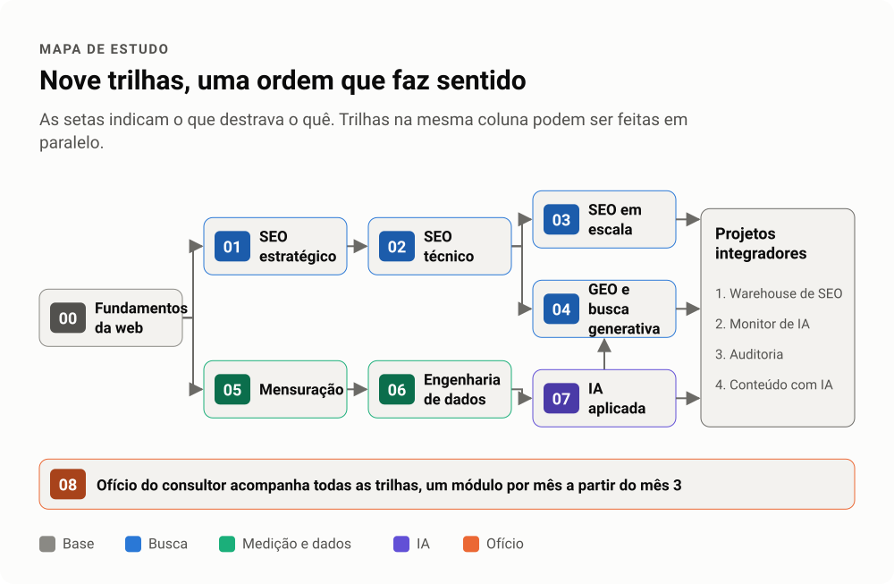
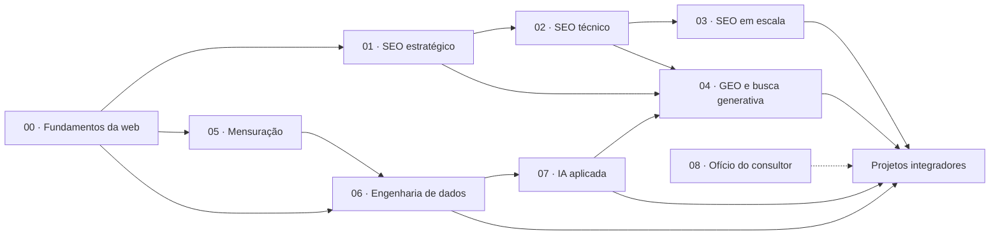
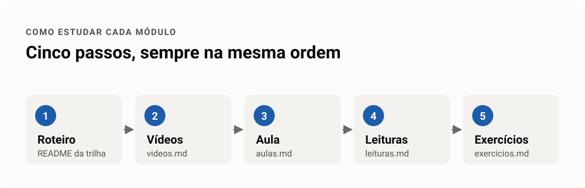
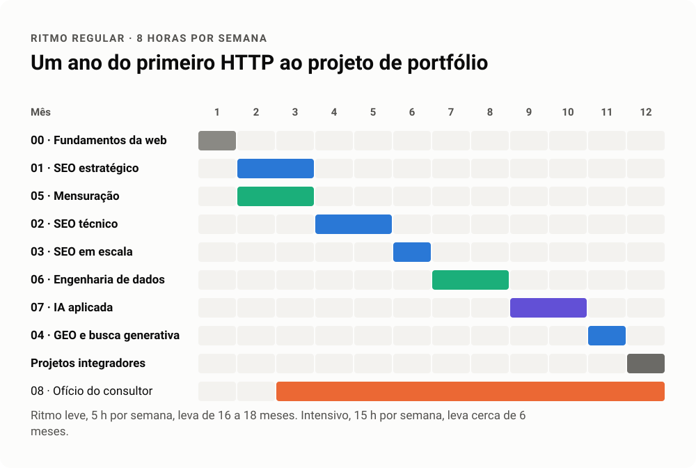

# Trilha SEO, Dados e IA

Trilha de estudos gratuita e aprofundada para quem quer trabalhar na interseção de busca orgânica, engenharia de dados e inteligência artificial. Vai do HTTP ao GEO, do GA4 ao data lake, do prompt ao agente com MCP.

Foi montada a partir de anos de trabalho de consultoria em SEO, SEO técnico, GEO, mensuração e dados para empresas de educação, saúde, varejo e mídia. Os vídeos e as leituras são de terceiros e estão só linkados. O roteiro, as aulas, os exercícios, os projetos e os casos são autorais.


## Para quem é

- Analista de SEO que quer dominar a parte técnica e os dados por trás das decisões.
- Pessoa de dados que quer entender busca orgânica e busca generativa.
- Dev que quer aprender a construir sites que o Google e as IAs encontram, leem e citam.
- Quem já usa IA no dia a dia e quer ir além do prompt, com RAG, agentes e avaliação.

Não é preciso saber programar para começar. A trilha 00 cobre o básico de web, terminal, Git, Python e SQL.

## Por que juntar SEO, dados e IA

Em 2026, a busca virou um sistema de recuperação de informação com várias portas de entrada. O Google tem AI Overviews e AI Mode. ChatGPT, Perplexity, Gemini e Copilot respondem com citações. Quem entende só de palavra-chave fica sem enxergar metade do jogo.

O profissional que faz diferença sabe três coisas ao mesmo tempo.

1. **Como a máquina lê o site.** Rastreio, renderização, indexação, dados estruturados e performance.
2. **Como medir o que aconteceu.** Coletar, modelar e cruzar Search Console, GA4, CRM e logs sem se enganar com o próprio número.
3. **Como a IA recupera e gera.** Embeddings, RAG e agentes, que são a mesma engenharia que decide se a sua página vira citação.

## Mapa de estudo

As setas indicam dependência. Ramos sem seta entre si podem ser feitos em paralelo. A trilha 08 acompanha todas.

<!-- infografico:mapa -->
<picture>
  <source media="(prefers-color-scheme: dark)" srcset="imagens/mapa-escuro.svg">
  
</picture>
<!-- /infografico -->

<details>
<summary>Ver o mapa em texto</summary>



</details>

## Trilhas

| # | Trilha | Módulos | Carga estimada | Material |
|---|---|---|---|---|
| 00 | [Fundamentos da web](trilhas/00-fundamentos-da-web) | 6 | 30 h | [aulas](trilhas/00-fundamentos-da-web/aulas.md) · [vídeos](trilhas/00-fundamentos-da-web/videos.md) · [leituras](trilhas/00-fundamentos-da-web/leituras.md) · [exercícios](trilhas/00-fundamentos-da-web/exercicios.md) |
| 01 | [SEO estratégico](trilhas/01-seo-estrategico) | 7 | 40 h | [aulas](trilhas/01-seo-estrategico/aulas.md) · [vídeos](trilhas/01-seo-estrategico/videos.md) · [leituras](trilhas/01-seo-estrategico/leituras.md) · [exercícios](trilhas/01-seo-estrategico/exercicios.md) |
| 02 | [SEO técnico](trilhas/02-seo-tecnico) | 10 | 60 h | [aulas](trilhas/02-seo-tecnico/aulas.md) · [vídeos](trilhas/02-seo-tecnico/videos.md) · [leituras](trilhas/02-seo-tecnico/leituras.md) · [exercícios](trilhas/02-seo-tecnico/exercicios.md) |
| 03 | [SEO em escala](trilhas/03-seo-em-escala) | 5 | 25 h | [aulas](trilhas/03-seo-em-escala/aulas.md) · [vídeos](trilhas/03-seo-em-escala/videos.md) · [leituras](trilhas/03-seo-em-escala/leituras.md) · [exercícios](trilhas/03-seo-em-escala/exercicios.md) |
| 04 | [GEO e busca generativa](trilhas/04-geo-busca-generativa) | 7 | 30 h | [aulas](trilhas/04-geo-busca-generativa/aulas.md) · [vídeos](trilhas/04-geo-busca-generativa/videos.md) · [leituras](trilhas/04-geo-busca-generativa/leituras.md) · [exercícios](trilhas/04-geo-busca-generativa/exercicios.md) |
| 05 | [Mensuração](trilhas/05-mensuracao) | 7 | 40 h | [aulas](trilhas/05-mensuracao/aulas.md) · [vídeos](trilhas/05-mensuracao/videos.md) · [leituras](trilhas/05-mensuracao/leituras.md) · [exercícios](trilhas/05-mensuracao/exercicios.md) |
| 06 | [Engenharia de dados](trilhas/06-engenharia-de-dados) | 9 | 70 h | [aulas](trilhas/06-engenharia-de-dados/aulas.md) · [vídeos](trilhas/06-engenharia-de-dados/videos.md) · [leituras](trilhas/06-engenharia-de-dados/leituras.md) · [exercícios](trilhas/06-engenharia-de-dados/exercicios.md) |
| 07 | [IA aplicada](trilhas/07-ia-aplicada) | 9 | 50 h | [aulas](trilhas/07-ia-aplicada/aulas.md) · [vídeos](trilhas/07-ia-aplicada/videos.md) · [leituras](trilhas/07-ia-aplicada/leituras.md) · [exercícios](trilhas/07-ia-aplicada/exercicios.md) |
| 08 | [Ofício do consultor](trilhas/08-oficio-do-consultor) | 6 | 20 h | [aulas](trilhas/08-oficio-do-consultor/aulas.md) · [vídeos](trilhas/08-oficio-do-consultor/videos.md) · [leituras](trilhas/08-oficio-do-consultor/leituras.md) · [exercícios](trilhas/08-oficio-do-consultor/exercicios.md) |

A carga é uma estimativa para assistir, ler e fazer os exercícios com calma. Some cerca de 60 h para os projetos integradores.

## Projetos integradores

Cada projeto junta três ou mais trilhas e termina num repositório seu, pronto para portfólio. Todos usam dados públicos ou do seu próprio site.

| Projeto | Trilhas | O que você entrega |
|---|---|---|
| [1. Data warehouse de SEO](projetos/01-data-warehouse-de-seo.md) | 02, 05, 06 | Search Console, GA4 e crawl num DuckDB modelado com dbt, com painel |
| [2. Monitor de visibilidade em IA](projetos/02-monitor-de-visibilidade-em-ia.md) | 04, 06, 07 | Coleta semanal de citações em respostas de IA, com série histórica |
| [3. Auditoria técnica com agente](projetos/03-auditoria-tecnica-com-agente.md) | 02, 07, 08 | Um agente que roda crawl, testa hipóteses e escreve o relatório com evidência |
| [4. Pipeline de conteúdo com IA local](projetos/04-pipeline-de-conteudo-com-ia-local.md) | 03, 06, 07 | Da pauta ao publicado, com dados, RAG, revisão humana e checagem de fatos |

## Casos reais

Na pasta [casos](casos) estão situações vividas em projetos de consultoria, com os nomes das empresas removidos. Cada caso mostra o sintoma, a primeira hipótese (quase sempre errada), o teste que separou causa de ruído e o que foi feito. São a parte que nenhum curso ensina.

## Como estudar

Cada trilha tem um `README.md` com o roteiro. Para cada módulo, siga cinco passos.

<!-- infografico:como-estudar -->
<picture>
  <source media="(prefers-color-scheme: dark)" srcset="imagens/como-estudar-escuro.svg">
  
</picture>
<!-- /infografico -->

1. **Leia o roteiro do módulo** no README da trilha. Ele diz o que importa e quais armadilhas evitar.
2. **Assista aos vídeos** em `videos.md`, na ordem.
3. **Leia a aula** em `aulas.md`. É o texto que amarra os vídeos com a prática, com exemplos que você roda no seu computador.
4. **Aprofunde** com o que estiver em `leituras.md`. A documentação oficial vem antes de qualquer blog.
5. **Faça os exercícios** em `exercicios.md` e marque o checklist do módulo.

No fim de cada trilha há um projeto curto. No fim de tudo, os projetos integradores.

## Ritmo sugerido

| Ritmo | Horas por semana | Duração aproximada |
|---|---|---|
| Leve | 5 h | 16 a 18 meses |
| Regular | 8 h | 11 a 12 meses |
| Intensivo | 15 h | 6 meses |

<!-- infografico:cronograma -->
<picture>
  <source media="(prefers-color-scheme: dark)" srcset="imagens/cronograma-escuro.svg">
  
</picture>
<!-- /infografico -->

Uma ordem que funciona no ritmo regular.

| Meses | Foco |
|---|---|
| 1 | 00 Fundamentos da web |
| 2 e 3 | 01 SEO estratégico e 05 Mensuração em paralelo |
| 4 e 5 | 02 SEO técnico |
| 6 | 03 SEO em escala |
| 7 e 8 | 06 Engenharia de dados |
| 9 e 10 | 07 IA aplicada |
| 11 | 04 GEO e busca generativa |
| 12 | Projetos integradores |

A trilha 08 vai junto, um módulo por mês a partir do mês 3.

## Estrutura

```
trilha-seo-dados-ia/
├── README.md
├── LICENSE
├── CONTRIBUTING.md
├── trilhas/
│   └── NN-nome-da-trilha/
│       ├── README.md        roteiro, conceitos, armadilhas e checklist
│       ├── aulas.md         texto didático de cada módulo, com exemplos
│       ├── videos.md        vídeos e playlists na ordem de estudo
│       ├── leituras.md      documentação, livros e artigos
│       └── exercicios.md    exercícios por módulo e projeto da trilha
├── projetos/                projetos integradores
├── casos/                   casos reais anonimizados
├── imagens/                 infográficos em SVG, versões clara e escura
└── ferramentas/             conferidor de links, verificador de diagramas e gerador de infográficos
```

## Princípios da curadoria

- **Gratuito primeiro.** Material pago só entra quando não há equivalente livre, e vem com o custo aproximado.
- **Fonte primária antes de opinião.** Documentação do Google, da Anthropic, do dbt e afins vêm antes de blog.
- **Atual.** Nada que ensine FID como métrica vigente, nem rich result de HowTo ou FAQ como oportunidade. Doutrina de SEO vence, então confira o changelog do Search Central antes de repetir uma regra.
- **Todo link foi aberto e conferido** na curadoria de outubro de 2026. Se algum quebrou, abra uma issue ou rode `python3 ferramentas/checar_links.py`.

## Autor

Sérgio Patrick, engenheiro de software, especialista em motores de buscas e inteligências artificiais. Consultor independente de SEO, GEO, dados e IA.

## Licença

O conteúdo autoral (roteiros, aulas, exercícios, projetos e casos) está sob [CC BY-SA 4.0](LICENSE). Pode copiar, adaptar e usar comercialmente, desde que dê o crédito e compartilhe pela mesma licença. Vídeos, livros e artigos linkados pertencem aos seus autores e não estão incluídos aqui.
