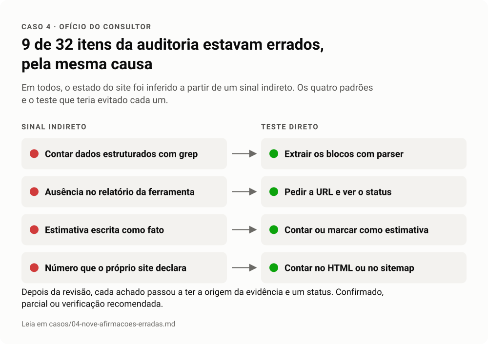

# Caso 4 · Nove afirmações erradas numa auditoria

**Setor.** Entretenimento. **Trilhas.** 02 SEO técnico, 08 Ofício do consultor.

<!-- infografico:caso-04 -->
<picture>
  <source media="(prefers-color-scheme: dark)" srcset="../imagens/caso-04-escuro.svg">
  
</picture>
<!-- /infografico -->

## Contexto
Auditoria de SEO entregue como backlog de 32 itens. Na revisão, surgiu a dúvida de que alguns itens não batiam com a realidade.

## Sintoma
Itens que descreviam problemas que, olhando de novo, não existiam.

## Primeira hipótese
Um ou dois erros pontuais de digitação ou de cópia.

## Teste
Reverificar cada item do zero, testando a rota diretamente em vez de confiar na evidência original.

## Causa
Nove itens estavam errados, todos pela mesma causa de fundo. O estado do site tinha sido inferido a partir de sinal indireto. Os padrões foram quatro.
1. **Grep em vez de parser.** Uma busca por texto achou dados estruturados que eram, na verdade, uma string dentro de um JavaScript. Com parser, eram zero.
2. **Ausência no relatório tratada como ausência no site.** Páginas que a ferramenta de SEO não mostrava respondiam 200 com título próprio.
3. **Estimativa como fato.** Um número de itens do catálogo foi escrito sem contagem.
4. **Número do próprio site como verificado.** Uma quantidade veio da meta description, não de contagem.

Um quinto ponto apareceu no caminho. Rotas que davam 404 tinham sido descritas como canonizadas, porque só o título foi testado, e a página de erro também tem título.

## O que foi feito
O backlog foi corrigido e cada item passou a ter a origem da evidência marcada (crawl próprio, ferramenta, Search Console) e um status (confirmado, parcial, verificação recomendada). A revisão também achou o problema mais grave, que não estava em nenhuma versão anterior. Uma rota parametrizada devolvia 200 indexável para qualquer texto na URL, um espaço de URLs infinito.

## Lição
Testar antes de afirmar e marcar a origem de cada evidência. Status e meta robots sempre juntos. Slug inventado em toda rota com parâmetro.
