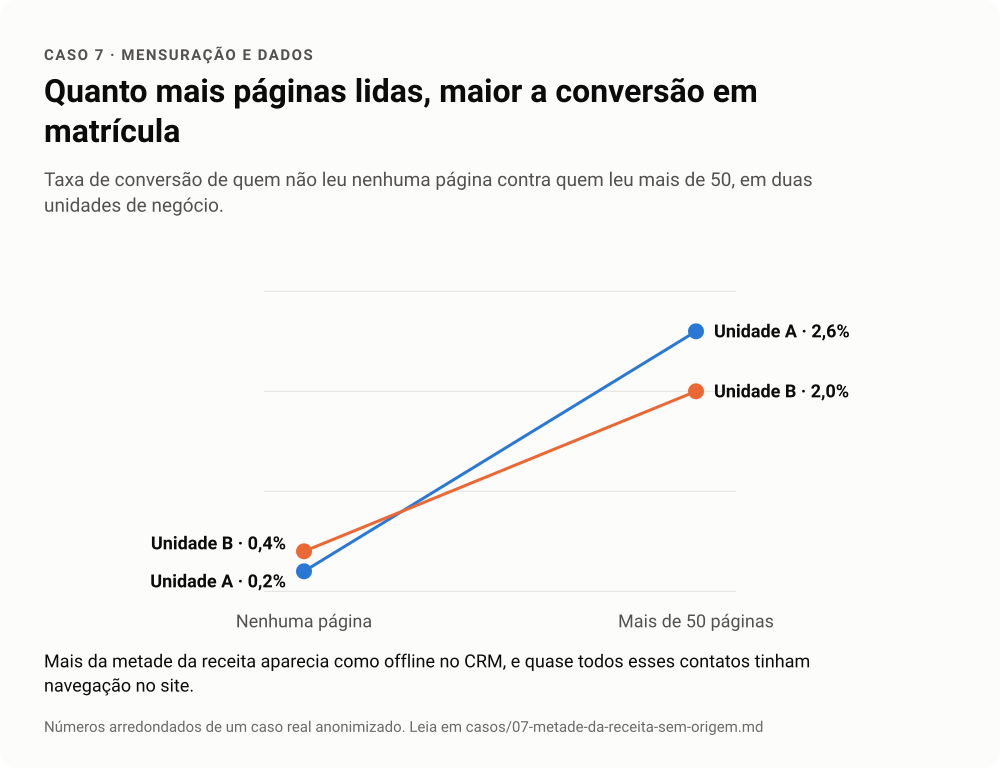

# Caso 7 · Metade da receita sem origem

**Setor.** Educação. **Trilhas.** 05 Mensuração, 06 Engenharia de dados.

<!-- infografico:caso-07 -->
<picture>
  <source media="(prefers-color-scheme: dark)" srcset="../imagens/caso-07-escuro.svg">
  
</picture>
<!-- /infografico -->

## Contexto
Diagnóstico de atribuição para entender quanto o conteúdo orgânico contribuía para matrículas.

## Sintoma
Mais da metade da receita aparecia no CRM com origem "offline", como se tivesse vindo de canais fora do digital.

## Primeira hipótese
Grande parte das vendas acontecia por telefone e atendimento presencial, sem passar pelo site.

## Teste
Cruzar os contatos "offline" com o histórico de navegação registrado no próprio CRM.

## Causa
Quase todos esses contatos tinham navegação no site, com dezenas de páginas vistas em média. A origem "offline" vinha da forma como o contato entrou no CRM (importação de planilha, integração entre sistemas, API), que sobrescrevia a fonte original.

## O que foi feito
A análise passou a usar o comportamento em vez da origem declarada. Apareceu uma curva clara de dose e resposta. Quanto mais páginas lidas, maior a conversão. Quem leu mais de 50 páginas converteu de cinco a treze vezes mais que quem não leu nenhuma. Um score de lead baseado em conteúdo separou leads que valiam quase vinte vezes mais que outros. A correção da origem no CRM entrou no backlog do time de dados.

## Lição
Antes de concluir que um canal não vende, descubra como o sistema grava a origem. E, quando a origem está quebrada, o comportamento ainda conta a história.
