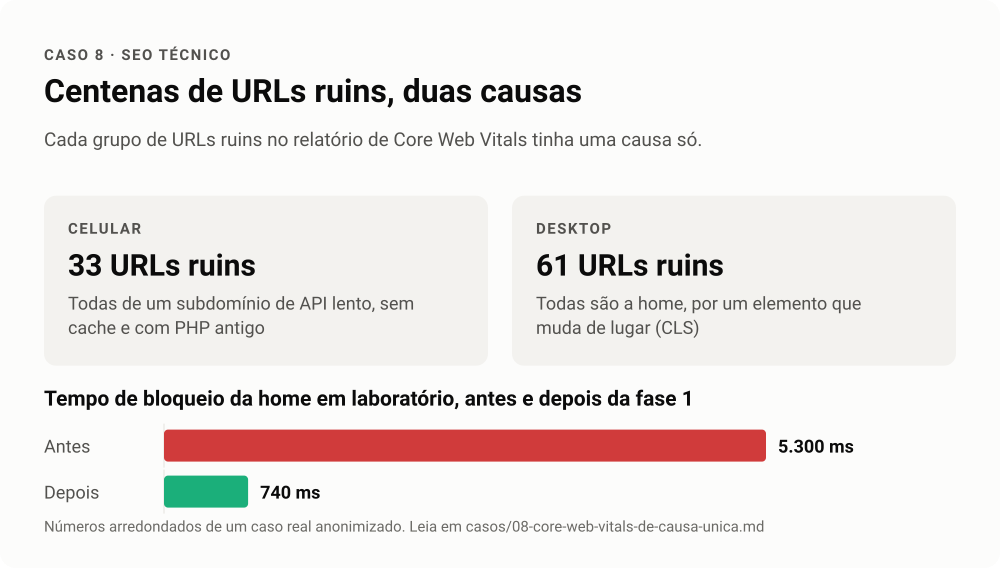

# Caso 8 · Core Web Vitals de causa única

**Setor.** Educação. **Trilhas.** 02 SEO técnico.

<!-- infografico:caso-08 -->
<picture>
  <source media="(prefers-color-scheme: dark)" srcset="../imagens/caso-08-escuro.svg">
  
</picture>
<!-- /infografico -->

## Contexto
O relatório de Core Web Vitals do Search Console mostrava centenas de URLs ruins ou precisando de melhoria, no celular e no desktop.

## Sintoma
Dezenas de URLs ruins no celular, dezenas no desktop, e centenas com LCP e INP acima do limite.

## Primeira hipótese
O site inteiro é lento e precisa de uma otimização ampla (imagens, scripts, cache, tema).

## Teste
Abrir cada grupo de URLs ruins e olhar quais templates e domínios estavam nele.

## Causa
Os dois grupos ruins tinham causa única cada um. No celular, todas as URLs ruins eram de um subdomínio de API lento, com versão antiga de PHP, sem cache e com duas meta robots contraditórias. No desktop, todas eram a home, por um único elemento que mudava de lugar durante o carregamento (CLS). Os grupos "precisa de melhoria" se concentravam em poucos templates.

## O que foi feito
Uma primeira fase com mudanças de configuração e backup de tudo (modo de depuração desligado, tag duplicada removida, script de terceiro desnecessário desativado, cache para a API lenta). Em laboratório, a nota da home mais que dobrou e o tempo de bloqueio caiu para cerca de um sétimo. A segunda fase atacou o que sobrou por ordem de retorno.

## Lição
Relatório de Core Web Vitals agrupa URLs parecidas. Antes de otimizar tudo, descubra o que cada grupo tem em comum. Duas correções certeiras valem mais que cem espalhadas.
