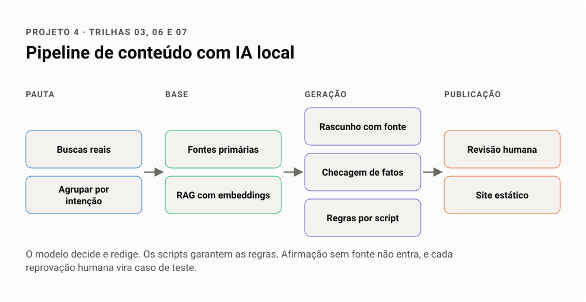

# Projeto 4 · Pipeline de conteúdo com IA local

Um pipeline que vai da pauta ao conteúdo publicado usando dados, RAG e modelos locais, com revisão humana e checagem de fatos em cada etapa. A ideia é provar que IA pode produzir conteúdo útil em escala sem cair em conteúdo genérico.

**Trilhas.** 03 SEO em escala, 06 Engenharia de dados, 07 IA aplicada.
**Carga estimada.** 15 a 20 h.

<!-- infografico:projeto-04 -->
<picture>
  <source media="(prefers-color-scheme: dark)" srcset="../imagens/projeto-04-escuro.svg">
  
</picture>
<!-- /infografico -->

## Inspiração

O projeto vem de um gerador local de vídeos documentais. Nele, o modelo pesquisa e escreve o roteiro, mas scripts fixos fazem o trabalho pesado (voz sintética, legenda, mixagem e montagem), a voz gerada é transcrita com Whisper e comparada com o roteiro, e toda imagem precisa de licença livre registrada. A mesma divisão vale para texto. O modelo decide e redige, os scripts garantem as regras.

## Dados de entrada

- Uma base aberta do seu tema (dados públicos do IBGE, de um portal de dados abertos, de documentação técnica ou de artigos científicos).
- Um modelo local via Ollama, ou um modelo de API, para comparar.

## Passos

1. **Pauta com dados.** Gere a lista de temas a partir de buscas reais (autocomplete, Search Console, perguntas frequentes) e agrupe por intenção.
2. **Base de conhecimento.** Indexe as fontes primárias num RAG com embeddings. Cada trecho guarda a fonte e a data.
3. **Rascunho.** O modelo escreve usando só o que veio da recuperação, citando a fonte de cada afirmação.
4. **Checagem de fatos.** Um segundo passo confere cada número e cada afirmação contra a fonte citada e marca o que não bate.
5. **Regras fixas por script.** Tamanho, estrutura de headings, links internos, dados estruturados, estilo da casa (por exemplo, sem travessão), créditos de imagem.
6. **Revisão humana.** Uma pessoa aprova ou devolve, com o motivo registrado. O motivo vira caso de teste.
7. **Publicação.** Gere páginas num site estático, com sitemap e `lastmod` real.
8. **Avaliação.** Meça a taxa de afirmações sem fonte, a taxa de aprovação na primeira revisão e, depois de algumas semanas, impressões e cliques.

## Cuidados

- Política do Google contra conteúdo em escala para manipular ranqueamento. Cada página precisa de valor próprio e de dado que não está em todo lugar.
- Afirmação sem fonte não entra.
- Imagem só com licença livre e crédito. Voz sintética só com voz criada do zero ou autorizada.

## Entregável

Repositório público com o pipeline, a base indexada (ou o script que a recria), 10 páginas publicadas num site estático e o relatório de avaliação.

## Critérios de avaliação

- [ ] Toda afirmação factual publicada tem fonte citada e conferida
- [ ] A checagem automática pegou pelo menos um erro real do rascunho
- [ ] As regras de estilo são aplicadas por script e testadas
- [ ] Os motivos de reprovação humana viraram casos de teste
- [ ] O custo e o tempo por página estão no README
