# Aulas · 00 · Fundamentos da web

Texto de apoio de cada módulo. Leia depois dos vídeos e antes dos exercícios. Onde houver comando ou código, rode no seu computador.

## Sumário

1. [Como a web funciona (HTTP, status, cabeçalhos, cache)](#aula-1-como-a-web-funciona-http-status-cabeçalhos-cache)
2. [DNS, CDN e HTTPS](#aula-2-dns-cdn-e-https)
3. [HTML semântico e o DOM](#aula-3-html-semântico-e-o-dom)
4. [Terminal e Git](#aula-4-terminal-e-git)
5. [Python para analistas](#aula-5-python-para-analistas)
6. [SQL básico](#aula-6-sql-básico)

Para rodar os exemplos em Python, crie um ambiente uma vez e reaproveite nas seis aulas.

```bash
python3 -m venv .venv
source .venv/bin/activate        # no Windows: .venv\Scripts\activate
pip install requests beautifulsoup4 pandas duckdb
```

## Aula 1. Como a web funciona (HTTP, status, cabeçalhos, cache)

### A ideia central

Toda página da web é uma conversa curta. Um cliente (o navegador, o Googlebot, o seu script) pede uma URL. O servidor responde com três coisas. Um código de status, uma lista de cabeçalhos e, às vezes, um corpo com o HTML. O buscador decide o que fazer com a página a partir dessa resposta, antes de ler uma palavra do texto.

O modelo mental certo é este. O status diz o que aconteceu, os cabeçalhos dizem como tratar o que veio e o corpo é o conteúdo. Uma página bonita no navegador pode estar errada para o Google, porque o navegador esconde o status e os cabeçalhos de você. Por isso a primeira ferramenta de um analista técnico é o terminal.

### Como funciona

#### Requisição e resposta

Uma requisição tem método, caminho, versão e cabeçalhos. Os dois métodos que você mais vai usar são GET e HEAD. O GET pede a página inteira. O HEAD pede só o status e os cabeçalhos, sem o corpo. O HEAD é rápido e barato para conferir status em lote. Ele engana em servidores mal configurados, que respondem ao HEAD de um jeito e ao GET de outro. Quando o resultado parecer estranho, repita com GET.

```bash
curl -sI https://www.wikipedia.org/            # HEAD, só cabeçalhos
curl -s -o /dev/null -w "%{http_code}\n" https://www.wikipedia.org/   # GET, imprime só o status
```

#### As famílias de status

| Família | Significado | O que o Google faz |
|---|---|---|
| 2xx | Deu certo | Processa o conteúdo. Se o conteúdo parecer página de erro, o Search Console marca como soft 404 |
| 3xx | Vá para outro lugar | Segue o `location` e usa o conteúdo do destino |
| 4xx | Erro do cliente | Não indexa. URL já indexada sai do índice |
| 5xx | Erro do servidor | Reduz o ritmo de rastreio. Se o erro persistir, a URL acaba saindo do índice |

Dois detalhes da documentação do Google merecem atenção. O 429 (muitas requisições) é tratado como erro de servidor, então ele também desacelera o rastreio. E todos os 4xx, exceto o 429, são tratados do mesmo jeito. Na prática, 404 e 410 têm efeito parecido para o Google. Use 410 quando a remoção for definitiva e intencional, porque outros clientes leem a diferença.

O fluxograma mostra o que o Googlebot faz com a URL conforme a família do status.

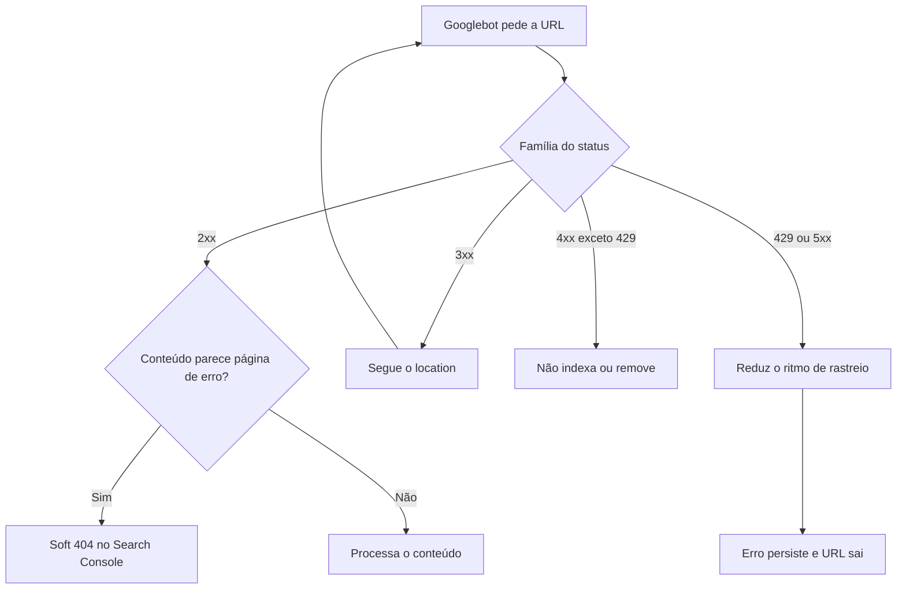

#### Os quatro redirecionamentos

| Status | Permanente? | Preserva o método? | Sinal para o Google |
|---|---|---|---|
| 301 | Sim | Não garante (POST pode virar GET) | Forte |
| 308 | Sim | Sim | Forte |
| 302 | Não | Não garante | Fraco |
| 307 | Não | Sim | Fraco |

Para o Google, 301 e 308 são equivalentes e indicam com força que o destino é a URL a indexar. 302, 303 e 307 também se equivalem e dão um sinal fraco. O Googlebot segue até 10 saltos numa cadeia. Cada salto custa tempo de rastreio e de carregamento, então o objetivo é um salto só, da URL antiga direto para a final.

#### Os cabeçalhos que importam para SEO

| Cabeçalho | Para que serve |
|---|---|
| `content-type` | Diz o formato do corpo (`text/html; charset=utf-8`, `application/pdf`) |
| `location` | Destino de um redirecionamento |
| `x-robots-tag` | Diretivas como `noindex` enviadas no cabeçalho. Funciona para PDF e imagem, que não têm meta robots |
| `cache-control` | Quem pode guardar a resposta e por quanto tempo |
| `last-modified` e `etag` | Identificam a versão do conteúdo para revalidação |
| `age` | Há quantos segundos a resposta está guardada num cache compartilhado |

#### Cache em três camadas

O navegador guarda uma cópia. A CDN guarda outra, mais perto do usuário. O servidor pode ter um cache próprio antes da aplicação. O `cache-control` controla as duas primeiras. `max-age=3600` deixa qualquer cache guardar por uma hora. `s-maxage` vale só para caches compartilhados, como a CDN. `no-cache` permite guardar, desde que o cache confira com o servidor antes de usar. `no-store` proíbe guardar.

A revalidação é o que economiza banda. O cliente manda `If-None-Match` com o `etag` que tem. Se nada mudou, o servidor responde 304 sem corpo. O Google também usa esse mecanismo. Um 304 avisa que o conteúdo não mudou desde o último rastreio.

A sequência mostra a revalidação com etag e os dois desfechos possíveis.

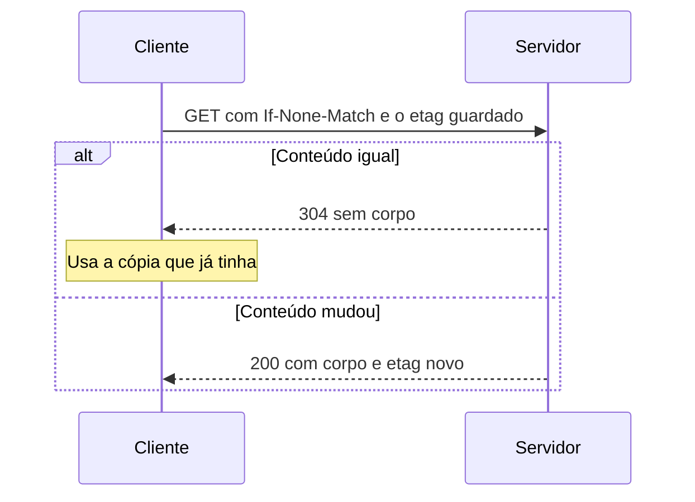

### Exemplo guiado

Vamos ler uma resposta real e seguir uma cadeia de redirecionamento.

1. Rode `curl -sI https://www.wikipedia.org/`. Numa leitura feita em outubro de 2026, a resposta trouxe `cache-control: s-maxage=86400, must-revalidate, max-age=3600`, um `etag`, um `last-modified`, um `age` de alguns milhares de segundos e `x-cache-status: hit-front`. Traduzindo, a CDN pode guardar a página por um dia, o navegador por uma hora, e aquela resposta saiu do cache da borda, sem tocar o servidor de aplicação.
2. Rode `curl -sIL http://www.wikipedia.org`. O `-L` segue os redirecionamentos e imprime os cabeçalhos de cada salto. Conte quantos blocos aparecem antes do 200.
3. Agora faça a mesma coisa em Python, um salto por vez, para ter controle sobre a cadeia. Salve como `cadeia.py`.

```python
import sys
from urllib.parse import urljoin

import requests

UA = "estudo-redirect/1.0 (+mailto:voce@exemplo.com)"


def cadeia(url, max_saltos=10):
    vistos = set()
    for salto in range(max_saltos + 1):
        if url in vistos:
            print(f"LAÇO detectado em {url}")
            return
        vistos.add(url)
        r = requests.get(url, allow_redirects=False, timeout=15,
                         headers={"User-Agent": UA})
        destino = r.headers.get("location")
        print(f"{salto}  {r.status_code}  {url}")
        if r.status_code not in (301, 302, 303, 307, 308) or not destino:
            return
        url = urljoin(url, destino)  # o location pode ser relativo
    print(f"Parei depois de {max_saltos} saltos")


if __name__ == "__main__":
    cadeia(sys.argv[1])
```

```bash
python cadeia.py http://www.wikipedia.org
```

A saída mostra `0  301  http://www.wikipedia.org` e depois `1  200  https://www.wikipedia.org/`. Um salto só, do http para o https. Teste o script em três domínios de sua escolha, sem https e sem www, e compare o tamanho das cadeias. Esse é o exercício de prática 2 e o desafio do módulo.

### Erros comuns

- **Confiar no que o navegador mostra.** O navegador segue redirecionamentos e esconde o status. A página parece normal e responde 302, ou parece normal e responde 404. Confira sempre com `curl -sI`.
- **Usar 302 para mudança definitiva.** O Google recebe um sinal fraco e pode manter a URL antiga como canônica. Mudança permanente pede 301 ou 308.
- **Deixar cadeias crescerem.** A cada migração, alguém cria um redirecionamento novo em cima do antigo. Depois de três migrações há quatro saltos. Atualize as regras antigas para apontar direto ao destino final.
- **Servir página de erro com status 200.** O usuário vê "página não encontrada" e o servidor diz que deu tudo certo. O resultado é soft 404 no Search Console e rastreio desperdiçado. Página inexistente responde 404 ou 410.
- **Concluir pelo HEAD quando o GET discorda.** Alguns servidores respondem 405 ou 200 ao HEAD por engano. Antes de afirmar um status estranho, repita com GET.

### Na prática

Uma página de erro também tem título. Parece óbvio, e mesmo assim derrubou parte de uma auditoria. Na conferência de um grupo de rotas, só o título da página foi testado. Rotas que respondiam 404 acabaram descritas como páginas canonizadas para a página-pai. O status nunca tinha sido olhado.

O raciocínio certo começa pelo status. Uma URL que responde 404 não é indexada, então o canonical dela não tem efeito nenhum. A afirmação correta seria "rotas respondem 404", que leva a uma recomendação diferente. Você pode reproduzir o fenômeno agora. Rode `curl -s https://pt.wikipedia.org/wiki/Pagina_que_nao_existe_xyz123 -o /dev/null -w "%{http_code}\n"` e depois abra a mesma URL no navegador. O status é 404 e a página tem título, texto e layout completos.

A regra que ficou é olhar status e meta robots juntos, sempre, com `curl -sI` e com o HTML na mão. Nenhum sinal isolado prova que uma página é válida.

### Resumo

- O status, os cabeçalhos e o corpo decidem o destino de uma URL no Google, nessa ordem de importância.
- 301 e 308 dão sinal forte de mudança permanente. 302 e 307 dão sinal fraco. Um salto só é o ideal.
- 429 e 5xx desaceleram o rastreio. 4xx tira a URL do índice.
- Cache tem camadas (navegador, CDN, servidor) e o `cache-control` diz quem guarda e por quanto tempo.
- Título e canonical não provam nada sem o status ao lado.

### Para ir além

- [Como os códigos de status HTTP afetam os rastreadores do Google](leituras.md), em leituras.md. Leia agora, porque liga cada status desta aula ao comportamento do Googlebot.
- [HTTP caching](leituras.md), da MDN, em leituras.md. Aprofunda `no-cache`, `s-maxage` e revalidação com o rigor da especificação.
- [Browser Caching Best Practices](videos.md), de Hussein Nasser, em videos.md. Mostra na prática a diferença entre `no-cache` e `max-age` que costuma confundir.

## Aula 2. DNS, CDN e HTTPS

### A ideia central

Antes de o servidor responder, o nome do site precisa virar um endereço, a conexão precisa ser cifrada e, quase sempre, uma CDN se coloca no meio. Essas camadas ficam invisíveis quando tudo funciona. Quando algo dá errado, elas explicam bloqueio de robô, versão velha da página em cache e redirecionamento que ninguém do time lembra de ter criado.

O modelo mental é uma cadeia de intermediários. DNS diz para onde ir. A CDN atende na borda e decide se repassa ao servidor de origem. O TLS garante que ninguém leu ou trocou a conversa no caminho. Cada intermediário pode responder no lugar do servidor, e um diagnóstico precisa saber qual deles respondeu.

### Como funciona

#### DNS

O DNS traduz `exemplo.com.br` em endereço IP. O seu computador pergunta a um resolvedor (do provedor, do Google, da Cloudflare). O resolvedor consulta a hierarquia de servidores até chegar ao servidor autoritativo do domínio, que dá a resposta final.

A sequência mostra o caminho de uma consulta até o servidor autoritativo.

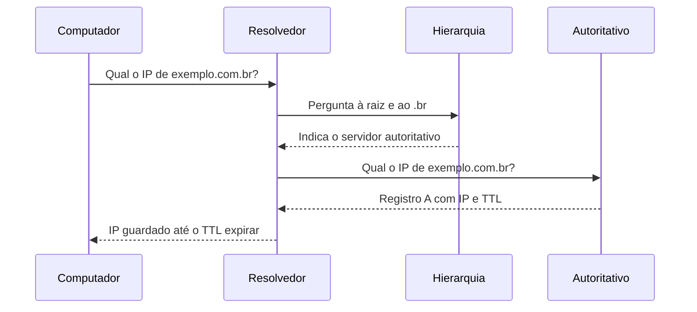

| Registro | O que guarda | Uso típico |
|---|---|---|
| A | Endereço IPv4 | Aponta o domínio para um servidor |
| AAAA | Endereço IPv6 | O mesmo, em IPv6 |
| CNAME | Apelido para outro nome | `www` apontando para o host da CDN |
| TXT | Texto livre | Verificação de propriedade (Search Console), SPF de e-mail |

Cada resposta vem com um TTL (time to live, tempo de vida) em segundos. É o tempo que os resolvedores podem guardar a resposta antes de perguntar de novo. Uma mudança de DNS com TTL de 86400 pode levar até um dia para chegar a todo mundo, porque cada resolvedor só pergunta de novo quando a cópia dele expira. Antes de uma migração, baixe o TTL com antecedência.

Para o SEO, o registro TXT tem uso direto. A propriedade de domínio do Search Console, que cobre todos os subdomínios e protocolos, só é verificada por DNS.

#### CDN

Uma CDN (content delivery network, rede de distribuição de conteúdo) tem servidores espalhados pelo mundo, chamados de borda ou edge. O usuário é atendido pelo ponto mais próximo. Se a borda tem a página em cache, ela responde sem tocar a origem. Se não tem, busca na origem e guarda conforme o `cache-control`.

A CDN costuma se denunciar nos cabeçalhos.

| Cabeçalho | CDN provável |
|---|---|
| `cf-ray`, `cf-cache-status` | Cloudflare |
| `x-amz-cf-id`, `via` com CloudFront | Amazon CloudFront |
| `x-served-by`, `x-cache` | Fastly |
| `x-vercel-id` | Vercel |

A CDN é também onde mora o WAF (web application firewall) e as regras de bot. Ela pode bloquear por IP, por país, por user-agent ou por comportamento. E ela pode servir a versão velha de uma página por horas depois de você corrigir a origem.

#### HTTPS, TLS e HSTS

HTTPS é HTTP dentro de uma conexão TLS. O certificado prova que o servidor é dono do nome e permite cifrar a conversa. Certificados têm validade curta, e a tendência do setor é encurtar ainda mais. Renovação automática deixou de ser opcional.

O cabeçalho `strict-transport-security` (HSTS) diz ao navegador para usar só HTTPS naquele domínio por um período. Com `includeSubDomains`, a regra vale para todos os subdomínios. Com `preload`, o domínio pode entrar numa lista embutida nos navegadores. HSTS mal configurado prende um subdomínio sem certificado fora do ar para quem já visitou o site.

#### Verificar um robô de verdade

User-agent é só um texto que o cliente escolhe. Qualquer pessoa pode mandar `GPTBot` ou `Googlebot` no cabeçalho. Por isso os buscadores e as empresas de IA publicam como verificar o robô real. O Google orienta fazer DNS reverso no IP do log, conferir que o nome termina em `googlebot.com`, `google.com` ou `googleusercontent.com` e fazer a busca direta para ver se volta o mesmo IP. O Google e a OpenAI também publicam as faixas de IP em JSON.

O fluxograma mostra a verificação em duas consultas que separa o Googlebot real do imitador.

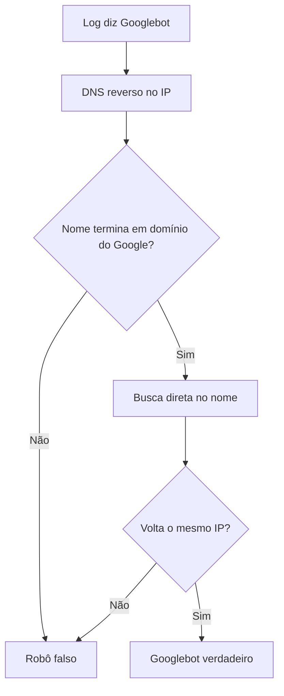

```bash
host 66.249.66.1                                  # DNS reverso
host crawl-66-249-66-1.googlebot.com              # busca direta, deve voltar 66.249.66.1
```

### Exemplo guiado

Vamos descobrir, num log de acesso, quantas visitas de robô são verdadeiras. O script baixa as faixas oficiais e confere cada IP. Salve como `verificar_robo.py`.

```python
import ipaddress
import re
import sys
from collections import Counter

import requests

FAIXAS = {
    "GPTBot": "https://openai.com/gptbot.json",
    "OAI-SearchBot": "https://openai.com/searchbot.json",
    "Googlebot": "https://developers.google.com/static/crawling/ipranges/common-crawlers.json",
}
UA = "estudo-logs/1.0 (+mailto:voce@exemplo.com)"
# formato "combined" do Apache e do Nginx
LINHA = re.compile(r'^(\S+) .*?" (\d{3}) .*"([^"]*)"$')


def redes(url):
    dados = requests.get(url, headers={"User-Agent": UA}, timeout=20).json()
    return [ipaddress.ip_network(p.get("ipv4Prefix") or p.get("ipv6Prefix"))
            for p in dados["prefixes"]]


faixas = {robo: redes(url) for robo, url in FAIXAS.items()}
contagem = Counter()

with open(sys.argv[1], encoding="utf-8", errors="replace") as log:
    for linha in log:
        m = LINHA.search(linha.strip())
        if not m:
            continue
        ip, status, agente = m.groups()
        for robo, lista in faixas.items():
            if robo in agente:
                ip_obj = ipaddress.ip_address(ip)
                real = any(ip_obj in rede for rede in lista)
                contagem[(robo, "verificado" if real else "falso", status)] += 1

for (robo, origem, status), n in sorted(contagem.items()):
    print(f"{robo:<14} {origem:<11} {status}  {n}")
```

Se você não tem log, crie um `access.log` de teste com três linhas.

```text
132.196.86.10 - - [01/Oct/2026:10:00:00 -0300] "GET /blog/a HTTP/1.1" 200 5120 "-" "Mozilla/5.0 (compatible; GPTBot/1.3; +https://openai.com/gptbot)"
189.6.10.20 - - [01/Oct/2026:10:00:05 -0300] "GET /blog/a HTTP/1.1" 403 512 "-" "GPTBot"
66.249.66.1 - - [01/Oct/2026:10:01:00 -0300] "GET / HTTP/1.1" 200 9000 "-" "Mozilla/5.0 (compatible; Googlebot/2.1; +http://www.google.com/bot.html)"
```

```bash
python verificar_robo.py access.log
```

A saída separa o GPTBot verificado, que recebeu 200, do GPTBot falso, que recebeu 403. As faixas mudam com o tempo, então baixe sempre a versão atual. Se o seu log usa outro formato, ajuste a expressão `LINHA`.

Depois rode `dig +short A wikipedia.org`, `dig wikipedia.org A` (anote o TTL na seção ANSWER) e `curl -sI https://www.wikipedia.org/ | grep -i strict`. Com isso você cobriu DNS, CDN e HSTS de um domínio real.

### Erros comuns

- **Mudar DNS na véspera da migração com TTL alto.** Parte dos usuários e do Googlebot continua no servidor antigo por horas. Baixe o TTL dias antes e suba de novo depois.
- **Esquecer o cache da CDN depois de uma correção.** A origem está certa e a borda continua servindo a versão errada. Depois de corrigir, limpe o cache da URL ou espere o `max-age` e confira com `curl -sI` olhando `age` e o status de cache.
- **Tratar o user-agent como identidade.** Contar visitas de "Googlebot" pelo texto do user-agent mistura robôs reais com imitadores. Verifique o IP.
- **Concluir bloqueio a partir de um teste local.** O seu IP não é o IP do robô. A regra do WAF pode tratar os dois de jeitos opostos.
- **Ativar HSTS com `includeSubDomains` sem inventário.** Um subdomínio interno sem certificado fica inacessível. Liste os subdomínios antes.

### Na prática

Um teste com o user-agent de um robô de IA, feito do computador da equipe, recebeu 403. Ferramentas automáticas de leitura de página também recebiam 403. A primeira hipótese foi a pior possível para o projeto. O site bloqueava os robôs de IA, e todo o trabalho de GEO seria inútil até resolver isso.

O teste que decidiu foi ler o log do servidor de um mês e contar as visitas por robô, conferindo os IPs com as faixas oficiais. O log mostrou o contrário. Os robôs reais, vindos dos blocos de IP oficiais, eram atendidos normalmente, com mais de mil visitas de robôs de busca de IA no mês, contando só uma parte do log. O bloqueio valia para IPs não verificados, como o da equipe. O robots.txt também não bloqueava nenhum robô de IA.

O raciocínio a guardar é sobre o que cada teste prova. O teste local prova como a CDN trata o seu IP com aquele user-agent. O log prova como o servidor tratou o robô de verdade. Uma conclusão errada logo no início teria mudado o projeto inteiro. A prova de bloqueio é o log, nunca o teste local.

### Resumo

- DNS traduz nome em IP e o TTL define quanto tempo uma resposta velha sobrevive.
- A CDN atende na borda, guarda cache e aplica regras de bot. Os cabeçalhos dizem qual CDN está no meio.
- HTTPS depende de certificado renovado em dia. HSTS força HTTPS e exige inventário de subdomínios.
- User-agent não é identidade. Robô verdadeiro se confirma pelo IP, com DNS reverso ou com as faixas publicadas.

### Para ir além

- [How DNS works](leituras.md), da DNSimple, em leituras.md. Um quadrinho que fixa a resolução de nomes melhor que qualquer diagrama.
- [O que é CDN?](leituras.md), da Cloudflare, em leituras.md. Vale ler agora para entender o que a borda guarda e o que repassa.
- [SSL, TLS, HTTPS Explained](videos.md), da ByteByteGo, em videos.md. Mostra o handshake TLS passo a passo, útil antes do desafio com `openssl s_client`.

## Aula 3. HTML semântico e o DOM

### A ideia central

O buscador lê HTML. Ele procura o título, a descrição, o canonical, as diretivas de robô, os headings, os links e os dados estruturados. Se esses elementos estão no lugar certo e já vêm na resposta do servidor, qualquer robô os encontra. Se só aparecem depois que o JavaScript roda, alguns robôs não os veem, e o Google só os vê numa segunda etapa.

O modelo mental tem duas versões da mesma página. O HTML de origem é o texto que o servidor mandou, o que aparece em "ver código-fonte" e no `curl`. O DOM (Document Object Model) é a árvore que o navegador monta a partir desse HTML, depois de executar os scripts. As duas podem ser bem diferentes num site feito em React, Vue ou Angular. Saber qual das duas você está olhando é metade do diagnóstico.

### Como funciona

#### O que fica no head

| Elemento | Para que serve | Observação |
|---|---|---|
| `<title>` | Título da página, candidato ao título do resultado | Um por página |
| `<meta name="description">` | Candidata ao trecho do resultado | O Google pode reescrever |
| `<link rel="canonical">` | Indica a URL preferida entre duplicatas | É uma sugestão. Com dois diferentes, o Google pode ignorar os dois |
| `<meta name="robots">` | Diretivas como `noindex` e `nofollow` | Equivale ao cabeçalho `x-robots-tag` |
| `<script type="application/ld+json">` | Dados estruturados em JSON-LD | Precisa ser JSON válido |

#### O que fica no body

Use um `h1` que diga do que a página trata e `h2` e `h3` para as seções, em ordem. Elementos semânticos como `header`, `nav`, `main`, `article` e `footer` dizem a função de cada bloco para robôs e leitores de tela. Imagens levam `alt` descritivo. Links são `<a href="/caminho">`. O Google documenta que só segue links em elementos `<a>` com `href`. Um `<span onclick="...">` ou um botão que muda de página por JavaScript não é um link rastreável.

#### Origem, DOM e renderização

O Google rastreia o HTML de origem, coloca a página numa fila e renderiza com uma versão recente do Chrome, quando então lê o DOM. Essa segunda etapa pode atrasar. Outros robôs, incluindo vários de IA, podem não executar JavaScript. A hipótese segura é que o conteúdo e os links importantes estejam no HTML de origem. Renderização no servidor (SSR) ou geração estática resolvem isso sem abrir mão do framework.

O fluxograma mostra o que cada tipo de robô chega a ler.

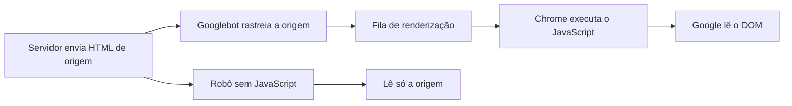

No navegador, compare os dois.

1. "Ver código-fonte" (Ctrl+U ou Cmd+Option+U) mostra o HTML de origem.
2. DevTools, aba Elements, mostra o DOM atual.
3. No Console, `document.querySelectorAll('a[href]').length` conta os links do DOM.

#### Por que parser e nunca grep

HTML não é texto plano. Um comentário, um atributo em outra ordem, uma string dentro de um script ou uma aspa simples mudam o significado sem mudar as palavras. Um parser (BeautifulSoup, lxml, o próprio navegador) monta a árvore como o buscador monta. O `grep` só acha sequências de caracteres.

### Exemplo guiado

Primeiro, veja o `grep` errar. Crie `teste.html`.

```html
<!doctype html>
<html lang="pt-BR">
<head>
  <title>Bolo de cenoura</title>
  <!-- <link rel="canonical" href="https://exemplo.com/velho"> -->
  <link href="https://exemplo.com/bolo-de-cenoura" rel="canonical">
  <script type="application/ld+json">{"@context":"https://schema.org","@type":"Recipe","name":"Bolo de cenoura"}</script>
  <script>
    // o tema monta outro bloco só se o usuário aceitar cookies
    var modelo = '<script type="application/ld+json">{"@type":"Product"}<\/script>';
  </script>
</head>
<body><h1>Bolo de cenoura</h1></body>
</html>
```

```bash
grep -c 'application/ld+json' teste.html   # responde 2
grep -c 'rel="canonical"' teste.html       # responde 2
```

Agora leia com parser. Salve como `ler.py`.

```python
import json
import sys

from bs4 import BeautifulSoup

html = open(sys.argv[1], encoding="utf-8").read()
sopa = BeautifulSoup(html, "html.parser")

canonicals = [l.get("href") for l in sopa.find_all("link", rel="canonical")]
blocos = sopa.find_all("script", type="application/ld+json")

print("canonicals:", canonicals)
print("blocos JSON-LD:", len(blocos))
for b in blocos:
    print("  @type:", json.loads(b.string).get("@type"))
```

```bash
python ler.py teste.html
```

O parser encontra um canonical e um bloco JSON-LD do tipo `Recipe`. O `grep` contou o canonical comentado e a string dentro do JavaScript. São dois números falsos em três linhas.

O fluxograma compara as duas leituras do mesmo `teste.html`.

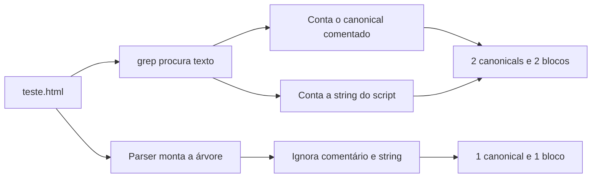

Depois, inspecione uma página real. Salve como `inspecionar.py`.

```python
import sys

import requests
from bs4 import BeautifulSoup

UA = "estudo-html/1.0 (+mailto:voce@exemplo.com)"


def meta(sopa, nome):
    tag = sopa.find("meta", attrs={"name": nome})
    return tag.get("content") if tag else None


url = sys.argv[1]
r = requests.get(url, headers={"User-Agent": UA}, timeout=20)
sopa = BeautifulSoup(r.text, "html.parser")

print("status        ", r.status_code)
print("x-robots-tag  ", r.headers.get("x-robots-tag"))
print("meta robots   ", meta(sopa, "robots"))
print("title         ", sopa.title.get_text(strip=True) if sopa.title else None)
print("description   ", meta(sopa, "description"))
print("canonical     ", [l.get("href") for l in sopa.find_all("link", rel="canonical")])
for h in sopa.find_all(["h1", "h2", "h3"]):
    print(f"{h.name:<14}", h.get_text(" ", strip=True)[:80])
```

```bash
python inspecionar.py https://pt.wikipedia.org/wiki/Hypertext_Transfer_Protocol
```

Repare em dois detalhes da saída. O canonical aponta para `https://pt.wikipedia.org/wiki/HTTP`, outra URL. A página que você pediu é uma variante, e o site declara qual é a preferida. E o primeiro heading listado é um `h2` do sumário, que vem antes do `h1` no código. Ordem no HTML nem sempre é ordem visual. Esse script é a semente do `raiox.py` do projeto da trilha.

### Erros comuns

- **Contar elementos com grep ou regex.** Comentários, scripts e ordem de atributos geram falso positivo e falso negativo. Use parser.
- **Olhar só o DOM no DevTools.** O DOM mostra a página depois do JavaScript. O que o servidor entregou está no código-fonte ou no `curl`. Compare os dois antes de concluir.
- **Links feitos com JavaScript sem `href`.** O Google não segue. Páginas inteiras ficam órfãs. Use `<a href>` com URL real.
- **Dois canonicals na mesma página.** Um vem do tema, outro do plugin. Com sinais conflitantes, o Google pode ignorar os dois. Garanta um só.
- **Canonical em página que não responde 200.** Ele não tem efeito. Resolva o status primeiro.
- **Dados estruturados com JSON inválido.** Uma vírgula a mais invalida o bloco inteiro. Valide com `json.loads` ou com o Teste de pesquisa aprimorada do Google.

### Na prática

Numa auditoria, a contagem de blocos de dados estruturados de um conjunto de páginas foi feita com `grep`. O número indicava que as páginas tinham marcação. A afirmação entrou no relatório. Na revisão, as mesmas páginas foram lidas com parser, e a contagem real era zero. O `grep` tinha encontrado a string `application/ld+json` dentro de um JavaScript, exatamente como no `teste.html` desta aula.

Um erro desses custa caro por dois motivos. Ele tira do relatório a recomendação certa, porque o texto diz que a marcação já existe. E, quando o cliente descobre um número falso, ele passa a duvidar dos números certos. A correção é simples e vale para qualquer contagem em HTML. Leia com parser, que monta a mesma árvore que o buscador monta.

### Resumo

- HTML de origem é o que o servidor manda. DOM é o que o navegador monta depois do JavaScript.
- Conteúdo e links importantes devem estar no HTML de origem, em `<a href>`.
- Title, description, canonical, meta robots e JSON-LD moram no head. Um de cada, coerentes com o status.
- HTML se lê com parser. `grep` serve para triagem, nunca para afirmar.

### Para ir além

- [Princípios básicos de SEO em JavaScript](leituras.md), do Google Search Central, em leituras.md. Leia agora, porque descreve as etapas de rastreio, renderização e indexação que esta aula resumiu.
- [Modelo de Objeto de Documento (DOM)](leituras.md), da MDN, em leituras.md. Aprofunda a árvore de nós antes do exercício de comparar origem e DOM.
- [DOM (Document Object Model)](videos.md), do Código Fonte TV, em videos.md. Dez minutos que deixam clara a diferença entre o HTML recebido e o renderizado.

## Aula 4. Terminal e Git

### A ideia central

O terminal é onde o trabalho técnico acontece sem intermediário. Você pede uma URL e vê a resposta crua. Filtra um arquivo de um milhão de linhas sem abrir no editor. Encadeia ferramentas pequenas e chega a um número em segundos. O Git é a rede de segurança. Ele guarda cada versão do seu trabalho, permite testar uma ideia numa branch sem estragar o que funciona e publica o resultado no GitHub para ser revisado e mostrado.

O modelo mental do terminal é o de peças pequenas ligadas por canos. Cada comando faz uma coisa e devolve texto. O pipe (`|`) liga a saída de um à entrada do próximo. O modelo mental do Git é o de fotografias. Cada commit é uma foto do projeto inteiro, com autor, data e mensagem, ligada à foto anterior.

### Como funciona

#### Comandos que você vai usar todo dia

| Comando | Faz o quê | Exemplo |
|---|---|---|
| `pwd`, `cd`, `ls` | Onde estou, mudar de pasta, listar | `cd ~/projetos && ls -la` |
| `cat`, `head`, `tail` | Ver arquivo inteiro, início, fim | `head -20 access.log` |
| `grep` | Filtrar linhas que contêm um texto | `grep -c "Googlebot" access.log` |
| `wc -l` | Contar linhas | `wc -l urls.txt` |
| `sort`, `uniq -c` | Ordenar, contar repetições | `sort status.txt \| uniq -c` |
| `find` | Achar arquivos | `find . -name "*.csv"` |
| `>` e `>>` | Gravar saída em arquivo, sobrescrevendo ou acrescentando | `grep 404 log > erros.txt` |

Variáveis de ambiente guardam configuração fora do código. `export GSC_PROPRIEDADE="sc-domain:exemplo.com.br"` cria uma variável que o seu script lê com `os.environ["GSC_PROPRIEDADE"]`. Chaves de API vivem aí ou num arquivo `.env` ignorado pelo Git. Nunca no código.

#### As três áreas do Git

O Git tem três lugares. O diretório de trabalho é a pasta com os arquivos. A área de preparação (staging) é onde você monta o próximo commit. O repositório guarda os commits.

| Comando | Move a mudança de onde para onde |
|---|---|
| `git add arquivo` | Do diretório de trabalho para a preparação |
| `git commit -m "mensagem"` | Da preparação para o repositório local |
| `git push` | Do repositório local para o remoto (GitHub) |
| `git pull` | Do remoto para o local, juntando com o que você tem |

O fluxograma mostra o caminho de uma mudança pelas três áreas até o GitHub e de volta.

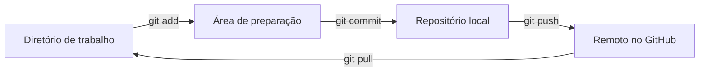

Uma branch é um ponteiro para um commit. Criar uma branch é barato e permite trabalhar numa mudança isolada. O merge junta a história de duas branches. O pull request é o pedido, feito no GitHub, para juntar uma branch na principal com revisão.

#### O que nunca entra no repositório

Chaves de API, senhas, tokens e arquivos `.env`. Ambientes virtuais (`.venv/`). Dados grandes ou dados de cliente. Um segredo que entrou num commit continua na história mesmo depois de apagado do arquivo. Se acontecer, considere a chave vazada e gere outra. O `.gitignore` é a primeira linha de defesa.

```text
.venv/
.env
__pycache__/
*.csv
dados/
```

### Exemplo guiado

Vamos criar um repositório, fazer uma branch e usar pipes num sitemap real.

1. Crie a pasta e o repositório.

```bash
mkdir raiox && cd raiox
git init
printf ".venv/\n.env\n__pycache__/\ndados/\n" > .gitignore
echo "# Raio-X de um site" > README.md
git add .gitignore README.md
git commit -m "Primeiro commit com README e gitignore"
```

2. Crie o repositório vazio no GitHub (sem README) e ligue ao local. Troque `seu-usuario` pelo seu.

```bash
git branch -M main
git remote add origin https://github.com/seu-usuario/raiox.git
git push -u origin main
```

3. Trabalhe numa branch e publique.

```bash
git switch -c descreve-objetivo
echo "Mostra o que um buscador recebe de cada URL." >> README.md
git add README.md
git commit -m "Descreve o objetivo no README"
git push -u origin descreve-objetivo
```

Abra o GitHub, crie o pull request, faça o merge e volte para a main local com `git switch main && git pull`.

4. Agora os pipes. Baixe um sitemap e conte as URLs. O exemplo usa o sitemap público do site do projeto Django.

```bash
curl -s -A "estudo-sitemap/1.0 (+mailto:voce@exemplo.com)" https://www.djangoproject.com/sitemap.xml -o sitemap.xml
grep -o "<loc>[^<]*</loc>" sitemap.xml | wc -l
grep -o "<loc>[^<]*</loc>" sitemap.xml | sed -E 's#</?loc>##g' | cut -d/ -f4 | sort | uniq -c | sort -rn | head
```

A segunda linha conta as tags `<loc>`. A terceira extrai as URLs, pega o primeiro trecho do caminho e conta quantas URLs há em cada pasta. Numa leitura de outubro de 2026, o arquivo tinha pouco mais de mil URLs, quase todas em `/weblog/`. O seu número vai ser outro, porque o sitemap muda. Se o arquivo for um sitemap índice (com `<sitemapindex>`), as `<loc>` apontam para outros sitemaps. Escolha um filho e repita. Repare que aqui o `grep` é triagem num XML de estrutura simples e previsível. Para uma afirmação que vai num relatório, leia o XML com parser.

O fluxograma mostra o que cada peça da terceira linha faz com o texto que recebe.

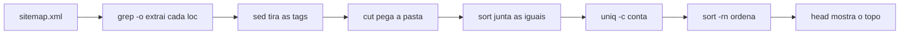

### Erros comuns

- **Versionar uma chave de API.** Ela fica na história do Git para sempre e robôs varrem o GitHub atrás disso. Use variável de ambiente e `.gitignore`. Se vazou, troque a chave.
- **Commits gigantes com mensagem vaga.** "Ajustes" com 40 arquivos impede entender e desfazer. Faça commits pequenos, cada um com uma mudança e uma mensagem que diz o porquê.
- **Trabalhar direto na main.** Um experimento quebrado vai junto para o que funciona. Abra uma branch para cada mudança.
- **Abrir arquivo grande no editor.** Um log de alguns gigabytes trava o editor. Use `head`, `grep` e `wc` e só leve para o Python o recorte que importa.
- **Esquecer o `git pull` antes de começar.** Você trabalha sobre uma versão velha e cria conflito à toa. Comece o dia com `git pull`.

### Na prática

Este módulo não tem caso na pasta casos/. Imagine um consultor que mantém os scripts de auditoria numa pasta solta no computador. Ele ajusta o crawler para um cliente, quebra a parte que lia o sitemap e só percebe três semanas depois, no projeto seguinte. Não há como saber o que mudou nem voltar à versão que funcionava.

Com Git, o mesmo ajuste seria uma branch. Se quebrasse, `git diff main` mostraria a linha exata. Se a ideia fosse ruim, `git switch main` voltaria ao estado bom em um segundo. O histórico também vira argumento. Quando o cliente pergunta como um número foi calculado, o commit mostra o código daquele dia. É a mesma reprodutibilidade que a trilha 08 cobra numa auditoria, aplicada ao seu próprio trabalho.

### Resumo

- O terminal encadeia comandos pequenos com pipes e resolve em segundos o que travaria um editor.
- Git tem três áreas (trabalho, preparação, repositório) e `add`, `commit` e `push` movem a mudança entre elas.
- Cada mudança vai numa branch e volta para a main por pull request.
- Segredo nunca entra no repositório. `.gitignore` e variável de ambiente desde o primeiro commit.

### Para ir além

- [Learn Git Branching](leituras.md), em leituras.md. Exercícios visuais de branch e merge, ótimos antes do desafio do conflito.
- [Pro Git](leituras.md), em leituras.md, capítulos 2 e 3. Para consultar quando um comando fizer algo que você não esperava.
- A aula sobre controle de versão do Missing Semester ([Version Control and Git](videos.md)), em videos.md. Explica o modelo de dados do Git, e com ele os comandos param de parecer mágica.

## Aula 5. Python para analistas

### A ideia central

Python é a cola entre as fontes de dados de um analista. Ele lê uma lista de URLs, chama cada uma, extrai o que interessa do HTML, cruza com uma planilha, consulta uma API e grava um CSV que o SQL e o painel consomem. O objetivo desta aula é fluência nesse ciclo de ler, transformar e gravar. Algoritmos sofisticados ficam para depois.

O modelo mental certo é o de um coletor educado e retomável. Educado, porque faz uma requisição por vez, com pausa, se identifica e para quando o servidor pede. Retomável, porque grava cada resultado assim que obtém e, se cair no meio, recomeça de onde parou. Um script que derruba o site do cliente ou que perde duas horas de coleta por um erro na linha 900 não serve para trabalho profissional.

### Como funciona

#### Ambiente virtual

Cada projeto tem as suas bibliotecas, nas suas versões. Um ambiente virtual isola essas bibliotecas numa pasta (`.venv`). Sem ele, atualizar o pandas para um projeto quebra outro.

```bash
python3 -m venv .venv          # ou: uv venv
source .venv/bin/activate
pip install requests beautifulsoup4 pandas   # ou: uv pip install ...
pip freeze > requirements.txt
```

Quem clonar o repositório recria o ambiente com `pip install -r requirements.txt`.

#### Tipos que você vai usar o tempo todo

| Tipo | Exemplo de SEO |
|---|---|
| `str` | `"https://exemplo.com.br/blog"` |
| `int`, `float` | `404`, `0.034` (um CTR) |
| `list` | `["/a", "/b", "/c"]`, uma lista de URLs, com ordem |
| `dict` | `{"status": 200, "title": "Home"}`, campos com nome |
| `set` | URLs já coletadas, para checar presença rápido |

Uma resposta HTTP no `requests` traz `r.status_code`, `r.headers` (um dicionário sem diferença entre maiúsculas e minúsculas), `r.text` e `r.url` (a URL final, depois dos redirecionamentos).

#### Coleta responsável

Três regras valem para qualquer coleta.

1. **Pausa entre requisições.** Dois a cinco segundos com variação aleatória, uma requisição por vez.
2. **User-agent descritivo.** Nome do projeto e um contato, para o dono do site saber quem é e como falar com você.
3. **Parada no primeiro 429.** O 429 significa "muitas requisições". O servidor está pedindo para você parar. Tentar de novo na hora agrava a situação e pode levar ao bloqueio do IP. Pare, grave o que tem e retome mais tarde.

Respeite também o robots.txt do site e colete só o que é público.

#### Erros que não podem travar o script

Timeout, DNS que não resolve e conexão recusada levantam exceções no `requests`. Capture `requests.RequestException`, registre o erro na linha daquela URL e siga para a próxima. Um erro numa URL é um dado, e o script deve continuar.

#### pandas em três operações

```python
import pandas as pd

df = pd.read_csv("resultado.csv")
print(df["status"].value_counts(dropna=False))           # contar por status
print(df["title"].str.len().mean())                      # tamanho médio do title
print(df[df.duplicated("title", keep=False)].sort_values("title"))  # titles repetidos
```

### Exemplo guiado

Vamos escrever o coletor que o exercício de prática 2 e o desafio pedem. Crie `urls.txt` com uma URL por linha. Para testar, use estas quatro, que incluem um 404 e um domínio que não existe.

```text
https://www.wikipedia.org/
https://pt.wikipedia.org/wiki/Hypertext_Transfer_Protocol
https://pt.wikipedia.org/wiki/Pagina_que_nao_existe_xyz123
http://nao-existe.invalid/
```

Salve como `coletor.py`.

```python
import csv
import random
import sys
import time
from pathlib import Path

import requests
from bs4 import BeautifulSoup

UA = "estudo-raiox/1.0 (+mailto:voce@exemplo.com)"
SAIDA = Path("resultado.csv")
CAMPOS = ["url", "status", "url_final", "title", "erro"]


def ja_coletadas():
    if not SAIDA.exists():
        return set()
    with SAIDA.open(newline="", encoding="utf-8") as f:
        return {linha["url"] for linha in csv.DictReader(f)}


def coletar(url, sessao):
    try:
        r = sessao.get(url, timeout=20)
    except requests.RequestException as e:
        return {"url": url, "status": "", "url_final": "", "title": "",
                "erro": type(e).__name__}
    title = ""
    if "html" in r.headers.get("content-type", ""):
        tag = BeautifulSoup(r.text, "html.parser").title
        title = tag.get_text(strip=True) if tag else ""
    return {"url": url, "status": r.status_code, "url_final": r.url,
            "title": title, "erro": ""}


def main():
    urls = [u.strip() for u in Path("urls.txt").read_text().splitlines() if u.strip()]
    feitas = ja_coletadas()
    pendentes = [u for u in urls if u not in feitas]
    print(f"{len(feitas)} já coletadas, {len(pendentes)} pendentes")

    novo = not SAIDA.exists()
    with SAIDA.open("a", newline="", encoding="utf-8") as f, requests.Session() as s:
        s.headers["User-Agent"] = UA
        escritor = csv.DictWriter(f, fieldnames=CAMPOS)
        if novo:
            escritor.writeheader()
        for i, url in enumerate(pendentes):
            linha = coletar(url, s)
            if linha["status"] == 429:
                print(f"429 em {url}. Parei. Rode de novo mais tarde.")
                sys.exit(1)
            escritor.writerow(linha)
            f.flush()
            print(linha["status"] or linha["erro"], url)
            if i < len(pendentes) - 1:
                time.sleep(random.uniform(2, 5))


if __name__ == "__main__":
    main()
```

```bash
python coletor.py
python coletor.py    # segunda execução, deve dizer "4 já coletadas, 0 pendentes"
```

Leia o código com atenção a quatro escolhas. O arquivo é aberto em modo de acréscimo (`"a"`) e cada linha é gravada com `flush()`, então nada se perde se o script cair. A função `ja_coletadas` lê o que já existe e pula essas URLs, o que torna o script retomável. A URL com 429 não é gravada, então a próxima execução tenta de novo. E a exceção de rede vira texto na coluna `erro`.

O fluxograma mostra o ciclo do coletor e o ponto em que ele retoma depois de parar.

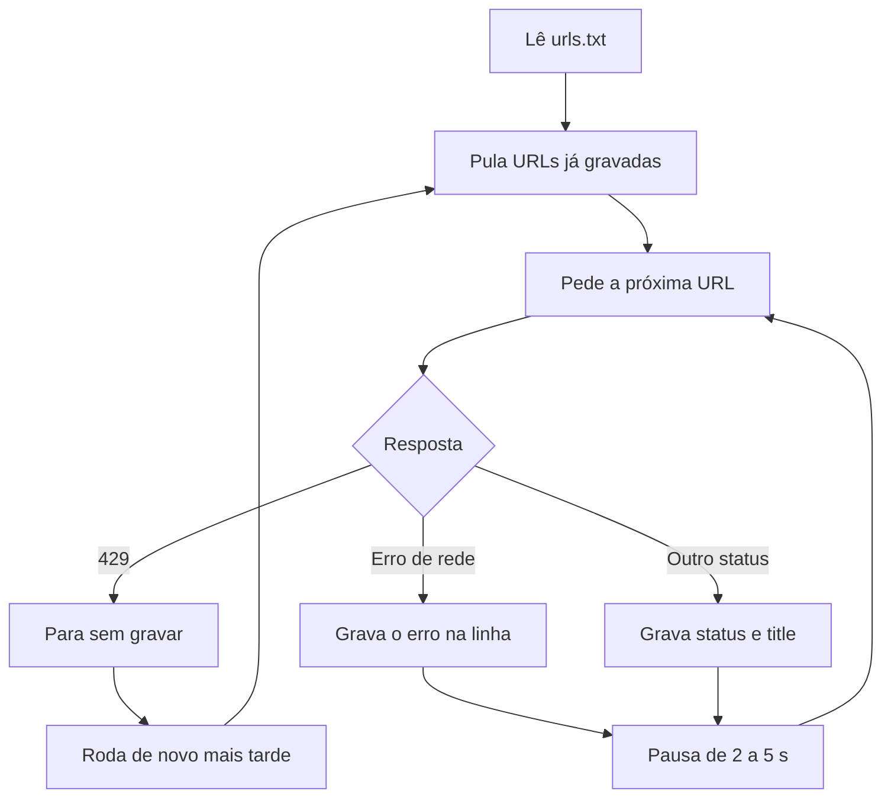

Abra o `resultado.csv`. A URL inexistente da Wikipédia respondeu 404 e, mesmo assim, tem um title completo. É o mesmo fenômeno da aula 1, agora visto em dados.

### Erros comuns

- **Instalar bibliotecas no Python do sistema.** Projetos brigam por versões e o ambiente fica impossível de reproduzir. Use `.venv` e `requirements.txt`.
- **Coletar sem pausa e em paralelo.** O servidor sofre, o 429 chega rápido e o IP pode ser bloqueado. Uma requisição por vez, com pausa.
- **Insistir depois do 429.** Laço de nova tentativa imediata é contornar o limitador. Pare, grave e retome depois.
- **Guardar tudo na memória e gravar no fim.** Uma exceção na URL 900 perde as 899 anteriores. Grave linha a linha.
- **Deixar uma exceção derrubar a coleta.** Um timeout para o script inteiro. Capture `requests.RequestException` e registre o erro.
- **Ler HTML com regex.** Os problemas da aula 3 voltam. Use BeautifulSoup.

### Na prática

Site com limitador de requisições responde 429. Num trabalho de coleta, a tentação é contornar. Diminuir a pausa, trocar de IP, disparar em paralelo para terminar logo. Cada uma dessas saídas tem o mesmo fim. O limitador endurece, o IP é bloqueado e, se o site for de um cliente, a equipe dele vê um ataque vindo da consultoria.

O raciocínio profissional inverte a pressa. O 429 é uma informação sobre o servidor, e a resposta certa é parar no primeiro, gravar o que já foi coletado e retomar depois, com a mesma pausa ou maior. Por isso o coletor desta aula foi desenhado retomável desde a primeira linha. Parar deixa de ser prejuízo quando recomeçar custa zero. Contornar o limitador é a forma mais rápida de ter o IP bloqueado e de perder a confiança do cliente.

### Resumo

- Um ambiente virtual por projeto, com as versões gravadas em `requirements.txt`.
- Listas guardam sequências, dicionários guardam campos com nome, conjuntos respondem "já vi isso?".
- Coleta responsável tem pausa, user-agent com contato, uma requisição por vez e parada no primeiro 429.
- Grave linha a linha e pule o que já foi feito. Erro de rede vira dado, nunca trava o script.

### Para ir além

- [10 minutes to pandas](leituras.md), em leituras.md. Leia agora para ter à mão as operações de agrupar, filtrar e ordenar da prática 3.
- [Python for Data Analysis, 3E](leituras.md), de Wes McKinney, em leituras.md. Os capítulos de leitura de arquivos e de limpeza cobrem o que vem depois do CSV.
- [Pandas 2025](videos.md), do Téo Me Why, em videos.md. Mostra o raciocínio de quem trabalha com dados enquanto resolve exercícios ao vivo.

## Aula 6. SQL básico

### A ideia central

SQL é a língua em que quase todo dado de negócio responde. O GA4 exportado para o BigQuery, o Search Console em lote, o CRM e o data lake falam SQL. Quem escreve uma consulta não depende de alguém para tirar um número e consegue conferir os números que recebe.

O modelo mental certo é pensar em conjuntos de linhas. Você parte de uma tabela, filtra linhas, agrupa, agrega e ordena. A ordem em que o banco executa difere da ordem em que você escreve. Primeiro `FROM` e `JOIN`, depois `WHERE`, `GROUP BY`, `HAVING`, `SELECT` e por fim `ORDER BY`. Entender essa ordem explica a maior parte dos erros de quem começa.

### Como funciona

#### A consulta básica

```sql
SELECT pagina, SUM(cliques) AS cliques
FROM gsc
WHERE data >= DATE '2026-09-01'
GROUP BY pagina
HAVING SUM(cliques) > 100
ORDER BY cliques DESC
LIMIT 20;
```

`WHERE` filtra linhas antes de agrupar. `HAVING` filtra grupos depois de agregar. Para "páginas com mais de 100 cliques em setembro", a data vai no `WHERE` e o limite de cliques vai no `HAVING`.

O fluxograma mostra a ordem em que o banco executa a consulta acima.

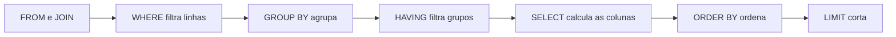

#### NULL não é zero

`NULL` significa "sem valor". Ele se comporta de um jeito próprio.

| Expressão | Resultado |
|---|---|
| `COUNT(*)` | Conta todas as linhas |
| `COUNT(coluna)` | Conta só as linhas em que a coluna não é NULL |
| `coluna = NULL` | Nunca é verdadeiro. Use `coluna IS NULL` |
| `SUM` e `AVG` | Ignoram NULL |

#### JOIN e o perigo de multiplicar linhas

`INNER JOIN` mantém só as linhas que casam nas duas tabelas. `LEFT JOIN` mantém todas as linhas da tabela da esquerda e preenche com NULL o que não casar. O perigo está na cardinalidade. Se uma linha da esquerda casa com três da direita, ela aparece três vezes no resultado. Somar uma coluna da esquerda depois desse join multiplica o valor por três.

#### CASE WHEN e datas

`CASE WHEN` cria categorias dentro da consulta, como agrupar status em famílias. Para datas, use literais explícitos (`DATE '2026-09-01'`) e funções como `date_trunc('month', data)` para agrupar por mês.

#### DuckDB

O DuckDB é um banco analítico que roda dentro de um processo, sem servidor. Ele lê CSV e Parquet direto do disco. Dá para usar pelo executável de linha de comando (veja a página de instalação no site do DuckDB) ou pelo pacote Python, que você já instalou no começo destas aulas.

```bash
python -c "import duckdb; print(duckdb.sql(\"SELECT status, COUNT(*) AS urls FROM read_csv_auto('resultado.csv') GROUP BY status\"))"
```

### Exemplo guiado

Vamos reproduzir o erro do `LEFT JOIN` que multiplica a receita e escrever a versão certa. Salve como `join.sql`.

```sql
CREATE TABLE pedidos AS
SELECT * FROM (VALUES
  (1, DATE '2026-09-01', 'organic', 300.00),
  (2, DATE '2026-09-01', 'cpc',     120.00),
  (3, DATE '2026-09-02', 'organic', 500.00)
) AS t(pedido_id, data, canal, receita);

CREATE TABLE itens AS
SELECT * FROM (VALUES
  (1, 'livro',   100.00),
  (1, 'caneta',  200.00),
  (2, 'agenda',  120.00),
  (3, 'mochila', 250.00),
  (3, 'estojo',  150.00),
  (3, 'livro',   100.00)
) AS t(pedido_id, produto, valor);

-- errado: cada pedido se repete uma vez por item
SELECT p.canal, SUM(p.receita) AS receita
FROM pedidos p LEFT JOIN itens i USING (pedido_id)
GROUP BY p.canal ORDER BY p.canal;

-- certo: agrega os itens antes do join, uma linha por pedido
WITH qtd AS (
  SELECT pedido_id, COUNT(*) AS n_itens FROM itens GROUP BY pedido_id
)
SELECT p.canal, SUM(p.receita) AS receita, SUM(q.n_itens) AS itens
FROM pedidos p LEFT JOIN qtd q USING (pedido_id)
GROUP BY p.canal ORDER BY p.canal;
```

Rode no Python.

```python
import duckdb

con = duckdb.connect()
for comando in open("join.sql", encoding="utf-8").read().split(";"):
    if comando.strip():
        resultado = con.sql(comando)
        if resultado is not None:
            print(resultado)
```

A primeira consulta diz que o orgânico vendeu 2.100. O pedido 1 (300) apareceu duas vezes e o pedido 3 (500) apareceu três. A receita real do orgânico é 800, que a segunda consulta devolve. A defesa é uma pergunta antes de somar. Qual é o grão da tabela depois do join? Se a resposta deixou de ser "uma linha por pedido", agregue antes.

O modelo de dados mostra por que o join repete a receita, já que um pedido tem um ou mais itens.

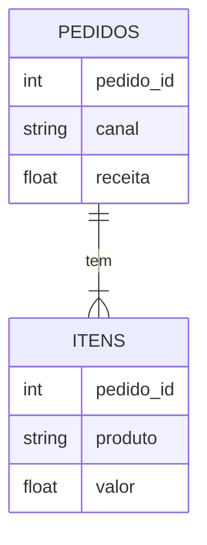

Para conferir rápido, compare `SELECT COUNT(*) FROM pedidos` com o `COUNT(*)` do resultado do join. Se o join tem mais linhas que a tabela da esquerda, houve multiplicação.

Agora responda perguntas sobre o `resultado.csv` da aula 5.

```sql
-- URLs por família de status
SELECT CASE
         WHEN status BETWEEN 200 AND 299 THEN '2xx'
         WHEN status BETWEEN 300 AND 399 THEN '3xx'
         WHEN status BETWEEN 400 AND 499 THEN '4xx'
         WHEN status >= 500 THEN '5xx'
         ELSE 'sem resposta'
       END AS familia,
       COUNT(*) AS urls
FROM read_csv_auto('resultado.csv')
GROUP BY familia
ORDER BY familia;

-- titles repetidos
SELECT title, COUNT(*) AS n
FROM read_csv_auto('resultado.csv')
GROUP BY title
HAVING COUNT(*) > 1;
```

A URL com erro de conexão tem `status` NULL e cai em "sem resposta". Sem o `ELSE`, ela desapareceria da contagem por família e o total não bateria com o número de URLs.

### Erros comuns

- **Somar depois de um join que mudou o grão.** A receita multiplica e ninguém percebe porque o número parece plausível. Confira contagens antes e depois do join e agregue antes quando o lado direito tem várias linhas por chave.
- **Filtrar agregado no `WHERE`.** `WHERE SUM(cliques) > 100` dá erro. Agregado se filtra no `HAVING`.
- **Comparar com `= NULL`.** A condição nunca é verdadeira e as linhas somem. Use `IS NULL`.
- **Esquecer o `ELSE` no `CASE WHEN`.** Linhas fora das categorias viram NULL e somem de gráficos e totais. Sempre tenha uma categoria para o resto.
- **Filtrar a tabela da direita no `WHERE` de um `LEFT JOIN`.** O filtro descarta as linhas com NULL e o `LEFT JOIN` vira `INNER JOIN` sem aviso. Ponha a condição no `ON`.

### Na prática

Este módulo não tem caso na pasta casos/. Imagine uma loja online que quer saber a receita do canal orgânico em setembro. O analista junta a tabela de pedidos com a de itens para também mostrar os produtos mais vendidos, e soma a receita do pedido no mesmo resultado. O painel mostra o orgânico com uma receita duas vezes e meia maior que a do financeiro. Por uma semana, a discussão é sobre atribuição, cookie e modelo de canal.

A causa é a do exemplo guiado. Pedidos com vários itens foram contados várias vezes. O raciocínio que encontra o erro em minutos é perguntar qual é o grão de cada tabela e qual é o grão do resultado, antes de discutir qualquer outra hipótese. Quando dois números da mesma coisa não batem, a primeira suspeita é a consulta, e só depois o mundo.

### Resumo

- O banco executa `FROM`, `WHERE`, `GROUP BY`, `HAVING`, `SELECT` e `ORDER BY`, nessa ordem.
- `WHERE` filtra linhas, `HAVING` filtra grupos.
- NULL não é zero. `COUNT(coluna)` ignora NULL e comparação com NULL usa `IS NULL`.
- Todo join tem um grão. Se ele mudou, agregue antes de somar.
- O DuckDB lê CSV direto e é o laboratório ideal para praticar.

### Para ir além

- [SQLBolt](leituras.md), em leituras.md. Faça as lições até `JOIN` e `GROUP BY` antes da prática 1.
- [Select Star SQL](leituras.md), em leituras.md. Ensina SQL resolvendo perguntas sobre um conjunto de dados real, o mesmo movimento da prática 3.
- [Aprenda SQL · Primeiras Magias na Linguagem dos Dados](videos.md), do Téo Me Why, em videos.md. SQL com raciocínio de analista, bom complemento ao exemplo do join.
