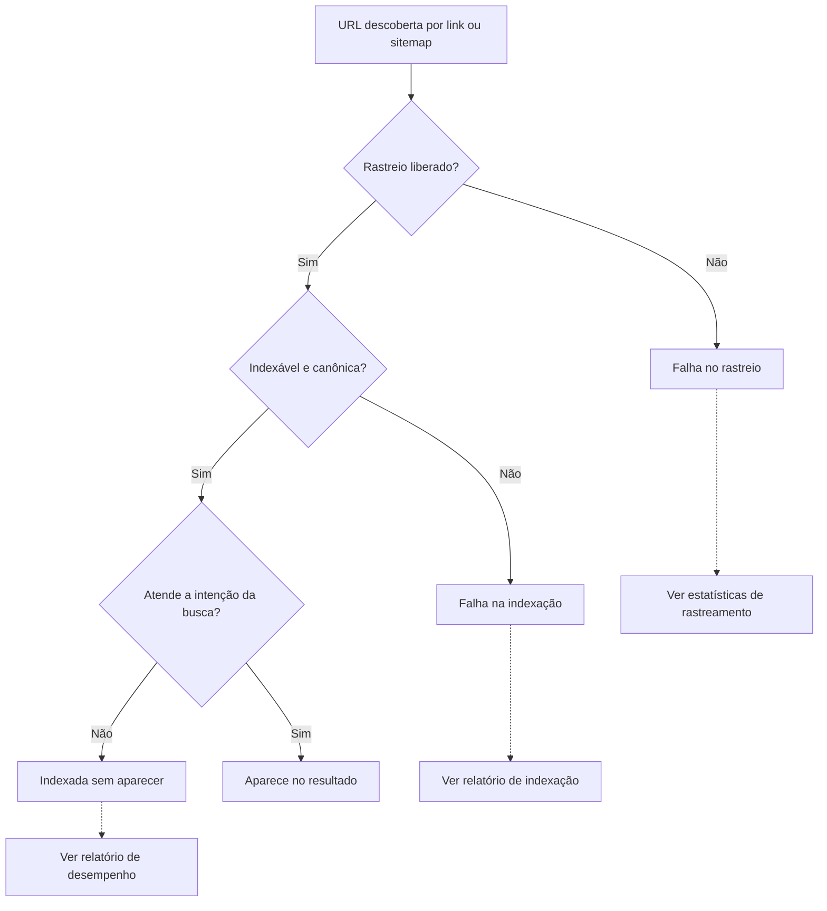
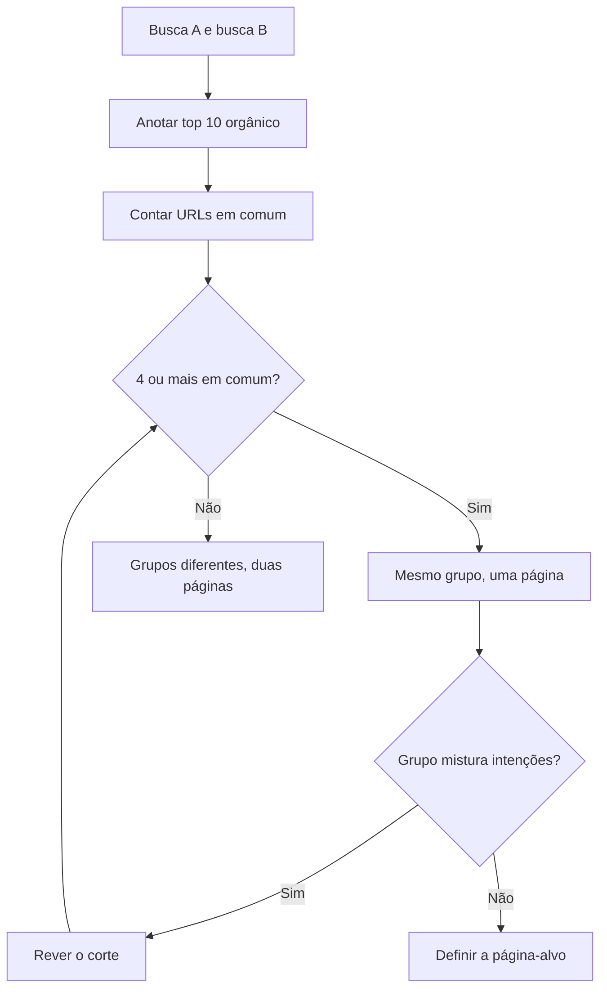
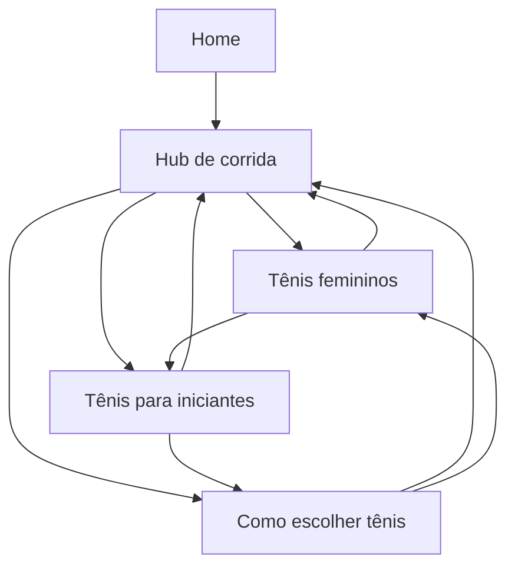
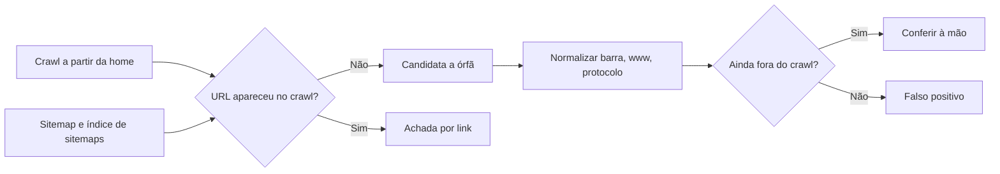
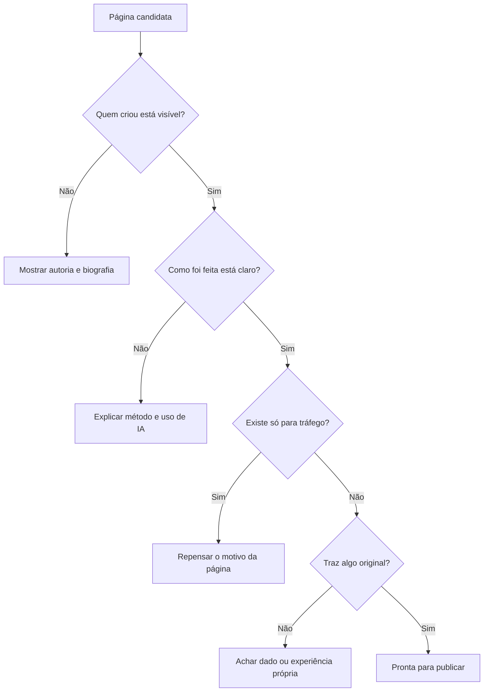
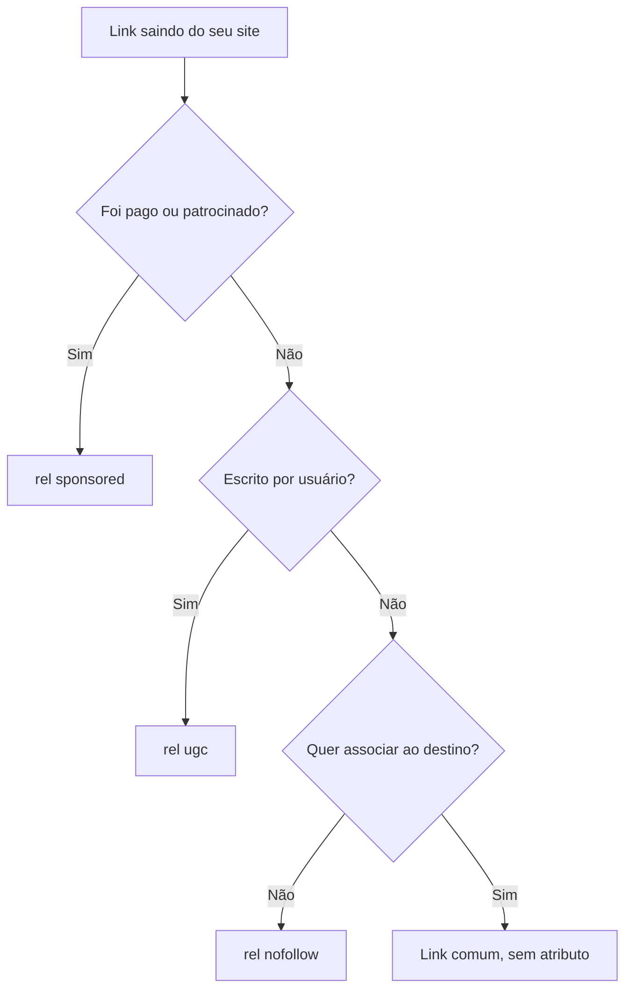
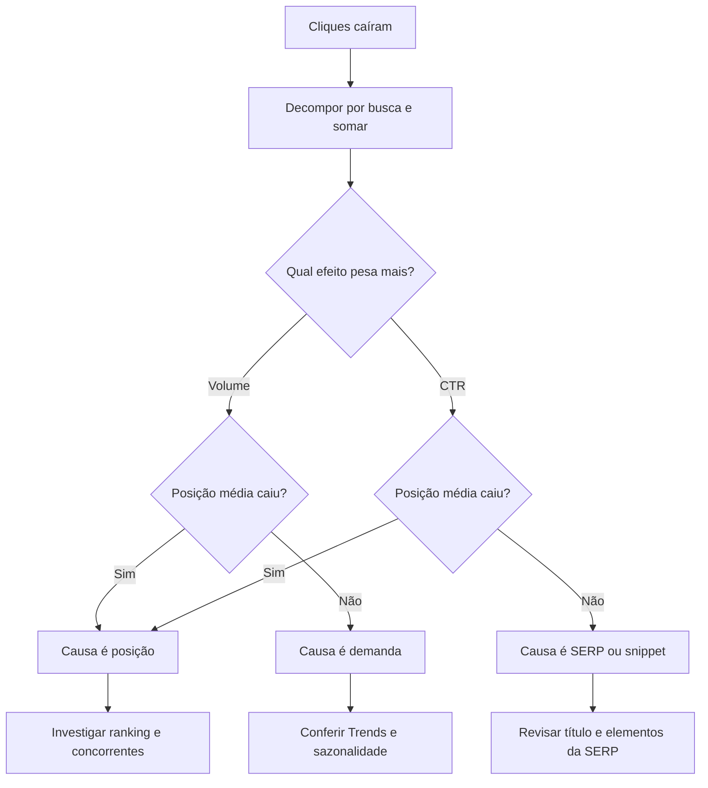
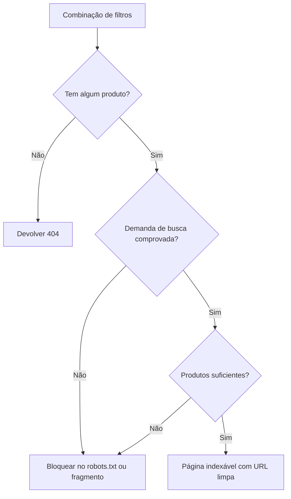

# Aulas · 01 · SEO estratégico

Texto de apoio de cada módulo. Leia depois dos vídeos e antes dos exercícios. Onde houver comando ou código, rode no seu computador.

## Sumário

1. [Como o Google funciona e a busca hoje](#aula-1-como-o-google-funciona-e-a-busca-hoje)
2. [Intenção de busca e pesquisa de palavras-chave](#aula-2-intenção-de-busca-e-pesquisa-de-palavras-chave)
3. [Arquitetura de informação e linkagem interna](#aula-3-arquitetura-de-informação-e-linkagem-interna)
4. [Conteúdo, E-E-A-T e atualizações de algoritmo](#aula-4-conteúdo-e-e-a-t-e-atualizações-de-algoritmo)
5. [Links, autoridade e digital PR](#aula-5-links-autoridade-e-digital-pr)
6. [Resultados da SERP, títulos e CTR](#aula-6-resultados-da-serp-títulos-e-ctr)
7. [SEO local e e-commerce](#aula-7-seo-local-e-e-commerce)

## Aula 1. Como o Google funciona e a busca hoje

### A ideia central

Toda pergunta de SEO começa com outra pergunta. Em que etapa o problema está? O Google trabalha em três etapas, e uma página pode parar em qualquer uma delas. Uma página que não foi rastreada não tem como ser indexada. Uma página indexada pode nunca aparecer para a busca que importa. Cada falha tem sintoma, ferramenta e conserto próprios.

O modelo mental certo é o de um funil com três portas. Antes de mexer em título, conteúdo ou link, descubra qual porta está fechada. Isso evita o erro mais comum de quem começa, que é aplicar tática de ranqueamento num problema de indexação.

### Como funciona

#### As três etapas

O guia oficial do Search Central descreve as etapas assim.

| Etapa | O que acontece | Falha típica | Onde ver |
|---|---|---|---|
| Rastreio (crawling) | O Googlebot baixa texto, imagens e vídeos de páginas que descobriu por links e sitemaps | URL bloqueada no robots.txt, servidor lento, página sem nenhum link apontando para ela | Estatísticas de rastreamento e inspeção de URL |
| Indexação | O Google analisa a página, agrupa duplicatas e escolhe a canônica, a versão que pode aparecer no resultado | Página duplicada sem canônica clara, `noindex` esquecido, conteúdo que só aparece depois de JavaScript quebrado | Relatório de indexação de páginas |
| Veiculação (serving) | Diante de uma busca, o Google procura no índice e ordena pelo que considera mais relevante para aquela pessoa, naquele lugar, naquele idioma e dispositivo | Página indexada que não ranqueia porque não atende a intenção ou perde para concorrentes melhores | Relatório de desempenho |

O diagrama mostra em que porta a página pode parar e onde conferir cada falha.



Dois pontos do guia valem como regra de conversa com cliente. O Google não aceita pagamento para rastrear mais ou ranquear melhor. E o Google não garante que vai rastrear, indexar ou mostrar uma página, mesmo que ela siga todas as diretrizes.

#### Sistemas de ranqueamento

A ordenação vem de sistemas automáticos que olham muitos sinais. O Google publica um guia com os sistemas ativos e os aposentados. Conhecer essa lista evita repetir mito. Alguns exemplos da lista atual.

| Sistema | O que faz, em uma frase |
|---|---|
| Sistemas de conteúdo original | Favorecem a reportagem original em vez da página que só a cita |
| Sistemas de deduplicação | Mostram só o resultado mais relevante entre vários quase iguais |
| Sistema de diversidade de sites | Em geral limita a dois os resultados de um mesmo site no topo, contando subdomínios como parte do domínio |
| Sistemas de análise de links e PageRank | Usam a forma como as páginas se ligam para entender tema e utilidade |
| Sistemas de informação confiável | Promovem páginas com autoridade e rebaixam conteúdo de baixa qualidade |
| Sistemas de detecção de spam | Identificam spam, inclusive com o SpamBrain |

Na lista de aposentados está o sistema de conteúdo útil (helpful content), incorporado aos sistemas principais em março de 2024. Panda entrou no núcleo em 2015 e Penguin em 2016. Quem fala de "penalidade do Panda" em 2026 está descrevendo algo que não existe mais como sistema separado.

#### Core updates

Core updates (atualizações principais) mudam a forma como os sistemas avaliam conteúdo no site inteiro. Elas não miram uma falha técnica. Por isso uma queda logo depois de uma delas raramente se resolve com correção técnica. As datas oficiais ficam no Google Search Status Dashboard, que você deve cruzar com a série de cliques antes de atribuir qualquer queda a uma atualização.

#### A página de resultados em 2026

A SERP (página de resultados) tem resultados orgânicos, anúncios, vídeos, imagens, produtos, mapas e as respostas geradas por IA, AI Overviews e AI Mode. O Google diz que não há requisito extra nem otimização especial para aparecer nesses recursos. Basta a página estar indexada e apta a aparecer com snippet.

Três detalhes de mensuração mudam a leitura dos relatórios.

1. O tráfego vindo de AI Overviews e AI Mode entra no relatório de desempenho, dentro do tipo de pesquisa Web. Ele não aparece separado.
2. Todos os links de uma AI Overview recebem a mesma posição, a posição do bloco na página.
3. O relatório de IA generativa do Search Console mostra só impressões, sem consulta e sem clique, e a série começa em maio de 2026.

Zero clique é a busca que termina na própria SERP. A pessoa lê a resposta e não clica em nada. Buscas de definição, conversão de unidade e fato curto tendem a zero clique. Isso explica parte das quedas de CTR sem perda de posição.

#### Marca e não marca

Busca por marca (o nome do site, erros de digitação dele, produtos exclusivos) tem CTR alto e posição boa quase sempre. Busca genérica é onde está o crescimento. Misturar as duas esconde o que aconteceu. Uma alta de marca pode mascarar uma queda genérica.

O Search Console tem desde novembro de 2025 um filtro de consultas de marca, disponível para todos os sites elegíveis desde março de 2026. A classificação é feita por um sistema interno assistido por IA. Ela só aparece em propriedades de nível superior (não em propriedades de caminho nem de subdomínio) e com volume suficiente de buscas. Quando o filtro não aparece, use regex.

### Exemplo guiado

Separe cliques de marca e de não marca no seu site em 15 minutos.

1. Abra o Search Console, vá em Desempenho e depois em Resultados da pesquisa.
2. Escolha os últimos 3 meses.
3. Se o filtro de consultas de marca aparecer, aplique "Marca" e anote cliques, impressões, CTR e posição média. Depois aplique "Sem marca" e anote os mesmos números.
4. Se o filtro não aparecer, adicione um filtro de Consulta, escolha a opção personalizada com regex e use uma expressão com as variações do nome. O Search Console usa a sintaxe RE2.

```
minhamarca|minha marca|mnhamarca|minha-marca
```

5. Anote os quatro números. Troque a condição para a que exclui a regex e anote de novo.
6. Monte uma tabela com as duas linhas e uma terceira com o total sem filtro. Some os cliques das duas linhas e compare com o total. Em geral a soma fica abaixo. Qualquer filtro de consulta ignora as consultas anonimizadas, que o Search Console omite por privacidade, então "corresponde" mais "não corresponde" fica abaixo do total. Para medir essa parte, aplique a regex `.*`, que casa com tudo, e compare com o total sem filtro.
7. Escreva uma frase de leitura. Exemplo de formato, sem número real. "A busca genérica responde por X% dos cliques e tem CTR Y vezes menor que a de marca."

Repita em dois períodos de 28 dias para ver qual grupo puxou a variação.

### Erros comuns

- **Atacar ranqueamento quando o problema é indexação.** A página não está no índice e alguém reescreve o título. Confira a inspeção de URL antes de qualquer tática.
- **Atribuir toda queda a core update.** Sem cruzar com as datas do Status Dashboard e com a série diária, a hipótese vira desculpa. Confira se a queda começou na janela da atualização e se atingiu o site inteiro ou uma seção.
- **Ler o total sem separar marca.** Uma campanha de mídia infla a busca de marca e esconde a perda genérica. Separe sempre.
- **Tratar AI Overview como canal separado no relatório.** Ela está dentro do tipo Web. Comparar períodos antes e depois da chegada dela no seu tema exige olhar CTR por posição, não só cliques.
- **Repetir regra de blog sem conferir a documentação.** O Search Central muda. Confira o changelog antes de afirmar.

### Na prática

A documentação do Google muda e a doutrina de SEO vence. O resultado enriquecido de HowTo saiu em 2023 e o de FAQ saiu para todos os sites em maio de 2026. Mesmo assim, recomendações de "adicionar FAQ schema para ganhar espaço na SERP" continuam circulando em checklist, template de auditoria e resposta pronta.

O raciocínio de quem trabalha bem é simples. Toda recomendação que depende de comportamento do Google tem data de validade. Antes de colocar uma delas num relatório para cliente, abra a fonte primária. No caso de dados estruturados, a galeria de recursos do Search Central lista o que ainda gera resultado enriquecido. Na versão atualizada em outubro de 2026, FAQ e HowTo não estão lá. O custo de conferir é de cinco minutos. O custo de não conferir é recomendar trabalho que não gera nada e perder a confiança de quem leu.

Crie o hábito de abrir o changelog da documentação do Search Central uma vez por mês e anotar o que mudou. É o exercício 3 da prática deste módulo.

### Resumo

- Rastreio, indexação e veiculação falham de jeitos diferentes. Descubra a etapa antes da tática.
- O Google publica a lista de sistemas de ranqueamento ativos e aposentados. Use essa lista para separar fato de mito.
- AI Overviews e AI Mode entram no tipo Web do relatório de desempenho, e os links de uma AI Overview dividem a mesma posição.
- Separe marca e não marca antes de ler qualquer variação de tráfego.
- Toda regra de SEO tem data. Confira o changelog antes de recomendar.

### Para ir além

- **How Search Works**, playlist do Google Search Central em [videos.md](videos.md). Assista antes de reler a tabela das três etapas.
- **Guia detalhado de como a Pesquisa Google funciona**, em [leituras.md](leituras.md). É a fonte primária desta aula.
- **Recursos de IA e seu site**, em [leituras.md](leituras.md). O que o Google diz sobre AI Overviews e AI Mode para quem publica.
- **How AI Is Changing Google Search and SEO**, em [videos.md](videos.md). A visão oficial recente, boa para comparar com o que circula em rede social.

## Aula 2. Intenção de busca e pesquisa de palavras-chave

### A ideia central

Palavra-chave é o rastro de uma necessidade. Duas pessoas que digitam "tênis para corrida" e "melhor tênis de corrida" provavelmente querem a mesma coisa, uma comparação para decidir a compra. Quem digita "tênis de corrida feminino 37" já decidiu e quer uma lista de produtos. A palavra muda pouco e a página certa muda muito.

O trabalho tem três partes. Agrupar buscas pela intenção, escolher uma única página para cada grupo e medir a oportunidade real de cada grupo. A SERP é o árbitro. O que o Google já mostra para uma busca é a melhor evidência do que ele entende como resposta.

### Como funciona

#### Os quatro tipos de intenção

| Intenção | A pessoa quer | Exemplo no tema corrida | Formato que costuma ganhar |
|---|---|---|---|
| Informacional | Aprender ou entender | como escolher tênis de corrida | Guia, artigo, vídeo |
| Navegacional | Chegar a um site específico | site da marca X | Home ou página oficial |
| Comercial | Comparar antes de comprar | melhor tênis de corrida 2026 | Comparativo, review, lista |
| Transacional | Comprar ou agir agora | comprar tênis de corrida feminino | Categoria ou produto |

Muitas buscas têm intenção mista. A SERP mostra a mistura. Se o top 10 tem metade de lojas e metade de guias, o Google ainda não decidiu, e você pode disputar com qualquer um dos dois formatos.

#### Cauda longa, volume e sazonalidade

Cauda longa são as buscas longas e específicas, cada uma com pouca procura, que somadas fazem a maior parte do volume de um tema. Elas costumam ter intenção mais clara e concorrência menor.

Volume de ferramenta é estimativa. As ferramentas modelam a procura a partir de amostras e de dados de anúncios, e cada uma usa um método. Por isso duas ferramentas dão números diferentes para a mesma busca. O dado que não é estimativa é o seu. As impressões do Search Console mostram quantas vezes o seu site apareceu de fato.

Sazonalidade se vê no Google Trends. O Trends mostra um índice relativo de 0 a 100 dentro do período escolhido, sem volume absoluto. Use para saber quando a procura sobe e para comparar termos entre si.

#### Dificuldade e valor

Dificuldade é a estimativa de quanto custa entrar no top 10, geralmente baseada nos links das páginas que já estão lá. Valor é quanto um clique daquela busca vale para o negócio. Uma busca transacional com volume baixo pode valer mais que uma informacional com volume alto. A prioridade combina demanda, valor, dificuldade e o que você tem de próprio para oferecer.

#### Agrupamento por SERP

Duas buscas que mostram os mesmos resultados são o mesmo tema para o Google. A regra prática é contar as URLs em comum no top 10 e definir um corte. Um corte comum é 4 ou mais URLs em comum para virar uma página só. O número exato importa menos que ter a regra escrita e aplicada igual em todos os pares.

O fluxo abaixo mostra a decisão entre uma ou duas páginas para um par de buscas.



#### Canibalização

Canibalização acontece quando duas páginas do mesmo site disputam a mesma busca e o Google alterna entre elas. O sintoma no Search Console é uma busca com duas URLs revezando semana a semana, nenhuma firme. A solução é escolher uma página, consolidar o conteúdo nela e apontar a outra para ela com redirecionamento ou canonical.

#### Onde coletar buscas

Autocomplete do Google, o bloco "as pessoas também perguntam", as consultas relacionadas do Google Trends e, principalmente, a aba de consultas do seu Search Console. Ferramentas pagas ajudam a ampliar a lista. Colete à mão e com calma. O robots.txt do Google bloqueia a página de resultados para robôs, e a coleta automatizada costuma ser barrada.

### Exemplo guiado

Agrupe buscas pela SERP com uma regra escrita.

1. Escolha três buscas parecidas do seu nicho. Faça cada uma em janela anônima e anote as 10 primeiras URLs orgânicas, sem anúncio. Registre data, cidade e dispositivo.
2. Monte um arquivo `serps.csv` com as colunas `busca`, `posicao` e `url`.

```
busca,posicao,url
tênis para corrida,1,https://a.com/tenis-corrida
tênis para corrida,2,https://b.com/melhores-tenis
melhor tênis de corrida,1,https://b.com/melhores-tenis
melhor tênis de corrida,2,https://a.com/tenis-corrida
```

3. Rode o script abaixo. Ele compara todos os pares, aplica o corte e junta os grupos de forma transitiva (se A anda com B e B anda com C, os três ficam juntos).

```python
"""Agrupa buscas que dividem URLs no top 10. Regra: MIN_COMUNS ou mais URLs em comum, mesmo grupo."""
from itertools import combinations

import pandas as pd

MIN_COMUNS = 4

serps = pd.read_csv("serps.csv")
top = serps[serps["posicao"] <= 10].groupby("busca")["url"].apply(set)

pai = {b: b for b in top.index}


def raiz(b):
    while pai[b] != b:
        pai[b] = pai[pai[b]]
        b = pai[b]
    return b


for a, b in combinations(top.index, 2):
    comuns = len(top[a] & top[b])
    print(f"{a} x {b}: {comuns} URLs em comum")
    if comuns >= MIN_COMUNS:
        pai[raiz(a)] = raiz(b)

grupos = pd.DataFrame({"busca": top.index, "grupo": [raiz(b) for b in top.index]})
print(grupos.sort_values("grupo").to_string(index=False))
```

```bash
pip install pandas
python agrupar_serp.py
```

4. Leia a saída. Cada grupo vira uma página-alvo. Se um grupo juntou buscas de intenção diferente, reveja o corte.
5. Leve os grupos para a planilha do projeto, com a fonte de cada busca e a página-alvo.

### Erros comuns

- **Uma página por palavra.** Gera dezenas de páginas quase iguais que se canibalizam. Agrupe pela SERP e faça uma página por grupo.
- **Confiar no volume da ferramenta como fato.** A ferramenta erra para cima e para baixo, principalmente na cauda longa. Cruze com as impressões do Search Console sempre que tiver.
- **Ignorar o formato da SERP.** Escrever um guia longo para uma busca em que o top 10 só tem páginas de produto não funciona. Copie o formato que a SERP pede e diferencie no conteúdo.
- **Esquecer a sazonalidade.** Um tema que pica em novembro precisa da página pronta e indexada antes. Olhe o Trends de cinco anos.
- **Resolver canibalização apagando uma página sem redirecionar.** Perde os links e o histórico da página removida. Consolide e redirecione.

### Na prática

Volume de ferramenta é estimativa. Sempre que possível, cruze com as impressões reais do Search Console. Uma busca com pouco volume na ferramenta pode ter milhares de impressões no seu site.

Por que isso acontece? A ferramenta estima uma busca exata. O seu site aparece para dezenas de variações dela, com erro de digitação, ordem trocada e complemento. Na prática, o Search Console soma tudo isso por você. Imagine um site de receitas que descarta "bolo de caneca" porque a ferramenta mostra volume baixo para a forma exata. No Search Console, a página antiga sobre o tema aparece para "bolo de caneca de chocolate", "bolo na caneca microondas" e outras trinta variações, e a soma de impressões é muito maior que a estimativa. O exemplo é hipotético. O raciocínio vale para qualquer nicho.

A regra que sai daí é usar a ferramenta para descobrir buscas e o Search Console para medir as que você já toca. Quando as duas fontes discordam, o dado próprio ganha.

### Resumo

- Intenção vem antes da palavra. A SERP mostra qual intenção o Google entende.
- Agrupe buscas pela SERP com um corte escrito, e faça uma página por grupo.
- Volume de ferramenta é estimativa. Impressão do Search Console é medida.
- Canibalização se resolve escolhendo uma página e consolidando nela.

### Para ir além

- **Masterclass de SEO** sobre intenção de busca, da Conversion, em [videos.md](videos.md). Aula longa sobre ler a intenção pela SERP, com exemplos do mercado brasileiro.
- **Fractured Search Intent**, da Ahrefs, em [videos.md](videos.md). Ajuda quando o seu agrupamento encontra SERPs com intenção misturada.
- **Pesquisa de Palavras-Chave**, o guia para iniciantes da Ahrefs, em [leituras.md](leituras.md). Leia junto com o guia da Semrush para comparar dois métodos de priorização.

## Aula 3. Arquitetura de informação e linkagem interna

### A ideia central

Arquitetura é a forma como o site distribui contexto e autoridade. Um hub que reúne um tema, páginas-filhas que aprofundam cada parte e links internos com texto descritivo dizem ao usuário, ao Google e à IA o que é o quê e o que é mais importante.

O modelo mental certo é o de um grafo. Cada página é um nó, cada link é uma aresta. A home recebe a maior parte dos links externos e repassa essa força pelos links internos. Uma página a seis cliques da home recebe pouca força e é visitada menos pelo robô. Uma página sem nenhum link interno (órfã) depende só do sitemap para ser achada.

### Como funciona

#### Links que o Google consegue seguir

O Google só rastreia com confiança um link que seja um elemento `<a>` com atributo `href`. Um `<span>` com `href` ou um `<a>` que navega por `onclick` não são links confiáveis. Menus e filtros feitos assim escondem páginas inteiras do robô.

```html
<!-- rastreável -->
<a href="/corrida/tenis-feminino/">tênis de corrida feminino</a>

<!-- não confiável -->
<span onclick="ir('/corrida/tenis-feminino/')">ver mais</span>
```

O texto âncora (o texto clicável do link) deve ser descritivo, razoavelmente curto e relevante para a página onde está. A documentação cita "clique aqui" e "leia mais" como exemplos ruins. A mesma documentação pede que toda página que importa receba link de pelo menos uma outra página do site.

#### Profundidade de clique

Profundidade é o número de cliques que separam uma página da home pelo caminho mais curto. Páginas que dão dinheiro (categorias, produtos, serviços, páginas de conversão) devem ficar a até 3 cliques. A profundidade se mede com crawl, nunca com a impressão de quem navega.

#### Hubs e clusters

Um hub é a página que organiza um tema e aponta para todas as páginas-filhas dele. Um cluster é o conjunto do hub com as filhas, que se ligam entre si e de volta ao hub. Isso concentra contexto. O Google vê dezenas de páginas sobre o mesmo assunto, ligadas de forma coerente, e entende que o site cobre o tema com profundidade.

O diagrama mostra um cluster, com o hub apontando para as filhas, as filhas ligadas entre si e todas voltando ao hub.



#### Breadcrumbs

Breadcrumb (trilha de navegação) mostra onde a página está na hierarquia, como "Início › Corrida › Tênis femininos". Ajuda o usuário a subir um nível e gera links internos consistentes em todo template. A marcação BreadcrumbList continua na galeria de dados estruturados do Google.

#### Taxonomias e páginas finas

Categoria é a classificação principal, e cada conteúdo costuma ter uma. Tag é rótulo livre, e cada conteúdo pode ter várias. O problema das tags é que cada uma gera uma página de listagem. Com centenas de tags usadas uma ou duas vezes, o site cria centenas de páginas finas, sem conteúdo próprio, que só repetem trechos de outras. A regra é que uma página de tag só merece ser indexável se tiver um número mínimo de itens e uma razão para existir como destino de busca.

### Exemplo guiado

Meça a profundidade de clique de um site pequeno e ache candidatas a órfã.

1. Escolha um site público pequeno ou o seu. Instale as bibliotecas.

```bash
pip install requests beautifulsoup4 protego pandas
```

2. Salve o crawler abaixo como `crawl_profundidade.py`. Ele respeita o robots.txt com o `protego`, que entende os curingas `*` e `$` como o Google (o `urllib.robotparser` da biblioteca padrão não entende). Faz pausa de 3 segundos, usa user-agent com contato e para no primeiro 429.

```python
"""Crawl educado que mede a profundidade de clique a partir da home."""
import csv
import sys
import time
from collections import deque
from urllib.parse import urldefrag, urljoin, urlparse

import requests
from bs4 import BeautifulSoup
from protego import Protego

INICIO = sys.argv[1]              # ex. https://www.exemplo.com.br/
LIMITE = int(sys.argv[2]) if len(sys.argv) > 2 else 500
PAUSA = 3                         # segundos entre requisições
UA = "estudo-trilha-seo/0.1 (+mailto:seu-email@exemplo.com)"


def carregar_robots(base):
    """Lê o robots.txt com um parser que entende * e $, como o Google."""
    resp = requests.get(urljoin(base, "/robots.txt"), headers={"User-Agent": UA}, timeout=30)
    if resp.status_code == 429 or resp.status_code >= 500:
        raise SystemExit(f"robots.txt respondeu {resp.status_code}. Parando.")
    return Protego.parse(resp.text if resp.status_code == 200 else "")


host = urlparse(INICIO).netloc
robots = carregar_robots(INICIO)
sessao = requests.Session()
sessao.headers["User-Agent"] = UA

fila = deque([(INICIO, 0)])
vistos = {INICIO: 0}
linhas = []

while fila and len(linhas) < LIMITE:
    url, nivel = fila.popleft()
    if not robots.can_fetch(url, UA):
        linhas.append([url, nivel, "bloqueada no robots.txt", ""])
        continue
    resp = sessao.get(url, timeout=30, allow_redirects=False)
    if resp.status_code == 429:
        print("429 recebido. Parando o crawl aqui.")
        break
    titulo = ""
    if resp.is_redirect:
        destino = urljoin(url, resp.headers["Location"])
        if urlparse(destino).netloc == host and destino not in vistos:
            vistos[destino] = nivel  # redirecionamento não conta como clique
            fila.append((destino, nivel))
    if resp.status_code == 200 and "text/html" in resp.headers.get("Content-Type", ""):
        sopa = BeautifulSoup(resp.text, "html.parser")
        titulo = sopa.title.get_text(strip=True) if sopa.title else ""
        for a in sopa.find_all("a", href=True):
            destino = urldefrag(urljoin(url, a["href"]))[0]
            if urlparse(destino).netloc == host and destino not in vistos:
                vistos[destino] = nivel + 1
                fila.append((destino, nivel + 1))
    linhas.append([url, nivel, resp.status_code, titulo])
    time.sleep(PAUSA)

with open("crawl.csv", "w", newline="", encoding="utf-8") as f:
    w = csv.writer(f)
    w.writerow(["url", "profundidade", "status", "titulo"])
    w.writerows(linhas)
print(f"{len(linhas)} URLs gravadas em crawl.csv")
```

```bash
python crawl_profundidade.py https://www.exemplo.com.br/ 500
```

3. Como a fila é em largura, a primeira vez que o crawler vê uma URL já é pelo caminho mais curto. A coluna `profundidade` é a profundidade de clique. Filtre as páginas que dão dinheiro com profundidade maior que 3.
4. Salve o script abaixo como `orfas.py`. Ele lê o sitemap (inclusive índice de sitemaps) e lista o que está lá e não apareceu no crawl.

```python
"""Cruza o sitemap com o crawl. O que está no sitemap e não foi achado por link é candidato a órfã."""
import sys
import xml.etree.ElementTree as ET

import pandas as pd
import requests

SITEMAP = sys.argv[1]
UA = "estudo-trilha-seo/0.1 (+mailto:seu-email@exemplo.com)"
NS = {"sm": "http://www.sitemaps.org/schemas/sitemap/0.9"}


def urls_do_sitemap(endereco):
    resp = requests.get(endereco, headers={"User-Agent": UA}, timeout=30)
    resp.raise_for_status()
    raiz = ET.fromstring(resp.content)
    if raiz.tag.endswith("sitemapindex"):
        urls = []
        for loc in raiz.findall("sm:sitemap/sm:loc", NS):
            urls += urls_do_sitemap(loc.text.strip())
        return urls
    return [loc.text.strip() for loc in raiz.findall("sm:url/sm:loc", NS)]


sitemap = set(urls_do_sitemap(SITEMAP))
crawl = set(pd.read_csv("crawl.csv")["url"])
candidatas = sorted(sitemap - crawl)
print(f"sitemap {len(sitemap)}, crawl {len(crawl)}, candidatas a órfã {len(candidatas)}")
pd.Series(candidatas, name="url").to_csv("candidatas_orfas.csv", index=False)
```

```bash
python orfas.py https://www.exemplo.com.br/sitemap.xml
```

5. Abra 5 candidatas e confira à mão. Algumas não são órfãs. O crawl parou no limite, ou o link existe só em JavaScript, ou a URL do sitemap difere por barra final ou `www`. Normalize antes de concluir.

O fluxo resume como o cruzamento separa a órfã real do falso positivo.



### Erros comuns

- **Medir profundidade navegando.** A pessoa acha um caminho de 2 cliques pelo menu e conclui que está tudo perto. O robô segue o caminho mais curto real, que o crawl mostra. Meça com crawl.
- **Menu e filtro em JavaScript sem `<a href>`.** Seções inteiras somem do rastreio. Use links de verdade nos elementos de navegação.
- **Âncora genérica.** "Saiba mais" repetido em cem links não diz nada sobre o destino. Escreva o nome do destino no texto do link.
- **Tag para tudo.** Cada tag vira uma página fina. Limite as tags, defina um mínimo de itens e deixe com `noindex` as que não chegam lá.
- **Concluir órfã só pelo cruzamento.** Diferença de barra final, protocolo ou parâmetro gera falso positivo. Normalize as URLs e confira uma amostra.

### Na prática

Num portal de saúde, a taxonomia de um banco de questões parecia um mapa de doenças. Era um mapa de capítulos. Um único tema cobria três doenças diferentes. Criar páginas a partir dela teria duplicado conteúdo.

O raciocínio que evitou o erro foi perguntar o que a pessoa busca. Ninguém busca um capítulo. As pessoas buscam a doença. Uma taxonomia feita para organizar questões de prova tem outra lógica, a do conteúdo programático. Se cada tema virasse página, uma mesma doença apareceria em vários temas, e cada página de tema falaria de várias doenças. Isso produz páginas que se sobrepõem e que não respondem a nenhuma busca por inteiro.

A arquitetura certa foi um hub de entidades. Cada doença ganhou uma página, que se liga às estruturas existentes (temas, questões, aulas) numa relação de muitos para muitos. Uma doença aponta para vários temas, e um tema aponta para várias doenças. O hub organiza o que a pessoa procura, e as estruturas antigas continuam servindo a quem estuda. A lição para qualquer site é desconfiar da taxonomia herdada. Ela foi feita para outro propósito.

### Resumo

- O site é um grafo. A força chega pela home e se distribui pelos links internos.
- Só `<a href>` é link confiável para o Google, e a âncora deve descrever o destino.
- Páginas que dão dinheiro ficam a até 3 cliques, medidos com crawl.
- Órfã se acha cruzando crawl e sitemap, com URLs normalizadas.
- Desconfie da taxonomia herdada. Modele o que as pessoas buscam.

### Para ir além

- **How to use internal linking for SEO**, do Google Search Central, em [videos.md](videos.md). O que o Google espera de links internos, na voz de quem faz o rastreio.
- **Práticas recomendadas para links de SEO no Google**, em [leituras.md](leituras.md). A regra do `<a href>` e os exemplos de âncora boa e ruim.
- **Website Architecture**, da Backlinko, em [leituras.md](leituras.md). Diagramas de estrutura plana e por silos para comparar com o seu.

## Aula 4. Conteúdo, E-E-A-T e atualizações de algoritmo

### A ideia central

O Google quer ranquear conteúdo feito para pessoas. Conteúdo que mostra experiência real, autoria clara e informação que não está em todo lugar. Em temas de saúde, dinheiro e segurança, a exigência sobe.

O modelo mental certo é o de um avaliador cético. Ele abre a sua página e pergunta quem escreveu, como foi feito e por que existe. Se a resposta para "por que existe" é "para pegar tráfego de busca", a página está do lado errado. A pergunta de fundo é sempre a mesma. O que esta página tem que as outras dez da SERP não têm?

### Como funciona

#### E-E-A-T

E-E-A-T são as iniciais em inglês de experiência, especialidade, autoridade e confiança.

| Letra | Pergunta | Sinal visível |
|---|---|---|
| Experience (experiência) | Quem escreveu viveu aquilo? | Foto própria, teste feito, caso real |
| Expertise (especialidade) | Quem escreveu sabe do assunto? | Formação, registro profissional, histórico |
| Authoritativeness (autoridade) | O site e o autor são referência no tema? | Menções, links de fontes reconhecidas |
| Trust (confiança) | Dá para confiar no conteúdo e no site? | Fontes citadas, data de revisão, contato, política clara |

A documentação do Google diz que, desses aspectos, a confiança é o mais importante. Diz também que E-E-A-T em si não é um fator de ranqueamento específico. Os sistemas usam uma combinação de sinais que se alinha com essa ideia. Portanto não existe "pontuação de E-E-A-T" para otimizar. Existe conteúdo que demonstra essas qualidades.

#### YMYL

YMYL (your money or your life, sua grana ou sua vida) são temas que podem afetar a saúde, a estabilidade financeira, a segurança das pessoas ou o bem-estar da sociedade. Nesses temas, o Google dá peso extra a sinais fortes de E-E-A-T. Uma página sobre dosagem de remédio sem autor e sem revisão profissional tem pouca chance. Uma página sobre receita de bolo não precisa de médico revisor.

#### Quem, como e por quê

O guia de conteúdo útil propõe avaliar cada página por três perguntas. Quem criou (autoria visível, com link para a biografia). Como foi criado (método, teste, uso de automação ou IA, quando for relevante para o leitor saber). Por que foi criado. O próprio guia diz que o "por quê" talvez seja a pergunta mais importante.

O guia também traz perguntas de autoavaliação. Uma delas pergunta se o conteúdo oferece informação, reportagem, pesquisa ou análise originais. É a pergunta que mais separa uma página que vale ranquear de uma que só reescreve as outras.

O fluxo aplica as três perguntas e a de originalidade a uma página antes de publicar.



#### Diretrizes dos avaliadores

O Google contrata avaliadores de qualidade que julgam resultados seguindo um manual público, as Search Quality Rater Guidelines. As notas deles servem para medir se os sistemas estão funcionando. Elas não mudam o ranqueamento de uma página específica. O manual é valioso porque mostra, com exemplos, o que o Google considera alta e baixa qualidade.

#### Atualizações e conteúdo útil

O sistema de conteúdo útil virou parte dos sistemas principais em março de 2024. Desde então, a avaliação de utilidade acontece junto com o resto do ranqueamento e as core updates são o momento em que mudanças de avaliação aparecem com mais força. A orientação oficial para quem perde tráfego numa core update é revisar o conteúdo com as perguntas de autoavaliação. Ela não aponta correção técnica.

#### Ganho de informação

Ganho de informação é o que a sua página acrescenta em relação ao que já existe na SERP. Um dado próprio, uma foto original, uma tabela que ninguém montou, uma experiência vivida. O termo é usado no mercado, e a ideia está nas perguntas do Google sobre originalidade. Página com ganho de informação atrai link, clique e citação em resposta de IA sem precisar de esforço extra de divulgação.

#### Conteúdo feito com IA

Usar IA para produzir conteúdo não viola, por si só, as políticas do Google. O que viola é produzir muitas páginas com o objetivo principal de manipular o ranqueamento, sem valor para o usuário. A política de abuso de conteúdo em escala vale para texto feito por IA, por pessoas ou pelos dois.

### Exemplo guiado

Confira os sinais de autoria e revisão de uma página YMYL do seu nicho.

1. Escolha uma página. Abra no navegador e anote o que está visível. Autor, credencial, revisor, data de publicação, data de atualização, fontes citadas, página "sobre" e contato.
2. Rode o script abaixo para ver o que a página declara em dados estruturados. Ele faz uma única requisição, com user-agent descritivo.

```python
"""Mostra autoria e datas declaradas em JSON-LD numa página."""
import json
import sys

import requests
from bs4 import BeautifulSoup

UA = "estudo-trilha-seo/0.1 (+mailto:seu-email@exemplo.com)"
resp = requests.get(sys.argv[1], headers={"User-Agent": UA}, timeout=30)
if resp.status_code == 429:
    raise SystemExit("429 recebido. Tente mais tarde.")
sopa = BeautifulSoup(resp.text, "html.parser")


def itens(dado):
    if isinstance(dado, list):
        for d in dado:
            yield from itens(d)
    elif isinstance(dado, dict):
        yield dado
        for d in dado.get("@graph", []):
            yield from itens(d)


for bloco in sopa.find_all("script", type="application/ld+json"):
    try:
        dado = json.loads(bloco.string or "")
    except json.JSONDecodeError:
        print("JSON-LD inválido encontrado")
        continue
    for item in itens(dado):
        campos = {c: item.get(c) for c in ("@type", "author", "reviewedBy", "datePublished", "dateModified")}
        if any(v for c, v in campos.items() if c != "@type"):
            print(json.dumps(campos, ensure_ascii=False, indent=2))
```

```bash
pip install requests beautifulsoup4
python autoria.py https://www.exemplo.com.br/pagina-ymyl/
```

3. Compare o que está visível com o que está declarado. Dado estruturado sem correspondência visível não ajuda e pode ser lido como engano.
4. Aplique as perguntas de autoavaliação do guia de conteúdo útil e dê nota de 1 a 5 em cada uma. Justifique toda nota abaixo de 3 com um trecho da página.
5. Feche com um briefing de melhoria. Intenção, ângulo próprio, o dado que só você tem, quem assina e quem revisa.

### Erros comuns

- **Tratar E-E-A-T como checklist técnico.** Colocar caixa de autor genérica em todas as páginas não demonstra experiência. Mostre a experiência no conteúdo (foto própria, teste, caso).
- **Autor fictício ou sem credencial em tema YMYL.** Em saúde e dinheiro, isso derruba a confiança. Use autor real, com biografia e registro profissional quando houver.
- **Atualizar só a data.** Trocar a data de atualização sem mudar o conteúdo é sinal de manipulação. Atualize de verdade e registre o que mudou.
- **Reagir a core update com correção técnica.** A queda vem de avaliação de conteúdo. Revise as páginas que perderam com as perguntas de autoavaliação.
- **Escrever mais um artigo genérico.** O décimo primeiro texto igual aos dez da SERP não tem por que ranquear. Encontre o ganho de informação antes de escrever.

### Na prática

Página com dado próprio (um levantamento, uma calculadora, uma base que só você tem) ganha links, cliques e citações em IA com muito menos esforço que mais um artigo genérico. Num grupo de educação, a calculadora menos divulgada tinha a melhor taxa de conversão de todo o conteúdo.

O raciocínio por trás disso tem três partes. Primeiro, a calculadora resolve uma tarefa. A pessoa chega com um problema concreto e sai com uma resposta que só ela recebeu, calculada com os números dela. Nenhum artigo concorrente entrega isso. Segundo, a calculadora atrai quem já está perto da decisão. Quem faz uma conta específica está mais adiante na jornada do que quem lê uma definição. Terceiro, ela foi a menos divulgada e mesmo assim converteu melhor. Isso indica que o valor estava na ferramenta, não na distribuição.

A consequência para a estratégia é mudar a ordem das prioridades. Antes de encomendar mais textos, procure o ativo que só você pode publicar. Pode ser um dado interno anonimizado, um cálculo que o seu público faz à mão, uma base pública que ninguém organizou.

### Resumo

- Confiança é o aspecto mais importante de E-E-A-T, e E-E-A-T não é um fator de ranqueamento isolado.
- Temas YMYL pedem autoria real, revisão e fontes.
- Avalie cada página por quem fez, como fez e por que existe.
- Ganho de informação é o que faz uma página merecer ranquear.
- IA pode ajudar a escrever. Conteúdo em escala para manipular ranqueamento viola a política, feito por quem for.

### Para ir além

- **Como criar conteúdo útil, confiável e que prioriza as pessoas**, em [leituras.md](leituras.md). Tem as perguntas de autoavaliação que você vai usar nos exercícios.
- **Search Quality Rater Guidelines**, versão resumida, em [leituras.md](leituras.md). O resumo oficial de como os avaliadores julgam E-E-A-T e YMYL.
- **How to use your experience and expertise**, com Lily Ray, em [videos.md](videos.md). Exemplos concretos de como mostrar experiência real no conteúdo.
- **Let's talk ranking updates**, do Search Off the Record, em [videos.md](videos.md). Como reagir a uma core update sem pânico.

## Aula 5. Links, autoridade e digital PR

### A ideia central

Link de outro site ainda é sinal de confiança. Quando um site independente aponta para o seu, ele empresta um pouco da reputação dele. O Google mantém sistemas de análise de links e PageRank na lista oficial de sistemas ativos.

O jeito sustentável de ganhar link é ter algo que vale citar e contar para quem escreve sobre o assunto. Comprar link, trocar link em massa ou espalhar link em diretório de baixa qualidade são práticas que a política de spam do Google descreve uma por uma.

### Como funciona

#### PageRank e o que ele virou

A ideia original do PageRank, publicada pelos fundadores do Google no fim dos anos 1990, imagina um navegante que clica em links ao acaso. A probabilidade de ele estar numa página é a importância dela. Uma página recebe importância dos links que apontam para ela, e passa parte dessa importância adiante pelos links que tem.

Hoje o PageRank é um entre vários sinais de links. Os sistemas de análise de links usam também o contexto, o texto âncora e a relação entre os temas das páginas para entender do que cada uma trata. Um link de um site do mesmo tema, dentro de um texto editorial, diz muito mais que um link num rodapé genérico.

#### Atributos de link

| Atributo | Quando usar |
|---|---|
| `rel="sponsored"` | Anúncio ou posicionamento pago. O Google prefere este ao `nofollow` para links pagos |
| `rel="ugc"` | Conteúdo gerado por usuário, como comentário e fórum |
| `rel="nofollow"` | Quando nenhum dos outros se aplica e você não quer associar o seu site ao destino |

Os valores podem ser combinados, como `rel="ugc nofollow"`. O Google em geral não segue links com esses atributos. A página de destino ainda pode ser rastreada se o Google a encontrar por outro caminho.

O fluxo mostra qual atributo escolher para um link que sai do seu site.



#### Esquemas de links

A política de spam chama de spam de links criar links para ou a partir de um site com o objetivo principal de manipular o ranqueamento. Os exemplos da política incluem.

- Comprar ou vender links que passam crédito de ranqueamento, em dinheiro, produto ou serviço.
- Troca excessiva de links e páginas de parceiros só para cruzar links.
- Programas ou serviços automáticos que criam links.
- Exigir link em contrato ou termo de uso sem deixar o dono do conteúdo qualificar o link.
- Publieditorial pago com links que passam crédito, e links com âncora otimizada em artigos de convidado ou comunicados distribuídos em outros sites.
- Links de diretórios e sites de favoritos de baixa qualidade.
- Links em widgets e rodapés espalhados por vários sites.

A mesma política reconhece que comprar e vender links é parte normal da publicidade na web. Não há violação quando o link pago leva `nofollow` ou `sponsored`.

#### Digital PR com dado próprio

Digital PR é fazer assessoria de imprensa com conteúdo que jornalistas e criadores querem citar. O formato que mais funciona é um levantamento com dado novo, apresentado com um número forte, um gráfico claro e a metodologia aberta. Fontes públicas como IBGE, DATASUS e dados.gov.br permitem produzir esse tipo de dado sem pesquisa própria.

#### Menções sem link

Muitas vezes a marca é citada e o link não vem. Achar essas menções e pedir o link é a forma mais barata de link building, porque o autor já reconheceu o seu valor. Busque o nome da marca entre aspas e exclua o próprio domínio com `-site:`.

### Exemplo guiado

Faça a triagem dos domínios que apontam para o seu site.

1. No Search Console, abra o relatório de Links e exporte a tabela de sites com mais links para o seu. Se não tiver site, use a cota gratuita de uma ferramenta de backlinks.
2. Monte um CSV com uma coluna `dominio`. Renomeie a coluna exportada se precisar.
3. Rode a triagem automática abaixo. Ela só sugere um rótulo pelo nome do domínio. A decisão final é sua, abrindo a página.

```python
"""Primeira triagem de domínios de referência. A decisão final é sua, olhando a página."""
import re
import sys

import pandas as pd

REGRAS = [
    ("diretório", r"(guia|lista|diretorio|empresas|catalogo|classificados)"),
    ("perfil", r"(facebook|instagram|linkedin|x\.com|twitter|youtube|tiktok|pinterest)"),
    ("spam", r"(\.xyz$|\.top$|seo-?(links|backlinks)|linkfarm|\d{4,})"),
    ("editorial", r"(\.gov\.br$|\.edu\.br$|\.org\.br$|noticias|jornal|revista)"),
]


def classificar(dominio):
    for rotulo, padrao in REGRAS:
        if re.search(padrao, dominio):
            return rotulo
    return "revisar"


tabela = pd.read_csv(sys.argv[1])
tabela["tipo"] = tabela["dominio"].str.lower().map(classificar)
print(tabela["tipo"].value_counts())
tabela.to_csv("dominios_classificados.csv", index=False)
```

```bash
pip install pandas
python classificar_dominios.py dominios.csv
```

4. Abra `dominios_classificados.csv` e revise cada linha, começando pelos marcados como "revisar". Abra a página que contém o link e corrija o rótulo.
5. Calcule a fração de editoriais. Liste os 5 melhores e pergunte o que eles têm em comum. Esse padrão diz que tipo de conteúdo do seu site atrai link.

### Erros comuns

- **Comprar pacote de links.** É o exemplo número um da política de spam. O risco é perder o crédito de todos os links ou receber ação manual. Invista em ativo que merece citação.
- **Medir sucesso por quantidade de links.** Cem links de diretório valem menos que um link editorial do seu tema. Classifique por tipo antes de contar.
- **Usar âncora exata em artigo de convidado.** A política cita esse caso. Deixe o autor escrever a âncora natural ou qualifique o link.
- **Fazer digital PR sem dado novo.** Jornalista não cita o que já leu em outro lugar. Comece pela pergunta que ninguém respondeu com números.
- **Esquecer de qualificar link pago no próprio site.** Parceria e publieditorial sem `sponsored` são esquema de links do lado de quem vende. Marque todo link pago.

### Na prática

O roteiro deste módulo não traz caso real, então segue um cenário hipotético. Imagine um blog de finanças pessoais que quer links de veículos de economia. A primeira ideia da equipe é oferecer artigos de convidado com link para a página de cartão de crédito. Isso esbarra na política (âncora otimizada em artigo de convidado) e raramente interessa ao editor.

A segunda ideia parte de um dado público. O Banco Central publica séries de taxas de juros por modalidade. A equipe cruza a série com dados de inflação do IBGE e calcula, para cada mês dos últimos anos, quanto custou rolar uma dívida do cartão em comparação com a inflação. O resultado vira uma página com metodologia aberta, um gráfico e uma tabela que qualquer jornalista pode baixar.

O raciocínio que faz isso funcionar é inverter a pergunta. Em vez de "onde consigo um link", a equipe pergunta "que número um jornalista de economia gostaria de ter e ainda não tem". O link vem como consequência da citação. E a página continua útil para o leitor comum, o que a protege de virar conteúdo feito só para buscador.

### Resumo

- Link continua sendo sinal de confiança, e o contexto do link pesa tanto quanto a existência dele.
- `sponsored` para pago, `ugc` para usuário, `nofollow` para o resto.
- A política de spam lista os esquemas de links. Leia a lista inteira uma vez.
- Dado próprio e metodologia aberta são o caminho sustentável para ganhar link.

### Para ir além

- **Políticas de spam para a Pesquisa Google na Web (spam de links)**, em [leituras.md](leituras.md). A lista completa de esquemas de links que esta aula resumiu.
- **Qualificar links externos para SEO**, em [leituras.md](leituras.md). Os exemplos oficiais de cada atributo.
- **Como o Digital PR se tornou a estratégia para construir reputação semântica**, da Conversion, em [videos.md](videos.md). Liga digital PR a marca e a busca com IA.

## Aula 6. Resultados da SERP, títulos e CTR

### A ideia central

Estar na primeira página é metade do trabalho. A outra metade é ser clicado. CTR (click-through rate, taxa de cliques) é cliques divididos por impressões. Ele depende do título, do snippet, dos elementos que aparecem acima do seu resultado e da posição.

A ferramenta mais útil deste módulo é uma conta. Quando os cliques caem, a variação se divide em duas partes. Uma vem da mudança de impressões (efeito volume) e outra da mudança de CTR (efeito CTR). Separar as duas diz onde procurar a causa. Demanda e posição mexem nas impressões. SERP e snippet mexem no CTR.

### Como funciona

#### Title link

O título que aparece no resultado se chama title link. O Google monta esse título automaticamente a partir de várias fontes. O elemento `<title>`, o título visual principal, os cabeçalhos como `<h1>`, a meta `og:title`, outros textos grandes e destacados, o texto âncora de links que apontam para a página e os dados estruturados de `WebSite`.

A documentação lista os casos em que o Google costuma reescrever.

| Problema no `<title>` | O que o Google faz |
|---|---|
| Título pela metade (separador sem nome de produto) | Busca o texto no cabeçalho ou em texto destacado |
| Título obsoleto (ano antigo no título, ano novo no corpo) | Usa a data visível na página |
| Título que não descreve o conteúdo | Ajusta para refletir a página |
| Títulos quase idênticos entre várias páginas | Acrescenta o detalhe que diferencia |
| Vários cabeçalhos com o mesmo destaque | Pode usar o primeiro cabeçalho |
| Idioma ou escrita diferente do conteúdo | Escolhe um título que combine com a página |
| Nome do site repetido | Pode omitir o nome do site do título |

O title link é cortado conforme a largura do dispositivo. Coloque o que importa no começo.

#### Snippet

O snippet é o texto abaixo do título. O Google gera a partir do conteúdo da página e pode usar a meta description quando ela descreve melhor a página para aquela busca. Uma meta description boa resume a página e responde à intenção principal. Os controles `nosnippet`, `data-nosnippet` e `max-snippet` limitam o que aparece, inclusive nas respostas de IA.

#### Rich results ainda vigentes

Rich results são resultados enriquecidos por dados estruturados (estrelas, preço, data de evento). A galeria oficial, na versão de outubro de 2026, lista recursos como Article, Breadcrumb, Event, Local business, Product, Recipe, Review snippet, Software app e Video. FAQ e HowTo não estão mais lá. Confira a galeria antes de prometer qualquer resultado enriquecido.

#### O que disputa o clique

Anúncios, AI Overviews, featured snippet, vídeos, imagens, produtos, mapas e "as pessoas também perguntam" ocupam espaço acima do primeiro orgânico. Estudos de terceiros, como os da Ahrefs e da Seer Interactive listados nas leituras, medem queda de CTR em buscas com AI Overview. Os números variam por método, amostra e período. Use esses estudos como referência de direção e meça o efeito no seu próprio site.

#### CTR por posição

CTR cai com a posição, e a curva muda por tipo de busca, dispositivo e elementos da SERP. Busca de marca tem CTR muito mais alto que busca genérica na mesma posição. Por isso, nunca compare CTR sem fixar a faixa de posição e separar marca.

#### A decomposição em efeito volume e efeito CTR

Chame de I0 e C0 as impressões e os cliques do período anterior, e de I1 e C1 os do período atual. O CTR é C dividido por I.

```
efeito volume = (I1 − I0) × CTR0
efeito CTR    = I1 × (CTR1 − CTR0)
```

A soma dá a variação total. A prova é uma linha de álgebra.

```
(I1 − I0) × CTR0 + I1 × (CTR1 − CTR0)
= I1×CTR0 − I0×CTR0 + I1×CTR1 − I1×CTR0
= I1×CTR1 − I0×CTR0
= C1 − C0
```

Dois cuidados práticos. O primeiro é fazer a conta por busca ou por página e depois somar. No agregado, uma troca de mix entre marca (CTR alto) e não marca (CTR baixo) aparece como queda de CTR sem que nenhuma busca tenha perdido CTR. O segundo é comparar janelas de 28 dias. Elas têm exatamente quatro semanas, com o mesmo número de segundas, terças e domingos. Janelas de 30 dias carregam dois dias da semana a mais, e em site com padrão semanal forte isso cria variação que não existe.

### Exemplo guiado

Exemplo inventado, para treinar a conta. Três buscas de compra de um site de saúde em duas janelas de 28 dias.

| Busca | Impressões antes | Cliques antes | Impressões depois | Cliques depois |
|---|---|---|---|---|
| agendar consulta | 20.000 | 1.200 | 19.500 | 900 |
| preço consulta | 12.000 | 480 | 11.800 | 400 |
| clínica perto de mim | 8.000 | 320 | 7.700 | 260 |
| **Total** | **40.000** | **2.000** | **39.000** | **1.560** |

No total, o CTR foi de 5,0% para 4,0% e os cliques caíram 440.

- Efeito volume = (39.000 − 40.000) × 5,0% = −50 cliques.
- Efeito CTR = 39.000 × (4,0% − 5,0%) = −390 cliques.
- Soma = −440, igual à variação total.

Quase 90% da queda veio do CTR. Se a posição média dessas buscas ficou estável, o problema está na SERP.

A árvore abaixo leva da queda de cliques a uma das três causas, demanda, posição ou CTR.



Agora faça a mesma conta por busca, com Python.

```python
import pandas as pd

# Exemplo inventado. Três buscas de compra em duas janelas de 28 dias.
antes = pd.DataFrame({
    "busca": ["agendar consulta", "preço consulta", "clínica perto de mim"],
    "impressoes": [20_000, 12_000, 8_000],
    "cliques": [1_200, 480, 320],
})
depois = pd.DataFrame({
    "busca": ["agendar consulta", "preço consulta", "clínica perto de mim"],
    "impressoes": [19_500, 11_800, 7_700],
    "cliques": [900, 400, 260],
})

d = antes.merge(depois, on="busca", how="outer", suffixes=("_0", "_1")).fillna(0)
d["ctr_0"] = (d["cliques_0"] / d["impressoes_0"]).fillna(0)
d["ctr_1"] = (d["cliques_1"] / d["impressoes_1"]).fillna(0)
d["efeito_volume"] = (d["impressoes_1"] - d["impressoes_0"]) * d["ctr_0"]
d["efeito_ctr"] = d["impressoes_1"] * (d["ctr_1"] - d["ctr_0"])
d["variacao"] = d["cliques_1"] - d["cliques_0"]

assert (d["efeito_volume"] + d["efeito_ctr"] - d["variacao"]).abs().max() < 1e-6
print(d[["busca", "variacao", "efeito_volume", "efeito_ctr"]].round(0))
print(d[["variacao", "efeito_volume", "efeito_ctr"]].sum().round(0))
```

```bash
pip install pandas
python decomposicao.py
```

O `assert` confere a identidade em cada linha. Neste exemplo as somas por busca batem com o agregado, porque nenhuma busca mudou muito de peso. Com dados reais, compare as duas versões. A diferença entre elas é o efeito de mix.

Para usar com o seu site, exporte do Search Console a tabela de consultas de duas janelas de 28 dias e troque os dois `DataFrame` por `pd.read_csv`. Lembre que a interface exporta no máximo 1.000 linhas.

### Erros comuns

- **Comparar CTR sem fixar posição.** Uma página que subiu de posição 8 para 4 ganha CTR sem nenhuma mudança de título. Compare na mesma faixa de posição.
- **Fazer a decomposição só no agregado.** A troca de mix entre marca e não marca aparece como efeito CTR. Faça por busca ou por página e some.
- **Usar janelas de 30 dias.** A composição de dias da semana muda e cria variação falsa. Use 28 dias ou múltiplos de 7.
- **Reescrever título e medir na semana seguinte.** O Google leva tempo para rastrear de novo e a variação semanal é grande. Registre a data e compare 28 dias antes e depois.
- **Prometer rich result descontinuado.** FAQ e HowTo não geram mais resultado enriquecido. Confira a galeria.

### Na prática

Este é o caso 1 da pasta de casos, a queda de leads que era CTR. Um painel semanal acompanhava os leads da busca orgânica. Numa semana eles caíram, sem nenhuma mudança no site, e a gestora perguntou o motivo.

A primeira hipótese foi perda de posição por atualização de algoritmo. É a hipótese mais comum e a mais cara de seguir errado, porque leva a semanas de revisão de conteúdo e de técnica.

O teste foi a decomposição desta aula, aplicada às buscas de compra. Depois, a conferência da posição média das mesmas buscas. O resultado mostrou impressões e posição estáveis, com o CTR em queda. A procura não tinha mudado e o ranking também não. O que mudou foi a página de resultados, com elementos novos interceptando o clique.

Duas decisões saíram daí. A primeira foi fixar o diagnóstico no painel, logo abaixo dos leads, com a decomposição em volume e CTR e os períodos rotulados em cada bloco. Assim a pergunta seguinte já vem respondida. A segunda foi agir no lugar certo, revisando títulos e descrições das páginas de compra e acompanhando os elementos da SERP.

A lição vale para qualquer queda. Queda de cliques tem três causas possíveis, demanda, posição e CTR. Cada uma pede uma ação diferente, e separar as três é uma conta simples.

### Resumo

- CTR depende de título, snippet, elementos da SERP e posição.
- O Google monta o title link a partir de várias fontes e reescreve títulos com problemas conhecidos.
- Variação de cliques = efeito volume + efeito CTR. Faça a conta por busca e some.
- Compare janelas de 28 dias e fixe a faixa de posição.
- Posição e impressões estáveis com CTR em queda apontam para a SERP.

### Para ir além

- **Como influenciar os links de título na Pesquisa Google**, em [leituras.md](leituras.md). A lista completa de fontes e de casos de reescrita.
- **Performance reports in Search Console**, do Google Search Central, em [videos.md](videos.md). Base para ler impressões, cliques, CTR e posição média antes de fazer a decomposição.
- **How to measure the CTR impact of Google's AI Overviews using third-party AIO data and the GSC API**, de Glenn Gabe, em [videos.md](videos.md). Mostra como medir o efeito no seu site em vez de depender de estudo agregado.
- **AIO Impact on Google CTR**, atualização de setembro de 2025 da Seer Interactive, em [leituras.md](leituras.md). Leia junto com o estudo da Ahrefs para ver como o método muda o número.

## Aula 7. SEO local e e-commerce

### A ideia central

SEO local e SEO de e-commerce têm regras próprias. No local, a pergunta é se o negócio aparece no mapa e no pacote local para quem está perto. Isso depende do Perfil da Empresa no Google e da consistência dos dados do negócio. No e-commerce, a pergunta é se o site oferece ao robô um conjunto controlado de páginas boas (categorias, filtros que valem a pena, produtos completos) em vez de milhões de combinações inúteis.

Os dois mundos se encontram num ponto. Em ambos, a tentação de gerar página em massa (uma por cidade, uma por combinação de filtro) é grande, e o resultado costuma ser página fina.

### Como funciona

#### Ranking local

O Google diz que o ranking local se baseia em três fatores.

| Fator | Definição oficial resumida | O que você controla |
|---|---|---|
| Relevância | Quanto o Perfil da Empresa combina com o que a pessoa buscou | Categoria certa, serviços, descrição completa |
| Distância | A distância entre o negócio e quem busca | Endereço correto e área de atendimento |
| Proeminência | Quanto o negócio é conhecido | Avaliações, respostas, menções, links, presença na web |

O Google também diz que não há como pagar por ranking local melhor.

#### NAP

NAP são as iniciais em inglês de nome, endereço e telefone. Quando esses dados aparecem diferentes no site, no Perfil da Empresa e em diretórios, o Google tem menos certeza de que se trata do mesmo negócio. Padronize um formato e use em todo lugar.

#### Páginas de cidade

A política de spam descreve como página de entrada (doorway) ter vários domínios ou páginas voltados para regiões ou cidades específicas que levam o usuário para uma única página. Uma página de cidade que só troca o nome é exatamente isso. Uma página de cidade legítima tem algo próprio. Endereço da unidade, equipe local, horários, depoimentos de clientes daquela cidade, preços ou prazos que mudam por região.

#### Navegação facetada

Navegação facetada é o sistema de filtros de uma loja (cor, tamanho, preço, marca). Cada combinação pode gerar uma URL, e o número de combinações cresce rápido. A documentação do Google dá dois caminhos.

Quando você não precisa que as URLs de filtro sejam indexadas, bloqueie os parâmetros de filtro no robots.txt ou use fragmento de URL (a parte depois do `#`), que o Google em geral ignora no rastreio.

Quando precisa, use `&` como separador de parâmetros, mantenha uma ordem fixa dos filtros, evite filtros duplicados e devolva 404 para combinações sem resultado. A documentação considera `rel="canonical"` e `rel="nofollow"` menos eficazes no longo prazo para controlar o rastreio de filtros.

A regra de negócio é simples. Um filtro só vira página indexável quando há demanda de busca comprovada para ele e produtos suficientes para a página ser útil.

O fluxo aplica essa regra a cada combinação de filtros.



#### Página de produto

Uma página de produto completa tem nome claro, preço, disponibilidade, variantes, imagens próprias, especificações, avaliações e dados estruturados de Product. Para variantes (cor, tamanho), o Google aceita desde 2024 a marcação ProductGroup, com `hasVariant`, `variesBy` e `productGroupID`.

#### Merchant Center e listagens gratuitas

O Merchant Center recebe o feed de produtos da loja e permite aparecer gratuitamente em superfícies de compras do Google. Dados de produto consistentes entre feed, página e dados estruturados evitam reprovação de itens.

### Exemplo guiado

Confira como uma loja trata as URLs de filtro.

1. Escolha uma loja pública. Aplique filtros de cor, tamanho e preço e copie as URLs geradas num arquivo `filtros.txt`, uma por linha. Inclua a categoria sem filtro e uma combinação absurda (dois tamanhos que se excluem).
2. Salve o script abaixo como `checar_filtros.py`. Ele lê o robots.txt com o `protego`, que entende os curingas do Google, faz pausa de 4 segundos, usa user-agent com contato e para no primeiro 429.

```python
"""Para cada URL de filtro, mostra status, canonical, meta robots e se o robots.txt bloqueia."""
import csv
import sys
import time
from urllib.parse import urljoin

import requests
from bs4 import BeautifulSoup
from protego import Protego

UA = "estudo-trilha-seo/0.1 (+mailto:seu-email@exemplo.com)"
PAUSA = 4


def carregar_robots(base):
    """Lê o robots.txt com um parser que entende * e $, como o Google."""
    resp = requests.get(urljoin(base, "/robots.txt"), headers={"User-Agent": UA}, timeout=30)
    if resp.status_code == 429 or resp.status_code >= 500:
        raise SystemExit(f"robots.txt respondeu {resp.status_code}. Parando.")
    return Protego.parse(resp.text if resp.status_code == 200 else "")


urls = [l.strip() for l in open(sys.argv[1], encoding="utf-8") if l.strip()]
robots = carregar_robots(urls[0])

with open("filtros.csv", "w", newline="", encoding="utf-8") as f:
    w = csv.writer(f)
    w.writerow(["url", "robots_txt", "status", "canonical", "meta_robots"])
    for url in urls:
        if not robots.can_fetch(url, "Googlebot"):
            w.writerow([url, "bloqueia", "", "", ""])
            continue
        resp = requests.get(url, headers={"User-Agent": UA}, timeout=30, allow_redirects=False)
        if resp.status_code == 429:
            print("429 recebido. Parando.")
            break
        sopa = BeautifulSoup(resp.text, "html.parser")
        canon = sopa.find("link", rel="canonical")
        meta = sopa.find("meta", attrs={"name": "robots"})
        w.writerow([
            url, "libera", resp.status_code,
            canon["href"] if canon else "",
            meta["content"] if meta else "",
        ])
        time.sleep(PAUSA)
print("resultado em filtros.csv")
```

```bash
pip install requests beautifulsoup4 protego
python checar_filtros.py filtros.txt
```

3. Leia `filtros.csv`. Para cada URL, responda se ela deveria ser indexável. Se a combinação absurda responde 200 indexável, a loja tem um espaço de URLs infinito. Se um filtro com demanda real está bloqueado, a loja está deixando tráfego na mesa.
4. Escreva a regra da loja em uma frase por filtro, com a evidência de demanda (autocomplete, Trends ou impressões).

### Erros comuns

- **NAP diferente em cada lugar.** Telefone antigo num diretório, endereço abreviado no site. Padronize e corrija as fontes principais.
- **Página de cidade que só troca o nome.** É página de entrada pela política de spam. Só crie página de cidade com conteúdo próprio daquela cidade.
- **Todo filtro indexável.** Gera milhões de URLs finas e desperdiça rastreio. Indexe só o que tem demanda e produtos suficientes.
- **Confiar em canonical para controlar filtro.** A documentação considera canonical e nofollow menos eficazes no longo prazo. Use robots.txt, fragmento ou URLs controladas.
- **Testar robots.txt com o `urllib.robotparser`.** Ele não entende `*` e `$` e dá resultado errado para regras de filtro. Use um parser como o `protego` ou o testador do Search Console.

### Na prática

O roteiro deste módulo não traz caso real, então segue um cenário hipotético. Imagine uma loja de calçados com 2 mil produtos e filtros de cor, tamanho, marca e preço. Todas as combinações geram URL indexável. O relatório de estatísticas de rastreamento mostra que a maior parte das requisições do Googlebot vai para URLs com parâmetro, e produtos novos demoram semanas para aparecer.

A primeira reação seria colocar canonical em todas as URLs de filtro apontando para a categoria. O raciocínio melhor começa pela demanda. A equipe lista as combinações que as pessoas buscam de fato, como "tênis de corrida feminino" e "sapatênis masculino preto", conferindo autocomplete, Trends e impressões. Essas poucas combinações viram páginas de categoria com URL limpa, título próprio e texto curto. O resto dos filtros continua existindo para quem navega, com os parâmetros bloqueados no robots.txt.

Em seguida, as combinações sem resultado passam a devolver 404. O que se espera depois é que o rastreio se concentre nas categorias e nos produtos. A forma de confirmar é medir a mesma fração de requisições com parâmetro um mês depois, no mesmo relatório.

### Resumo

- Ranking local depende de relevância, distância e proeminência, e não se compra.
- NAP consistente em todas as fontes.
- Página de cidade só com conteúdo próprio da cidade.
- Filtro só vira página indexável com demanda comprovada e produtos suficientes.
- Página de produto completa tem preço, estoque, variantes, avaliações e dados estruturados.

### Para ir além

- **Dicas para melhorar sua classificação local no Google**, em [leituras.md](leituras.md). A fonte dos três fatores de ranking local.
- **Práticas recomendadas de SEO para sites de e-commerce**, em [leituras.md](leituras.md). O hub oficial com URLs, navegação e dados de produto.
- **Let's talk shopping markup**, do Search Off the Record, em [videos.md](videos.md). Dados estruturados de produto e Merchant Center na visão do Google.
- **Guia COMPLETO de SEO para e-commerce!**, da Semrush Brasil, em [videos.md](videos.md). Categorias e arquitetura de loja em português.
