# Aulas · 02 · SEO técnico

Texto de apoio de cada módulo. Leia depois dos vídeos e antes dos exercícios. Onde houver comando ou código, rode no seu computador.

Os scripts em Python foram escritos para Python 3.12. Instale as dependências uma vez num ambiente virtual.

```bash
python3.12 -m venv .venv
source .venv/bin/activate
pip install requests beautifulsoup4 protego duckdb pandas
```

Toda coleta desta trilha segue a mesma regra. Pausa entre requisições, user-agent descritivo com contato e parada no primeiro 429. Troque `voce@exemplo.com` pelo seu e-mail em todos os scripts.

## Sumário

1. [Rastreio, renderização e indexação](#aula-1-rastreio-renderização-e-indexação)
2. [robots.txt, meta robots e sitemaps](#aula-2-robotstxt-meta-robots-e-sitemaps)
3. [Canonical, duplicação, parâmetros e paginação](#aula-3-canonical-duplicação-parâmetros-e-paginação)
4. [Status HTTP, redirecionamentos e migração de site](#aula-4-status-http-redirecionamentos-e-migração-de-site)
5. [JavaScript SEO](#aula-5-javascript-seo)
6. [Core Web Vitals (LCP, INP, CLS)](#aula-6-core-web-vitals-lcp-inp-cls)
7. [Dados estruturados](#aula-7-dados-estruturados)
8. [Logs de servidor e ferramentas de crawl](#aula-8-logs-de-servidor-e-ferramentas-de-crawl)
9. [Sites internacionais (hreflang)](#aula-9-sites-internacionais-hreflang)
10. [SEO em CMS (WordPress, Elementor, Shopify)](#aula-10-seo-em-cms-wordpress-elementor-shopify)

## Aula 1. Rastreio, renderização e indexação

### A ideia central

Uma página só aparece na busca depois de passar por quatro portas. O Google precisa descobrir a URL, baixar o arquivo, renderizar a página e decidir se ela entra no índice. Cada porta falha por motivos diferentes, e cada uma tem um relatório no Search Console. Todo diagnóstico de indexação começa com uma pergunta simples. Em qual porta a página parou?

O modelo mental certo é um funil com filas. Rastrear custa servidor do seu lado e máquina do lado do Google. Renderizar custa ainda mais. Indexar é uma decisão sobre qualidade e duplicação. Boa parte do que parece erro técnico de indexação é, na verdade, falta de capacidade, falta de demanda ou uma decisão de qualidade. Saber separar esses três casos economiza semanas de trabalho na direção errada.

### Como funciona

#### Descoberta

O Google descobre URLs por links em páginas que já conhece, por sitemaps e por redirecionamentos. Uma URL sem link interno e fora do sitemap é uma página órfã. Ela pode ter sido descoberta um dia, mas perde força a cada ciclo de rastreio.

Para contar como caminho de descoberta, o link precisa ser um elemento `<a>` com atributo `href`. Botão com `onclick`, `<span>` clicável e rota montada só no JavaScript não levam o robô a lugar nenhum. A aula 5 volta a isso.

#### Rastreio

O Googlebot consulta o robots.txt, pede a URL ao servidor e guarda a resposta. A documentação do Googlebot traz números que ajudam a calibrar a expectativa.

- O Googlebot da Busca lê os primeiros 2 MB de um arquivo HTML ou de texto, medidos sem compressão. O que passar disso é ignorado. Para PDF, o limite é 64 MB.
- CSS e JavaScript referenciados no HTML são baixados em pedidos separados, cada um com o seu próprio limite.
- Na maioria dos sites, o Googlebot não deveria acessar mais de uma vez a cada poucos segundos, em média.
- Respostas 5xx e 429 fazem o Google reduzir o ritmo de rastreio por um tempo. A recuperação é gradual.

O guia de cota de rastreamento separa dois fatores. O limite de capacidade é quanto o seu servidor aguenta sem sofrer, e ele cai quando o site fica lento ou devolve erro. A demanda é quanto o Google quer rastrear, e depende de tamanho, frequência de atualização, qualidade e relevância do site em comparação com outros. Servidor lento baixa o limite. Conteúdo fraco baixa a demanda.

O mesmo guia diz para quem a cota importa de verdade. Sites com mais de 1 milhão de páginas que mudam toda semana, sites com mais de 10 mil páginas que mudam todo dia e sites com grande parte das URLs em "Detectada, mas não indexada no momento". O próprio Google chama esses números de estimativa. Num blog de 300 posts, cota de rastreamento quase nunca é o problema.

#### Renderização

Páginas que respondem 200 entram numa fila de renderização. Um Chromium sem interface (headless), mantido sempre na versão atual, executa o JavaScript e produz o DOM final, a árvore de elementos que o navegador monta. Páginas com erro, como um 404, podem nem chegar a ser renderizadas. Um estudo público da Vercel com a MERJ, de 2024, mediu atraso mediano de 10 segundos entre o rastreio e a renderização no site que analisou, com uma cauda que passava de horas. Use o número só como ordem de grandeza.

#### Indexação

Com o HTML renderizado em mãos, o Google extrai texto, links, dados estruturados e sinais de canonical. Depois agrupa páginas duplicadas, escolhe uma canônica por grupo e decide se ela entra no índice. Estar no índice não garante aparecer para nenhuma busca. Ranqueamento é outra etapa.

O fluxograma mostra as quatro portas em sequência e os pontos em que a URL pode parar.

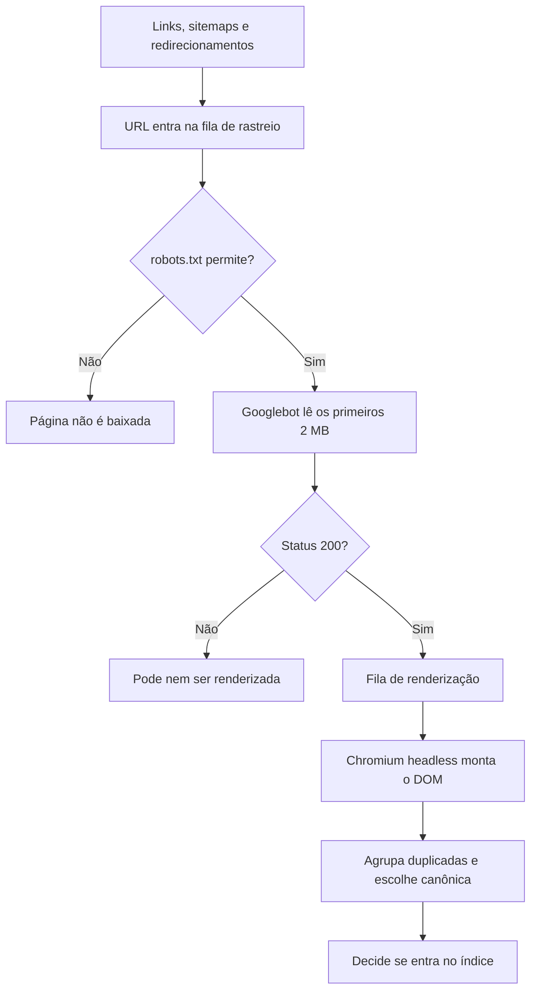

#### Onde cada etapa aparece no Search Console

| Etapa | Onde olhar | O que procurar |
|---|---|---|
| Descoberta | Sitemaps e relatório de indexação de páginas | URLs conhecidas e nunca rastreadas, com data de último rastreamento vazia |
| Rastreio | Estatísticas de rastreamento, em Configurações | Respostas, tipo de arquivo, finalidade, tipo de Googlebot e status do host |
| Renderização | Inspeção de URL, com "Testar o URL publicado" | Recursos carregados, console de JavaScript, DOM renderizado e captura de tela |
| Indexação | Indexação de páginas e inspeção de URL | Motivo de exclusão, canônica declarada e canônica selecionada pelo Google |

As estatísticas de rastreamento são o mais perto de um log que o Search Console oferece. Elas quebram os pedidos por resposta (200, 301, 404, 5xx e outros), por tipo de arquivo (HTML, imagem, JavaScript, CSS, JSON, PDF), por finalidade (descoberta de URL nova ou atualização de URL conhecida) e por tipo de Googlebot (smartphone, computador, imagem, carregamento de recurso da página). O bloco de status do host olha os últimos 90 dias e separa falha ao buscar o robots.txt, falha de DNS e falha de conexão com o servidor.

#### Os motivos de exclusão que mais aparecem

Os nomes abaixo são os do relatório em português.

| Motivo | O que significa | Primeira hipótese |
|---|---|---|
| Detectada, mas não indexada no momento | O Google conhece a URL e ainda não rastreou | Rastrear poderia sobrecarregar o site, ou há URLs demais de baixo valor competindo pela fila |
| Rastreada, mas ainda não indexada | Baixou, avaliou e deixou de fora por enquanto | Conteúdo fino, páginas quase iguais, valor baixo para quem busca |
| Cópia, o Google e o usuário não escolheram a mesma página canônica | A canonical declarada foi ignorada | Sinais contraditórios entre canonical, links, sitemap e redirecionamento |
| Cópia sem página canônica selecionada pelo usuário | Duplicada e sem canonical | Parâmetros, barra final, http e https |
| Página alternativa com tag canônica adequada | Aponta para outra canônica, e o Google aceitou | Na maioria das vezes, comportamento esperado |
| URL marcado como "noindex" | A página pediu para ficar fora | Confirmar se o `noindex` foi intencional |
| Erro soft 404 | Responde 200, mas parece erro ou página vazia | Template de "não encontrado" servido com 200 |

O primeiro trabalho com esse relatório é separar exclusão correta de exclusão problemática. Página de filtro com canonical para a categoria deve estar fora. Artigo com tráfego potencial em "Rastreada, mas ainda não indexada" é problema.

O fluxograma separa os dois motivos que mais se confundem e a pergunta que cada um pede.

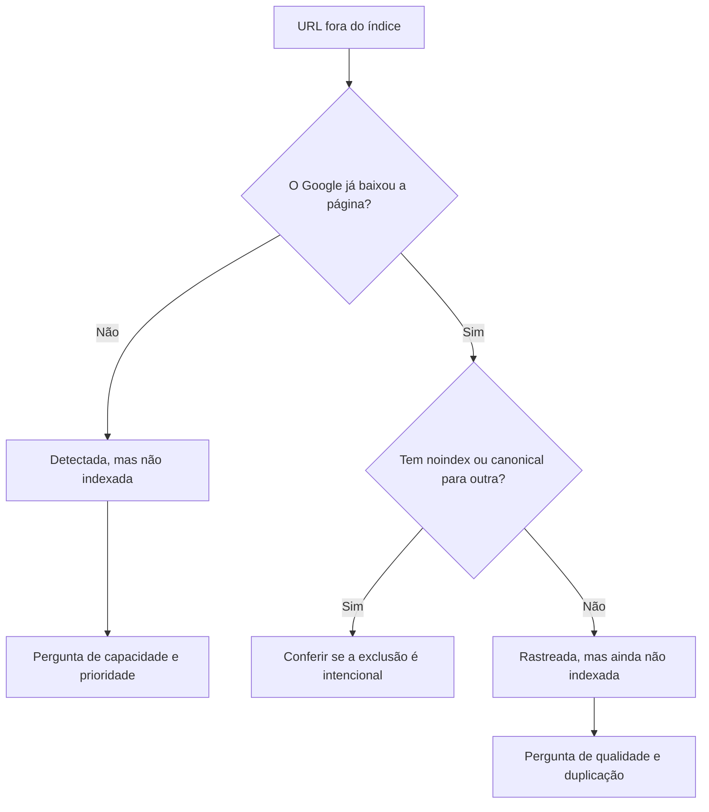

### Exemplo guiado

O objetivo é comparar o HTML de origem com o que o Google renderizou em cinco URLs do seu site.

1. Escolha cinco URLs com perfis diferentes. Home, uma categoria, um artigo antigo, um artigo recente e uma página que dependa de JavaScript, se houver.
2. Baixe o HTML de origem com `curl`, com pausa e user-agent descritivo.

```bash
UA="auditoria-estudo/1.0 (+mailto:voce@exemplo.com)"
i=0
for url in \
  https://www.seusite.com.br/ \
  https://www.seusite.com.br/categoria/ \
  https://www.seusite.com.br/blog/artigo-antigo/ ; do
  i=$((i+1))
  curl -s -A "$UA" "$url" -o "origem_$i.html"
  echo "$i $url $(wc -c < origem_$i.html) bytes"
  sleep 3
done
```

3. No Search Console, cole cada URL na inspeção, clique em "Testar o URL publicado" e depois em "Ver a página testada". Copie o HTML para `renderizado_1.html`, `renderizado_2.html` e assim por diante. Se você não tem o Search Console do site, o teste de pesquisa aprimorada mostra a mesma visão do Googlebot para qualquer URL pública.
4. Rode o comparador abaixo em cada par. Ele remove scripts e estilos, conta palavras do conteúdo principal e lista os links que só existem depois do JavaScript.

```python
"""Compara o HTML de origem com o renderizado.
Uso: python comparar_html.py origem_1.html renderizado_1.html"""
import sys

from bs4 import BeautifulSoup


def resumo(caminho):
    soup = BeautifulSoup(open(caminho, encoding="utf-8").read(), "html.parser")
    for tag in soup(["script", "style", "noscript", "template"]):
        tag.decompose()
    principal = soup.find("main") or soup.body or soup
    links = {a["href"] for a in soup.find_all("a", href=True)
             if not a["href"].startswith(("#", "javascript:"))}
    canon = soup.find("link", rel="canonical")
    return {
        "title": soup.title.get_text(strip=True) if soup.title else "",
        "canonical": canon.get("href", "") if canon else "",
        "h1": [h.get_text(strip=True) for h in soup.find_all("h1")],
        "palavras_no_principal": len(principal.get_text(" ", strip=True).split()),
        "links": links,
    }


a, b = resumo(sys.argv[1]), resumo(sys.argv[2])
for campo in ("title", "canonical", "h1", "palavras_no_principal"):
    marca = "  " if a[campo] == b[campo] else "!!"
    print(f"{marca} {campo:22} origem={a[campo]!r}  renderizado={b[campo]!r}")
print(f"   links                  origem={len(a['links'])}  renderizado={len(b['links'])}")
for href in sorted(b["links"] - a["links"])[:20]:
    print(f"   só no renderizado: {href}")
```

5. Registre numa tabela, por URL, o que muda entre as duas versões. Title, canonical, H1, número de palavras e links. Diferença em canonical ou em `noindex` entre origem e renderizado é achado grave, porque o Google pode tomar a decisão olhando só a primeira versão.
6. Abra as estatísticas de rastreamento e anote o tipo de arquivo mais pedido e a proporção de respostas que não são 200. Se JavaScript e JSON somam mais pedidos que HTML, o Googlebot está gastando boa parte do rastreio para montar páginas.

### Erros comuns

- **Pedir indexação em massa.** A inspeção tem limite diário por propriedade, e o pedido coloca a URL na fila sem mudar a avaliação dela. O jeito certo é descobrir por que a página ficou de fora e corrigir a causa.
- **Tratar todo motivo de exclusão como erro.** Página alternativa com canonical correta e filtro com `noindex` devem estar fora. Abra três exemplos de cada motivo e decida se a exclusão está certa antes de abrir um ticket.
- **Confiar só no `curl` para dizer o que o Google vê.** O `curl` mostra a origem. O Google indexa o renderizado. Compare os dois sempre que o site usar JavaScript para montar conteúdo.
- **Ler "Detectada" como "Rastreada".** Na primeira, o Google nem baixou a página, e a pergunta é de capacidade e prioridade. Na segunda, ele baixou e não gostou, e a pergunta é de qualidade.
- **Esquecer o tamanho do HTML.** Página que injeta megabytes de JSON inline antes do conteúdo pode passar dos 2 MB lidos pelo Googlebot. O texto que vem depois do corte não existe para ele.

### Na prática

"Detectada, mas não indexada no momento" em massa costuma ser sinal de qualidade ou de cota, raramente de erro técnico. O exemplo a seguir é hipotético e serve para mostrar o raciocínio.

Imagine um portal de imóveis que gera uma página para cada combinação de bairro, tipo de imóvel e faixa de preço. São 40 mil URLs, e 32 mil aparecem como "Detectada, mas não indexada no momento". A reação comum é pedir indexação, enviar um sitemap novo e cobrar o time de desenvolvimento.

A pergunta que muda o projeto vem antes. Essas 32 mil páginas merecem estar no índice? Se a maioria tem dois ou três anúncios, título gerado e texto igual ao da página vizinha, o Google está fazendo exatamente o que deveria. Ele viu a quantidade, estimou o valor e decidiu não gastar rastreio. Pedir indexação de 10 mil dessas URLs só repete a pergunta para quem já respondeu.

O teste que separa as hipóteses é olhar as páginas do mesmo template que estão indexadas. Se as indexadas têm mais anúncios e mais busca associada, a causa é valor. A saída é consolidar combinações pequenas, tirar do sitemap e dos links internos o que não tem demanda e deixar a cota para as páginas que têm. Se as indexadas e as excluídas são iguais em conteúdo e a diferença está no tempo de resposta ou nos erros 5xx das estatísticas de rastreamento, aí a causa é capacidade do servidor.

### Resumo

- Descoberta, rastreio, renderização e indexação são etapas separadas, e cada uma falha por um motivo diferente.
- O Googlebot lê os primeiros 2 MB do HTML sem compressão e só segue links feitos com `<a href>`.
- "Detectada" é problema de fila e prioridade. "Rastreada" é decisão de qualidade.
- Compare sempre o HTML de origem com o renderizado antes de concluir o que o Google viu.
- Antes de pedir indexação, pergunte se a página merece estar no índice.

### Para ir além

- Em [vídeos](videos.md), a playlist **How Search Works** dá o mapa completo em episódios curtos. Assista antes de reler a seção de renderização.
- Em [vídeos](videos.md), **How to read the Indexing Report** mostra cada status do relatório de indexação na tela. Bom para fazer junto com o exercício de prática 2.
- Em [leituras](leituras.md), o **Relatório de indexação de páginas** da Ajuda do Search Console explica cada motivo de exclusão e o que fazer. Deixe aberto enquanto analisa o seu site.
- Em [leituras](leituras.md), a série **Assunto em dezembro** do blog do Google aprofunda custo de rastreio e cache de recursos.

## Aula 2. robots.txt, meta robots e sitemaps

### A ideia central

Três ferramentas, três funções. O robots.txt controla rastreio, ou seja, o que o robô pode baixar. A meta robots e o cabeçalho `X-Robots-Tag` controlam indexação, ou seja, o que pode aparecer na busca. O sitemap sugere o que vale a pena rastrear. Quase todo acidente grave nessa área vem de usar uma ferramenta no lugar da outra.

O caso mais comum é bloquear no robots.txt uma página que se queria tirar do índice. O robô para de baixar a página, deixa de ver o `noindex` que estava nela e a URL pode continuar no índice, sem descrição, por tempo indeterminado. A regra mental é esta. Para tirar do índice, deixe rastrear e diga `noindex`. Para economizar rastreio, bloqueie no robots.txt páginas que nunca precisaram estar no índice.

### Como funciona

#### robots.txt segundo a RFC 9309

O robots.txt virou padrão da IETF em setembro de 2022, como RFC 9309 (Robots Exclusion Protocol). O Google publica como interpreta a especificação, e os detalhes abaixo vêm das duas fontes.

- **Um arquivo por origem.** O arquivo fica em `/robots.txt` na raiz e vale só para aquele protocolo, host e porta. `https://www.exemplo.com.br/robots.txt` não vale para `https://loja.exemplo.com.br` nem para `http://www.exemplo.com.br`.
- **Campos aceitos pelo Google.** `user-agent`, `allow`, `disallow` e `sitemap`. O Google não aceita `crawl-delay`. Outros buscadores podem aceitar.
- **Maiúsculas.** O nome do campo não diferencia maiúsculas. O caminho diferencia. `Disallow: /fish` não bloqueia `/Fish.asp`.
- **Prefixo.** A regra casa com o começo do caminho. `Disallow: /busca` bloqueia `/busca?q=x` e também `/buscador-de-cep`.
- **Curingas.** `*` casa com qualquer sequência de caracteres. `$` marca o fim da URL. `Disallow: /*.pdf$` bloqueia tudo que termina em `.pdf`.
- **Precedência.** Vale a regra mais específica, a que tem o caminho mais longo. Em empate entre `allow` e `disallow`, o Google usa a menos restritiva, que é o `allow`.
- **Grupos.** Cada robô obedece só ao grupo mais específico para o nome dele. Se existe um grupo `User-agent: Googlebot`, o Googlebot ignora o grupo `User-agent: *` inteiro. Os dois não se somam.
- **Tamanho.** O Google lê até 500 KiB. O que passar disso é ignorado.
- **Cache.** O Google costuma guardar o arquivo por até 24 horas. Uma mudança no robots.txt pode levar um dia para valer.
- **Erros.** Um 4xx no robots.txt (menos o 429) é tratado como se não houvesse arquivo, então tudo fica liberado. Um 5xx faz o Google parar de rastrear o site nas primeiras 12 horas. Até 30 dias, ele usa a última cópia boa. Depois disso, se o site estiver no ar, age como se não houvesse restrição.
- **Não é segurança.** A própria RFC diz que as regras não são forma de autorização de acesso. Qualquer pessoa lê o arquivo, e um robô mal-intencionado ignora o que está nele. Área privada se protege com login.

#### Um exemplo comentado

```text
# Vale para todos os robôs que não têm grupo próprio
User-agent: *
Disallow: /busca
Disallow: /*?filtro=
Allow: /busca/ajuda

# O Googlebot usa SÓ este grupo e ignora o de cima
User-agent: Googlebot
Disallow: /rascunhos/

Sitemap: https://www.exemplo.com.br/sitemap_index.xml
```

Esse arquivo tem duas armadilhas. O Googlebot fica livre para rastrear `/busca` e os filtros, porque o grupo dele não repete as regras gerais. E `Disallow: /busca` bloqueia, para os outros robôs, a página `/buscador-de-cep`, que ninguém queria bloquear. A forma segura de testar é com a biblioteca `protego`, que segue a especificação do Google.

O fluxograma mostra como o Googlebot decide se pode baixar um caminho.

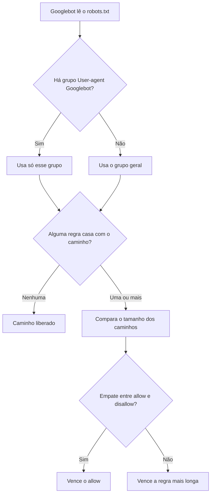

```python
from protego import Protego

regras = open("robots.txt", encoding="utf-8").read()
rp = Protego.parse(regras)
testes = [
    ("Googlebot", "https://www.exemplo.com.br/busca?q=tenis"),
    ("Googlebot", "https://www.exemplo.com.br/rascunhos/post-1"),
    ("Bingbot", "https://www.exemplo.com.br/busca?q=tenis"),
    ("Bingbot", "https://www.exemplo.com.br/busca/ajuda"),
    ("Bingbot", "https://www.exemplo.com.br/buscador-de-cep"),
    ("Bingbot", "https://www.exemplo.com.br/tenis?filtro=azul"),
]
for ua, url in testes:
    print(f"{ua:10} {'LIBERADA' if rp.can_fetch(url, ua) else 'BLOQUEADA':10} {url}")
```

Com o arquivo acima, a saída mostra `/busca?q=tenis` liberada para o Googlebot e bloqueada para o Bingbot, e `/buscador-de-cep` bloqueada para o Bingbot. Rode sempre esse tipo de teste antes de publicar uma mudança.

#### Meta robots e X-Robots-Tag

A meta robots vai no `<head>` do HTML. O `X-Robots-Tag` vai no cabeçalho HTTP e serve também para PDF, imagem e qualquer arquivo sem HTML.

```html
<meta name="robots" content="noindex, follow">
<meta name="googlebot" content="max-snippet:120, max-image-preview:large">
```

```text
HTTP/2 200
content-type: application/pdf
x-robots-tag: noindex
```

| Diretiva | Efeito no Google |
|---|---|
| `noindex` | Não mostra a página nos resultados |
| `nofollow` | Não segue os links da página |
| `none` | Igual a `noindex, nofollow` |
| `nosnippet` | Sem trecho de texto nem prévia de vídeo no resultado |
| `max-snippet:[n]` | Limita o trecho a n caracteres |
| `max-image-preview:[none, standard, large]` | Tamanho máximo da prévia de imagem |
| `noimageindex` | Não indexa as imagens da página |
| `unavailable_after:[data]` | Tira a página dos resultados depois da data |
| `noarchive` | Listada pelo Google entre as regras que ele não usa mais |

Quando há regras em conflito, vale a mais restritiva. `nosnippet` vence `max-snippet:50`. E toda essa lista só funciona se o robô puder baixar a página. URL bloqueada no robots.txt tem as regras de indexação ignoradas, porque o robô nunca chega a lê-las.

#### Sitemaps

O sitemap XML é uma lista de URLs que você declara como importantes. Os limites são de 50 mil URLs e 50 MB sem compressão por arquivo. Acima disso, divida em vários arquivos e liste todos num sitemap índice. As regras que o Google documenta são poucas e diretas.

- URLs absolutas e completas, com protocolo. Arquivo em UTF-8.
- O Google ignora `<priority>` e `<changefreq>`.
- O Google usa o `<lastmod>` quando ele é consistente e verificável. `lastmod` honesto é a data da última mudança relevante na página. Atualizar todas as datas a cada deploy ensina o Google a ignorar o campo.
- Sem envio pelo Search Console, um sitemap vale só para a pasta onde está e para as de baixo. Por isso a raiz é o lugar recomendado.
- Envio pelo relatório de Sitemaps do Search Console, pela API do Search Console ou por uma linha `Sitemap:` no robots.txt. O endpoint de "ping" de sitemap foi desativado pelo Google em 2023 e hoje não faz nada.
- Enviar o sitemap é uma dica. O Google não promete rastrear tudo o que está nele.

Existem extensões para imagem e para notícias. O sitemap de notícias serve para sites que publicam no Google Notícias e deve listar só artigos recentes. O de imagem ajuda a descobrir imagens que o robô não acharia pelo HTML, como as carregadas por JavaScript.

Um sitemap deve conter só URLs que respondem 200, são indexáveis e são a própria canônica. URL com `noindex`, redirecionamento ou 404 dentro do sitemap é sinal contraditório e polui o relatório.

O fluxograma liga cada objetivo à ferramenta certa e mostra onde o bloqueio anula o noindex.

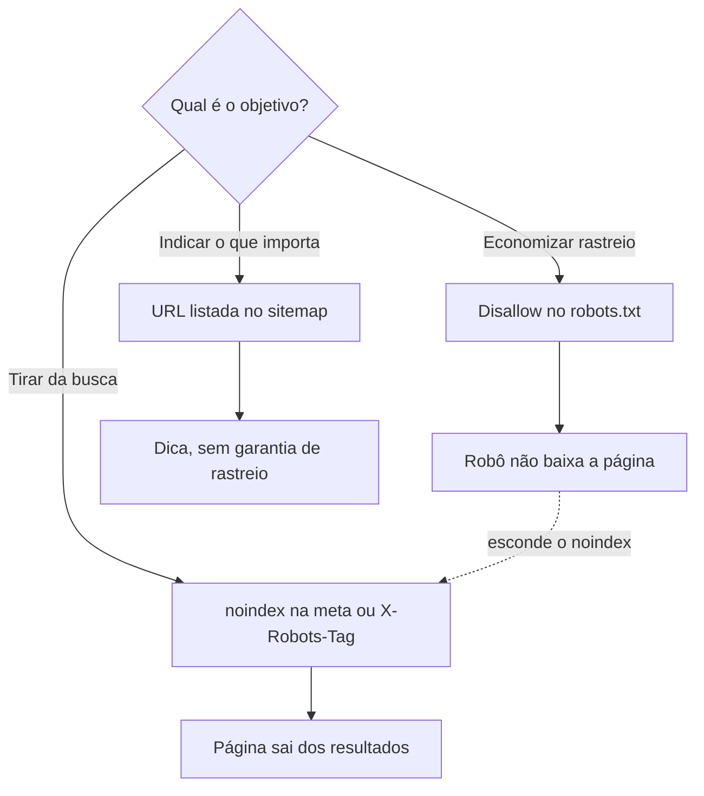

### Exemplo guiado

O script abaixo lê um sitemap ou um sitemap índice, pede cada URL sem seguir redirecionamento e registra status, meta robots e `X-Robots-Tag`. Ele pausa 3 segundos entre pedidos e para no primeiro 429.

```python
"""Lê o sitemap (ou o índice), pede cada URL e registra status e regras de indexação.
Uso: python sitemap_check.py https://www.seusite.com.br/sitemap.xml"""
import csv
import gzip
import sys
import time
import xml.etree.ElementTree as ET

import requests
from bs4 import BeautifulSoup

UA = "auditoria-estudo/1.0 (+mailto:voce@exemplo.com)"
PAUSA = 3
NS = {"sm": "http://www.sitemaps.org/schemas/sitemap/0.9"}

s = requests.Session()
s.headers["User-Agent"] = UA


class Parar(Exception):
    pass


def pedir(url):
    time.sleep(PAUSA)
    r = s.get(url, timeout=20, allow_redirects=False)
    if r.status_code == 429:
        raise Parar(url)
    return r


def urls_do_sitemap(url):
    conteudo = pedir(url).content
    if url.endswith(".gz"):
        conteudo = gzip.decompress(conteudo)
    raiz = ET.fromstring(conteudo)
    if raiz.tag.endswith("sitemapindex"):
        for loc in raiz.findall("sm:sitemap/sm:loc", NS):
            yield from urls_do_sitemap(loc.text.strip())
    else:
        for loc in raiz.findall("sm:url/sm:loc", NS):
            yield loc.text.strip()


linhas = []
try:
    for url in urls_do_sitemap(sys.argv[1]):
        r = pedir(url)
        meta = ""
        if r.status_code == 200 and "html" in r.headers.get("Content-Type", ""):
            tag = BeautifulSoup(r.text, "html.parser").find("meta", attrs={"name": "robots"})
            meta = tag.get("content", "") if tag else ""
        linhas.append({"url": url, "status": r.status_code,
                       "destino": r.headers.get("Location", ""),
                       "meta_robots": meta,
                       "x_robots": r.headers.get("X-Robots-Tag", "")})
except Parar as e:
    print(f"429 em {e}. Parei. Retome depois.", file=sys.stderr)

with open("sitemap_check.csv", "w", newline="", encoding="utf-8") as f:
    w = csv.DictWriter(f, fieldnames=["url", "status", "destino", "meta_robots", "x_robots"])
    w.writeheader()
    w.writerows(linhas)

problemas = [l for l in linhas if l["status"] != 200
             or "noindex" in (l["meta_robots"] + l["x_robots"]).lower()]
print(f"{len(linhas)} URLs checadas, {len(problemas)} com problema (não 200 ou noindex)")
```

Com 3 segundos de pausa, mil URLs levam perto de uma hora. Rode em segundo plano e não reduza a pausa para ganhar tempo.

O segundo passo mede a cobertura. Exporte as páginas do relatório de desempenho do Search Console (aba Páginas) para `gsc_paginas.csv` e cruze com o resultado.

```python
import pandas as pd

def normalizar(url):
    return str(url).strip().replace("\n", "").replace(" ", "%20").rstrip("/").lower()

sm = pd.read_csv("sitemap_check.csv")
gsc = pd.read_csv("gsc_paginas.csv")              # colunas da exportação do Search Console
gsc = gsc.rename(columns={gsc.columns[0]: "url"})  # a primeira coluna é a página

sm["chave"] = sm["url"].map(normalizar)
gsc["chave"] = gsc["url"].map(normalizar)

so_gsc = gsc[~gsc["chave"].isin(sm["chave"])]
so_sm = sm[~sm["chave"].isin(gsc["chave"])]
print(f"Páginas com clique ou impressão fora do sitemap: {len(so_gsc)}")
print(f"URLs do sitemap sem nenhuma impressão no período: {len(so_sm)}")
so_gsc.head(30).to_csv("fora_do_sitemap.csv", index=False)
```

A normalização em minúsculas é uma simplificação para o cruzamento. Lembre que caminhos de URL diferenciam maiúsculas, então confira à mão os casos que só casam por causa dela.

### Erros comuns

- **Bloquear no robots.txt para desindexar.** O robô não vê o `noindex` e a URL pode ficar no índice sem descrição. Deixe rastrear, aplique `noindex` e só bloqueie depois que a página sair, se ainda fizer sentido.
- **Criar um grupo para o Googlebot e esquecer as regras gerais.** O Googlebot passa a ignorar todo o grupo `*`. Repita no grupo dele as regras que também valem para ele.
- **Regra curta demais.** `Disallow: /p` bloqueia `/produtos`, `/promocoes` e `/politica-de-privacidade`. Termine o caminho com barra ou use `$` quando quiser casar exatamente.
- **Robots.txt de homologação em produção.** Um `Disallow: /` que veio do ambiente de teste derruba o rastreio do site inteiro. Coloque um teste automático no deploy que falha se o robots.txt de produção bloquear a raiz.
- **Sitemap como retrato do site.** O sitemap é o que o site declara. URLs importantes podem estar fora dele, e URLs mortas podem estar dentro.
- **`lastmod` com a data do deploy em todas as URLs.** O Google deixa de confiar no campo e perde um sinal útil para decidir o que rastrear de novo.

### Na prática

Este é o caso 2 da pasta [casos](../../casos/02-sitemap-que-escondia-o-site.md). Num site de saúde, era preciso dizer, com segurança, quantas páginas existiam e quantas respondiam. O número iria para um documento técnico que podia ser contestado.

O sitemap listava pouco mais de mil endereços, espalhados por mais de cem arquivos. A primeira hipótese foi a mais natural. O sitemap representa o site, então basta varrer o que está nele.

O teste que derrubou a hipótese foi simples. Cruzar o sitemap com as páginas que recebiam tráfego no Search Console, exatamente o segundo script do exemplo guiado. Das mil páginas com mais tráfego orgânico, 918 não estavam no sitemap. Uma seção inteira, com algumas das páginas mais visitadas, tinha ficado de fora. Uma varredura só pelo sitemap teria errado justamente no ponto que mais importava.

A varredura final usou a união de sitemap e páginas do Search Console, sem duplicatas, num total perto de 2 mil endereços. Cerca de 1.770 responderam 200 e 220 deram 404. Um detalhe de execução custou tempo. Algumas URLs exportadas do Search Console vinham com espaços e quebras de linha no meio, e só casaram depois de normalizadas. Por isso a função `normalizar` do exemplo existe.

A regra que fica serve para qualquer auditoria. Toda afirmação sobre "o site todo" precisa de pelo menos duas fontes independentes, e de preferência três, com sitemap, Search Console e crawl.

### Resumo

- robots.txt controla rastreio, meta robots e `X-Robots-Tag` controlam indexação, sitemap sugere prioridade.
- Página bloqueada no robots.txt não tem o `noindex` lido.
- No robots.txt vale a regra mais longa, empate favorece o `allow` e grupos de robôs não se somam.
- Sitemap tem limite de 50 mil URLs e 50 MB sem compressão, e o Google só usa `lastmod` confiável.
- Cobertura real se mede com a união de sitemap, Search Console e crawl.

### Para ir além

- Em [vídeos](videos.md), **What can you actually put in a robots.txt?** é um episódio de 2026 sobre regras válidas e erros comuns. Assista antes de escrever qualquer regra nova.
- Em [leituras](leituras.md), **Como o Google interpreta a especificação de robots.txt** tem a tabela de precedência e o tratamento de erros HTTP. É a referência para o exercício de fixação 2.
- Em [leituras](leituras.md), **Especificações de metatags robots** lista todas as diretivas aceitas e as que o Google já não usa.
- Em [vídeos](videos.md), **Do sitemaps still matter?** ajuda a decidir quando o sitemap faz diferença no seu site.

## Aula 3. Canonical, duplicação, parâmetros e paginação

### A ideia central

O mesmo conteúdo em várias URLs divide links, divide sinais e gasta rastreio. O Google resolve isso agrupando as URLs duplicadas e escolhendo uma delas como canônica, a representante do grupo. As outras ficam fora dos resultados.

Você pode sugerir qual URL deve ser a canônica. A documentação do Google é explícita ao dizer que essa indicação é uma dica, e que o Google pode escolher outra página por vários motivos. O modelo mental certo é de votação. Canonical, redirecionamento, sitemap, links internos e protocolo são votos. Quando todos apontam para a mesma URL, o Google quase sempre concorda. Quando se contradizem, ele decide sozinho.

### Como funciona

#### De onde vem a duplicação

| Origem | Exemplo | Correção típica |
|---|---|---|
| Protocolo | `http://` e `https://` | 301 para https |
| Host | `exemplo.com.br` e `www.exemplo.com.br` | 301 para uma versão só |
| Barra final | `/produto` e `/produto/` | 301 para uma versão, links internos na mesma |
| Maiúsculas | `/Produto` e `/produto` | 301 para minúsculas, ou 404 para a variante |
| Rastreamento | `?utm_source=newsletter` | Canonical para a URL limpa |
| Ordenação e filtro | `?ordem=preco&cor=azul` | Canonical para a categoria, e rastreio contido |
| Sessão | `?sessionid=abc123` | Tirar o identificador da URL |
| Ambiente | `homolog.exemplo.com.br` aberto | Login no ambiente de teste |
| Região | Mesmo texto em `/br/` e `/pt/` | Hreflang e canonical por versão (aula 9) |

O Google lembra que alguma duplicação é normal em qualquer site e não viola nenhuma política. O objetivo é consolidar sinais, e ninguém é punido por ter variantes.

#### Os sinais e o peso de cada um

Segundo a documentação de consolidação de URLs, os métodos podem ser combinados, e somar sinais na mesma direção aumenta a chance de o Google aceitar a sua escolha.

| Método | Força do sinal | Quando usar |
|---|---|---|
| Redirecionamento 301 ou 308 | Forte | A URL antiga não precisa mais existir para o usuário |
| `rel="canonical"` no `<head>` | Forte | As duas URLs precisam continuar acessíveis, como filtro e UTM |
| `rel="canonical"` no cabeçalho HTTP | Forte | Arquivos sem HTML, como PDF |
| Inclusão no sitemap | Fraco | Sempre, listando só as canônicas |

Além desses, o Google cita entre os fatores se a página é servida em https ou http. Links internos também contam como sinal na prática. Se o menu do site aponta para a versão sem barra e a canonical aponta para a versão com barra, você está votando nas duas.

O fluxograma mostra a escolha da canônica como uma votação entre sinais.

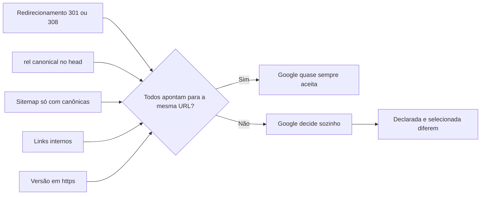

#### Regras de implementação

- Use URL absoluta, com protocolo. URL relativa funciona, mas o Google desaconselha porque costuma quebrar com o tempo.
- O `<link rel="canonical">` só é aceito dentro do `<head>`. No `<body>` ele é ignorado. Um script de terceiro que fecha o `<head>` antes da hora, ou um elemento inválido dentro dele, pode empurrar a canonical para o corpo da página.
- Escolha um método por página. Canonical no HTML apontando para A e no cabeçalho HTTP apontando para B é contradição.
- Não use robots.txt para canonizar. A URL bloqueada não é lida, e os sinais dela não são consolidados.
- Não use `noindex` para escolher a canônica dentro do mesmo site. O `noindex` tira a página da busca e não transfere nada.
- Não use a ferramenta de remoção de URLs para canonizar. Ela esconde todas as versões da URL.
- Não aponte a canonical para um fragmento (`#secao`).

#### Quando o Google ignora a canonical declarada

Os motivos mais frequentes aparecem sempre que se compara a canônica declarada com a escolhida.

1. A canonical aponta para uma página com conteúdo diferente. Página 2 de uma categoria com canonical para a página 1 é o exemplo clássico.
2. A canonical aponta para uma URL que redireciona, dá 404 ou tem `noindex`.
3. Os links internos e o sitemap apontam para outra versão.
4. A página tem duas tags canonical, com valores diferentes, uma do tema e outra de um plugin.
5. A canonical do HTML de origem é diferente da canonical que o JavaScript escreve depois.

Para ver a decisão do Google, use a inspeção de URL do Search Console. O relatório mostra o "URL canônico declarado pelo usuário" e o "URL canônico selecionado pelo Google". A canônica escolhida só aparece nos dados indexados. O teste em tempo real não consegue prever qual versão será a canônica, porque a escolha acontece na indexação.

#### Parâmetros e navegação facetada

Filtros de loja (cor, tamanho, marca, preço) combinados entre si geram milhões de URLs a partir de algumas centenas de produtos. É o caso mais comum de espaço de URLs quase infinito. O guia do Google sobre navegação facetada parte de uma pergunta. Essas combinações precisam aparecer na busca?

- Se não precisam, o guia recomenda bloquear o rastreio delas no robots.txt e manter uma página de listagem sem filtro. Filtros que vivem depois do `#` também não geram rastreio, porque o Google em geral ignora fragmentos. Canonical e `nofollow` aparecem no guia como opções mais fracas no longo prazo.
- Se precisam, use `&` como separador de parâmetros, mantenha os filtros sempre na mesma ordem e devolva 404 para combinações sem resultado, filtros repetidos ou combinações sem sentido.
- Entre os dois extremos, as combinações com demanda real, como "tênis de corrida masculino", merecem virar páginas de verdade, com URL limpa, título próprio, link interno e lugar no sitemap.
- Parâmetros de rastreamento, como UTM, devem ter canonical para a URL limpa. Melhor ainda é não usá-los em links internos.

O fluxograma resume a decisão para cada combinação de filtros.

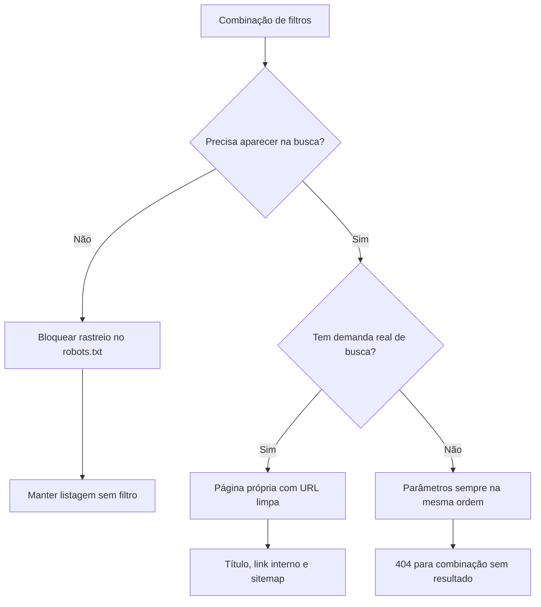

#### Paginação

O Google não usa mais `rel="next"` e `rel="prev"`. Outros buscadores podem usar. As boas práticas atuais são estas.

- Cada página da sequência tem URL própria, como `?page=2`. Número de página em fragmento (`#page=2`) é ignorado.
- Cada página tem canonical para si mesma. Não use a primeira página como canônica da sequência inteira, porque o conteúdo é diferente.
- Cada página liga para a seguinte com `<a href>`. Ligar todas de volta para a primeira ajuda a indicar o ponto de partida.
- Botão "carregar mais" e rolagem infinita só funcionam para o Google se houver também links rastreáveis para as páginas seguintes. O robô não clica nem rola.

#### Espaço de URLs infinito

Rota parametrizada é qualquer rota em que um pedaço da URL vira consulta, como `/produto/{slug}`, `/cidade/{nome}` ou `/busca/{termo}`. Se a aplicação devolve 200 para qualquer texto nesse pedaço, existem infinitas URLs válidas. O teste é inventar um slug que não existe e olhar status, title e meta robots juntos. O certo é 404. Um 200 indexável é achado grave.

### Exemplo guiado

O script abaixo testa as variantes de uma URL (http, com e sem www, barra trocada, maiúsculas, UTM) e um slug inventado na mesma rota. Para cada uma, mostra a cadeia de redirecionamento, o status final, a canonical, a meta robots e o title.

```python
"""Testa variantes de uma URL e um slug inventado.
Uso: python variantes.py https://www.seusite.com.br/blog/meu-artigo/"""
import sys
import time
from urllib.parse import urlsplit, urlunsplit

import requests
from bs4 import BeautifulSoup

UA = "auditoria-estudo/1.0 (+mailto:voce@exemplo.com)"
PAUSA = 3
s = requests.Session()
s.headers["User-Agent"] = UA

base = urlsplit(sys.argv[1])
host_sem_www = base.netloc.removeprefix("www.")
caminho = base.path or "/"
outra_barra = caminho.rstrip("/") if caminho.endswith("/") and caminho != "/" else caminho + "/"
pai = caminho.rstrip("/").rsplit("/", 1)[0]

variantes = {
    "original": base.geturl(),
    "http": urlunsplit(("http", base.netloc, caminho, "", "")),
    "sem www": urlunsplit(("https", host_sem_www, caminho, "", "")),
    "com www": urlunsplit(("https", "www." + host_sem_www, caminho, "", "")),
    "barra trocada": urlunsplit(("https", base.netloc, outra_barra, "", "")),
    "maiúsculas": urlunsplit(("https", base.netloc, caminho.upper(), "", "")),
    "utm": urlunsplit(("https", base.netloc, caminho, "utm_source=teste", "")),
    "slug inventado": urlunsplit(("https", base.netloc, pai + "/slug-que-nao-existe-48213/", "", "")),
}

for nome, url in variantes.items():
    time.sleep(PAUSA)
    try:
        r = s.get(url, timeout=20)  # segue redirecionamentos e guarda o histórico
    except requests.RequestException as erro:
        print(f"{nome:15} ERRO {erro.__class__.__name__}")
        continue
    if r.status_code == 429 or any(h.status_code == 429 for h in r.history):
        sys.exit("429 recebido. Parei.")
    cadeia = " > ".join(str(h.status_code) for h in r.history) or "-"
    soup = BeautifulSoup(r.text, "html.parser")
    canon = soup.find("link", rel="canonical")
    meta = soup.find("meta", attrs={"name": "robots"})
    titulo = soup.title.get_text(strip=True)[:50] if soup.title else ""
    print(f"{nome:15} saltos={cadeia:10} final={r.status_code} {r.url}")
    print(f"{'':15} canonical={canon.get('href') if canon else '(nenhuma)'}"
          f"  robots={meta.get('content') if meta else '(nenhuma)'}  title={titulo!r}")
```

Rodando contra `https://www.python.org/about/`, as variantes http, sem www e sem barra final voltam com um 301 para a URL original. A versão em maiúsculas e o slug inventado respondem 404. E as duas páginas de erro têm title. Esse detalhe importa. Quem testa só o title conclui que a rota existe. Status, meta robots e canonical precisam ser lidos juntos.

Para uma checagem rápida no terminal, `curl -sIL` mostra cada salto com status e destino.

```bash
UA="auditoria-estudo/1.0 (+mailto:voce@exemplo.com)"
curl -sIL -A "$UA" http://python.org/about | grep -iE "^HTTP|^location"
```

Monte uma tabela com cada variante, o que ela faz hoje e o que deveria fazer. Toda variante deveria redirecionar com 301 para a versão oficial, ou declarar canonical para ela, no caso de UTM e filtros.

### Erros comuns

- **Canonical da página 2 para a página 1.** O Google tende a ignorar, porque o conteúdo é diferente, e os produtos da página 2 perdem um caminho de descoberta. Cada página aponta para si mesma.
- **Canonical para URL que redireciona ou dá 404.** O sinal se contradiz e o Google escolhe sozinho. Toda canonical precisa apontar para uma URL que responde 200 e é indexável.
- **Duas tags canonical na mesma página.** Comum quando tema e plugin de SEO escrevem a tag ao mesmo tempo. Conte as tags com parser em todos os templates e deixe uma só.
- **Links internos para a versão não canônica.** O menu aponta para `/produto`, a canonical diz `/produto/`. Corrija os links na origem, no template, em vez de depender da canonical.
- **Testar só o title de uma rota inventada.** Página de erro também tem title. Leia status, meta robots e canonical antes de afirmar que uma rota existe ou foi canonizada.
- **Usar `noindex` em filtros que deveriam consolidar sinais.** O `noindex` não transfere nada para a categoria. Se a ideia é consolidar, use canonical. Se a ideia é economizar rastreio, contenha o rastreio.

### Na prática

Esta lição vem do caso 4 da pasta [casos](../../casos/04-nove-afirmacoes-erradas.md), uma auditoria entregue como backlog de 32 itens num site de entretenimento. Na revisão, cada item foi testado de novo, direto na rota, sem confiar na evidência original.

Dois achados ligam direto a esta aula. O primeiro foi um erro da própria auditoria. Rotas que davam 404 tinham sido descritas como canonizadas, porque só o title tinha sido conferido, e a página de erro também tinha title. Foi exatamente o que o script do exemplo guiado mostrou no python.org.

O segundo foi o problema mais grave do site, e ele não aparecia em nenhuma versão anterior do relatório. Uma rota parametrizada devolvia 200, indexável, para qualquer texto colocado na URL, com title gerado a partir do próprio texto. `/rota/{qualquer-coisa}` virava uma página nova. Nenhuma ferramenta tinha apontado, porque nenhuma ferramenta inventa URLs. O crawler só segue links que existem.

O raciocínio que achou o problema é replicável. Para cada rota com parâmetro, invente um valor absurdo e veja o que volta. Se volta 200, sem `noindex` e com canonical para si mesma, qualquer link externo com erro de digitação, qualquer robô que monte URLs e qualquer pessoa mal-intencionada podem criar páginas no seu índice. A correção é a aplicação devolver 404 quando o slug não existe no banco.

### Resumo

- Canonical é uma dica forte, e o Google decide quando os sinais se contradizem.
- Redirecionamento, canonical, sitemap, links internos e protocolo devem apontar para a mesma URL.
- A canonical só vale no `<head>`, com URL absoluta, e nunca deve apontar para redirecionamento, 404 ou `noindex`.
- Paginação sem `rel=next`, com URL própria, canonical para si mesma e links `<a href>` entre as páginas.
- Teste um slug inventado em toda rota parametrizada e leia status, meta robots e canonical juntos.

### Para ir além

- Em [vídeos](videos.md), **Handling Dupes · Same Same or Different?** mostra como o time do Google escolhe a canônica entre páginas parecidas. Assista antes do desafio desta aula.
- Em [leituras](leituras.md), **Como especificar um canônico com rel="canonical" e outros métodos** compara os métodos e lista o que evitar.
- Em [leituras](leituras.md), **Gerenciar o rastreamento de URLs de navegação facetada** é a leitura obrigatória para quem trabalha com loja virtual.
- Em [vídeos](videos.md), **SEO For Paginations** da Aleyda Solis traz exemplos visuais de paginação bem e mal feita.

## Aula 4. Status HTTP, redirecionamentos e migração de site

### A ideia central

O código de status é a primeira coisa que o robô lê, antes de qualquer texto. Ele diz se a página existe, se mudou de lugar, se sumiu ou se o servidor está com problema. Um status errado anula todo o resto. Uma página excelente servida com 404 não existe para a busca, e uma página de erro servida com 200 vira lixo no índice.

Migração é o momento em que milhares de status mudam de uma vez. Troca de domínio, de CMS, de estrutura de URL ou de layout pode apagar anos de trabalho se o mapa de redirecionamento estiver errado. O modelo mental certo é tratar migração como projeto com mapa, teste antes, monitoramento diário depois e plano de volta.

### Como funciona

#### O que o Google faz com cada status

| Status | Significado | Comportamento documentado do Google |
|---|---|---|
| 200 | OK | Segue para renderização e indexação |
| 301, 308 | Movido permanentemente | Sinal forte de que o destino deve ser a canônica |
| 302, 303, 307 | Movido temporariamente | Sinal fraco. A origem pode continuar nos resultados |
| 304 | Não modificado | Avisa que o conteúdo é o mesmo do último rastreio. Não muda a indexação |
| 404, 410 | Não encontrado, removido | Tratados da mesma forma. URLs já indexadas saem do índice e o rastreio delas diminui |
| 429 | Requisições demais | Tratado como servidor sobrecarregado. O ritmo de rastreio cai |
| 5xx | Erro do servidor | O ritmo de rastreio cai. URLs indexadas ficam por um tempo e saem se o erro persistir |

O Google segue até 10 saltos de redirecionamento por padrão. Isso não torna cadeias aceitáveis. Cada salto é mais um pedido, mais tempo para o usuário e mais um ponto onde alguém pode quebrar a regra.

Para o Google, 404 e 410 têm o mesmo efeito. O 410 continua útil porque diz a qualquer cliente que a remoção foi intencional. Use 410 para conteúdo retirado de propósito e 404 para o resto.

O soft 404 é uma página que responde 200, mas mostra mensagem de erro ou fica vazia. O Search Console reporta esses casos como "Erro soft 404". Ele é pior que um 404 honesto por três motivos. Gasta rastreio, porque o Google continua voltando. Confunde a medição, porque a URL aparece como existente nas ferramentas. E pode entrar no índice antes de o Google perceber.

#### Tipos de redirecionamento

| Tipo | Como o Google interpreta |
|---|---|
| 301 e 308 no servidor | Permanente. O mais confiável |
| Meta refresh com 0 segundo | Permanente |
| Meta refresh com atraso | Temporário |
| `window.location` em JavaScript | Permanente, se a renderização der certo. Use só quando não houver alternativa no servidor |
| 302, 303 e 307 | Temporário |

301 e 308 diferem num detalhe. O 308 garante que o método HTTP se mantém, então um POST continua POST. Para SEO, os dois valem o mesmo.

#### Migração em três fases

O guia de mudança de site com troca de URL do Google pede um mapa de cada URL antiga para a nova, redirecionamentos permanentes no servidor, links internos atualizados e sitemaps das URLs antigas e novas. Na troca de domínio ou subdomínio, a ferramenta de mudança de endereço do Search Console também deve ser usada. Ela não é necessária para http para https, nem para troca de www, nem para mudança de caminho no mesmo domínio.

Dois pontos do guia derrubam práticas comuns. Os redirecionamentos devem ficar no ar pelo maior tempo possível, em geral por pelo menos um ano. E mandar muitas URLs antigas para uma página sem relação com elas, como a home nova, pode ser tratado como soft 404. O mapa precisa ser um para um, com cada URL antiga apontando para a equivalente mais próxima.

O Google avisa que oscilação de posição durante a mudança é esperada. Num site médio, a troca das URLs antigas pelas novas no índice pode levar algumas semanas ou mais.

| Fase | Itens principais | Responsável típico |
|---|---|---|
| Antes | Inventário de URLs (sitemap, Search Console e crawl), mapa um para um, crawl de base com status, title e canonical, export de desempenho por URL, homologação fechada com login, plano de volta | SEO e produto |
| Durante | Redirecionamentos publicados, robots.txt de produção conferido, canonical e hreflang apontando para as novas URLs, sitemap novo enviado, mudança de endereço quando houver troca de domínio | Desenvolvimento |
| Depois | Teste automático do mapa inteiro no primeiro dia, monitoramento diário de 404, 5xx e soft 404 nas primeiras semanas, comparação de cliques por URL antiga e nova, links externos importantes atualizados | SEO e desenvolvimento |

A linha do tempo mostra o que acontece em cada fase da migração e por quanto tempo.

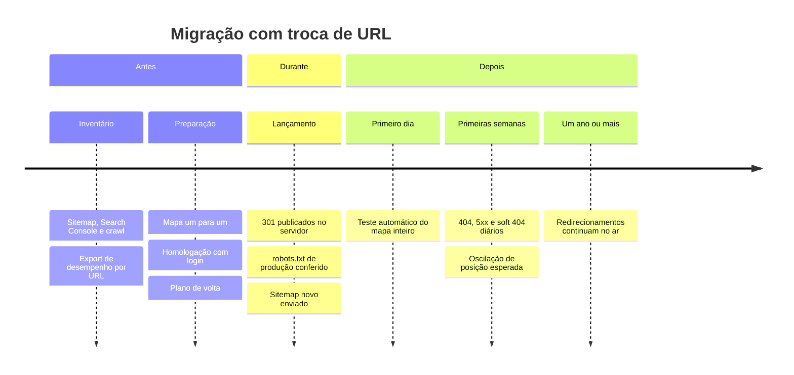

### Exemplo guiado

O ponto de partida é um arquivo `mapa.csv` com as colunas `origem` e `destino`. O script segue cada salto manualmente, sem deixar a biblioteca esconder a cadeia, e classifica cada linha.

```python
"""Testa um mapa de redirecionamento. mapa.csv tem as colunas origem,destino.
Uso: python testar_redirects.py mapa.csv"""
import csv
import sys
import time
from urllib.parse import urljoin

import requests

UA = "auditoria-estudo/1.0 (+mailto:voce@exemplo.com)"
PAUSA = 2
MAX_SALTOS = 10

s = requests.Session()
s.headers["User-Agent"] = UA


def seguir(url):
    """Segue os saltos um a um e devolve a lista [(url, status), ...]."""
    caminho = []
    for _ in range(MAX_SALTOS):
        time.sleep(PAUSA)
        r = s.get(url, timeout=20, allow_redirects=False)
        caminho.append((url, r.status_code))
        if r.status_code == 429:
            sys.exit(f"429 em {url}. Parei.")
        if r.status_code not in (301, 302, 303, 307, 308):
            return caminho
        url = urljoin(url, r.headers["Location"])
        if url in [u for u, _ in caminho]:
            caminho.append((url, "laço"))
            return caminho
    return caminho


with open(sys.argv[1], newline="", encoding="utf-8") as f:
    for linha in csv.DictReader(f):
        caminho = seguir(linha["origem"])
        final, status = caminho[-1]
        saltos = len(caminho) - 1
        codigos = [c for _, c in caminho[:-1]]
        if status == "laço":
            veredito = "LAÇO"
        elif final != linha["destino"]:
            veredito = "DESTINO ERRADO"
        elif status != 200:
            veredito = f"DESTINO RESPONDE {status}"
        elif saltos > 1:
            veredito = f"CADEIA ({saltos} saltos)"
        elif any(c not in (301, 308) for c in codigos):
            veredito = "TEMPORÁRIO"
        else:
            veredito = "OK"
        print(f"{veredito:22} {linha['origem']} -> {final} {codigos}")
```

Um teste rápido com URLs públicas mostra o formato da saída.

```text
origem,destino
http://python.org/,https://www.python.org/
http://python.org/about,https://www.python.org/about/
```

```text
OK                     http://python.org/ -> https://www.python.org/ [301]
CADEIA (2 saltos)      http://python.org/about -> https://www.python.org/about/ [301, 301]
```

A segunda linha é uma cadeia típica. O primeiro salto troca protocolo e host, e o segundo acrescenta a barra final. A correção é a regra do servidor mandar direto para o destino final num salto só.

A sequência compara os pedidos da cadeia atual com a regra corrigida.

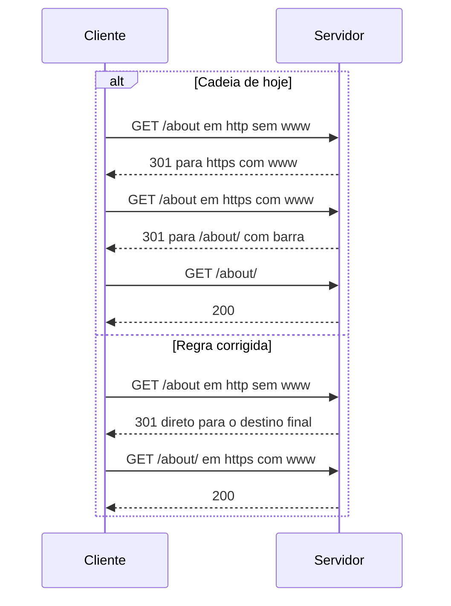

Rode o script no dia da migração e de novo uma semana depois. Regras de redirecionamento costumam ser sobrescritas por deploys seguintes.

### Erros comuns

- **Mandar tudo para a home.** O Google pode tratar como soft 404, e o usuário que veio de um link antigo não acha o que procurava. Cada URL antiga vai para a equivalente mais próxima. Sem equivalente, 404 ou 410.
- **Usar 302 numa mudança definitiva.** A URL antiga pode continuar nos resultados e a nova demora a herdar os sinais. Mudança definitiva é 301 ou 308.
- **Remover os redirecionamentos meses depois.** Links externos antigos voltam a dar 404 e os sinais se perdem. Mantenha por pelo menos um ano, e o ideal é não remover.
- **Cadeias acumuladas.** Cada migração empilha um salto sobre o anterior. Depois de três projetos, há URLs com quatro saltos. Atualize as regras antigas para apontar direto ao destino atual.
- **Página de erro com 200.** O template de "não encontrado" responde 200 e vira soft 404. Confira o status de uma URL inventada em cada template.
- **Lançar com o robots.txt ou o `noindex` da homologação.** É o acidente mais comum de migração. Inclua os dois no checklist do dia do lançamento, com um nome responsável.

### Na prática

Um erro 500 que aparece por poucos minutos pode vir de uma atualização de PHP feita pela hospedagem, sem nenhuma mudança no seu código. Saber separar um incidente seu de um incidente do provedor muda a conversa com o cliente e com o time.

O primeiro passo é contar os erros por minuto no log de acesso. No formato combinado, o mais comum em Apache e Nginx, o status é o nono campo e a data é o quarto.

```bash
awk '$9 ~ /^5/ {print substr($4, 2, 17)}' access.log | sort | uniq -c | sort -rn | head
```

A saída tem uma linha por minuto, com o total de respostas 5xx, como `  2 10/Oct/2026:13:55`. Um pico curto e concentrado, seguido de volta ao normal, tem cara de reinício de serviço. Um aumento gradual tem cara de recurso esgotado, como memória, conexões de banco ou processos.

O segundo passo é cruzar o horário do pico com três fontes. O log de erro do servidor ou do PHP, que costuma registrar a versão nova ou o módulo que faltou. A página de status do provedor, que anuncia manutenções e incidentes. E o histórico de deploy do seu time. Se o pico bate com uma manutenção anunciada e nenhum deploy seu aconteceu no período, o incidente é do provedor. A recomendação passa a ser outra, como pedir janela de manutenção avisada ou mudar de plano, e o time de desenvolvimento não perde um dia procurando bug que não existe.

Para o Google, poucos minutos de 500 raramente causam estrago. O ritmo de rastreio cai por um tempo e volta aos poucos. O risco está no erro que se repete toda semana sem ninguém olhar.

### Resumo

- 301 e 308 são sinais fortes de mudança. 302 e 307 são fracos.
- Para o Google, 404 e 410 têm o mesmo efeito. 429 e 5xx reduzem o ritmo de rastreio.
- Soft 404 é página de erro com 200 e é pior que um 404 honesto.
- Migração pede mapa um para um, redirecionamentos por pelo menos um ano e monitoramento diário nas primeiras semanas.
- Antes de culpar o código por um 500, conte erros por minuto e cruze com o log de erro, a página de status do provedor e o histórico de deploy.

### Para ir além

- Em [vídeos](videos.md), **Let's talk redirects** explica como o Google trata 301, 302, meta refresh e cadeias. Assista antes de montar o mapa do exercício.
- Em [leituras](leituras.md), **Como os códigos de status HTTP afetam os rastreadores do Google** é a fonte da tabela desta aula, com os casos de DNS e rede.
- Em [leituras](leituras.md), **The Website Migration Guide** da Moz tem o checklist por fase mais completo e gratuito. Use como base para o seu.
- Em [vídeos](videos.md), **Staging and launching a site** trata do lançamento sem levar homologação para o índice.

## Aula 5. JavaScript SEO

### A ideia central

O Google renderiza JavaScript, com três ressalvas. Renderiza depois do rastreio, numa fila. Renderiza com limites de tempo e de recursos. E não clica, não rola a página com a intenção de ver mais, não preenche formulário. Conteúdo e links que só aparecem depois de uma interação não existem para ele.

Os robôs de IA são ainda mais sensíveis. Um estudo da Vercel com a MERJ, publicado em dezembro de 2024, concluiu que nenhum dos grandes robôs de IA analisados executava JavaScript, incluindo os da OpenAI, da Anthropic e da Perplexity. Eles chegavam a baixar arquivos JS, sem executar. As exceções eram o robô da Apple, que renderiza, e o Gemini, que usa a infraestrutura do Google. O modelo mental mais seguro é este. Tudo o que importa para a busca e para a citação em IA, texto principal, links, title, canonical, meta robots e dados estruturados, deve estar no HTML que o servidor entrega.

### Como funciona

#### Modelos de renderização

| Modelo | Onde o HTML é montado | O que o robô recebe no primeiro pedido | Risco para SEO |
|---|---|---|---|
| Estática (SSG) | No build, antes do deploy | HTML completo | Baixo. Atenção a páginas que mudam muito |
| No servidor (SSR) | A cada pedido, no servidor | HTML completo | Baixo. Atenção ao TTFB |
| Híbrida (ISR, SSR com partes no cliente) | Parte no servidor, parte no navegador | HTML com o essencial | Médio. Depende do que ficou para o cliente |
| No cliente (CSR) | No navegador, com JavaScript | Uma casca quase vazia e um bundle JS | Alto. Tudo depende da renderização |

Hidratação é o passo em que o JavaScript do cliente assume o HTML que veio do servidor e liga os eventos. Se o HTML do servidor e o do cliente divergem, o framework pode descartar e redesenhar partes da página. Para o robô, isso significa conteúdo diferente entre origem e renderizado. Para o usuário, significa piscadas na tela e piora do CLS e do INP.

#### O que a documentação do Google diz sobre JavaScript

- O Googlebot processa páginas JavaScript em três fases. Rastreio, renderização e indexação. Toda página com status 200 entra na fila de renderização.
- A renderização usa um Chromium sempre atualizado.
- Páginas com status diferente de 200, como 404, podem não ser renderizadas.
- Se o HTML original tem `noindex`, o Google pode pular a renderização. Um JavaScript que tira o `noindex` depois pode nunca rodar. Se quer a página indexada, não coloque `noindex` no código original.
- O Google só descobre links que são elementos `<a>` com `href`. Links inseridos por JavaScript valem, desde que sigam esse formato.
- Em aplicações de página única (SPA), use a History API (`pushState`) para as rotas. Rotas em fragmento, como `/#/produtos`, não são resolvidas com confiança.
- Recursos bloqueados no robots.txt não são baixados. Se o JS ou o CSS essencial estiver bloqueado, a renderização falha.
- O serviço de renderização faz cache agressivo e pode ignorar cabeçalhos de cache. Coloque um hash do conteúdo no nome do arquivo, como `main.2bb85551.js`, para que cada versão tenha URL nova.
- O Googlebot recusa pedidos de permissão, como câmera ou localização. Conteúdo que depende de permissão não é visto.

O fluxograma mostra os dois pontos em que o Google pode pular a renderização.

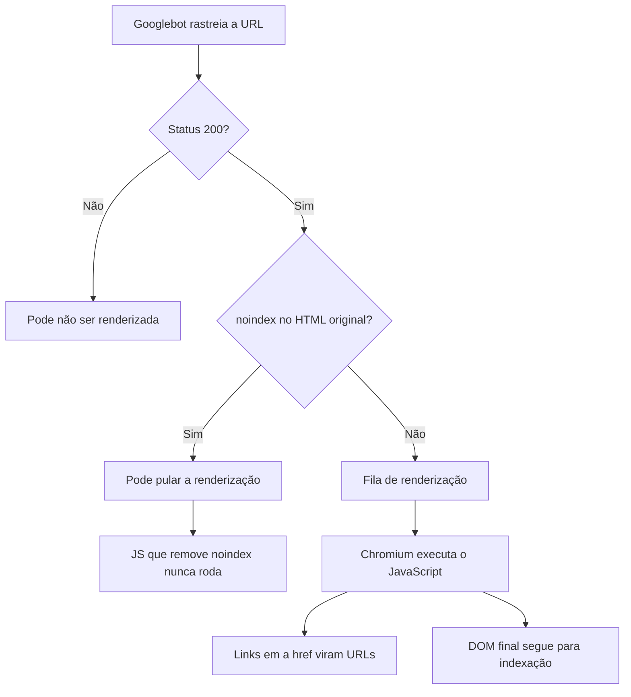

#### Links que funcionam e links que não funcionam

```html
<!-- O robô segue -->
<a href="/produtos/tenis-corrida">Tênis de corrida</a>

<!-- O robô não segue -->
<span onclick="location.href='/produtos/tenis-corrida'">Tênis de corrida</span>
<a onclick="abrir('tenis-corrida')">Tênis de corrida</a>
<a href="#" data-rota="/produtos/tenis-corrida">Tênis de corrida</a>
```

#### Soft 404 em SPA

Numa SPA, a rota é resolvida no navegador e o servidor costuma responder 200 para qualquer caminho. Uma URL que não existe mostra "produto não encontrado" com status 200, e vira soft 404. O Google documenta duas saídas. Redirecionar por JavaScript para uma URL que o servidor responde com 404, como `/nao-encontrado`. Ou inserir `<meta name="robots" content="noindex">` por JavaScript nas páginas de erro. A melhor solução, quando a arquitetura permite, é o próprio servidor responder 404.

#### Lazy loading

Carregar imagens e blocos sob demanda é boa prática de performance. O risco é o conteúdo só carregar depois de um evento que o robô não dispara, como rolagem ou clique. Use o atributo nativo `loading="lazy"` em imagens fora da primeira tela, ou `IntersectionObserver`, que carregam quando o elemento entra na área visível. Nunca use lazy loading na imagem principal da primeira tela, porque isso atrasa o LCP (aula 6).

### Exemplo guiado

O objetivo é descobrir o que some sem JavaScript e comparar o que três visitantes diferentes recebem. Um navegador, o Google e um robô de IA.

1. **Sem JavaScript.** Abra a página no Chrome, abra o DevTools, pressione `Cmd+Shift+P` no Mac ou `Ctrl+Shift+P` no Windows e Linux, digite "Disable JavaScript" e recarregue. Anote o que sumiu. Texto principal, preço, menu, links de paginação, imagens. Reative pelo mesmo menu.
2. **HTML de origem.** Baixe o que o servidor entrega no primeiro pedido.

```bash
UA="auditoria-estudo/1.0 (+mailto:voce@exemplo.com)"
curl -s -A "$UA" https://www.seusite.com.br/pagina/ -o origem.html
```

3. **DOM renderizado no navegador.** Com a página aberta e o JavaScript ativo, rode no console do DevTools o comando abaixo. Ele copia o HTML final para a área de transferência. Cole num arquivo `renderizado.html`.

```js
copy(document.documentElement.outerHTML)
```

4. **Comparação.** Use o `comparar_html.py` da aula 1.

```bash
python comparar_html.py origem.html renderizado.html
```

Se o número de palavras no conteúdo principal cai muito na origem, ou se os links de produto só aparecem no renderizado, a página depende de JavaScript para o que importa. Para o Google, isso significa esperar a fila de renderização. Para a maioria dos robôs de IA, significa uma página vazia.

A sequência mostra o que cada um dos três visitantes recebe do mesmo servidor.

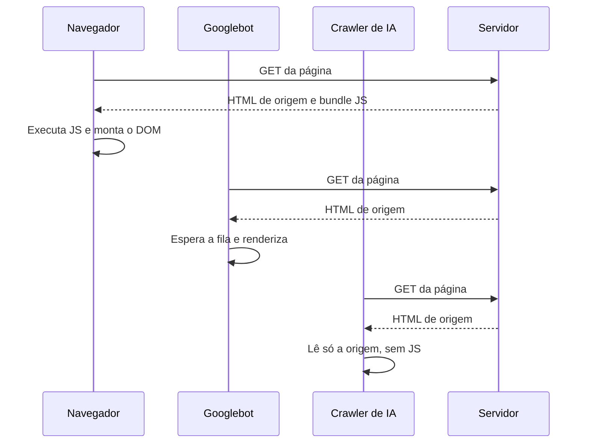

5. **Visão do Google.** Rode a mesma URL no teste de pesquisa aprimorada ou na inspeção de URL do Search Console. A documentação de depuração do Google diz que essas ferramentas mostram os recursos carregados, a saída do console de JavaScript, as exceções e o DOM renderizado. Compare o HTML dessa visão com o seu `renderizado.html`. Diferenças costumam vir de recursos bloqueados ou de erros de JavaScript que só acontecem no ambiente do Google.

6. **Para o desafio.** Duas páginas mínimas mostram a diferença na prática. Publique as duas no GitHub Pages e inspecione cada uma.

```html
<!-- estatica.html: o conteúdo está no HTML -->
<!doctype html>
<html lang="pt-BR">
<head><meta charset="utf-8"><title>Versão estática</title></head>
<body><main><h1>Receita de pão de queijo</h1><p>Texto completo da receita.</p></main></body>
</html>
```

```html
<!-- injetada.html: o conteúdo chega 3 segundos depois, por JavaScript -->
<!doctype html>
<html lang="pt-BR">
<head><meta charset="utf-8"><title>Versão injetada</title></head>
<body><main id="app"></main>
<script>
  setTimeout(() => {
    document.getElementById("app").innerHTML =
      "<h1>Receita de pão de queijo</h1><p>Texto completo da receita.</p>";
  }, 3000);
</script>
</body>
</html>
```

Um `curl` de cada uma mostra o que um robô sem JavaScript recebe. Mudar o user-agent do `curl` para o de um robô de IA não muda o que o servidor do GitHub Pages entrega, e não prova nada sobre o comportamento do robô real. Quem decide o que o robô vê é o próprio robô e o seu servidor, e a prova está no log (aula 8).

### Erros comuns

- **`noindex` no HTML original com a ideia de tirar por JavaScript depois.** O Google pode nem renderizar a página. Defina indexação no servidor.
- **Links de navegação feitos com `onclick` ou botões.** O robô não descobre as páginas de destino. Use `<a href>` com URL real, mesmo que o framework intercepte o clique.
- **Rotas com `#`.** O Google não resolve fragmento como página. Use a History API e configure o servidor para responder cada rota.
- **SPA que responde 200 para tudo.** Cada URL inventada vira soft 404, e o problema da aula 3 aparece em escala. O servidor deve conhecer as rotas válidas e responder 404 nas outras.
- **Bloquear `/static/` ou `/assets/` no robots.txt.** O Google não baixa o JS e o CSS e a renderização sai quebrada. Libere os recursos necessários para montar a página.
- **Achar que o Google basta.** Robôs de IA, na maioria, leem só a origem. Title, texto principal e dados estruturados precisam estar no HTML do servidor.

### Na prática

O README deste módulo não traz um caso, então o exemplo a seguir é hipotético. Imagine uma loja feita como SPA em React. O time de produto reclama que as páginas de categoria não aparecem no Google, enquanto as de produto aparecem.

O primeiro teste é o do exemplo guiado. O `curl` da categoria devolve um `<div id="root"></div>` e um bundle. O renderizado tem 48 produtos. Até aqui, só se sabe que a página depende de JavaScript, e o Google renderiza JavaScript. Ainda não há causa.

O segundo teste olha os links. No renderizado, cada card de produto é um `<div>` com `onclick`, e a paginação é um botão "ver mais" que chama a API. Não há nenhum `<a href>` para produto nem para a página 2. A categoria, para o Google, é uma página sem links e com texto quase nenhum, o que explica "Rastreada, mas ainda não indexada". Os produtos aparecem porque estão no sitemap. A categoria não leva até eles.

A correção sai em duas etapas. A primeira é barata e resolve a descoberta. Trocar os cards por `<a href>` e criar links de paginação com `?page=2`, mantendo o botão para quem navega. A segunda é renderizar a categoria no servidor, para que o texto e os links estejam na origem, o que também atende os robôs de IA. A ordem importa. A primeira etapa cabe numa sprint. A segunda é decisão de arquitetura e precisa de outro tipo de conversa com o time.

### Resumo

- O Google renderiza JavaScript numa fila, com limites, e sem interagir com a página.
- A maioria dos grandes robôs de IA não executa JavaScript, segundo o estudo da Vercel com a MERJ de 2024.
- Links precisam ser `<a href>`, rotas precisam usar a History API, e `noindex` deve ser decidido no servidor.
- Compare origem, renderizado no navegador e visão do Google antes de concluir qualquer coisa.
- Mudar o user-agent do `curl` não prova o que um robô real recebe. A prova está no log.

### Para ir além

- Em [vídeos](videos.md), a playlist **JavaScript SEO** do Martin Splitt é a base desta aula. Pule o episódio de dynamic rendering, como o próprio README de vídeos recomenda.
- Em [leituras](leituras.md), **Corrigir problemas de JavaScript relacionados à Pesquisa** é o checklist de depuração para usar com o exercício de prática 3.
- Em [leituras](leituras.md), **Renderização na Web** do web.dev compara SSR, SSG, CSR e hidratação com prós e contras. Leia antes de propor mudança de arquitetura.
- Em [vídeos](videos.md), **Working With Your Devs On JavaScript SEO Bugs** ensina a levar o achado para o time de desenvolvimento.

## Aula 6. Core Web Vitals (LCP, INP, CLS)

### A ideia central

Core Web Vitals são três métricas de experiência medidas em usuários reais. LCP mede carregamento, INP mede resposta à interação e CLS mede estabilidade visual. O INP substituiu o FID em março de 2024. O Google usa essas métricas como um dos sinais de experiência na busca. Elas ajudam, e a documentação do Google não promete posição para quem passa.

O modelo mental certo tem duas partes. A primeira é separar dado de campo de dado de laboratório. O campo diz se há problema, porque vem de usuários reais. O laboratório ajuda a achar a causa, porque é reproduzível. A segunda é pensar em grupos de páginas e em causas comuns. O relatório do Search Console agrupa URLs parecidas, e um grupo ruim costuma ter uma causa só.

### Como funciona

#### As três métricas

| Métrica | O que mede | Bom | Precisa melhorar | Ruim |
|---|---|---|---|---|
| LCP (Largest Contentful Paint) | Tempo até o maior bloco de texto ou imagem da primeira tela aparecer | até 2,5 s | até 4 s | acima de 4 s |
| INP (Interaction to Next Paint) | Tempo entre uma interação (clique, toque, tecla) e a próxima atualização da tela, perto da pior interação da visita | até 200 ms | até 500 ms | acima de 500 ms |
| CLS (Cumulative Layout Shift) | Soma dos deslocamentos inesperados de layout na maior rajada da visita | até 0,1 | até 0,25 | acima de 0,25 |

A página passa quando o percentil 75 está na faixa boa, separado por celular e desktop. O percentil 75 foi escolhido para que a maioria das visitas tenha boa experiência, sem que poucos casos extremos dominem o número. Em termos práticos, se 3 em cada 4 visitas forem boas, a página passa.

O FID media só o atraso da primeira interação, antes de o navegador começar a processá-la. O INP olha todas as interações da visita e inclui o tempo de processamento e o tempo até a tela atualizar. Por isso sites que passavam com folga no FID podem falhar no INP.

#### Campo e laboratório

| | Dado de campo | Dado de laboratório |
|---|---|---|
| Fonte | Usuários reais do Chrome (CrUX), Search Console, RUM próprio | Lighthouse, PageSpeed Insights (parte de baixo), DevTools |
| Período | CrUX é uma média móvel de 28 dias | Uma execução, agora |
| Aparelho e rede | Os dos seus usuários | Simulados |
| INP | Medido | Não existe sem interação. O Lighthouse usa o TBT como aproximação |
| Serve para | Saber se há problema e se a correção funcionou | Achar a causa e testar a correção antes de publicar |

O TBT (Total Blocking Time) soma o tempo em que tarefas longas bloqueiam a thread principal durante o carregamento. Tarefa longa é qualquer tarefa acima de 50 ms. TBT alto no laboratório costuma indicar INP ruim no campo, porque a mesma thread principal ocupada atrasa a resposta ao clique.

Quando campo e laboratório discordam, o campo vence. O laboratório roda num aparelho e numa rede simulados, sem cookies, sem banner de consentimento e sem o histórico de cache dos seus usuários.

O fluxograma mostra o ciclo entre campo e laboratório numa correção.

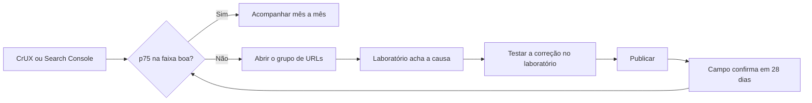

#### LCP em quatro partes

O web.dev divide o LCP em quatro partes, com uma proporção de referência para cada uma. São diretrizes flexíveis.

| Parte | O que é | Referência |
|---|---|---|
| TTFB | Tempo até o primeiro byte do HTML | cerca de 40% |
| Atraso de carregamento | Do TTFB até o navegador começar a baixar o recurso do LCP | menos de 10% |
| Tempo de carregamento | Download do recurso do LCP, em geral uma imagem | cerca de 40% |
| Atraso de renderização | Do fim do download até o elemento aparecer na tela | menos de 10% |

As correções seguem a parte que pesa mais. TTFB alto pede cache de página, CDN ou servidor melhor. Atraso de carregamento alto pede que a imagem esteja no HTML inicial, sem depender de CSS ou JavaScript para ser descoberta, e com `fetchpriority="high"` na tag. Tempo de carregamento alto pede imagem menor, em formato moderno e no tamanho certo. Atraso de renderização alto pede menos CSS e JS bloqueando a pintura. O web.dev é taxativo num ponto. Nunca use lazy loading na imagem do LCP.

O fluxograma mostra as quatro partes do LCP em ordem e a correção típica de cada uma.

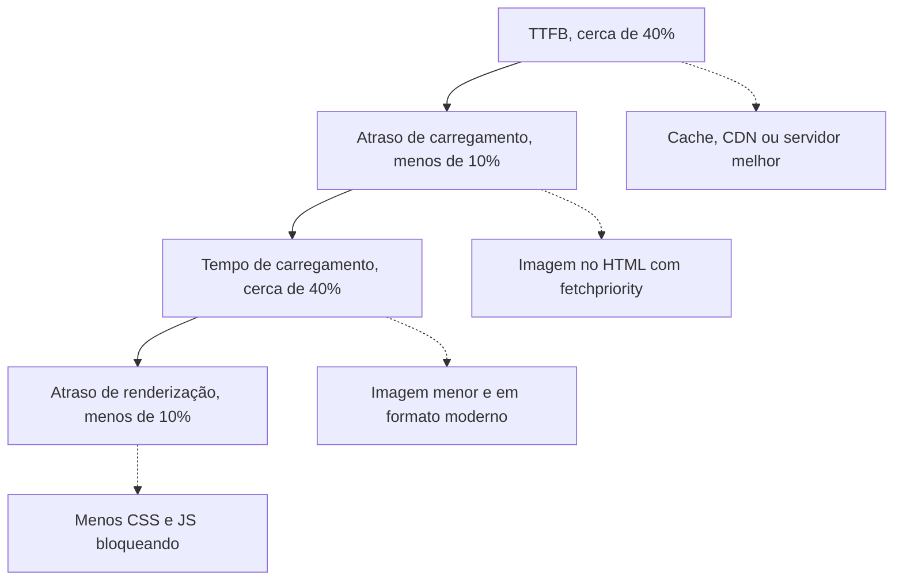

```html

```

#### INP e a thread principal

Uma interação tem três partes. O atraso de entrada, enquanto a thread principal termina o que estava fazendo. O tempo de processamento, enquanto os seus manipuladores de evento rodam. E o atraso de apresentação, até o navegador pintar o resultado. As causas mais comuns são scripts de terceiros (chat, tags de marketing, testes A/B), manipuladores de evento pesados e DOM muito grande. As correções mais comuns são adiar ou remover terceiros, quebrar tarefas longas em partes menores devolvendo o controle ao navegador e reduzir o trabalho feito a cada clique.

#### CLS e espaço reservado

O CLS sobe quando algo aparece e empurra o que já estava na tela. Imagem sem `width` e `height`, anúncio ou embed sem espaço reservado, banner inserido no topo depois do carregamento e fonte web que troca e muda o tamanho do texto. A correção é reservar o espaço antes. Dimensões em toda imagem, `aspect-ratio` ou `min-height` em contêineres de anúncio e embed, e conteúdo novo inserido abaixo do que o usuário está vendo.

### Exemplo guiado

**1. Campo pela API do CrUX.** A API é gratuita e exige uma chave do Google Cloud. Guarde a chave em variável de ambiente, nunca no código. O limite documentado é de 150 consultas por minuto por projeto.

```python
"""p75 de LCP, INP e CLS no CrUX, por origem e tipo de aparelho.
Uso: export CRUX_API_KEY=... ; python crux.py https://www.site1.com.br https://www.site2.com.br"""
import os
import sys
import time

import requests

API = "https://chromeuxreport.googleapis.com/v1/records:queryRecord"
CABECALHO = {"X-Goog-Api-Key": os.environ["CRUX_API_KEY"]}
METRICAS = {"largest_contentful_paint": ("LCP", 2500),
            "interaction_to_next_paint": ("INP", 200),
            "cumulative_layout_shift": ("CLS", 0.1)}

for origem in sys.argv[1:]:
    for aparelho in ("PHONE", "DESKTOP"):
        time.sleep(1)
        r = requests.post(API, headers=CABECALHO, timeout=30,
                          json={"origin": origem, "formFactor": aparelho,
                                "metrics": list(METRICAS)})
        if r.status_code == 429:
            sys.exit("429 recebido. Parei.")
        if r.status_code == 404:
            print(f"{origem} {aparelho}: sem dados suficientes no CrUX")
            continue
        r.raise_for_status()
        dados = r.json()["record"]["metrics"]
        partes = []
        for nome, (sigla, limite) in METRICAS.items():
            if nome in dados:
                p75 = float(dados[nome]["percentiles"]["p75"])  # o CLS vem como texto
                selo = "bom" if p75 <= limite else "ACIMA DO BOM"
                partes.append(f"{sigla}={p75:g} ({selo})")
        print(f"{origem} {aparelho}: " + ", ".join(partes))
```

LCP e INP voltam em milissegundos. O CLS volta como texto com duas casas, por isso o `float`. Um 404 da API quer dizer que a origem não tem tráfego suficiente no Chrome para entrar no relatório.

**2. Laboratório no PageSpeed Insights.** Rode três templates (home, categoria, artigo ou produto). A parte de cima da página mostra o campo, a de baixo mostra o Lighthouse. Monte uma tabela com as duas colunas lado a lado e escreva, para cada template, por que elas discordam.

**3. O elemento do LCP.** Com a página aberta, cole no console do DevTools o código abaixo e recarregue. Ele mostra o tempo e o elemento do LCP.

```js
new PerformanceObserver((lista) => {
  const ultima = lista.getEntries().at(-1);
  console.log("LCP", Math.round(ultima.startTime), "ms", ultima.element);
}).observe({ type: "largest-contentful-paint", buffered: true });
```

**4. O que se mexe.** Este segundo trecho lista cada deslocamento de layout e os elementos que se moveram.

```js
new PerformanceObserver((lista) => {
  for (const e of lista.getEntries()) {
    if (!e.hadRecentInput) {
      console.log("deslocamento", e.value.toFixed(4), e.sources?.map((s) => s.node));
    }
  }
}).observe({ type: "layout-shift", buffered: true });
```

**5. A tarefa longa do INP.** No painel Performance do DevTools, ative a limitação de CPU em 4x, grave, faça a interação (abrir menu, filtrar lista) e pare. Procure os blocos marcados com triângulo vermelho na trilha da thread principal. Clique no maior e veja, na aba de baixo, qual script e qual função consumiram o tempo.

### Erros comuns

- **Usar a nota do Lighthouse como meta.** A nota é de laboratório e varia entre execuções. A meta é o percentil 75 de campo dentro da faixa boa.
- **Otimizar o site inteiro antes de olhar os grupos.** O relatório agrupa URLs parecidas, e cada grupo costuma ter causa única. Abra cada grupo, veja os templates e os domínios dele e ataque a causa comum.
- **Lazy loading na imagem principal.** Atrasa o LCP em toda página. Use `fetchpriority="high"` nela e `loading="lazy"` só fora da primeira tela.
- **Esperar resultado no dia seguinte.** O CrUX é uma média de 28 dias. Uma correção leva semanas para aparecer por inteiro no campo. Acompanhe com laboratório no curto prazo e com campo no médio.
- **Projetar receita a partir de correlação curta.** Poucos meses de dado geram correlação forte por acaso, por sazonalidade. Use âncoras publicadas e mostre a faixa de incerteza.

### Na prática

Duas lições desta aula vêm de casos reais.

A primeira é o caso 8 da pasta [casos](../../casos/08-core-web-vitals-de-causa-unica.md), num site de educação. O relatório de Core Web Vitals mostrava dezenas de URLs ruins no celular, dezenas no desktop e centenas acima do limite em LCP e INP. A primeira hipótese foi a de sempre. O site inteiro é lento e precisa de uma otimização ampla de imagens, scripts, cache e tema.

O teste foi abrir cada grupo e olhar quais templates e domínios estavam nele. No celular, todas as URLs ruins eram de um subdomínio de API lento, com versão antiga de PHP, sem cache e com duas meta robots contraditórias. No desktop, todas eram a home, por um único elemento que mudava de lugar durante o carregamento. Os grupos "precisa de melhoria" se concentravam em poucos templates.

A primeira fase foi só de configuração, com backup de tudo. Modo de depuração desligado, tag duplicada removida, script de terceiro desnecessário desativado e cache na API lenta. Em laboratório, a nota da home mais que dobrou e o tempo de bloqueio caiu para cerca de um sétimo. A segunda fase atacou o resto por ordem de retorno. Duas correções certeiras valeram mais que cem espalhadas.

A segunda lição é o caso 6, [a correlação que não servia](../../casos/06-correlacao-que-nao-servia.md), num varejo online. A pergunta era quanto de receita a melhoria de Core Web Vitals traria. A correlação entre LCP no celular e receita mensal era forte e estatisticamente significativa, mas só havia seis meses de sobreposição entre os dados. O intervalo de confiança ia de quase nada a quase perfeito, e um teste de placebo mostrou que o mês em que a métrica de interação piorou era só o quarto pior entre doze cortes. Com seis pontos, qualquer sazonalidade gera correlação forte. O número entregue saiu de âncoras publicadas, aplicadas ao tráfego e à receita do próprio site, com uma faixa de mínimo a máximo. O deck mostrou a correlação e explicou por que ela não foi usada.

### Resumo

- LCP até 2,5 s, INP até 200 ms e CLS até 0,1 no percentil 75, separados por celular e desktop.
- Campo diz se há problema, laboratório ajuda a achar a causa. Quando discordam, o campo vence.
- O LCP se divide em TTFB, atraso de carregamento, tempo de carregamento e atraso de renderização. Ataque a parte que pesa mais.
- Grupos ruins no Search Console costumam ter causa única. Descubra o que eles têm em comum antes de otimizar.
- Business case de performance usa âncoras publicadas e mostra a faixa de incerteza.

### Para ir além

- Em [vídeos](videos.md), **A deep dive into optimizing LCP** mostra as quatro partes do LCP na prática. Assista antes do exercício de prática 2.
- Em [vídeos](videos.md), **Deciphering INP and Core Web Vitals** conta por que o FID saiu e qual é o peso real das métricas no ranking. Bom para calibrar a conversa com o cliente.
- Em [leituras](leituras.md), **Como entender o Core Web Vitals e os resultados da pesquisa do Google** dá o peso real das métricas na busca, sem exagero.
- Em [leituras](leituras.md), **Otimizar a Mudança de layout cumulativa** lista as causas comuns de CLS e a correção de cada uma.

## Aula 7. Dados estruturados

### A ideia central

Dado estruturado é uma descrição da página escrita para máquinas, com o vocabulário do Schema.org. Ele diz, sem ambiguidade, que esta página é um produto com tal preço, que este site pertence a tal organização, que este artigo foi escrito por tal pessoa. Buscadores usam isso para entender entidades e, em alguns tipos, para exibir resultados enriquecidos, como estrelas, preço e trilha de navegação.

O modelo mental certo é um grafo. Cada entidade (organização, site, página, artigo, produto, pessoa) é um nó com identificador próprio, e as entidades se ligam por esses identificadores. Escrever o grafo uma vez, de forma coerente, vale mais que espalhar blocos soltos que repetem e contradizem dados. Um dado estruturado errado ou duplicado atrapalha mais do que ajuda, porque manda sinais conflitantes sobre a mesma coisa.

### Como funciona

#### Formatos

O Google aceita três formatos. JSON-LD, microdados e RDFa. Ele recomenda JSON-LD sempre que a estrutura do site permitir, e os três funcionam se a marcação for válida. JSON-LD fica num bloco `<script type="application/ld+json">`, separado do HTML visível, o que facilita manter e testar. Microdados e RDFa são atributos misturados ao HTML.

O Google consegue ler JSON-LD inserido por JavaScript. Como a maioria dos robôs de IA não executa JavaScript (aula 5), o lugar seguro para o JSON-LD é o HTML que o servidor entrega.

#### O que o Google exige

- **Coerência com a página.** A documentação pede para não marcar informação que o usuário não vê, mesmo que ela seja verdadeira. Preço no JSON-LD diferente do preço na tela é o exemplo clássico.
- **Propriedades obrigatórias.** Cada tipo com resultado enriquecido tem propriedades obrigatórias. Sem elas, a página não fica elegível. Com elas, fica elegível, sem garantia de exibição.
- **Tipos vigentes.** A galeria de resultados da pesquisa lista os tipos que ainda geram resultado enriquecido. Hoje ela inclui Article, Breadcrumb, Event, Organization, Product, Review snippet, Recipe, Video, Local business, Job posting, Profile page e Discussion forum, entre outros. O resultado de HowTo saiu em 2023, e o de FAQ saiu para todos os sites em maio de 2026. A caixa de pesquisa de sitelinks também não está mais na galeria. Marcação desses tipos não está errada, e também não gera mais nada na busca do Google.

#### Organization e BreadcrumbList segundo a documentação

Para Organization, o Google recomenda a marcação na home ou numa página que descreva a organização, como "Sobre". Não há propriedade obrigatória. As recomendadas incluem `name`, `url`, `logo`, `sameAs`, `description`, endereço e contato. O logo precisa ter pelo menos 112 x 112 pixels e uma URL que o Google consiga rastrear e indexar.

Para BreadcrumbList, a trilha precisa de pelo menos dois `ListItem`, cada um com `position`, `name` e `item`. No último item, o `item` pode ser omitido, e o Google usa a URL da página. A documentação atual diz que o recurso aparece no desktop.

#### `@id` e o grafo de entidades

`@id` é parte do padrão JSON-LD do W3C. Ele dá um identificador único a um nó, em forma de URI. Por convenção, usa-se a URL da página com um fragmento, como `https://www.exemplo.com.br/#organization`. Em qualquer outro lugar do grafo, `{"@id": "https://www.exemplo.com.br/#organization"}` aponta para esse nó sem repetir os dados. A documentação do Google não fala de `@id` nas páginas de Organization e de dados estruturados em geral. Ele é recurso do JSON-LD, lido por qualquer parser que siga o padrão.

O bloco abaixo descreve uma página de categoria com Organization, WebSite, WebPage e BreadcrumbList num único `@graph`.

```json
{
  "@context": "https://schema.org",
  "@graph": [
    {
      "@type": "Organization",
      "@id": "https://www.exemplo.com.br/#organization",
      "name": "Exemplo Calçados",
      "url": "https://www.exemplo.com.br/",
      "logo": {
        "@type": "ImageObject",
        "url": "https://www.exemplo.com.br/img/logo-512.png",
        "width": 512,
        "height": 512
      },
      "sameAs": [
        "https://www.instagram.com/exemplocalcados",
        "https://www.linkedin.com/company/exemplocalcados"
      ]
    },
    {
      "@type": "WebSite",
      "@id": "https://www.exemplo.com.br/#website",
      "url": "https://www.exemplo.com.br/",
      "name": "Exemplo Calçados",
      "inLanguage": "pt-BR",
      "publisher": { "@id": "https://www.exemplo.com.br/#organization" }
    },
    {
      "@type": "CollectionPage",
      "@id": "https://www.exemplo.com.br/tenis/corrida/#webpage",
      "url": "https://www.exemplo.com.br/tenis/corrida/",
      "name": "Tênis de corrida",
      "isPartOf": { "@id": "https://www.exemplo.com.br/#website" },
      "breadcrumb": { "@id": "https://www.exemplo.com.br/tenis/corrida/#breadcrumb" }
    },
    {
      "@type": "BreadcrumbList",
      "@id": "https://www.exemplo.com.br/tenis/corrida/#breadcrumb",
      "itemListElement": [
        { "@type": "ListItem", "position": 1, "name": "Início", "item": "https://www.exemplo.com.br/" },
        { "@type": "ListItem", "position": 2, "name": "Tênis", "item": "https://www.exemplo.com.br/tenis/" },
        { "@type": "ListItem", "position": 3, "name": "Corrida" }
      ]
    }
  ]
}
```

Leia as ligações de baixo para cima. A trilha pertence à página. A página faz parte do site. O site é publicado pela organização. Os dados da organização aparecem completos uma vez, e as outras páginas do site podem só apontar para o `@id` dela.

O diagrama mostra as entidades do bloco e a propriedade que liga cada par pelo @id.

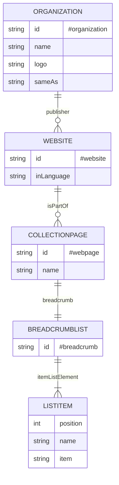

#### Duas ferramentas de validação

| Ferramenta | O que valida | Quando usar |
|---|---|---|
| Teste de pesquisa aprimorada (Google) | Só os tipos com resultado enriquecido no Google, com as regras do Google | Saber se a página está elegível no Google |
| Validador do Schema.org | Qualquer tipo do vocabulário, sem regras de produto | Conferir a sintaxe e o grafo inteiro, inclusive tipos sem resultado enriquecido |

Use as duas. Uma Organization pode passar no validador do Schema.org e ter um logo que o Google não aceita.

### Exemplo guiado

**1. Escreva o grafo.** Adapte o bloco acima para o seu site ou para um site fictício. Valide no validador do Schema.org e no teste de pesquisa aprimorada. Confira que o validador mostra as entidades ligadas, sem nós soltos.

**2. Conte blocos com parser.** O script abaixo baixa uma lista de páginas, extrai todos os blocos JSON-LD com BeautifulSoup e `json.loads`, abre `@graph` e listas, conta os tipos e marca blocos inválidos e tipos duplicados.

```python
"""Extrai e conta blocos JSON-LD com parser. Uso: python jsonld.py urls.txt"""
import json
import sys
import time
from collections import Counter

import requests
from bs4 import BeautifulSoup

UA = "auditoria-estudo/1.0 (+mailto:voce@exemplo.com)"
PAUSA = 3
UNICOS = {"Product", "Organization", "BreadcrumbList", "WebSite"}
s = requests.Session()
s.headers["User-Agent"] = UA


def tipos(no):
    """Devolve os @type de um bloco, abrindo @graph e listas."""
    if isinstance(no, list):
        for item in no:
            yield from tipos(item)
    elif isinstance(no, dict):
        if "@graph" in no:
            yield from tipos(no["@graph"])
        if "@type" in no:
            t = no["@type"]
            yield from (t if isinstance(t, list) else [t])


for url in open(sys.argv[1], encoding="utf-8").read().split():
    time.sleep(PAUSA)
    r = s.get(url, timeout=20)
    if r.status_code == 429:
        sys.exit(f"429 em {url}. Parei.")
    soup = BeautifulSoup(r.text, "html.parser")
    contagem, invalidos = Counter(), 0
    for bloco in soup.find_all("script", type="application/ld+json"):
        try:
            dado = json.loads(bloco.string or "")
        except json.JSONDecodeError:
            invalidos += 1
            continue
        contagem.update(tipos(dado))
    duplicados = [t for t, n in contagem.items() if n > 1 and t in UNICOS]
    print(url, r.status_code, dict(contagem), f"inválidos={invalidos}",
          f"DUPLICADOS={duplicados}" if duplicados else "")
```

Coloque em `urls.txt` 20 páginas do mesmo template, uma por linha. Uma página de produto com `{'Product': 2}` tem dois blocos de produto. O passo seguinte é comparar nome, preço e disponibilidade dos dois blocos com o que aparece na tela.

**3. Confira a Organization.** Abra o bloco de Organization da home e verifique três coisas. Se `logo` e `image` usam https, se a URL do logo responde 200 e se cada perfil de `sameAs` existe.

```bash
UA="auditoria-estudo/1.0 (+mailto:voce@exemplo.com)"
curl -sI -A "$UA" https://www.exemplo.com.br/img/logo-512.png | head -1
```

### Erros comuns

- **Dois blocos do mesmo tipo com dados diferentes.** Tema e aplicativo de SEO escrevem Product ao mesmo tempo, com preços ou nomes divergentes. Escolha uma fonte e desligue a outra.
- **Contar dados estruturados com grep.** Uma busca por `"@type": "Product"` acha texto dentro de um script qualquer, que não é JSON-LD. Use parser e `json.loads`.
- **Marcação que contradiz a página.** Preço, disponibilidade ou nota no JSON-LD diferente do que o usuário vê. Gere o JSON-LD da mesma fonte de dados que monta a tela.
- **Imagem e logo em http.** Um site em https com `logo` em http pode ter a imagem recusada. Revise todas as URLs do grafo.
- **Tratar FAQ e HowTo como oportunidade.** Esses resultados saíram da busca do Google. Recomendar a marcação como ganho de visibilidade no Google é erro de auditoria.
- **Organization diferente em cada template.** Nome, logo ou `sameAs` mudando de página para página. Defina a Organization uma vez, com `@id`, e aponte para ela.

### Na prática

O README deste módulo traz dois achados de auditoria. Numa loja, cada página de produto tinha dois blocos Product, um do tema e outro de um aplicativo de SEO, com dados diferentes. E num site inteiro, a Organization era inválida e a imagem de compartilhamento usava http.

O raciocínio para achar os dois é o mesmo. Primeiro, contar blocos por tipo em várias páginas do mesmo template, com o script do exemplo guiado. Dois Product por página aparece na primeira rodada. Depois, comparar os campos dos blocos entre si e com a tela. A divergência mostra que o Google recebia duas versões do mesmo produto e tinha de escolher uma. A correção natural é desligar a marcação de uma das fontes, e a escolha da fonte que fica deve considerar qual delas acompanha preço e estoque em tempo real.

O caso 4 da pasta [casos](../../casos/04-nove-afirmacoes-erradas.md) mostra o erro oposto, de achar dados estruturados onde eles não existiam. Uma busca por texto encontrou o que parecia ser JSON-LD. Era uma string dentro de um JavaScript. Com parser, a contagem era zero. O item entrou no backlog como "dados estruturados presentes" e estava errado. Daí a regra desta aula. Conte blocos com parser, nunca com grep, e confira se eles concordam entre si e com a página.

### Resumo

- JSON-LD é o formato recomendado pelo Google e deve estar no HTML do servidor.
- Dados estruturados precisam bater com o que o usuário vê.
- `@id` liga entidades num grafo, sem repetir dados.
- Use a galeria do Google para saber o que ainda gera resultado enriquecido. HowTo e FAQ não geram mais.
- Conte blocos com parser e procure duplicados e divergências.

### Para ir além

- Em [leituras](leituras.md), **Marcações de dados estruturados compatíveis com a Pesquisa Google** é a galeria oficial. Consulte antes de recomendar qualquer tipo.
- Em [leituras](leituras.md), **Getting Started · schema.org** explica o vocabulário independente do Google. Útil para o desafio do grafo com `@graph`.
- Em [vídeos](videos.md), **Structured data for web developers** mostra como a marcação é lida e as boas práticas de implementação.
- Em [vídeos](videos.md), **Let's talk shopping markup** aprofunda Product, preço e variantes para quem trabalha com loja.

## Aula 8. Logs de servidor e ferramentas de crawl

### A ideia central

Uma ferramenta de crawl mostra o que você acha que o robô vê. Ela segue links a partir de um ponto de partida, com as regras que você configurou. O log de servidor mostra o que o robô viu de fato. Cada pedido que chegou, com data, URL, status e user-agent. Juntos, contam a história inteira. O crawl acha o que existe e não deveria (páginas órfãs, cadeias, `noindex` acidental). O log acha o que o robô faz com o que existe (seções ignoradas, rastreio desperdiçado em parâmetros, erros que só ele recebe).

O segundo modelo mental é sobre evidência. Cada fonte tem um ponto cego. A ferramenta de SEO mostra o que ela rastreou, o Search Console mostra o que o Google reporta, o crawl mostra o que seus links alcançam e o log mostra o que bateu no servidor. Um entregável sério diz de qual fonte veio cada afirmação e o que foi testado.

### Como funciona

#### O formato do log de acesso

Apache e Nginx usam por padrão um formato chamado combinado.

```text
66.249.66.1 - - [10/Oct/2026:13:55:36 -0300] "GET /blog/receita-de-bolo HTTP/1.1" 200 2326 "-" "Mozilla/5.0 (Linux; Android 6.0.1; Nexus 5X Build/MMB29P) AppleWebKit/537.36 (KHTML, like Gecko) Chrome/141.0.0.0 Mobile Safari/537.36 (compatible; Googlebot/2.1; +http://www.google.com/bot.html)"
```

| Campo | Exemplo | Uso em SEO |
|---|---|---|
| IP | `66.249.66.1` | Verificar se o robô é real |
| Data e hora | `10/Oct/2026:13:55:36 -0300` | Frequência de rastreio, picos de erro |
| Método e caminho | `GET /blog/receita-de-bolo` | Seções rastreadas, parâmetros |
| Status | `200` | Erros que o robô recebe |
| Bytes | `2326` | Páginas pesadas ou vazias |
| Referer | `-` | Robôs quase nunca mandam |
| User-agent | `... Googlebot/2.1 ...` | Quem diz ser o visitante |

Em sites atrás de CDN, o log do servidor pode mostrar só o IP da CDN, e parte dos pedidos nem chega à origem. Nesses casos, o log da própria CDN é a fonte certa. E lembre que IP é dado pessoal pela LGPD. Peça o log com o mínimo necessário, guarde com cuidado e apague quando o trabalho terminar.

#### Verificar robôs

O user-agent é texto, e qualquer um escreve "Googlebot" no próprio. O Google documenta duas formas de verificar.

1. **DNS reverso seguido de DNS direto.** O nome devolvido para o IP precisa terminar em `googlebot.com`, `google.com` ou `googleusercontent.com`, e o DNS direto desse nome precisa voltar ao mesmo IP.
2. **Lista de IPs publicada.** O Google publica as faixas em arquivos JSON. Os rastreadores comuns, como o Googlebot, estão em `common-crawlers.json`. Há listas separadas para rastreadores especiais e para buscadores acionados por usuário.

```bash
host 66.249.66.1
# 1.66.249.66.in-addr.arpa domain name pointer crawl-66-249-66-1.googlebot.com.

host crawl-66-249-66-1.googlebot.com
# crawl-66-249-66-1.googlebot.com has address 66.249.66.1
```

O mesmo teste com `dig`, que traz só a resposta.

```bash
dig +short -x 66.249.66.1
dig +short crawl-66-249-66-1.googlebot.com A
```

Os dois passos são necessários. Qualquer pessoa que controla o DNS reverso do próprio IP pode fazê-lo apontar para um nome terminado em `googlebot.com`. O DNS direto desse nome só volta ao IP original se o nome for mesmo do Google.

A sequência mostra a verificação em dois passos e onde um robô falso é barrado.

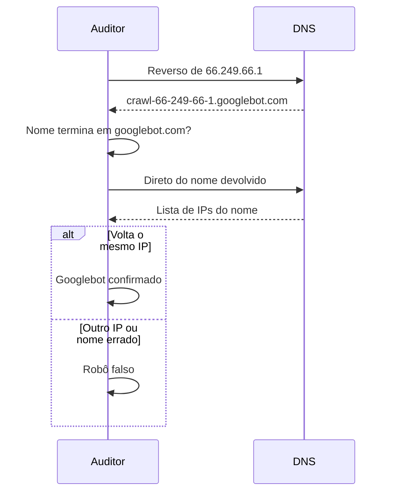

Robôs de IA seguem a mesma lógica, com a fonte de cada empresa. A OpenAI publica as faixas do GPTBot em `https://openai.com/gptbot.json`, e o Bing publica as do Bingbot em `https://www.bing.com/toolbox/bingbot.json`, no mesmo formato do Google.

#### Ferramentas de crawl

O Screaming Frog é o crawler mais usado no mercado. A versão gratuita rastreia até 500 URLs, e a licença custa cerca de US$ 279 por ano, segundo a página listada em leituras. Os recursos que mais importam numa auditoria são estes.

- **Extração customizada.** Captura, por XPath, seletor CSS ou expressão regular, um dado que nenhum relatório padrão traz, como data de atualização, autor ou preço.
- **Crawl com renderização.** Executa o JavaScript antes de ler a página. Rode uma vez sem e uma vez com, e compare (aula 5).
- **Lista de URLs.** Rastreia uma lista pronta, como a união de sitemap e Search Console da aula 2, em vez de seguir links.
- **Velocidade.** Limite o número de pedidos por segundo. O padrão costuma ser agressivo para sites pequenos.

Um crawler em Python resolve sites pequenos e médios e ensina o que a ferramenta faz por baixo. O script do exemplo guiado respeita o robots.txt, pausa entre pedidos e para no primeiro 429.

### Exemplo guiado

**1. Crawl.** O script parte da home, segue links do mesmo host, lê status, title, canonical, meta robots e `X-Robots-Tag` e grava `crawl.csv`.

```python
"""Crawler mínimo para auditoria. Uso: python crawl.py https://www.seusite.com.br 500"""
import csv
import sys
import time
from collections import deque
from urllib.parse import urljoin, urldefrag, urlsplit

import requests
from bs4 import BeautifulSoup
from protego import Protego

UA = "auditoria-estudo/1.0 (+mailto:voce@exemplo.com)"
PAUSA = 3  # segundos entre requisições
PULAR = (".jpg", ".jpeg", ".png", ".gif", ".webp", ".svg", ".pdf", ".zip", ".mp4")

inicio = sys.argv[1].rstrip("/") + "/"
limite = int(sys.argv[2]) if len(sys.argv) > 2 else 500
host = urlsplit(inicio).netloc

s = requests.Session()
s.headers["User-Agent"] = UA
rr = s.get(urljoin(inicio, "/robots.txt"), timeout=20)
if rr.status_code == 429 or rr.status_code >= 500:
    sys.exit("robots.txt indisponível. Pare e tente mais tarde.")
robots = Protego.parse(rr.text if rr.status_code == 200 else "")


def enfileirar(novo):
    novo = urldefrag(novo)[0]
    partes = urlsplit(novo)
    if partes.netloc == host and not partes.path.lower().endswith(PULAR) and novo not in vistos:
        vistos.add(novo)
        fila.append(novo)


fila, vistos, linhas = deque([inicio]), {inicio}, []
while fila and len(linhas) < limite:
    url = fila.popleft()
    if not robots.can_fetch(url, UA):
        linhas.append({"url": url, "status": "bloqueada-robots"})
        continue
    time.sleep(PAUSA)
    r = s.get(url, timeout=20, allow_redirects=False)
    if r.status_code == 429:
        print("429 recebido. Parando. Retome mais tarde.", file=sys.stderr)
        break
    linha = {"url": url, "status": r.status_code,
             "destino": r.headers.get("Location", ""),
             "x_robots": r.headers.get("X-Robots-Tag", "")}
    if r.status_code == 200 and "text/html" in r.headers.get("Content-Type", ""):
        soup = BeautifulSoup(r.text, "html.parser")
        canon = soup.find("link", rel="canonical")
        meta = soup.find("meta", attrs={"name": "robots"})
        linha["title"] = soup.title.get_text(strip=True) if soup.title else ""
        linha["canonical"] = canon.get("href", "") if canon else ""
        linha["meta_robots"] = meta.get("content", "") if meta else ""
        for a in soup.find_all("a", href=True):
            enfileirar(urljoin(url, a["href"]))
    elif r.is_redirect:
        enfileirar(urljoin(url, r.headers["Location"]))
    linhas.append(linha)

campos = ["url", "status", "destino", "title", "canonical", "meta_robots", "x_robots"]
with open("crawl.csv", "w", newline="", encoding="utf-8") as f:
    w = csv.DictWriter(f, fieldnames=campos)
    w.writeheader()
    w.writerows(linhas)
print(f"{len(linhas)} URLs gravadas em crawl.csv")
```

Com 3 segundos de pausa, 5 mil URLs levam pouco mais de quatro horas. É lento de propósito. Um crawl rápido demais derruba site pequeno e vira incidente no seu nome.

**2. Log no DuckDB.** Salve o SQL abaixo como `log.sql`. Ele lê cada linha do log como texto, separa os campos com uma expressão regular, cria a tabela `acessos` e responde duas perguntas. Onde estão os picos de 5xx e quais seções cada robô visita.

```sql
CREATE OR REPLACE TABLE acessos AS
WITH bruto AS (
  SELECT regexp_extract(
           linha,
           '^(\S+) \S+ \S+ \[([^\]]+)\] "(\S+) (\S+) [^"]*" (\d{3}) \S+ "([^"]*)" "([^"]*)"',
           ['ip', 'quando', 'metodo', 'caminho', 'status', 'referer', 'ua']
         ) AS c
  FROM read_csv('access.log', columns = {'linha': 'VARCHAR'},
                delim = '\t', header = false, quote = '', escape = '')
)
SELECT c.ip,
       strptime(c.quando, '%d/%b/%Y:%H:%M:%S %z') AS quando,
       c.metodo,
       c.caminho,
       CAST(c.status AS INTEGER) AS status,
       c.referer,
       c.ua
FROM bruto
WHERE c.ip <> '';

-- Respostas 5xx por minuto, picos primeiro
SELECT date_trunc('minute', quando) AS minuto, count(*) AS erros_5xx
FROM acessos
WHERE status >= 500
GROUP BY 1
ORDER BY erros_5xx DESC
LIMIT 20;

-- Visitas de robôs por seção (primeiro nível do caminho)
SELECT CASE
         WHEN ua ILIKE '%googlebot%' THEN 'Googlebot (declarado)'
         WHEN ua ILIKE '%gptbot%' THEN 'GPTBot (declarado)'
         WHEN ua ILIKE '%bingbot%' THEN 'Bingbot (declarado)'
         ELSE 'outros'
       END AS robo,
       '/' || split_part(split_part(caminho, '?', 1), '/', 2) AS secao,
       count(*) AS visitas
FROM acessos
GROUP BY ALL
ORDER BY visitas DESC;
```

Rode com o Python, que já tem o DuckDB instalado.

```python
import duckdb

con = duckdb.connect("log.duckdb")
for comando in open("log.sql", encoding="utf-8").read().split(";"):
    if comando.strip():
        resultado = con.sql(comando)
        if resultado is not None:
            resultado.show()
```

A palavra "declarado" no rótulo é proposital. Até aqui, só se sabe o que o user-agent diz.

**3. Verificação.** Pegue os IPs distintos que se dizem Googlebot e confira por DNS. O script abaixo faz o reverso, confere o domínio e faz o direto.

```python
"""Verifica se um IP do log é mesmo do Google (DNS reverso, depois DNS direto).
Uso: python verificar_bot.py 66.249.66.1 203.0.113.9"""
import socket
import sys

DOMINIOS = (".googlebot.com", ".google.com", ".googleusercontent.com")


def verificar(ip):
    try:
        nome = socket.gethostbyaddr(ip)[0]          # DNS reverso
    except OSError:
        return False, "sem DNS reverso"
    if not nome.endswith(DOMINIOS):
        return False, f"reverso aponta para {nome}"
    try:
        ips = socket.gethostbyname_ex(nome)[2]      # DNS direto
    except OSError:
        return False, f"{nome} não resolve"
    return ip in ips, nome


for ip in sys.argv[1:]:
    ok, detalhe = verificar(ip)
    print(f"{ip:16} {'GOOGLE' if ok else 'NÃO É GOOGLE':13} {detalhe}")
```

Para robôs de outras empresas, confira o IP contra as faixas publicadas.

```python
"""Confere se IPs do log estão nas faixas publicadas por cada empresa.
Uso: python faixas.py 66.249.66.1 20.171.207.1"""
import ipaddress
import sys

import requests

UA = "auditoria-estudo/1.0 (+mailto:voce@exemplo.com)"
LISTAS = {
    "Google (rastreadores comuns)": "https://developers.google.com/static/crawling/ipranges/common-crawlers.json",
    "OpenAI GPTBot": "https://openai.com/gptbot.json",
    "Bingbot": "https://www.bing.com/toolbox/bingbot.json",
}


def redes(url):
    dados = requests.get(url, headers={"User-Agent": UA}, timeout=20).json()
    return [ipaddress.ip_network(p.get("ipv4Prefix") or p.get("ipv6Prefix"))
            for p in dados["prefixes"]]


faixas = {nome: redes(url) for nome, url in LISTAS.items()}
for ip in sys.argv[1:]:
    endereco = ipaddress.ip_address(ip)
    donos = [nome for nome, lista in faixas.items() if any(endereco in r for r in lista)]
    print(f"{ip:16} {', '.join(donos) or 'fora de todas as faixas listadas'}")
```

Refaça a contagem por seção só com os IPs verificados. Agora sim o rótulo pode perder o "declarado".

O fluxograma mostra como ler cada URL cruzando o crawl com o log verificado.

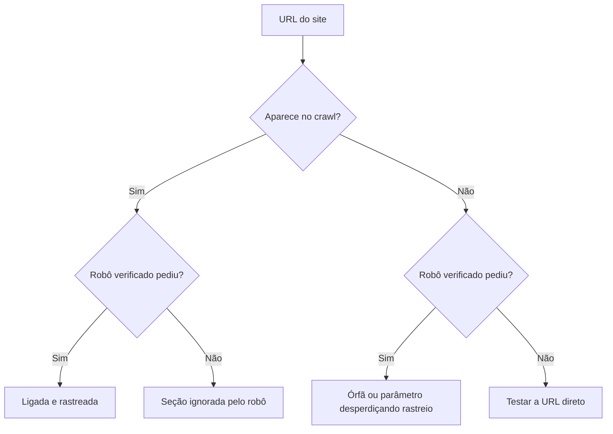

### Erros comuns

- **Confiar no user-agent.** Robôs falsos se apresentam como Googlebot o tempo todo. Verifique por DNS ou pela lista de IPs antes de concluir qualquer coisa sobre o Google.
- **Ausência no relatório tratada como ausência no site.** A ferramenta não achou a página porque nenhum link levava a ela, ou porque o limite de URLs acabou. Teste a URL direto antes de afirmar que ela não existe.
- **Testar acesso de robô de IA do seu próprio computador.** O servidor pode tratar o seu IP de um jeito e o IP oficial do robô de outro. O log com IPs verificados é a prova.
- **Crawl sem pausa.** Derruba site pequeno, aciona o firewall e contamina o próprio resultado com 429 e 403. Pausa de 2 a 5 segundos e parada no primeiro 429.
- **Entregável sem origem da evidência.** Quem lê não sabe se o achado veio de crawl próprio, de ferramenta, do Search Console ou do log, e não consegue reproduzir. Marque a origem e o status de cada item (confirmado, parcial, verificação recomendada).
- **Log de um dia só.** O Googlebot visita seções diferentes em dias diferentes. Para falar de frequência de rastreio, use pelo menos algumas semanas.

### Na prática

Dois casos da pasta mostram o valor de cada fonte e o risco de confiar numa só.

No caso 4, [nove afirmações erradas numa auditoria](../../casos/04-nove-afirmacoes-erradas.md), páginas que "não existiam" segundo uma ferramenta de SEO respondiam 200, com título próprio. A ferramenta não tinha chegado até elas, e a auditoria leu a ausência no relatório como ausência no site. Esse foi um dos quatro padrões que, somados, geraram nove itens errados num backlog de 32. A correção foi de método. Cada item passou a ter a origem da evidência marcada (crawl próprio, ferramenta, Search Console) e um status (confirmado, parcial, verificação recomendada), e cada rota passou a ser testada direto.

No caso 3, [o bloqueio de robôs de IA que não existia](../../casos/03-bloqueio-de-robos-que-nao-existia.md), num portal de educação médica, ferramentas automáticas recebiam 403, e um teste com o user-agent de robôs de IA feito do computador da equipe também. A conclusão parecia óbvia. O site bloqueia robôs de IA, e o esforço de GEO seria inútil até resolver isso. O teste que decidiu foi ler um mês de log e contar visitas por robô, com os IPs oficiais. O bloqueio valia só para IPs não verificados, como o da equipe. Os robôs reais, vindos das faixas oficiais, eram atendidos normalmente, com robôs de busca de IA na casa de mais de mil visitas no mês, contando só uma parte do log. O robots.txt também não bloqueava nenhum robô de IA. Uma conclusão errada logo no começo teria mudado o projeto inteiro.

O raciocínio que une os dois casos é este. Antes de afirmar que algo existe ou não existe, que algo bloqueia ou não bloqueia, pergunte qual fonte enxerga isso diretamente. Para o que o robô recebe, essa fonte é o log com IPs verificados.

### Resumo

- Crawl mostra o que os seus links alcançam. Log mostra o que o robô pediu e recebeu.
- Verifique o Googlebot por DNS reverso seguido de DNS direto, ou pela lista de IPs publicada pelo Google.
- Robôs de IA se verificam pelas faixas de IP que cada empresa publica.
- Crawl com pausa, robots.txt respeitado e parada no primeiro 429.
- Todo achado diz de que fonte veio e o que foi testado.

### Para ir além

- Em [leituras](leituras.md), **Verificar solicitações de rastreadores e coletores do Google** é a fonte oficial da verificação por DNS e das listas de IP. Leia antes do exercício de prática 3.
- Em [vídeos](videos.md), **Screaming Frog Log File Analyser · 6.0** mostra como importar logs e cruzar com o crawl numa interface, para comparar com o seu DuckDB.
- Em [leituras](leituras.md), **Gerenciamento da cota de rastreamento** ajuda a interpretar o rastreio por seção em sites grandes.
- Em [vídeos](videos.md), **Crawl Budget and the Crawl Stats report** liga a cota de rastreamento ao relatório de estatísticas, a fonte mais próxima de log dentro do Search Console.

## Aula 9. Sites internacionais (hreflang)

### A ideia central

Quando um site tem versões por idioma ou por país, o Google precisa saber qual delas mostrar para cada pessoa. O hreflang é a anotação que liga essas versões e diz qual é para quem. Ele não traduz nada e não detecta idioma. Ele organiza um grupo de páginas equivalentes para que a busca entregue a versão certa.

O conceito é simples. A execução é onde tudo quebra, porque cada página precisa listar todas as outras versões e a si mesma, com códigos válidos e URLs que respondem 200. Basta uma versão sem o link de volta para aquele par ser ignorado. O modelo mental certo é tratar o conjunto de versões como um único objeto, gerado de uma única fonte de dados, e nunca como anotações escritas à mão em cada template.

### Como funciona

#### Códigos

O valor do hreflang é um código de idioma no formato ISO 639-1, opcionalmente seguido de um código de região no formato ISO 3166-1 alfa-2. A região sozinha não vale.

| Código | Significado | Válido? |
|---|---|---|
| `pt` | Português, qualquer região | Sim |
| `pt-BR` | Português do Brasil | Sim |
| `pt-PT` | Português de Portugal | Sim |
| `es-MX` | Espanhol do México | Sim |
| `en-GB` | Inglês do Reino Unido | Sim |
| `en-UK` | Tentativa de Reino Unido | Não. O código do país é GB |
| `BR` | Só a região | Não. Falta o idioma |
| `es-419` | Espanhol da América Latina | Não é aceito pelo Google |
| `x-default` | Versão para quem não se encaixa em nenhuma | Sim |

O `x-default` aponta a versão usada quando nenhuma outra combina com a configuração do navegador da pessoa. Costuma ser uma página de escolha de idioma ou a versão internacional em inglês.

#### Regras que o Google documenta

- **Cada versão lista a si mesma e todas as outras.** Se duas páginas não apontam uma para a outra, as anotações entre elas são ignoradas. Os outros pares do grupo continuam valendo.
- **URL completa, com protocolo.** `https://www.exemplo.com/pt-br/` é válido. `//www.exemplo.com/pt-br/` e `/pt-br/` não são.
- **Três formas equivalentes.** Tags `<link>` no `<head>`, cabeçalho HTTP `Link` (útil para PDF) ou entradas `<xhtml:link>` no sitemap. Escolha uma forma e mantenha.
- **O Google não usa hreflang nem o atributo `lang` para descobrir o idioma da página.** Ele usa o conteúdo visível.
- **Versões traduzidas não são duplicadas.** Páginas localizadas só são tratadas como duplicadas se o conteúdo principal ficar sem tradução, como uma página em pt-BR e outra em pt-PT com o mesmo texto.

#### Canonical e hreflang juntos

Cada versão de idioma tem canonical para si mesma. A canonical precisa estar no mesmo idioma da página. Se todas as versões apontam a canonical para a versão em inglês, o Google entende que as outras são cópias, e as anotações de hreflang delas deixam de fazer sentido. O hreflang também só deve apontar para URLs canônicas, que respondem 200 e são indexáveis.

O Google também diz que dá preferência a URLs que fazem parte de grupos de hreflang recíprocos ao escolher a canônica. É mais um motivo para manter a reciprocidade em dia.

#### Estrutura de URL

O guia de sites multirregionais do Google compara quatro opções.

| Estrutura | Exemplo | A favor | Contra |
|---|---|---|---|
| ccTLD | `exemplo.pt` | Sinal geográfico claro, sites separados | Caro, mais infraestrutura, regras de registro por país, um país por domínio |
| Subdomínio | `pt.exemplo.com` | Fácil de montar, servidores em lugares diferentes | O usuário pode não perceber o país pela URL |
| Subdiretório | `exemplo.com/pt-pt/` | Fácil de montar, manutenção baixa, mesmo host | O usuário pode não perceber o país pela URL, separação mais difícil |
| Parâmetro | `exemplo.com?loc=pt` | Nenhum | O Google não recomenda |

O mesmo guia pede para não redirecionar automaticamente pelo idioma presumido ou pelo IP da pessoa. O Googlebot costuma rastrear a partir dos Estados Unidos e não manda cabeçalho `Accept-Language`. Um redirecionamento por IP pode impedir o robô de ver as outras versões. Ofereça um seletor de idioma com links e deixe a pessoa escolher.

### Exemplo guiado

Uma página com três versões, em pt-BR, pt-PT e en, mais o `x-default` apontando para a versão em inglês. As três formas abaixo dizem a mesma coisa. Use só uma.

O diagrama mostra o grupo como um objeto só, com cada versão ligada às outras nos dois sentidos.

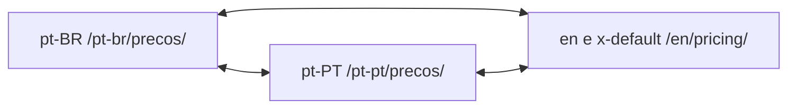

**No HTML.** O mesmo bloco aparece, idêntico, no `<head>` das três páginas.

```html
<link rel="alternate" hreflang="pt-BR" href="https://www.exemplo.com/pt-br/precos/">
<link rel="alternate" hreflang="pt-PT" href="https://www.exemplo.com/pt-pt/precos/">
<link rel="alternate" hreflang="en" href="https://www.exemplo.com/en/pricing/">
<link rel="alternate" hreflang="x-default" href="https://www.exemplo.com/en/pricing/">
```

**No cabeçalho HTTP.** Útil para arquivos sem HTML, como um PDF com versões por idioma.

```text
Link: <https://www.exemplo.com/pt-br/tabela.pdf>; rel="alternate"; hreflang="pt-BR",
      <https://www.exemplo.com/pt-pt/tabela.pdf>; rel="alternate"; hreflang="pt-PT",
      <https://www.exemplo.com/en/table.pdf>; rel="alternate"; hreflang="en",
      <https://www.exemplo.com/en/table.pdf>; rel="alternate"; hreflang="x-default"
```

**No sitemap.** Cada `<url>` lista todas as versões, inclusive a própria. O namespace `xhtml` precisa ser declarado.

```xml
<?xml version="1.0" encoding="UTF-8"?>
<urlset xmlns="http://www.sitemaps.org/schemas/sitemap/0.9"
        xmlns:xhtml="http://www.w3.org/1999/xhtml">
  <url>
    <loc>https://www.exemplo.com/pt-br/precos/</loc>
    <xhtml:link rel="alternate" hreflang="pt-BR" href="https://www.exemplo.com/pt-br/precos/"/>
    <xhtml:link rel="alternate" hreflang="pt-PT" href="https://www.exemplo.com/pt-pt/precos/"/>
    <xhtml:link rel="alternate" hreflang="en" href="https://www.exemplo.com/en/pricing/"/>
    <xhtml:link rel="alternate" hreflang="x-default" href="https://www.exemplo.com/en/pricing/"/>
  </url>
  <url>
    <loc>https://www.exemplo.com/pt-pt/precos/</loc>
    <xhtml:link rel="alternate" hreflang="pt-BR" href="https://www.exemplo.com/pt-br/precos/"/>
    <xhtml:link rel="alternate" hreflang="pt-PT" href="https://www.exemplo.com/pt-pt/precos/"/>
    <xhtml:link rel="alternate" hreflang="en" href="https://www.exemplo.com/en/pricing/"/>
    <xhtml:link rel="alternate" hreflang="x-default" href="https://www.exemplo.com/en/pricing/"/>
  </url>
  <url>
    <loc>https://www.exemplo.com/en/pricing/</loc>
    <xhtml:link rel="alternate" hreflang="pt-BR" href="https://www.exemplo.com/pt-br/precos/"/>
    <xhtml:link rel="alternate" hreflang="pt-PT" href="https://www.exemplo.com/pt-pt/precos/"/>
    <xhtml:link rel="alternate" hreflang="en" href="https://www.exemplo.com/en/pricing/"/>
    <xhtml:link rel="alternate" hreflang="x-default" href="https://www.exemplo.com/en/pricing/"/>
  </url>
</urlset>
```

**Conferindo um site real.** O script abaixo lê o hreflang de uma página, visita cada versão apontada e confere três coisas. Se a página lista a si mesma, se cada versão responde 200 e se cada versão aponta de volta. Ele também marca códigos fora do formato idioma ou idioma-região.

O fluxograma mostra as checagens que o script faz em cada par de versões.

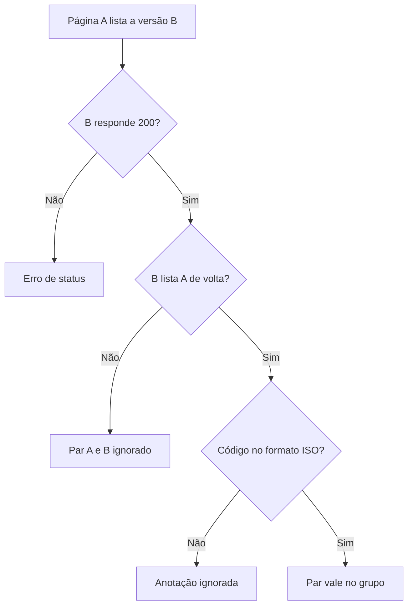

```python
"""Confere reciprocidade, status e códigos do hreflang.
Uso: python hreflang_check.py https://www.exemplo.com/pt-br/pagina"""
import re
import sys
import time

import requests
from bs4 import BeautifulSoup

UA = "auditoria-estudo/1.0 (+mailto:voce@exemplo.com)"
PAUSA = 3
CODIGO = re.compile(r"^(x-default|[a-z]{2}(-[a-z]{2})?)$")  # ISO 639-1 e ISO 3166-1 alfa-2
s = requests.Session()
s.headers["User-Agent"] = UA
cache = {}


def alternates(url):
    if url in cache:
        return cache[url]
    time.sleep(PAUSA)
    r = s.get(url, timeout=20, allow_redirects=False)
    if r.status_code == 429:
        sys.exit(f"429 em {url}. Parei.")
    if r.status_code != 200:
        return r.status_code, {}
    soup = BeautifulSoup(r.text, "html.parser")
    pares = {}
    for link in soup.find_all("link", rel="alternate", hreflang=True):
        pares[link["hreflang"].lower()] = link["href"]
    cache[url] = (200, pares)
    return cache[url]


origem = sys.argv[1]
status, conjunto = alternates(origem)
print(f"{origem} -> {status}, {len(conjunto)} anotações")
if origem not in conjunto.values():
    print("  ERRO a página não lista a si mesma")
for codigo, url in conjunto.items():
    if not CODIGO.match(codigo):
        print(f"  ERRO código inválido {codigo}")
    if url == origem:
        continue
    st, volta = alternates(url)
    if st != 200:
        print(f"  ERRO {codigo} {url} responde {st}")
    elif origem not in volta.values():
        print(f"  ERRO {codigo} {url} não aponta de volta (sem reciprocidade)")
    else:
        print(f"  ok   {codigo} {url}")
```

O formato do código é só a primeira checagem. `en-uk` passa na expressão regular e continua errado, porque UK não é código ISO 3166-1. Confira as regiões contra a lista oficial. A comparação de URL é exata, então a página precisa declarar o hreflang com a mesma URL que você passou ao script, com o mesmo protocolo e a mesma barra final.

### Erros comuns

- **Falta de reciprocidade.** A versão em pt-BR aponta para a de Portugal, e a de Portugal não aponta de volta. O par é ignorado. Gere todas as anotações de uma única tabela de equivalências.
- **Código de país inventado.** `en-UK`, `pt-BRA`, `es-LA`. O Google ignora. Use ISO 3166-1 alfa-2 (`GB`, `BR`) e lembre que `es-419` não é aceito.
- **Canonical de todas as versões para o inglês.** As outras viram cópia e somem. Cada versão tem canonical para si mesma.
- **Hreflang para URL que redireciona, dá 404 ou tem `noindex`.** O grupo fica inconsistente. Aponte só para canônicas que respondem 200.
- **Redirecionamento automático por IP.** O Googlebot, rastreando em geral dos Estados Unidos, pode nunca ver as versões de outros países. Use seletor de idioma com links.
- **Duas versões com o mesmo texto.** pt-BR e pt-PT com conteúdo idêntico podem ser tratadas como duplicadas. Adapte o conteúdo principal, além de moeda e telefone.

### Na prática

O README deste módulo não traz um caso, então o cenário a seguir é hipotético. Imagine uma escola online brasileira que vai abrir operação em Portugal e no México. Hoje o site está em `escola.com.br`, com 3 mil páginas em pt-BR.

A primeira decisão é de estrutura. Um ccTLD para cada país dá o sinal geográfico mais claro, mas exige três domínios, três propriedades no Search Console e autoridade construída do zero em cada um. Subdiretórios num domínio genérico, como `escola.com/pt-br/`, `escola.com/pt-pt/` e `escola.com/es-mx/`, aproveitam a autoridade existente e cabem num só deploy. Para uma empresa que ainda está testando os mercados novos, a segunda opção costuma ganhar. A troca de `escola.com.br` para `escola.com/pt-br/` é uma migração completa, com tudo o que a aula 4 pede.

A segunda decisão é de escopo. Nem toda página brasileira terá equivalente. Um curso que só existe no Brasil não ganha hreflang para Portugal. O conjunto de hreflang de cada página lista só as versões que existem de verdade, e por isso a tabela de equivalências precisa ser mantida pelo time de conteúdo, junto com o catálogo.

A terceira decisão é o português de Portugal. Se a versão pt-PT for só uma cópia com preço em euro, o Google pode tratá-la como duplicada da pt-BR. A adaptação precisa chegar ao texto principal, com vocabulário, exemplos e regras locais.

A quarta é o `x-default`. Com três versões e nenhuma em inglês, uma página de escolha de país é o `x-default` mais honesto. Ela atende quem chega de outro lugar sem empurrar ninguém para a versão errada.

### Resumo

- Hreflang liga versões equivalentes e diz qual mostrar para quem. Ele não detecta idioma.
- Código de idioma ISO 639-1 com região ISO 3166-1 alfa-2 opcional. Região sozinha não vale.
- Cada versão lista a si mesma e todas as outras. Par sem volta é ignorado.
- Cada versão tem canonical para si mesma, e o hreflang aponta só para canônicas com 200.
- Nada de redirecionamento automático por IP ou idioma presumido. Use seletor com links.

### Para ir além

- Em [leituras](leituras.md), **Versões localizadas das páginas** é a especificação oficial nas três formas. É a referência para o exercício de prática 1.
- Em [leituras](leituras.md), **Gerenciar sites multilíngues e multirregionais** traz a comparação de estruturas usada no desafio.
- Em [vídeos](videos.md), **Hunting a heinous hreflang headache** é um estudo de caso de depuração. Assista depois de rodar o script num site real.
- Em [leituras](leituras.md), **hreflang Tags Testing Tool** serve para conferir o seu script contra uma ferramenta pronta.

## Aula 10. SEO em CMS (WordPress, Elementor, Shopify)

### A ideia central

A maior parte dos sites roda num CMS, e cada CMS guarda as coisas num lugar diferente. Title pode estar no banco de dados, no tema ou num plugin. Canonical pode vir do tema e do plugin ao mesmo tempo. O robots.txt pode ser um arquivo, uma regra virtual ou um template. Saber onde cada coisa mora decide como você implementa a mudança e, principalmente, como você desfaz.

O modelo mental certo separa código de conteúdo. Código vive em arquivos, entra no Git, passa por revisão e volta com um `git revert`. Conteúdo vive no banco de dados ou na plataforma, muda pelo painel ou pela API e só volta se alguém fez backup antes. Toda mudança de SEO num CMS começa com a pergunta "isso é código ou é conteúdo?", porque a resposta define o teste, o deploy e o plano de volta.

### Como funciona

#### WordPress

| O quê | Onde fica | Como versionar e desfazer |
|---|---|---|
| Tema e plugins | Arquivos em `wp-content/themes` e `wp-content/plugins` | Git e deploy |
| Posts, páginas, menus | Banco de dados (tabelas de posts e de metadados) | Backup do banco, revisões do WordPress |
| Configurações, inclusive dos plugins de SEO | Banco de dados (tabela de opções) | Backup do banco, export do plugin |
| Title, meta description, canonical por página | Metadados do plugin de SEO, no banco | Backup do banco |
| robots.txt | Arquivo físico na raiz, se existir. Senão, gerado pelo WordPress e pelos plugins | Arquivo no Git, ou configuração no banco |
| Sitemap | Gerado na hora pelo WordPress ou pelo plugin de SEO | Configuração no banco |

O fluxograma mostra a pergunta que vem antes de toda mudança e o caminho de volta de cada lado.

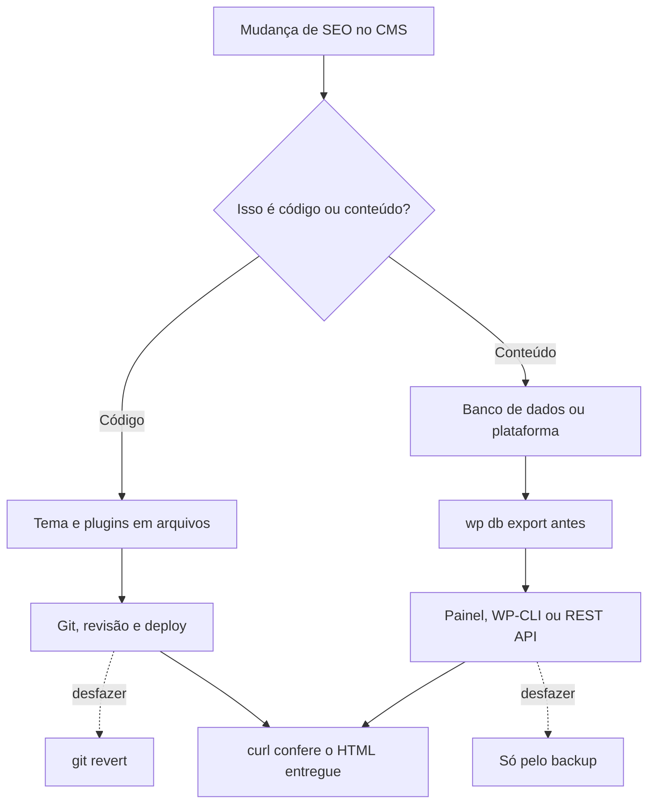

Os plugins de SEO, como Yoast e Rank Math, escrevem no `<head>` o title, a meta description, a canonical, a meta robots, as tags de compartilhamento e o JSON-LD. Quando um tema também escreve algumas dessas tags, aparecem duplicatas. Daí a importância de listar o que cada plugin injeta.

Duas ferramentas permitem trabalhar sem clicar no painel. O WP-CLI é a linha de comando do WordPress. A REST API expõe posts, páginas e taxonomias em JSON, em `/wp-json/wp/v2/`.

```bash
wp plugin list --status=active              # o que está ativo
wp option get blog_public                   # 0 = "evitar que mecanismos de busca indexem"
wp db export backup-antes-da-mudanca.sql    # backup do banco antes de qualquer gravação
wp post list --post_type=page --fields=ID,post_title,post_name --format=csv
```

A opção `blog_public` merece atenção especial. Ela corresponde à caixa "Evitar que mecanismos de busca indexem este site", nas configurações de leitura. É comum ela ficar marcada depois de um lançamento que veio da homologação.

#### Cache

| Tipo | O que guarda | Efeito numa mudança de SEO |
|---|---|---|
| Cache de página | O HTML pronto de cada URL, no plugin, no servidor ou na CDN | A mudança só aparece depois de limpar o cache daquela URL |
| Cache de objeto | Resultados de consultas ao banco, em Redis ou Memcached | Opção alterada direto no banco pode não aparecer até expirar |
| Cache do navegador e da CDN para CSS e JS | Arquivos estáticos | Arquivo novo com o mesmo nome pode demorar a chegar |

Depois de qualquer mudança, teste com `curl` e confira o HTML entregue. O painel mostra o que está no banco. O `curl` mostra o que o robô recebe.

A sequência mostra por que o painel e o curl podem discordar.

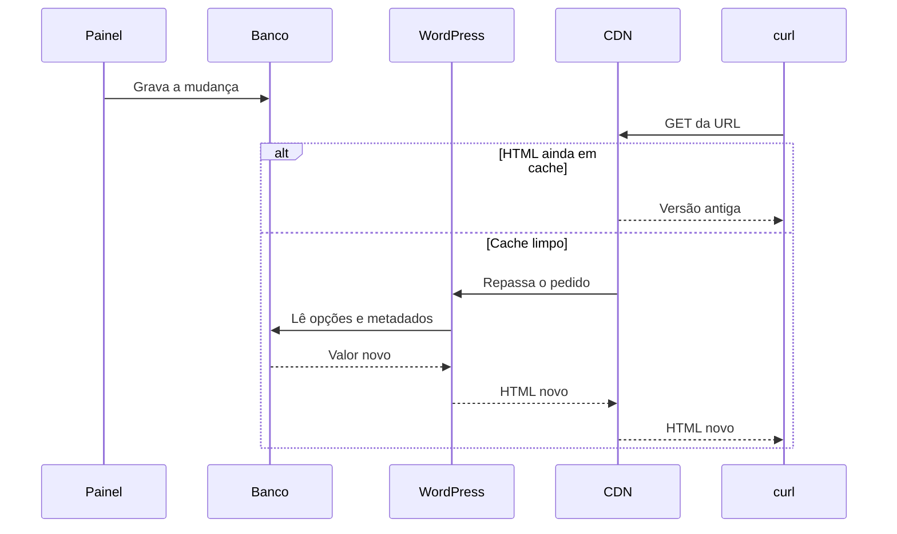

#### Elementor

O Elementor guarda o conteúdo de cada página no banco de dados, num metadado do post chamado `_elementor_data`, em JSON. O CSS de cada página é gerado a partir desse JSON e salvo em arquivos. Dois efeitos práticos.

- Uma página feita no Elementor não sobe por Git. Copiar o tema para outro ambiente leva o código e deixa o layout para trás.
- Gravar esse conteúdo por fora do editor, por WP-CLI ou script, passa pelas regras de segurança do WordPress sobre HTML. Sem um usuário com permissão para HTML sem filtro, partes como `<script>` dentro de widgets HTML podem ser removidas sem aviso. Depois de gravar, leia de volta o que ficou no banco e compare.

```bash
wp post meta get 123 _elementor_data > pagina-123-antes.json   # guarde antes de mexer
```

#### Shopify

| O quê | Onde fica |
|---|---|
| Title e meta description | No admin, em cada produto, coleção, página e post, na seção de mecanismos de pesquisa |
| Canonical | No tema, em geral no `theme.liquid`, com a variável `{{ canonical_url }}` |
| robots.txt | Gerado pela Shopify. Para mudar, crie o template `robots.txt.liquid` no tema |
| Sitemap | Gerado automaticamente em `/sitemap.xml` |
| Dados estruturados | No tema e em aplicativos, muitas vezes nos dois ao mesmo tempo |

As URLs da Shopify têm prefixos fixos, como `/products/`, `/collections/`, `/pages/` e `/blogs/`, que você não troca. Um mesmo produto pode aparecer em `/products/tenis` e em `/collections/corrida/products/tenis`. A segunda leva canonical para a primeira no tema padrão. Temas antigos e customizados podem quebrar isso, e os links internos das coleções devem apontar para a URL canônica.

A documentação da Shopify sobre `robots.txt.liquid` recomenda usar os objetos Liquid fornecidos, como `robots.default_groups`, em vez de escrever o arquivo inteiro à mão, e guardar uma cópia do `/robots.txt` atual antes de publicar. O exemplo abaixo mantém as regras padrão e acrescenta o bloqueio de URLs de busca interna com parâmetro `q`.

```liquid

  {{- group.user_agent }}

  
    {{ rule }}
  

  
    {{ 'Disallow: /*?q=*' }}
  

  
    {{ group.sitemap }}
  

```

### Exemplo guiado

**1. O que cada plugin injeta.** Suba um WordPress local com o LocalWP ou com o `wp-env`. Rode o script abaixo na home antes de ativar um plugin de SEO, ative o plugin e rode de novo. A diferença entre os dois arquivos é o que o plugin acrescentou.

```python
"""Lista o que está no <head> de uma página. Uso: python head.py http://localhost:8888/ > antes.txt"""
import sys

import requests
from bs4 import BeautifulSoup

UA = "auditoria-estudo/1.0 (+mailto:voce@exemplo.com)"
r = requests.get(sys.argv[1], headers={"User-Agent": UA}, timeout=20)
head = BeautifulSoup(r.text, "html.parser").head
for tag in head.find_all(["title", "meta", "link", "script"]):
    if tag.name == "title":
        print("title", tag.get_text(strip=True))
    elif tag.name == "meta" and (tag.get("name") or tag.get("property")):
        print("meta", tag.get("name") or tag.get("property"), "=", tag.get("content", "")[:80])
    elif tag.name == "link":
        print("link", " ".join(tag.get("rel", [])), tag.get("href", ""))
    elif tag.name == "script":
        print("script", tag.get("type", ""), tag.get("src", "(inline)"))
```

```bash
python head.py http://localhost:8888/ > antes.txt
wp plugin install wordpress-seo --activate
python head.py http://localhost:8888/ > depois.txt
diff antes.txt depois.txt
```

Ajuste a porta ao seu ambiente local. Procure tags repetidas, como duas canonical ou dois blocos JSON-LD.

**2. Inventário pela REST API.** Em vez de rastrear um WordPress para listar posts, peça à API. Cada página da API traz até 100 itens, e o cabeçalho `X-WP-TotalPages` diz quantas páginas existem.

```python
"""Lista posts de um WordPress pela REST API, sem crawl.
Uso: python wp_posts.py https://www.seusite.com.br"""
import csv
import sys
import time

import requests

UA = "auditoria-estudo/1.0 (+mailto:voce@exemplo.com)"
PAUSA = 3
base = sys.argv[1].rstrip("/")
s = requests.Session()
s.headers["User-Agent"] = UA

linhas, pagina, total_paginas = [], 1, 1
while pagina <= total_paginas:
    time.sleep(PAUSA)
    r = s.get(f"{base}/wp-json/wp/v2/posts", timeout=30,
              params={"per_page": 100, "page": pagina,
                      "_fields": "id,date,modified,slug,link,title"})
    if r.status_code == 429:
        print("429 recebido. Parei.", file=sys.stderr)
        break
    r.raise_for_status()
    total_paginas = int(r.headers.get("X-WP-TotalPages", 1))
    for p in r.json():
        linhas.append({"id": p["id"], "data": p["date"], "modificado": p["modified"],
                       "slug": p["slug"], "url": p["link"], "titulo": p["title"]["rendered"]})
    print(f"página {pagina} de {total_paginas}")
    pagina += 1

with open("posts.csv", "w", newline="", encoding="utf-8") as f:
    w = csv.DictWriter(f, fieldnames=["id", "data", "modificado", "slug", "url", "titulo"])
    w.writeheader()
    w.writerows(linhas)
print(f"{len(linhas)} posts em posts.csv")
```

A coluna `modificado` é a fonte honesta do `lastmod` do sitemap (aula 2). Compare com o que o sitemap do site declara.

**3. Uma loja Shopify pública.** Abra o robots.txt, o sitemap e o `<head>` de um produto. Anote o que é padrão da plataforma e o que parece customizado, como regras extras no robots.txt ou blocos JSON-LD de aplicativos.

```bash
UA="auditoria-estudo/1.0 (+mailto:voce@exemplo.com)"
LOJA=https://loja-exemplo.myshopify.com
curl -s -A "$UA" "$LOJA/robots.txt" | head -40
sleep 3
curl -s -A "$UA" "$LOJA/sitemap.xml" | head -20
sleep 3
python head.py "$LOJA/products/nome-do-produto"
```

**4. Plano de volta.** Antes de qualquer gravação em produção, escreva os passos de desfazer. Para trocar o plugin de SEO de um WordPress, um roteiro mínimo tem estes itens.

1. Backup do banco com `wp db export` e cópia de `wp-content`.
2. Export das configurações do plugin atual e crawl de base com title, canonical e meta robots.
3. Teste completo em homologação, com o mesmo crawl comparado ao de base.
4. Critério de sucesso escrito antes. Por exemplo, zero página com title vazio, zero canonical duplicada e sitemap respondendo 200.
5. Passos de desfazer, com tempo estimado e o nome de quem decide voltar.

### Erros comuns

- **Mudar conteúdo direto em produção sem backup.** No banco não há `git revert`. Faça `wp db export` antes, sempre.
- **Tema e plugin escrevendo as mesmas tags.** Duas canonical, dois blocos Product, dois titles. Escolha uma fonte e desligue a outra, depois confira com o script de `<head>`.
- **Confiar no painel em vez do HTML.** O cache pode servir a versão antiga por horas. Teste com `curl` depois de limpar o cache.
- **Esquecer a caixa de "evitar indexação" depois do lançamento.** O site inteiro pede para ficar fora da busca. Inclua `wp option get blog_public` no checklist do dia.
- **Reescrever o `robots.txt.liquid` inteiro à mão.** Regras padrão da Shopify somem sem ninguém perceber. Use os objetos Liquid e compare com a cópia do arquivo anterior.
- **Criar pastas no diretório público de um WordPress.** O servidor entrega a pasta antes de passar o pedido ao WordPress, e a rota com o mesmo nome deixa de funcionar.

### Na prática

O README deste módulo reúne três armadilhas vividas em projetos, e as três vêm da mesma confusão entre código e conteúdo.

A primeira é que uma página do Elementor mora no banco de dados. Quem versiona o tema no Git e faz deploy por pipeline tende a esperar que a página nova suba junto. Ela não sobe, porque o layout está no `_elementor_data` do banco de produção. O plano de publicação de uma página do Elementor precisa incluir exportar e importar o conteúdo, ou montar a página no próprio ambiente de produção.

A segunda é que gravar o conteúdo dessa página por WP-CLI passou pelo filtro de segurança do WordPress, que apagou `<script>` de widgets HTML sem avisar. Sem mensagem de erro, a página pode ir ao ar sem o script e ninguém perceber. A lição é ler de volta o que foi gravado e comparar com o que se pretendia gravar, sempre que a gravação sai do editor.

A terceira aconteceu num host gerenciado. Criar uma pasta no diretório público derrubou uma rota do WordPress com o mesmo nome. A explicação está nas regras de reescrita do WordPress. O servidor só passa o pedido ao WordPress quando o caminho não corresponde a um arquivo ou a uma pasta real. Por exemplo, uma pasta `/cursos/` criada para guardar arquivos faz o servidor responder no lugar da página `/cursos/`.

As três apontam para o mesmo procedimento. Teste em homologação, guarde backup antes de gravar e confira o resultado no HTML entregue, e não no painel.

### Resumo

- Separe código (arquivos, Git) de conteúdo (banco, plataforma). A separação define teste, deploy e plano de volta.
- No WordPress, plugins de SEO controlam title, canonical, robots e sitemap, e o WP-CLI e a REST API dispensam cliques e crawl.
- Página do Elementor mora no banco e não sobe por Git. Gravação fora do editor pode perder HTML sem aviso.
- Na Shopify, robots.txt se muda pelo `robots.txt.liquid` com os objetos Liquid, e as URLs têm prefixos fixos.
- Backup antes, homologação antes e `curl` depois de toda mudança.

### Para ir além

- Em [leituras](leituras.md), **SEO** do Shopify.dev cobre canonical, robots.txt e dados estruturados no código do tema. Leia antes de mexer em Liquid.
- Em [leituras](leituras.md), **Optimization** do WordPress.org explica hospedagem e as camadas de cache que afetam o que o robô recebe.
- Em [vídeos](videos.md), **9 Common Technical SEO Issues on Shopify** mostra as duplicações típicas de coleção e tag.
- Em [vídeos](videos.md), **Plugin SEO RankMath** e **Plugin SEO Yoast**, do Curso em Vídeo, ajudam no exercício de comparar o `<head>` antes e depois do plugin.
