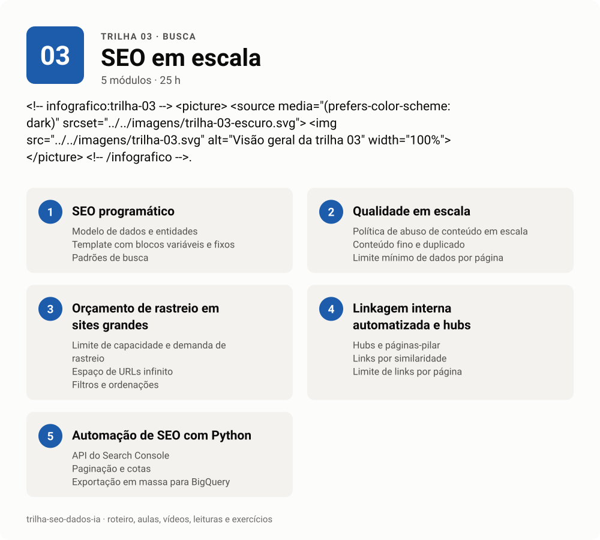

# 03 · SEO em escala

<!-- infografico:trilha-03 -->
<picture>
  <source media="(prefers-color-scheme: dark)" srcset="../../imagens/trilha-03-escuro.svg">
  
</picture>
<!-- /infografico -->

Quando o site tem dezenas de milhares de páginas, o trabalho muda de natureza. Você deixa de otimizar página por página e passa a desenhar templates, regras e bases de dados. O ganho é enorme e o risco também, porque um erro de template se repete em todas as páginas.

**Pré-requisitos.** Trilhas 01 e 02. Python básico (trilha 00).
**Carga estimada.** 25 h.

**Ao terminar, você consegue**
- desenhar um projeto de SEO programático a partir de uma base de dados real;
- definir regras de qualidade que decidem quais páginas merecem existir e ser indexadas;
- gerenciar orçamento de rastreio em sites grandes;
- automatizar coleta e análise com a API do Search Console e scripts de crawl.

## Roteiro

### 1. SEO programático (templates e bases de dados)

SEO programático é gerar páginas a partir de dados estruturados, cada uma respondendo uma busca específica. Funciona quando cada página tem informação própria e útil. Falha quando só troca o nome da cidade.

**Conceitos-chave.** Modelo de dados e entidades. Template com blocos variáveis e fixos. Padrões de busca (X em Y, X para Y, X vs Y). Chave canônica e slug estável. Publicação em lotes.

**Na prática.** O erro mais caro é partir da taxonomia que você já tem. Num portal médico, os temas de um banco de questões viraram, quando analisados, cerca de três doenças por tema (374 temas, 1.140 entidades). O projeto certo começou modelando a entidade (doença) e ligando cada uma às estruturas existentes, numa relação de muitos para muitos.

- [ ] Modelei as entidades e os atributos de um projeto programático
- [ ] Defini a regra de slug e o que acontece quando dois itens colidem
- [ ] Gerei 20 páginas de teste a partir de um CSV com Python e Jinja

### 2. Qualidade em escala

O Google tem uma política contra conteúdo em escala feito para manipular ranqueamento, com ou sem IA. A defesa é ter um critério explícito de quando a página merece existir.

**Conceitos-chave.** Política de abuso de conteúdo em escala. Conteúdo fino e duplicado. Limite mínimo de dados por página. `noindex` até atingir o limite. Revisão por amostragem. Página que agrega dados de várias fontes.

- [ ] Escrevi a regra de qualidade (quantos dados mínimos, que campos obrigatórios) de um projeto
- [ ] Separei páginas de um projeto real em "indexar", "noindex" e "não gerar"
- [ ] Li a política de spam do Google sobre conteúdo em escala

### 3. Orçamento de rastreio em sites grandes

Acima de algumas dezenas de milhares de URLs, o Google não rastreia tudo com a mesma frequência. Gastar rastreio com filtros, parâmetros e páginas inúteis atrasa a descoberta do que importa.

**Conceitos-chave.** Limite de capacidade e demanda de rastreio. Espaço de URLs infinito. Filtros e ordenações. Cadeias de redirecionamento. Erros 5xx e lentidão reduzindo o rastreio. `lastmod` confiável.

- [ ] Medi no log ou nas estatísticas de rastreamento quanto vai para URLs com parâmetro
- [ ] Propus regras para fechar um espaço de URLs infinito

### 4. Linkagem interna automatizada e hubs

Em escala, link interno é regra de template. Hubs de tema, links para entidades relacionadas e breadcrumbs consistentes distribuem autoridade sem depender de editor.

**Conceitos-chave.** Hubs e páginas-pilar. Links por similaridade (atributos ou embeddings). Limite de links por página. Breadcrumbs por taxonomia. Páginas órfãs geradas por template.

- [ ] Desenhei a regra de links relacionados de um template
- [ ] Calculei a profundidade de clique das páginas geradas

### 5. Automação de SEO com Python

A interface do Search Console devolve no máximo mil linhas. A API devolve muito mais, e a exportação para BigQuery devolve tudo. Automatizar coleta, crawl e checagens é o que permite trabalhar em escala.

**Conceitos-chave.** API do Search Console (Search Analytics, URL Inspection). Paginação e cotas. Exportação em massa para BigQuery. Crawl com `requests` e parser. Agendamento com cron. Alertas.

**Na prática.** Quem só tem a interface pode fatiar a tabela de páginas por prefixo de URL e somar depois. Dá certo, com três cuidados. O filtro "contém" falha em alguns prefixos, então confira a soma dos cortes contra o total do painel. Depois de navegar, o extrator pode ler a tabela antiga ainda presente na página. E a união de cortes pode contar a mesma URL duas vezes. A API resolve tudo isso, e é o caminho recomendado.

- [ ] Coletei 16 meses de dados por página e por busca com a API do Search Console
- [ ] Agendei a coleta diária e gravei em Parquet ou DuckDB
- [ ] Escrevi um alerta que avisa quando uma seção perde mais de 20% de cliques

## Material

- [Aulas](aulas.md)
- [Vídeos](videos.md)
- [Leituras](leituras.md)
- [Exercícios e projeto da trilha](exercicios.md)

**Próxima trilha.** [04 GEO e busca generativa](../04-geo-busca-generativa).
