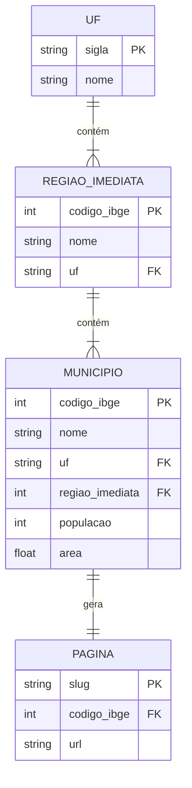
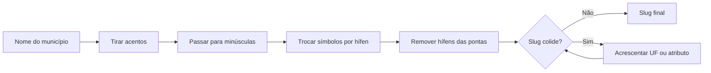
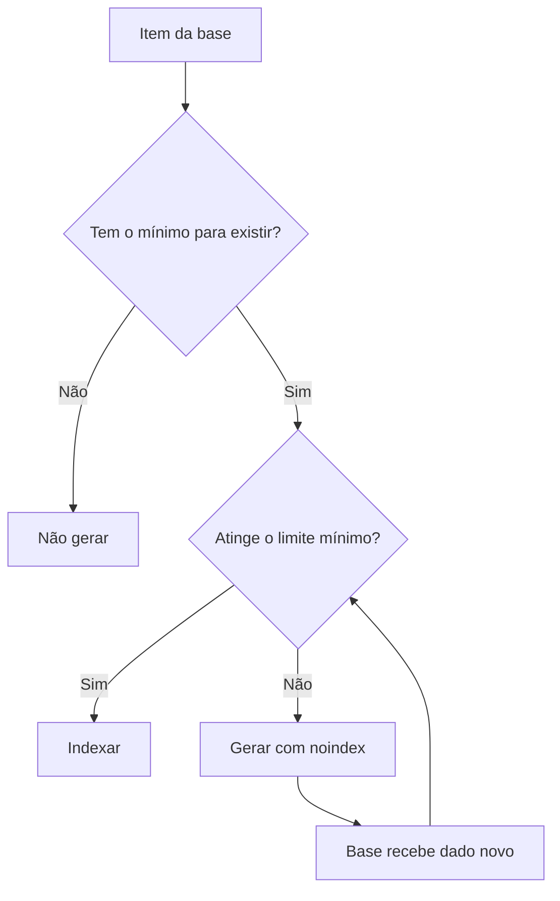
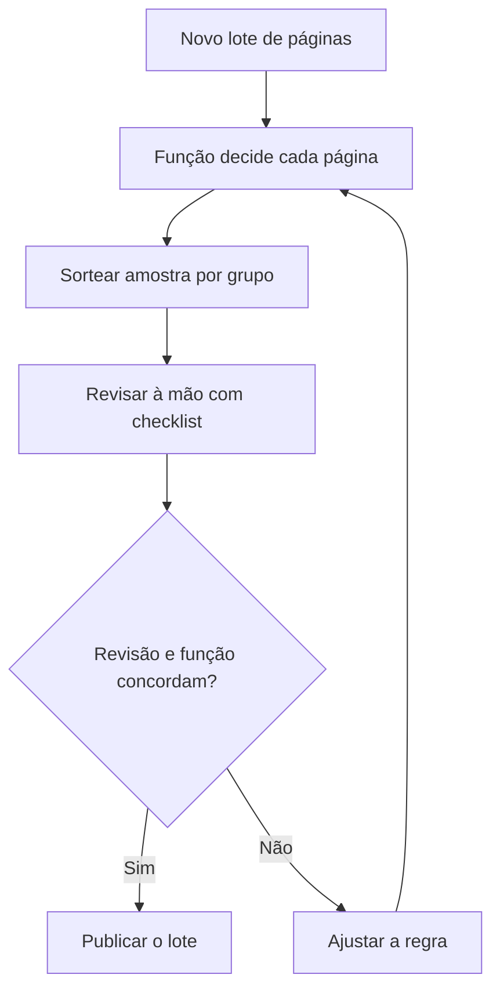
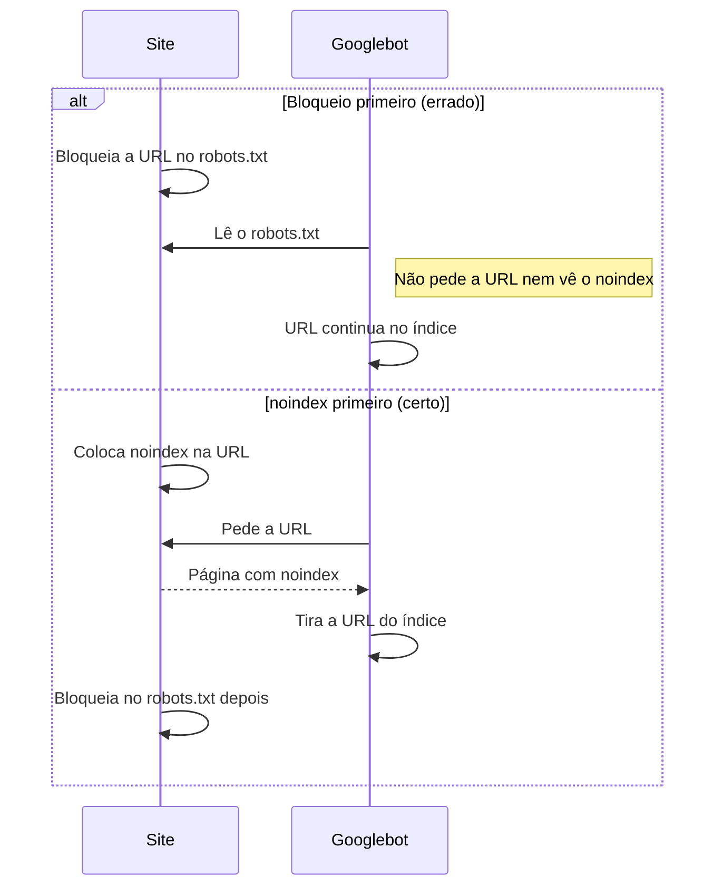
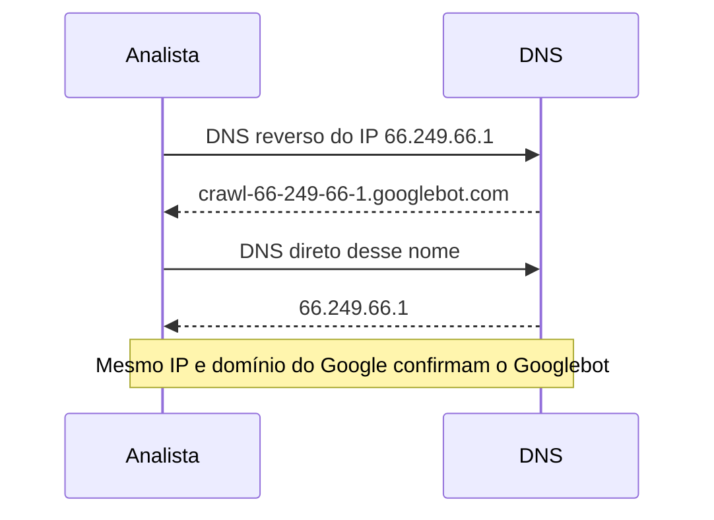
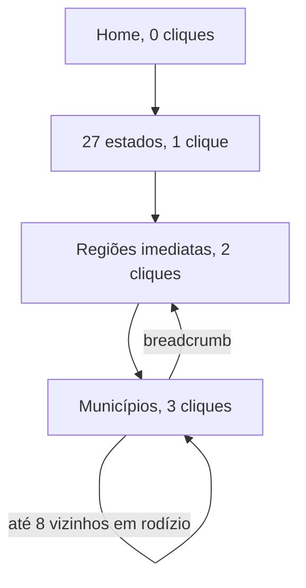
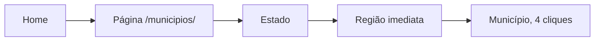
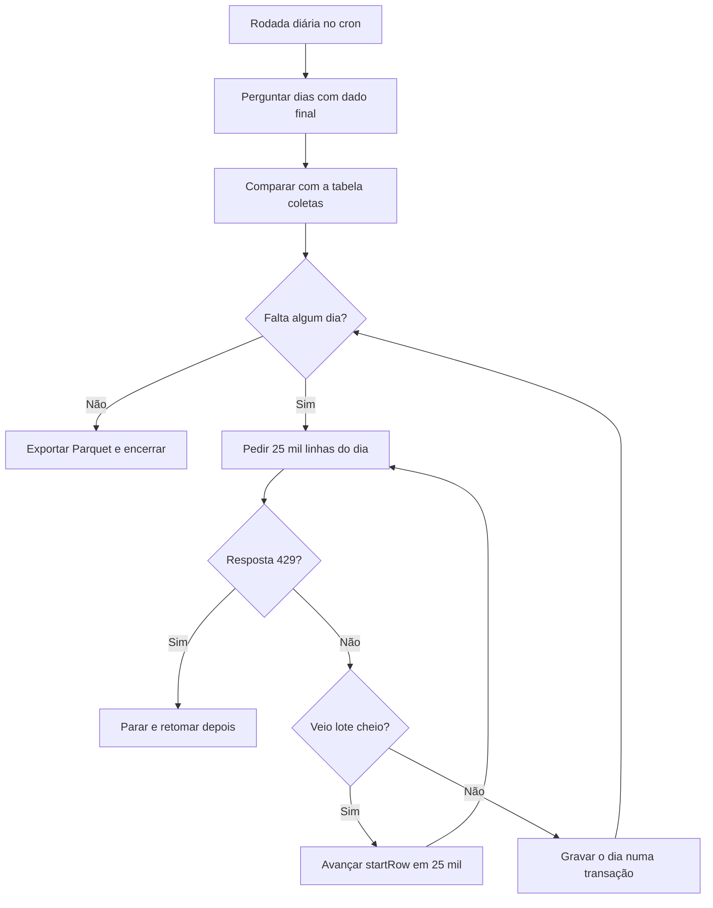

# Aulas · 03 · SEO em escala

Texto de apoio de cada módulo. Leia depois dos vídeos e antes dos exercícios. Onde houver comando ou código, rode no seu computador.

## Sumário

1. [SEO programático (templates e bases de dados)](#aula-1-seo-programático-templates-e-bases-de-dados)
2. [Qualidade em escala](#aula-2-qualidade-em-escala)
3. [Orçamento de rastreio em sites grandes](#aula-3-orçamento-de-rastreio-em-sites-grandes)
4. [Linkagem interna automatizada e hubs](#aula-4-linkagem-interna-automatizada-e-hubs)
5. [Automação de SEO com Python](#aula-5-automação-de-seo-com-python)

## Aula 1. SEO programático (templates e bases de dados)

### A ideia central

SEO programático é gerar páginas a partir de dados estruturados, cada uma respondendo a uma busca específica. "Clima em Petrópolis", "dentista em Joinville", "Python vs R para análise de dados". O texto da página sai de um template e os números saem de uma base.

O modelo mental certo é o de um produto de dados com uma vitrine. A base é o produto. O template é a vitrine. Se a base não tem informação própria para cada item, nenhum template salva a página. Por isso o trabalho começa pela modelagem de dados, muito antes do HTML.

### Como funciona

#### Padrões de busca

Projetos programáticos nascem de padrões de busca que se repetem com uma variável trocada.

| Padrão | Exemplo | O que a página precisa ter de próprio |
|---|---|---|
| X em Y | dentista em Joinville | Lista real de dentistas, bairros, preços ou avaliações daquela cidade |
| X para Y | notebook para programar | Critérios específicos daquele uso e produtos que atendem |
| X vs Y | Python vs R | Comparação lado a lado com dados dos dois itens |

O padrão precisa de demanda comprovada (autocomplete, Trends, impressões) e de uma SERP que aceite esse tipo de página. Se o top 10 de "dentista em Joinville" só tem diretórios grandes e mapas, uma página nova com a mesma lista dificilmente entra.

#### Modelo de dados e entidades

Entidade é a coisa sobre a qual a página fala. Município, doença, produto, profissão. Cada entidade tem atributos (população, sintomas, preço) e relações com outras entidades (município pertence a estado, doença tem tratamentos). Antes de escrever qualquer template, desenhe esse modelo numa tabela.

| Entidade | Chave canônica | Atributos | Relações |
|---|---|---|---|
| Município | código IBGE | nome, UF, população, área | pertence a uma região imediata e a uma UF |
| Região imediata | código IBGE | nome | contém municípios |

A chave canônica é o identificador estável da entidade. O nome muda (grafia, acento, reforma administrativa). O código não muda. A URL deriva da chave e do nome, e a tabela guarda o vínculo entre os dois.

O modelo abaixo mostra as entidades da tabela, as chaves e a página que cada município gera.



#### Slug estável e colisões

O slug é a parte legível da URL, como `alta-floresta-d-oeste-ro`. A regra precisa ser escrita e determinística. Tirar acentos, passar para minúsculas, trocar tudo que não é letra ou número por hífen e remover hífens das pontas.

Colisão acontece quando dois itens diferentes geram o mesmo slug. Em municípios brasileiros, só o nome colide muito. "Bom Jesus", por exemplo, existe em cinco estados. Juntar o nome com a UF resolve no caso dos municípios. Em outras bases, a saída é acrescentar um atributo que diferencia ou, em último caso, a chave. Decida a regra antes de publicar, porque trocar slug depois significa redirecionar milhares de URLs.

O fluxo mostra a regra de slug do começo ao fim, com o tratamento de colisão.



#### Template com blocos fixos e variáveis

O template tem blocos fixos (estrutura, navegação, explicação do método) e blocos variáveis (números, tabelas, comparações, listas de itens relacionados). O que torna a página útil é a parte variável. Se você tirar o nome da cidade e a página continuar igual à da cidade vizinha, o template falhou.

#### Publicação em lotes

Publique em lotes pequenos e meça. Um lote de 50 a 100 páginas, conferido por crawl e acompanhado no Search Console por algumas semanas, mostra se o Google indexa e se as páginas recebem impressões. Publicar 50 mil de uma vez transforma um erro de template em 50 mil erros.

### Exemplo guiado

Gere 20 páginas de teste com dados abertos do IBGE.

1. Crie um ambiente e instale as bibliotecas.

```bash
python3.12 -m venv .venv
source .venv/bin/activate
pip install requests jinja2
```

2. Salve o script abaixo como `gerar.py`. Ele baixa a lista de municípios uma única vez, guarda em cache, para no primeiro 429 e usa user-agent com contato. Depois aplica a regra de slug, conta colisões com e sem a UF e gera 20 páginas com Jinja2.

```python
"""Gera páginas de teste a partir da API de localidades do IBGE."""
import json
import re
import time
import unicodedata
from pathlib import Path

import requests
from jinja2 import Environment, select_autoescape

URL = "https://servicodados.ibge.gov.br/api/v1/localidades/municipios"
UA = "trilha-seo-dados-ia/0.1 (estudo; seu-email@exemplo.com)"
CACHE = Path("municipios.json")


def baixar():
    if CACHE.exists():
        return json.loads(CACHE.read_text(encoding="utf-8"))
    resp = requests.get(URL, headers={"User-Agent": UA}, timeout=60)
    if resp.status_code == 429:
        raise SystemExit("429 recebido. Parando. Tente de novo mais tarde.")
    resp.raise_for_status()
    CACHE.write_text(resp.text, encoding="utf-8")
    time.sleep(3)
    return resp.json()


def slugify(texto):
    texto = unicodedata.normalize("NFKD", texto)
    texto = texto.encode("ascii", "ignore").decode("ascii")
    texto = re.sub(r"[^a-z0-9]+", "-", texto.lower())
    return texto.strip("-")


def colisoes(slugs):
    contagem = {}
    for s in slugs:
        contagem[s] = contagem.get(s, 0) + 1
    return {s: n for s, n in contagem.items() if n > 1}


def uf_de(m):
    return m["regiao-imediata"]["regiao-intermediaria"]["UF"]


MODELO = """<!doctype html>
<html lang="pt-BR">
<head>
  <meta charset="utf-8">
  <title>{{ nome }} ({{ uf }}) · região imediata e vizinhos</title>
  <link rel="canonical" href="https://exemplo.com.br/municipios/{{ slug }}/">
</head>
<body>
  <nav><a href="/">Início</a> › <a href="/municipios/{{ uf | lower }}/">{{ uf }}</a> › {{ nome }}</nav>
  <h1>{{ nome }}, {{ uf_nome }}</h1>
  <p>{{ nome }} faz parte da região imediata de {{ imediata }},
     que tem {{ vizinhos | length }} outros municípios.</p>
  
  <h2>Outros municípios da região imediata</h2>
  <ul>
  <li><a href="/municipios/{{ v.slug }}/">{{ v.nome }}</a></li>
  </ul>
  
  <p>Código IBGE {{ id }}. Fonte IBGE, API de localidades.</p>
</body>
</html>
"""


def main():
    municipios = baixar()
    linhas = []
    for m in municipios:
        uf = uf_de(m)
        linhas.append({
            "id": m["id"],
            "nome": m["nome"],
            "uf": uf["sigla"],
            "uf_nome": uf["nome"],
            "imediata": m["regiao-imediata"]["nome"],
            "slug": f"{slugify(m['nome'])}-{uf['sigla'].lower()}",
        })
    print(len(linhas), "municípios")
    so_nome = colisoes([slugify(l["nome"]) for l in linhas])
    com_uf = colisoes([l["slug"] for l in linhas])
    print("slugs repetidos só com o nome:", len(so_nome), "exemplos:", list(so_nome)[:3])
    print("slugs repetidos com nome e UF:", len(com_uf))

    por_regiao = {}
    for l in linhas:
        por_regiao.setdefault(l["imediata"] + l["uf"], []).append(l)

    env = Environment(autoescape=select_autoescape(default=True))
    modelo = env.from_string(MODELO)
    saida = Path("site/municipios")
    for l in linhas[:20]:
        vizinhos = [v for v in por_regiao[l["imediata"] + l["uf"]] if v["id"] != l["id"]]
        pasta = saida / l["slug"]
        pasta.mkdir(parents=True, exist_ok=True)
        (pasta / "index.html").write_text(modelo.render(**l, vizinhos=vizinhos), encoding="utf-8")
    print("20 páginas em", saida)


if __name__ == "__main__":
    main()
```

```bash
python gerar.py
```

3. Leia a saída. Compare quantos slugs colidem só com o nome e quantos colidem com nome e UF.
4. Abra duas páginas geradas no navegador, lado a lado. Pergunte o que uma tem que a outra não tem. A resposta honesta é pouca coisa, e a Aula 2 mede isso com código.

Dois detalhes que este exemplo ensina sobre dado público. Na consulta de outubro de 2026, a API devolveu 5.571 municípios, um a mais que o número que muita gente repete. E um deles veio sem o campo `microrregiao`, porque foi criado depois da última revisão daquela divisão. Por isso o script lê a UF pela região imediata. Dado público muda. Sempre conte o que veio antes de escrever o número num texto.

### Erros comuns

- **Começar pelo template.** Sem modelo de dados, o template só troca o nome. Modele entidades, atributos e chave antes do HTML.
- **Slug derivado só do nome.** Gera colisões e quebra quando o nome muda. Derive o slug do nome com um atributo que diferencia e guarde o vínculo com a chave.
- **Partir da taxonomia que você já tem.** Ela foi feita para outro propósito e mistura entidades. Modele o que as pessoas buscam.
- **Publicar tudo de uma vez.** Um erro de template se repete em todas as páginas. Publique em lotes e meça cada um.
- **Trocar a regra de slug depois de publicado.** Cada URL alterada precisa de redirecionamento. Feche a regra antes do primeiro lote.

### Na prática

O erro mais caro é partir da taxonomia que você já tem. Num portal médico, os temas de um banco de questões viraram, quando analisados, cerca de três doenças por tema (374 temas, 1.140 entidades).

A tentação era óbvia. Já existiam 374 temas organizados, com questões ligadas a cada um. Gerar 374 páginas parecia o caminho curto. O raciocínio que mudou o projeto foi olhar o que estava dentro de cada tema. Um tema de prova agrupa doenças que costumam cair juntas, e quem busca no Google procura uma doença, não um tema de prova. Uma página por tema falaria de três doenças ao mesmo tempo e não responderia a busca de nenhuma delas por inteiro.

O projeto certo começou modelando a entidade. Cada doença virou um registro com chave própria, e cada registro foi ligado às estruturas existentes numa relação de muitos para muitos. Uma doença aponta para vários temas, e um tema aponta para várias doenças. Com isso a base passou de 374 itens para 1.140 entidades, cada uma com uma busca clara por trás e com o conteúdo que já existia distribuído entre elas. O número de páginas triplicou, e cada uma passou a ter um motivo para existir.

### Resumo

- SEO programático é produto de dados com vitrine. A base vem primeiro.
- Cada padrão de busca precisa de demanda comprovada e de dado próprio por página.
- A chave canônica é estável e o slug segue uma regra escrita que trata colisões.
- Desconfie da taxonomia herdada e modele a entidade que as pessoas buscam.
- Publique em lotes e meça antes de escalar.

### Para ir além

- **Programmatic SEO, Explained for Beginners**, da Ahrefs, em [leituras.md](leituras.md). Como achar o padrão de busca e montar o template.
- **Políticas de spam para a Pesquisa Google na Web (páginas de entrada)**, em [leituras.md](leituras.md). A definição oficial de doorway, o maior risco do projeto programático.
- **Doorway Pages vs. Programmatic SEO**, de Edward Sturm, em [videos.md](videos.md). A linha entre página programática útil e página de entrada, com exemplos.

## Aula 2. Qualidade em escala

### A ideia central

O Google tem uma política contra conteúdo em escala feito para manipular o ranqueamento. Ela vale com ou sem IA. A defesa é ter um critério explícito, escrito em código, de quando uma página merece existir e quando merece ser indexada.

O modelo mental certo é o de um portão com três saídas. Indexar, `noindex` e não gerar. Toda página passa pelo portão antes de ir ao ar, e o portão é uma função que qualquer pessoa da equipe pode ler e testar.

### Como funciona

#### A política de abuso de conteúdo em escala

A política define o abuso como gerar muitas páginas com o objetivo principal de manipular o ranqueamento. Os exemplos da política incluem.

- Usar IA generativa ou ferramentas parecidas para gerar muitas páginas sem acrescentar valor para o usuário.
- Raspar feeds, resultados de busca ou outros conteúdos para gerar muitas páginas.
- Costurar conteúdo de páginas diferentes sem acrescentar valor.
- Criar vários sites para esconder a natureza em escala do conteúdo.
- Criar muitas páginas que não fazem sentido para quem lê e só servem para reunir palavras-chave.

A política vale para conteúdo feito por IA, por pessoas ou pelas duas coisas. Ela foi criada no anúncio da core update de março de 2024, junto com as políticas de abuso de reputação de site e de domínio expirado.

#### Conteúdo fino e duplicado

Página fina é a que tem pouco conteúdo próprio. Em projeto programático, ela aparece de três formas mensuráveis.

| Sinal | Como medir com código |
|---|---|
| Pouco texto visível | Contar palavras do corpo, sem navegação e sem rodapé |
| Pouco dado próprio | Contar números, linhas de tabela ou atributos preenchidos |
| Parecida demais com as irmãs | Comparar trechos de 5 palavras (shingles) entre páginas e calcular a similaridade de Jaccard |

Duplicado é quando duas URLs mostram o mesmo conteúdo. O Google agrupa duplicatas e escolhe uma canônica. Você pode sinalizar a preferida com `rel="canonical"`, redirecionamento ou consistência de links internos.

#### Limite mínimo e `noindex`

O limite mínimo define o que uma página precisa ter para ser indexável. Campos obrigatórios, quantidade mínima de dados, texto próprio mínimo. Abaixo do limite, a página pode existir para quem navega, com `noindex`, ou nem ser gerada.

Por que `noindex` em vez de esperar? Porque a página pode ser útil para o usuário que chega por link interno, e porque o dado pode completar depois. Quando o item atinge o limite, a regra muda a decisão para indexar sem nenhuma intervenção manual.

O portão abaixo mostra as três saídas e o caminho de volta quando o dado completa.



#### Revisão por amostragem

Nenhuma regra automática acerta tudo. Sorteie páginas de cada grupo, revise à mão com um checklist e compare com a decisão da função. Onde as duas discordam, a regra precisa de ajuste. Repita a cada lote.

O ciclo de revisão de cada lote fica assim.



#### Agregar dados de várias fontes

A forma mais segura de passar no portão é cruzar fontes. Uma página de município com população, indicadores de saúde, escolas e clima, cada dado com a fonte citada, tem informação que nenhuma das fontes sozinha oferece. Costurar textos é o que a política proíbe. Cruzar dados com método é o que gera valor.

### Exemplo guiado

Meça sinais de página fina nas 20 páginas geradas na Aula 1 e aplique uma regra.

1. Instale o parser.

```bash
pip install beautifulsoup4
```

2. Salve o script abaixo como `medir.py`, na mesma pasta do `gerar.py`.

```python
"""Mede sinais de página fina nas páginas geradas e aplica a regra de qualidade."""
import re
from itertools import combinations
from pathlib import Path

from bs4 import BeautifulSoup

MIN_NUMEROS = 4          # dados numéricos próprios na página
MIN_PALAVRAS = 150       # palavras visíveis no corpo
MAX_SIMILARIDADE = 0.80  # parecida demais com outra página do mesmo template


def texto_visivel(caminho):
    sopa = BeautifulSoup(caminho.read_text(encoding="utf-8"), "html.parser")
    for tag in sopa(["nav", "script", "style"]):
        tag.decompose()
    return sopa.body.get_text(" ", strip=True)


def shingles(texto, n=5):
    palavras = re.findall(r"\w+", texto.lower())
    return {" ".join(palavras[i:i + n]) for i in range(len(palavras) - n + 1)}


paginas = {p.parent.name: texto_visivel(p) for p in Path("site/municipios").glob("*/index.html")}
conjuntos = {slug: shingles(t) for slug, t in paginas.items()}

similaridade = {slug: 0.0 for slug in paginas}
for a, b in combinations(paginas, 2):
    sa, sb = conjuntos[a], conjuntos[b]
    j = len(sa & sb) / len(sa | sb) if sa | sb else 1.0
    similaridade[a] = max(similaridade[a], j)
    similaridade[b] = max(similaridade[b], j)


def decidir(palavras, numeros, sim):
    if palavras < 30:
        return "nao gerar"
    if palavras >= MIN_PALAVRAS and numeros >= MIN_NUMEROS and sim <= MAX_SIMILARIDADE:
        return "indexar"
    return "noindex"


grupos = {}
for slug, texto in sorted(paginas.items()):
    palavras = len(texto.split())
    numeros = len(set(re.findall(r"\d[\d.,]*", texto)))
    decisao = decidir(palavras, numeros, similaridade[slug])
    grupos[decisao] = grupos.get(decisao, 0) + 1
    print(f"{slug:35s} palavras={palavras:4d} números={numeros:2d} "
          f"similaridade={similaridade[slug]:.2f} -> {decisao}")
print(grupos)
```

```bash
python medir.py
```

3. Leia o resultado. Com o template da Aula 1, todas as páginas caem em `noindex`. Elas têm poucas palavras e só dois números próprios (o código IBGE e a contagem de vizinhos). O portão está funcionando.
4. Enriqueça a base com uma segunda fonte pública, como um agregado do SIDRA com população, e mostre o dado no template. Rode `gerar.py` e `medir.py` de novo e veja quantas páginas mudam de grupo.
5. Sorteie 5 páginas de cada grupo e revise à mão. Anote onde você discorda da função e ajuste os limites.

Os limites deste exemplo são ponto de partida. Calibre com a sua base e escreva no README do projeto o porquê de cada número.

### Erros comuns

- **Regra que só existe na cabeça de alguém.** Ninguém consegue auditar nem repetir. Escreva a regra como função e versione junto com o código.
- **Usar IA para "enriquecer" texto de página sem dado.** Mais palavras sem informação nova continuam sendo página fina, e a política cita esse caso. Enriqueça com dado.
- **Indexar tudo e esperar o Google filtrar.** Páginas fracas pesam na avaliação do conjunto. Use `noindex` até a página atingir o limite.
- **Medir similaridade só pelo título.** Títulos diferentes escondem corpos iguais. Compare o texto visível inteiro.
- **Nunca revisar a amostra.** A regra deriva com o tempo e com a base. Revise uma amostra a cada lote.

### Na prática

O roteiro deste módulo não traz caso real, então segue um cenário hipotético. Imagine um comparador de cursos que gera uma página para cada combinação de curso e cidade. São 300 cursos e 500 cidades, 150 mil combinações. A equipe de conteúdo propõe usar IA para escrever um parágrafo de introdução para cada página, para que nenhuma fique vazia.

O raciocínio que evita o problema começa pela pergunta da política. Qual é o valor para o usuário? Na maior parte das combinações, a base não tem nenhuma escola daquele curso naquela cidade. O parágrafo gerado por IA falaria sobre "estudar o curso X na cidade Y" sem nenhum dado, e seria exatamente o que a política descreve.

A equipe escreve então a regra. Uma combinação só é gerada se a base tiver pelo menos uma escola com preço, carga horária e endereço. Fica indexável com pelo menos três escolas e uma comparação de preços. O resultado esperado é uma fração pequena das 150 mil combinações publicada, cada uma com informação que a pessoa não acha reunida em outro lugar. O resto continua como filtro de busca interna, sem página própria.

### Resumo

- A política de abuso de conteúdo em escala mira o objetivo de manipular, com ou sem IA.
- Página fina se mede com código. Palavras, dados próprios e similaridade com as irmãs.
- Toda página passa por uma função que devolve indexar, `noindex` ou não gerar.
- Revise uma amostra a cada lote e ajuste a regra.
- Cruzar fontes de dados gera valor. Costurar textos é o que a política proíbe.

### Para ir além

- **Políticas de spam para a Pesquisa Google na Web (abuso de conteúdo em escala)**, em [leituras.md](leituras.md). O texto oficial que esta aula resumiu, com todos os exemplos.
- **Orientações da Pesquisa Google sobre conteúdo de IA generativa no seu site**, em [leituras.md](leituras.md). Quando o uso de IA é aceito e quando vira spam.
- **Handling Dupes · Same Same or Different?**, do Search Off the Record, em [videos.md](videos.md). Como o Google agrupa duplicatas e escolhe a canônica.

## Aula 3. Orçamento de rastreio em sites grandes

### A ideia central

O Google não rastreia todas as URLs de um site grande com a mesma frequência. Ele decide quanto pode rastrear sem sobrecarregar o servidor e quanto quer rastrear com base no que acha que vale a pena. Rastreio gasto com filtro, parâmetro e página inútil atrasa a descoberta do que importa.

O modelo mental certo é o de um orçamento com dois tetos. Um teto é técnico (o servidor aguenta). O outro é de interesse (as URLs valem a visita). O trabalho é subir o primeiro e não desperdiçar o segundo.

### Como funciona

#### Para quem isso importa

O guia oficial diz que o assunto é relevante para três perfis de site.

- Sites grandes, com mais de 1 milhão de páginas únicas e conteúdo que muda com frequência moderada (uma vez por semana).
- Sites médios ou maiores, com mais de 10 mil páginas únicas e conteúdo que muda muito rápido (todo dia).
- Sites com grande parte das URLs classificadas no Search Console como descobertas e ainda não indexadas.

Fora desses perfis, o orçamento de rastreio raramente é o problema. Um blog de 500 páginas que não indexa tem outro problema.

#### Limite de capacidade e demanda

| Conceito | Definição | O que aumenta | O que reduz |
|---|---|---|---|
| Limite de capacidade de rastreio | Quanto tempo o servidor pode passar com conexões abertas para o Google, compartilhado entre todos os robôs dele | Servidor rápido e estável | Respostas lentas, erros 5xx e sinais de limite como HTTP 429 |
| Demanda de rastreio | Quanto o Google quer rastrear, com base em tamanho, frequência de mudança, qualidade e relevância | URLs populares e conteúdo que muda de verdade | Inventário inflado com duplicatas e URLs sem valor |

O ponto que mais engana é a demanda. Sem orientação, o Google tenta rastrear todas ou quase todas as URLs que conhece. Se o site expõe milhões de combinações de filtro, ele vai tentar visitá-las.

#### Espaço de URLs infinito

Espaço infinito é quando o site gera URLs válidas sem limite. Fontes comuns são calendários com "próximo mês" para sempre, filtros combináveis em qualquer ordem, busca interna indexável e rotas parametrizadas que respondem 200 para qualquer texto. Cada uma dessas URLs consome rastreio e nenhuma acrescenta conteúdo.

#### O que o guia recomenda

- Gerenciar o inventário de URLs e consolidar conteúdo duplicado.
- Bloquear no robots.txt o que você não quer rastreado de jeito nenhum.
- Devolver 404 ou 410 para páginas removidas de vez e eliminar soft 404 (página de erro que responde 200).
- Manter os sitemaps atualizados, com `<lastmod>` quando o conteúdo muda. O Google usa o `lastmod` se ele for consistente e verificável, e ignora `priority` e `changefreq`.
- Evitar cadeias longas de redirecionamento.
- Deixar as páginas leves e responder `304 Not Modified` quando nada mudou.

Duas recomendações do guia vão contra a intuição. Não use `noindex` para economizar rastreio, porque o Google ainda pede a página e só depois a descarta. E não use o robots.txt para redistribuir o orçamento de forma temporária.

#### A ordem das regras importa

Se você bloqueia uma URL no robots.txt, o Google não a visita, então não vê o `noindex` nem a canonical que estiverem nela. Para tirar do índice URLs que já estão lá, primeiro deixe o robô ver o `noindex` ou o redirecionamento. Bloqueie depois, quando elas já tiverem saído. Para URLs que nunca deveriam ter existido, corrija os links que as geram, porque é por eles que o robô as descobre.

A sequência compara a ordem errada com a certa para tirar uma URL do índice.



#### Onde medir

O relatório de estatísticas de rastreamento do Search Console mostra total de requisições, tamanho baixado, tempo médio de resposta, estado do host e quebras por código de resposta, tipo de arquivo, propósito (descoberta ou atualização) e tipo de Googlebot. Ele só existe para propriedades de nível raiz. A fonte mais completa é o log do servidor, que registra cada visita.

No log, não confie só no user-agent, que qualquer um pode copiar. O Google documenta duas formas de verificar o Googlebot. Uma é o DNS reverso do IP, que deve terminar em `googlebot.com`, `google.com` ou `googleusercontent.com`, seguido do DNS direto, que deve voltar ao mesmo IP. A outra é comparar o IP com as listas publicadas em JSON, como a `common-crawlers.json`.

A sequência mostra a verificação por DNS em duas consultas.



### Exemplo guiado

Meça para onde vai o rastreio do Googlebot com um log e o DuckDB.

1. Instale o DuckDB.

```bash
pip install duckdb
```

2. Se não tiver um log real, gere um de treino com o script abaixo, salvo como `gerar_log.py`. Ele cria 20 mil linhas no formato combinado do Apache e Nginx, com proporções inventadas entre páginas limpas, filtros, busca interna, redirecionamentos e erros.

```python
"""Gera um log de acesso de exemplo, com proporções inventadas."""
import random
from datetime import datetime, timedelta

random.seed(42)
inicio = datetime(2026, 9, 1)
caminhos = (
    [("/produto/{}", 200)] * 40
    + [("/categoria/tenis?cor={}&ordem=preco", 200)] * 35
    + [("/busca?q=termo{}", 200)] * 10
    + [("/antigo/{}", 301)] * 10
    + [("/produto/{}", 404)] * 3
    + [("/categoria/{}", 503)] * 2
)
with open("access.log", "w") as f:
    for i in range(20_000):
        modelo, status = random.choice(caminhos)
        quando = inicio + timedelta(seconds=i * 120)
        data = quando.strftime("%d/%b/%Y:%H:%M:%S +0000")
        url = modelo.format(random.randint(1, 3000))
        f.write(
            f'66.249.66.1 - - [{data}] "GET {url} HTTP/1.1" {status} 5120 "-" '
            '"Mozilla/5.0 (compatible; Googlebot/2.1; +http://www.google.com/bot.html)"\n'
        )
print("access.log gerado")
```

3. Salve a análise como `analisar_log.py`. Ela lê o log linha a linha (funciona com arquivos grandes e com curinga, como `logs/*.log`), extrai os campos com regex e agrupa as requisições do Googlebot.

```python
import duckdb

con = duckdb.connect("rastreio.duckdb")
con.execute(r"""
CREATE OR REPLACE TABLE log AS
SELECT
  regexp_extract(linha, '^(\S+)', 1)                        AS ip,
  regexp_extract(linha, '\[([^\]]+)\]', 1)                  AS quando,
  regexp_extract(linha, '"[A-Z]+ (\S+) HTTP', 1)            AS url,
  TRY_CAST(regexp_extract(linha, '" (\d{3}) ', 1) AS INT)   AS status,
  regexp_extract(linha, '"([^"]*)"$', 1)                    AS ua
FROM read_csv('access.log', columns = {'linha': 'VARCHAR'},
              delim = '\x01', header = false, quote = '', escape = '')
""")

con.sql(r"""
SELECT
  CASE
    WHEN status >= 500             THEN '5xx'
    WHEN status IN (301, 302, 308) THEN 'redirecionamento'
    WHEN status = 404              THEN '404'
    WHEN url LIKE '%?%'            THEN 'com parâmetro'
    ELSE 'página limpa 200'
  END AS grupo,
  count(*) AS requisicoes,
  round(100.0 * count(*) / sum(count(*)) OVER (), 1) AS pct
FROM log
WHERE ua LIKE '%Googlebot%'
GROUP BY grupo
ORDER BY requisicoes DESC
""").show()

con.sql(r"""
SELECT regexp_extract(url, '^(/[^/?]*)', 1) AS secao, count(*) AS requisicoes
FROM log WHERE ua LIKE '%Googlebot%'
GROUP BY secao ORDER BY requisicoes DESC
""").show()
```

```bash
python gerar_log.py
python analisar_log.py
```

4. Leia as duas tabelas. No log de treino, menos da metade das visitas vai para página limpa com 200. O resto vai para filtros, busca interna, redirecionamentos e erros. Com um log real, o retrato é o ponto de partida das regras.
5. Antes de tirar conclusão de um log real, verifique por DNS reverso uma amostra dos IPs que dizem ser Googlebot.

```bash
host 66.249.66.1
host crawl-66-249-66-1.googlebot.com
```

O primeiro comando deve devolver um nome em `googlebot.com`. O segundo deve devolver o mesmo IP.

### Erros comuns

- **Usar `noindex` para economizar rastreio.** O Google ainda pede a página. Para economizar rastreio, bloqueie no robots.txt ou elimine a URL.
- **Bloquear no robots.txt antes de desindexar.** O robô deixa de ver o `noindex` e a URL pode continuar no índice. Desindexe primeiro e bloqueie depois.
- **Contar o Googlebot pelo user-agent.** Robôs falsos copiam o nome. Verifique por DNS reverso ou pelas listas de IP do Google.
- **`lastmod` com a data de hoje em todas as URLs.** O Google deixa de confiar no campo. Atualize `lastmod` só quando o conteúdo mudar de verdade.
- **Tratar orçamento de rastreio como problema de site pequeno.** Em site pequeno, a página que não indexa costuma ter problema de qualidade ou de descoberta. Confira os perfis do guia antes.

### Na prática

Este é um trecho do caso 4 da pasta de casos, sobre nove afirmações erradas numa auditoria. A revisão do backlog achou o problema mais grave, que não estava em nenhuma versão anterior. Uma rota parametrizada devolvia 200 indexável para qualquer texto na URL, um espaço de URLs infinito.

Por que ninguém viu antes? Porque as ferramentas de auditoria seguem links, e nenhum link apontava para slugs inventados. A rota só aparecia como problema quando alguém testava de propósito uma URL que não deveria existir. Um slug inventado devolvia a página de modelo, com status 200 e sem `noindex`.

O raciocínio que ligou isso ao orçamento de rastreio é simples. Qualquer link quebrado, erro de digitação em site externo ou parâmetro inventado vira uma URL válida e indexável. O Google descobre essas URLs com o tempo e passa a visitá-las. O inventário cresce sem limite, e cada visita a uma URL inútil é uma visita a menos numa página que importa.

A lição que o caso registra vale como rotina. Teste slug inventado em toda rota com parâmetro e confira status e meta robots juntos. A resposta certa para o slug inventado é 404.

### Resumo

- Orçamento de rastreio tem dois tetos, capacidade do servidor e demanda do Google.
- O guia vale para sites com mais de 1 milhão de páginas, mais de 10 mil páginas que mudam todo dia ou muitas URLs descobertas e não indexadas.
- `noindex` não economiza rastreio. robots.txt economiza e esconde o `noindex`.
- Espaço de URLs infinito é o maior desperdício. Teste slug inventado em toda rota.
- Meça no log, com o Googlebot verificado por DNS.

### Para ir além

- **Gerenciamento da cota de rastreamento**, em [leituras.md](leituras.md). O guia oficial que esta aula resumiu.
- **Gerenciar o rastreamento de URLs de navegação facetada**, em [leituras.md](leituras.md). A fonte mais comum de desperdício em e-commerce.
- **Crawl Budget and the Crawl Stats report**, do Google Search Central, em [videos.md](videos.md). Como ler o relatório de estatísticas de rastreamento.
- **Should I worry about crawl budget?**, do Search Off the Record, em [videos.md](videos.md). Quando o assunto é problema real e quando é mito.

## Aula 4. Linkagem interna automatizada e hubs

### A ideia central

Num site com dezenas de milhares de páginas, ninguém escolhe link à mão. Link interno vira regra de template. A regra decide para onde cada página aponta, quantos links ela tem e como a força chega até a última página gerada.

O modelo mental certo é o de um grafo que você projeta antes de construir. Cada regra de template cria arestas em massa. Antes de publicar, você gera o grafo inteiro em código e mede profundidade, links de entrada e órfãs. Isso é muito mais barato que descobrir o problema no Search Console meses depois.

### Como funciona

#### Hub e página-pilar

Hub é uma página de navegação que organiza um conjunto e aponta para todas as páginas dele. A página de um estado que lista as regiões, ou a de uma categoria que lista os produtos. Página-pilar é um conteúdo longo e completo sobre um tema, que aprofunda o assunto e aponta para páginas-filhas que detalham cada parte. O hub organiza. O pilar ensina. Projetos programáticos dependem mais de hubs.

#### Links por regra

A regra de links relacionados pode usar atributos ou similaridade.

| Tipo de regra | Exemplo | Vantagem | Risco |
|---|---|---|---|
| Por atributo | Municípios da mesma região imediata | Previsível e fácil de explicar | Entidade sem pares fica sem links |
| Por similaridade de embeddings | Páginas com texto parecido | Encontra relações que os atributos não mostram | Concentra links nas páginas mais "médias" e pode criar ligações estranhas |

Embeddings são vetores numéricos que representam o significado de um texto. Duas páginas com vetores próximos tratam de assuntos parecidos. Modelos abertos, como os da biblioteca `sentence-transformers`, geram esses vetores no seu computador.

#### Limite de links por página

O Google não fixa um número máximo de links por página. O limite é prático. Muitos links diluem a atenção do usuário e o valor de cada um. Uma regra comum é limitar os relacionados a um número fixo e usar rodízio para que todas as páginas recebam links de entrada.

#### Breadcrumbs por taxonomia

Breadcrumb gerado pela taxonomia garante que toda página aponta para os níveis acima. Isso cria um caminho curto de volta ao hub e reforça a hierarquia. Gere sempre a partir do modelo de dados, nunca de texto digitado.

#### Órfãs geradas por template

Um template gera órfãs sem ninguém perceber quando a regra de links só aponta para itens "populares", quando a paginação dos hubs corta a lista ou quando uma entidade não tem pares pelo atributo escolhido. A documentação do Google pede que toda página que importa receba link de pelo menos uma outra página do site. Em escala, isso se garante medindo o grafo.

### Exemplo guiado

Gere os links de 5.571 páginas de município com uma regra e meça o grafo com `networkx`.

1. Instale a biblioteca. Use o `municipios.json` baixado na Aula 1.

```bash
pip install networkx
```

2. Salve como `links.py`. A regra é esta. A home aponta para os 27 estados. Cada estado aponta para as suas regiões imediatas. Cada região aponta para os seus municípios. Cada município aponta de volta para a região (breadcrumb) e para até 8 vizinhos da mesma região, em rodízio.

O grafo abaixo mostra a regra e a profundidade de cada nível.



```python
"""Gera links por regra de template e mede profundidade e órfãs."""
import json
import re
import unicodedata

import networkx as nx


def slugify(texto):
    texto = unicodedata.normalize("NFKD", texto).encode("ascii", "ignore").decode("ascii")
    return re.sub(r"[^a-z0-9]+", "-", texto.lower()).strip("-")


municipios = json.load(open("municipios.json", encoding="utf-8"))
paginas = []
for m in municipios:
    ri = m["regiao-imediata"]
    uf = ri["regiao-intermediaria"]["UF"]["sigla"].lower()
    paginas.append({
        "url": f"/municipios/{slugify(m['nome'])}-{uf}/",
        "nome": m["nome"],
        "uf": uf,
        "hub_regiao": f"/regioes/{ri['id']}/",
    })

G = nx.DiGraph()
G.add_node("/")
for uf in sorted({p["uf"] for p in paginas}):
    G.add_edge("/", f"/municipios/{uf}/")  # home aponta para os 27 estados

MAX_RELACIONADOS = 8
por_regiao = {}
for p in paginas:
    por_regiao.setdefault(p["hub_regiao"], []).append(p)

for hub, membros in por_regiao.items():
    uf = membros[0]["uf"]
    G.add_edge(f"/municipios/{uf}/", hub)          # estado aponta para a região
    membros.sort(key=lambda p: p["nome"])
    for i, p in enumerate(membros):
        G.add_edge(hub, p["url"])                   # região aponta para cada município
        G.add_edge(p["url"], hub)                   # breadcrumb de volta
        vizinhos = membros[i + 1:] + membros[:i]    # rodízio: cada um linka os próximos
        for v in vizinhos[:MAX_RELACIONADOS]:
            G.add_edge(p["url"], v["url"])

profundidade = nx.single_source_shortest_path_length(G, "/")
urls = [p["url"] for p in paginas]
fundas = [u for u in urls if profundidade.get(u, 99) > 3]
orfas = [u for u in urls if G.in_degree(u) == 0 or u not in profundidade]
print(f"{len(urls)} páginas, {len(fundas)} a mais de 3 cliques, {len(orfas)} órfãs")
dist = {}
for u in urls:
    d = profundidade.get(u, 99)
    dist[d] = dist.get(d, 0) + 1
print("profundidade:", dict(sorted(dist.items())))
entradas = sorted(G.in_degree(u) for u in urls)
print("links de entrada, mínimo e máximo:", entradas[0], entradas[-1])
```

```bash
python links.py
```

3. Com essa regra, todos os municípios ficam a 3 cliques da home e nenhum fica órfão.
4. Agora faça o teste que mostra o valor de medir antes. Troque a linha da home por um nível intermediário, uma página `/municipios/` que lista os estados, como muita gente faria. Substitua `G.add_node("/")` por `G.add_edge("/", "/municipios/")` e, dentro do laço, aponte `"/municipios/"` para cada estado em vez da home. Rode de novo. Todos os 5.571 municípios passam para 4 cliques. Uma decisão de menu mudou a profundidade do site inteiro.

O caminho com o nível intermediário fica com um clique a mais.


5. Olhe o mínimo de links de entrada. Existe pelo menos uma região imediata com um único município, que só recebe o link do hub. Decida o que a regra faz com entidades sem pares (por exemplo, completar com vizinhos de outra região do mesmo estado) e escreva a decisão.

### Erros comuns

- **Links relacionados só para as páginas populares.** As populares recebem tudo e a cauda vira órfã. Use rodízio ou limite de links de entrada por página.
- **Similaridade sem limite.** Algumas páginas aparecem em centenas de listas e outras em nenhuma. Meça a distribuição de links de entrada depois de gerar.
- **Hub paginado sem fim.** A página 40 da lista fica a 40 cliques. Divida o hub por subníveis (estado, região) em vez de paginar uma lista enorme.
- **Breadcrumb digitado à mão.** Diverge da taxonomia e cria caminhos quebrados. Gere do modelo de dados.
- **Medir só depois de publicar.** O Search Console mostra o problema meses depois. Gere o grafo em código antes e meça profundidade e órfãs.

### Na prática

O roteiro deste módulo não traz caso real, então segue um cenário hipotético. Imagine um site de vagas de emprego com uma página por cargo e cidade. A regra de links relacionados mostra, em cada página, "vagas parecidas" ordenadas por número de candidaturas. Seis meses depois, o Search Console mostra milhares de páginas descobertas e não indexadas, quase todas de cidades pequenas.

A primeira hipótese seria qualidade. O raciocínio melhor começa pelo grafo. A equipe gera a lista de links do template em código e conta os links de entrada. As páginas de cidades grandes aparecem em milhares de listas de "vagas parecidas", porque têm mais candidaturas. As de cidades pequenas não aparecem em nenhuma. Elas só são alcançadas pela paginação do hub do cargo, a dezenas de cliques da home.

A correção muda duas regras. Os relacionados passam a ser por proximidade geográfica (mesmo cargo em cidades vizinhas), com limite de 8 e rodízio. E o hub do cargo ganha um nível por estado, em vez de uma lista paginada. Antes de publicar, a equipe roda de novo a medição e confirma que nenhuma página indexável passa de 3 cliques.

### Resumo

- Em escala, link interno é regra de template, e a regra se testa em código.
- Hub organiza um conjunto. Pilar aprofunda um tema.
- Links por atributo são previsíveis. Links por embeddings acham relações novas e concentram links se não houver limite.
- Meça profundidade, links de entrada e órfãs antes de publicar.
- Uma decisão de menu muda a profundidade do site inteiro.

### Para ir além

- **Internal Linking for SEO**, de Kevin Indig, em [leituras.md](leituras.md). Modelos centralizado e descentralizado de linkagem para sites grandes.
- **How to Identify Semantically Similar Pages & Outliers**, do Screaming Frog, em [leituras.md](leituras.md). Embeddings para sugerir links, útil para o desafio do módulo.
- **Content Hubs**, da Ahrefs, em [videos.md](videos.md). Como montar hubs que concentram autoridade num tema.

## Aula 5. Automação de SEO com Python

### A ideia central

A interface do Search Console mostra no máximo 1.000 linhas por tabela. Para um site com milhares de páginas e dezenas de milhares de buscas, isso é uma amostra pequena. A API devolve muito mais, e a exportação em massa para o BigQuery devolve praticamente tudo.

O modelo mental certo é o de um banco de dados próprio que cresce todo dia. Uma coleta diária grava o dia que acabou de ser publicado. Os relatórios e alertas leem desse banco, nunca da interface. Com isso você deixa de depender do limite de linhas e da janela de 16 meses.

### Como funciona

#### As três formas de pegar os dados

| Forma | O que entrega | Limite | Quando usar |
|---|---|---|---|
| Interface | Tabelas e gráficos prontos | 1.000 linhas por tabela, 16 meses | Olhar rápido |
| API Search Analytics | Linhas por dimensão (data, página, busca, país, dispositivo, aparência) | Até 50 mil linhas por dia, por tipo de pesquisa, por propriedade. Até 25 mil linhas por chamada | Coleta diária, histórico de 16 meses |
| Exportação em massa para BigQuery | Todos os dados de desempenho, exceto consultas anonimizadas | Começa no dia da configuração, sem histórico anterior. Exige projeto com faturamento | Sites grandes, análise em SQL |

A exportação em massa roda uma vez por dia. A primeira acontece em até 48 horas depois da configuração. O conjunto de dados se chama `searchconsole` por padrão e recebe as tabelas `searchdata_site_impression`, `searchdata_url_impression` e `ExportLog`. Sem prazo de expiração configurado, os dados se acumulam para sempre e o custo de armazenamento cresce junto. Para ter os meses anteriores à configuração, use a API.

#### Como a consulta funciona

A chamada é `searchanalytics.query`, um POST para a propriedade. A propriedade de domínio se escreve `sc-domain:exemplo.com.br`. A de prefixo de URL se escreve com a barra final, `https://www.exemplo.com.br/`.

| Campo | O que faz |
|---|---|
| `startDate`, `endDate` | Datas no formato AAAA-MM-DD, no fuso do Pacífico, com as duas pontas incluídas |
| `dimensions` | Agrupamento, entre `date`, `page`, `query`, `country`, `device`, `searchAppearance` e `hour` |
| `type` | Tipo de pesquisa. `web` é o padrão. Há também `image`, `video`, `news`, `discover` e `googleNews` |
| `rowLimit` | De 1 a 25.000 linhas por chamada. O padrão é 1.000 |
| `startRow` | Deslocamento a partir de zero, usado para paginar |
| `dataState` | Sem valor ou `final`, só dado consolidado. `all` inclui dado recente ainda incompleto |
| `dimensionFilterGroups` | Filtros, com operadores como `equals`, `contains`, `includingRegex` e `excludingRegex` (regex em RE2) |

A resposta traz `rows`, e cada linha tem `keys` (os valores das dimensões, na ordem pedida), `clicks`, `impressions`, `ctr` e `position`. As linhas vêm ordenadas por cliques, do maior para o menor.

#### Paginação por `startRow`

Para pegar mais de 25 mil linhas, repita a mesma chamada aumentando `startRow` em 25 mil a cada vez. Pare quando uma resposta trouxer menos linhas do que você pediu. Se o total cair exatamente na borda de um lote, a próxima chamada volta vazia, e o laço termina do mesmo jeito.

A documentação recomenda consultar um dia por vez. Isso reduz o custo de cada chamada e evita estourar a cota. Os dados costumam ficar prontos com 2 a 3 dias de atraso.

#### Por que os números não batem com a interface

Três motivos documentados. A API não garante todas as linhas, e devolve as principais dentro dos limites internos. Agrupar por página e por busca faz o sistema descartar parte dos dados para responder em tempo razoável. E os dados agrupados por página são calculados de outro jeito (por página) do que os agrupados por propriedade. Por isso o script desta aula grava também o total do dia, agrupado só por data, para você saber quanto da soma as tabelas detalhadas cobrem.

Dois cuidados de cálculo. CTR de um grupo é a soma de cliques dividida pela soma de impressões, nunca a média dos CTRs. Posição média de um grupo é a média das posições ponderada pelas impressões.

#### Cotas

| Recurso | Limite documentado |
|---|---|
| Search Analytics por site | 1.200 consultas por minuto |
| Search Analytics por usuário | 1.200 consultas por minuto |
| Search Analytics por projeto | 30 milhões por dia e 40 mil por minuto |
| URL Inspection por site | 2.000 por dia e 600 por minuto |

Além dessas, a Search Analytics tem uma cota de carga, medida em janelas de 10 minutos e de um dia. Consultas agrupadas por página e por busca ao mesmo tempo são as mais caras, e períodos longos custam mais que um dia só. Quando a cota acaba, a API devolve erro de cota excedida. A regra desta trilha é parar no primeiro 429, guardar o que já foi coletado e retomar na próxima rodada.

#### URL Inspection

A API URL Inspection (`urlInspection.index.inspect`) devolve, para uma URL, o que a ferramenta de inspeção mostra. Em `inspectionResult.indexStatusResult` estão campos como `verdict`, `coverageState`, `googleCanonical`, `userCanonical`, `lastCrawlTime`, `robotsTxtState` e `pageFetchState`. Com 2.000 consultas por dia por site, ela serve para amostras e páginas prioritárias, não para o site inteiro.

### Exemplo guiado

Colete 16 meses de dados por página e por busca, grave em DuckDB e agende a coleta diária.

#### 1. Credencial com conta de serviço

1. No Google Cloud, crie um projeto e ative a Google Search Console API.
2. Crie uma conta de serviço e gere uma chave JSON para ela. Em algumas organizações, a criação de chave vem bloqueada por política. Nesse caso, peça ao administrador ou use um projeto pessoal.
3. Copie o e-mail da conta de serviço (termina em `iam.gserviceaccount.com`). No Search Console, abra Configurações, depois Usuários e permissões, e adicione esse e-mail como usuário da propriedade. Comece com a permissão restrita, que permite ler os dados.
4. Guarde o JSON fora do repositório e aponte para ele por variável de ambiente. Nunca faça commit da chave.

```bash
export GOOGLE_APPLICATION_CREDENTIALS="$HOME/.credenciais/gsc-conta-servico.json"
export GSC_SITE="sc-domain:exemplo.com.br"
echo "*.json" >> .gitignore
pip install google-api-python-client google-auth duckdb pandas pyarrow
```

#### 2. O coletor

Salve como `coleta_gsc.py`. Ele descobre pela própria API quais dias já têm dado final, coleta só os que faltam no banco, pagina por `startRow`, grava cada dia numa transação e para no primeiro 429. Rodar de novo não duplica nada.

O fluxo mostra o caminho de uma rodada do coletor.



```python
"""Coleta o desempenho do Search Console por dia e grava em DuckDB.

Variáveis de ambiente
  GOOGLE_APPLICATION_CREDENTIALS  caminho do JSON da conta de serviço
  GSC_SITE                        propriedade, ex. sc-domain:exemplo.com.br
  GSC_BANCO                       arquivo DuckDB (padrão gsc.duckdb)
  GSC_DIAS                        quantos dias para trás (padrão 480, cerca de 16 meses)
"""
import datetime as dt
import os
import sys
import time

import duckdb
import pandas as pd
from google.oauth2 import service_account
from googleapiclient.discovery import build
from googleapiclient.errors import HttpError

ESCOPOS = ["https://www.googleapis.com/auth/webmasters.readonly"]
SITE = os.environ["GSC_SITE"]
BANCO = os.environ.get("GSC_BANCO", "gsc.duckdb")
DIAS = int(os.environ.get("GSC_DIAS", "480"))
LINHAS_POR_PAGINA = 25_000  # máximo aceito por rowLimit
PAUSA = 1.0                 # segundos entre chamadas

TABELAS = {
    "paginas": ["page"],
    "paginas_buscas": ["page", "query"],
}


def servico():
    caminho = os.environ["GOOGLE_APPLICATION_CREDENTIALS"]
    cred = service_account.Credentials.from_service_account_file(caminho, scopes=ESCOPOS)
    return build("searchconsole", "v1", credentials=cred, cache_discovery=False)


def consultar(svc, corpo):
    """Uma chamada. Para no primeiro 429 e deixa o resto para a próxima rodada."""
    try:
        return svc.searchanalytics().query(siteUrl=SITE, body=corpo).execute()
    except HttpError as erro:
        if erro.resp.status == 429:
            print("429 recebido (cota). Parando. O que já foi gravado fica.")
            sys.exit(2)
        raise


def dias_finais(svc, inicio, fim):
    """Dias com dado final publicado, segundo a própria API."""
    corpo = {"startDate": inicio.isoformat(), "endDate": fim.isoformat(),
             "dimensions": ["date"], "type": "web", "rowLimit": LINHAS_POR_PAGINA}
    linhas = consultar(svc, corpo).get("rows", [])
    return {r["keys"][0]: r for r in linhas}


def coletar(svc, dia, dimensoes):
    """Todas as linhas de um dia, paginando com startRow."""
    linhas, inicio = [], 0
    while True:
        corpo = {
            "startDate": dia,
            "endDate": dia,
            "dimensions": dimensoes,
            "type": "web",
            "rowLimit": LINHAS_POR_PAGINA,
            "startRow": inicio,
        }
        lote = consultar(svc, corpo).get("rows", [])
        for r in lote:
            linhas.append([dia, *r["keys"], r["clicks"], r["impressions"], r["position"]])
        time.sleep(PAUSA)
        if len(lote) < LINHAS_POR_PAGINA:
            return pd.DataFrame(linhas, columns=["dia", *dimensoes, "cliques", "impressoes", "posicao"])
        inicio += LINHAS_POR_PAGINA


def preparar(con):
    con.execute("""CREATE TABLE IF NOT EXISTS totais (
        dia DATE PRIMARY KEY, cliques DOUBLE, impressoes DOUBLE, posicao DOUBLE)""")
    con.execute("""CREATE TABLE IF NOT EXISTS paginas (
        dia DATE, page VARCHAR, cliques DOUBLE, impressoes DOUBLE, posicao DOUBLE)""")
    con.execute("""CREATE TABLE IF NOT EXISTS paginas_buscas (
        dia DATE, page VARCHAR, query VARCHAR, cliques DOUBLE, impressoes DOUBLE, posicao DOUBLE)""")
    con.execute("""CREATE TABLE IF NOT EXISTS coletas (
        dia DATE PRIMARY KEY, coletado_em TIMESTAMP)""")


def main():
    svc = servico()
    con = duckdb.connect(BANCO)
    preparar(con)

    fim = dt.date.today() - dt.timedelta(days=1)
    inicio = fim - dt.timedelta(days=DIAS)
    disponiveis = dias_finais(svc, inicio, fim)
    feitos = {str(d) for (d,) in con.execute("SELECT dia FROM coletas").fetchall()}
    pendentes = sorted(set(disponiveis) - feitos)
    print(f"{len(disponiveis)} dias publicados, {len(pendentes)} a coletar")

    for dia in pendentes:
        quadros = {nome: coletar(svc, dia, dims) for nome, dims in TABELAS.items()}
        t = disponiveis[dia]
        con.execute("BEGIN")
        con.execute("DELETE FROM totais WHERE dia = ?", [dia])
        con.execute("INSERT INTO totais VALUES (?, ?, ?, ?)",
                    [dia, t["clicks"], t["impressions"], t["position"]])
        for nome, quadro in quadros.items():
            con.execute(f"DELETE FROM {nome} WHERE dia = ?", [dia])
            con.register("lote", quadro)
            con.execute(f"INSERT INTO {nome} SELECT * FROM lote")
            con.unregister("lote")
        con.execute("INSERT INTO coletas VALUES (?, now())", [dia])
        con.execute("COMMIT")
        print(dia, {n: len(q) for n, q in quadros.items()})

    con.execute("COPY paginas_buscas TO 'paginas_buscas.parquet' (FORMAT parquet)")
    con.close()


if __name__ == "__main__":
    main()
```

```bash
python coleta_gsc.py
```

Por que perguntar à API quais dias estão prontos? Porque, sem `dataState`, a API só devolve dado final. Um dia ainda não publicado voltaria vazio e seria marcado como coletado. Perguntando primeiro, o script só grava dias completos, e o dia publicado não muda depois.

A primeira rodada de 16 meses faz centenas de chamadas e pode levar horas num site grande. Se parar por cota, rode de novo mais tarde. Ela continua de onde parou.

#### 3. Confira a cobertura

Compare a soma das tabelas detalhadas com o total do dia.

```sql
SELECT t.dia, t.cliques AS total,
       sum(p.cliques) AS soma_paginas,
       round(100 * sum(p.cliques) / t.cliques, 1) AS cobertura_pct
FROM totais t JOIN paginas p USING (dia)
GROUP BY t.dia, t.cliques
ORDER BY t.dia DESC
LIMIT 7;
```

```bash
duckdb gsc.duckdb < cobertura.sql
```

Se não tiver a linha de comando do DuckDB, rode a mesma consulta com `duckdb.connect("gsc.duckdb").sql(...).show()` em Python. Anote a cobertura no README do projeto. Ela muda de site para site.

#### 4. Agende

No cron, rode uma vez por dia, de manhã. Guarde as variáveis num arquivo `.env` fora do repositório, com `export` em cada linha.

```
15 7 * * * cd /caminho/do/projeto && . ./.env && .venv/bin/python coleta_gsc.py >> coleta.log 2>&1
```

No GitHub Actions, guarde o conteúdo do JSON como segredo do repositório, grave num arquivo temporário no início do job e aponte `GOOGLE_APPLICATION_CREDENTIALS` para ele.

#### 5. Alerta por seção

A consulta abaixo compara a última semana com a média das quatro anteriores, por seção (primeiro nível da URL), e lista as que perderam mais de 20% de cliques. Ela usa como referência o último dia com dado final, então dias incompletos nunca entram.

```sql
WITH base AS (
  SELECT
    dia,
    coalesce(nullif(regexp_extract(page, '^https?://[^/]+/([^/?#]+)', 1), ''), '(home)') AS secao,
    cliques
  FROM paginas
),
ref AS (SELECT max(dia) AS ultimo FROM base),
semanas AS (
  SELECT
    secao,
    -- semana 0 é a mais recente; 1 a 4 são as quatro anteriores
    CAST(floor(date_diff('day', dia, (SELECT ultimo FROM ref)) / 7) AS INT) AS semana,
    sum(cliques) AS cliques
  FROM base
  WHERE dia > (SELECT ultimo FROM ref) - INTERVAL 35 DAY
  GROUP BY ALL
)
SELECT
  secao,
  sum(cliques) FILTER (WHERE semana = 0)             AS ultima_semana,
  sum(cliques) FILTER (WHERE semana BETWEEN 1 AND 4) / 4 AS media_4_anteriores,
  round(100 * (ultima_semana / media_4_anteriores - 1), 1) AS variacao_pct
FROM semanas
GROUP BY secao
HAVING media_4_anteriores >= 50          -- ignora seção pequena demais
   AND ultima_semana < 0.8 * media_4_anteriores
ORDER BY variacao_pct;
```

Semanas inteiras de 7 dias comparam dias da semana iguais. O corte de 50 cliques evita alarme em seção pequena, onde 20% são poucos cliques. Feriados ainda geram alarme falso, e o tratamento deles fica para o desafio do módulo.

#### 6. URL Inspection numa amostra

Salve como `inspecao.py`. Ele lê `urls.txt`, uma URL por linha, todas da propriedade, e grava estado de indexação e canônicas.

```python
"""Inspeciona uma lista de URLs e grava estado de indexação e canônicas."""
import csv
import sys
import time

from googleapiclient.errors import HttpError

from coleta_gsc import SITE, servico

svc = servico()
urls = [l.strip() for l in open("urls.txt", encoding="utf-8") if l.strip()]
campos = ["verdict", "coverageState", "googleCanonical", "userCanonical", "lastCrawlTime"]

with open("inspecao.csv", "w", newline="", encoding="utf-8") as f:
    w = csv.writer(f)
    w.writerow(["url", *campos])
    for url in urls:
        try:
            r = svc.urlInspection().index().inspect(
                body={"inspectionUrl": url, "siteUrl": SITE}
            ).execute()
        except HttpError as erro:
            if erro.resp.status == 429:
                print("429 recebido (cota). Parando.")
                sys.exit(2)
            raise
        estado = r["inspectionResult"].get("indexStatusResult", {})
        w.writerow([url, *[estado.get(c, "") for c in campos]])
        time.sleep(1)
print("resultado em inspecao.csv")
```

```bash
python inspecao.py
```

Compare `googleCanonical` com `userCanonical`. Onde os dois diferem, o Google escolheu outra canônica que não a declarada, e vale entender por quê.

### Erros comuns

- **Pedir 16 meses numa chamada só, agrupando por página e busca.** É a consulta mais cara possível e a que mais perde dados. Consulte um dia por vez.
- **Parar de paginar cedo.** Sem `startRow`, você fica com as primeiras 25 mil linhas. Repita até uma resposta vir com menos linhas que o pedido.
- **Gravar dia incompleto como coletado.** O dia volta vazio ou parcial e nunca é corrigido. Pergunte à API quais dias têm dado final.
- **Fazer média de CTR e de posição.** O resultado não representa o grupo. Some cliques e impressões e pondere a posição pelas impressões.
- **Chave JSON no repositório.** Qualquer pessoa com acesso lê os dados da propriedade. Use variável de ambiente, `.gitignore` e segredo no CI.
- **Retentar em laço quando a cota acaba.** A cota de carga piora e o bloqueio dura mais. Pare no 429 e retome depois.

### Na prática

Quem só tem a interface pode fatiar a tabela de páginas por prefixo de URL e somar depois. Dá certo, com três cuidados. O filtro "contém" falha em alguns prefixos, então confira a soma dos cortes contra o total do painel. Depois de navegar, o extrator pode ler a tabela antiga ainda presente na página. E a união de cortes pode contar a mesma URL duas vezes. A API resolve tudo isso, e é o caminho recomendado.

Cada cuidado tem um raciocínio por trás. O primeiro é de reconciliação. Um corte que devolve menos do que deveria não avisa nada. Só a soma conferida contra o total mostra o buraco. O segundo é de tempo. Uma página da interface atualiza a tabela de forma assíncrona, e um extrator apressado lê a versão anterior. O resultado parece válido e está errado. O terceiro é de conjunto. Prefixos se sobrepõem (`/blog/` e `/blog/receitas/`), e a mesma URL entra nos dois cortes.

A API elimina os três problemas porque devolve linhas com chave explícita, paginação determinística e nenhum estado de tela. E o hábito da reconciliação continua valendo com ela. É por isso que o coletor desta aula grava o total do dia ao lado das tabelas detalhadas. Uma lição parecida aparece no caso 2 da pasta de casos. As URLs vindas do Search Console precisaram de normalização, porque algumas tinham espaços e quebras de linha no meio. Dado coletado em escala sempre passa por conferência antes de virar número de relatório.

### Resumo

- A interface mostra 1.000 linhas. A API chega a 50 mil linhas por dia por tipo. A exportação para BigQuery traz tudo menos consultas anonimizadas, a partir da data da configuração.
- Pagine com `rowLimit` de 25 mil e `startRow` crescente, até vir menos que o pedido.
- Consulte um dia por vez, só dias com dado final, e pare no primeiro 429.
- Grave o total do dia para saber quanto as tabelas detalhadas cobrem.
- Credencial por conta de serviço, com o caminho em variável de ambiente e a chave fora do repositório.

### Para ir além

- **Query your Google Search analytics data**, em [leituras.md](leituras.md). A referência oficial de dimensões, filtros e paginação usada nesta aula.
- **Google Search Console API**, guia de JC Chouinard em [leituras.md](leituras.md). Outra implementação da autenticação e da paginação para comparar com a sua.
- **Intro to Search Console bulk data export**, do Google Search Central, em [videos.md](videos.md). Para quando o site passar do limite de linhas da API.
- **Getting started with Python & running an SEO crawler in 8 minutes**, de Elias Dabbas, em [videos.md](videos.md). O próximo passo de automação, juntar crawl aos dados do Search Console.
