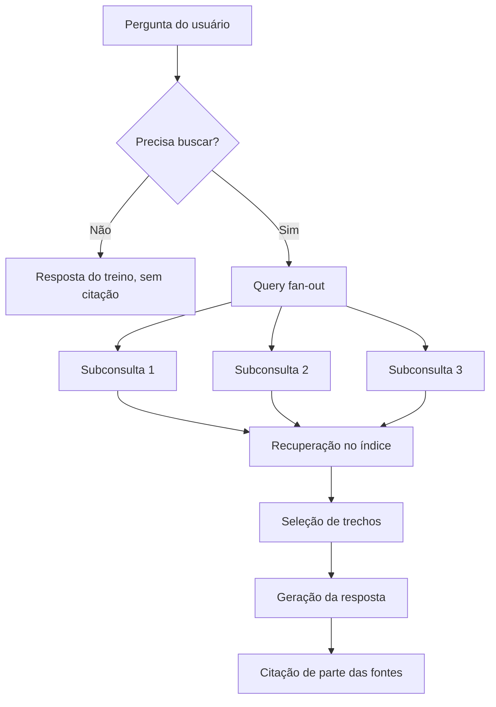
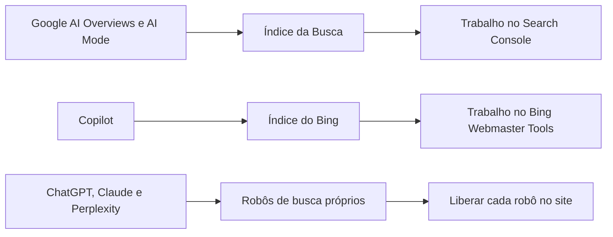
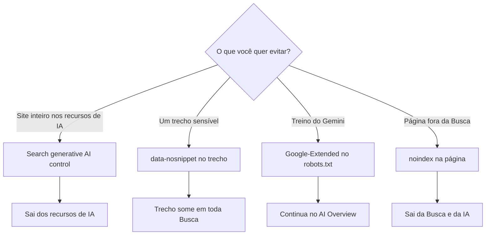
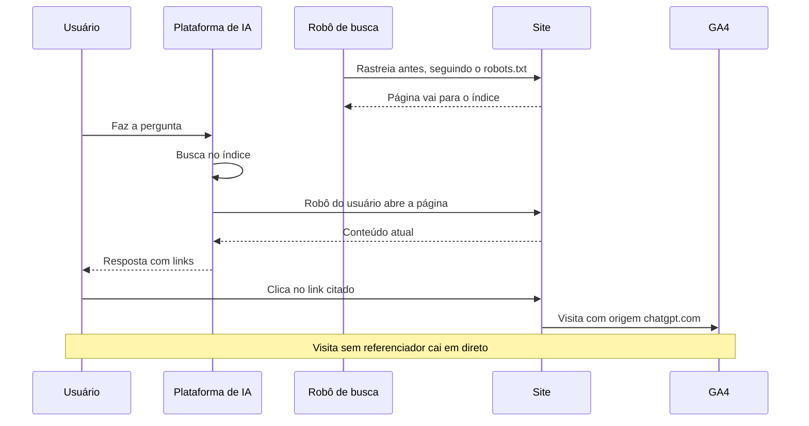
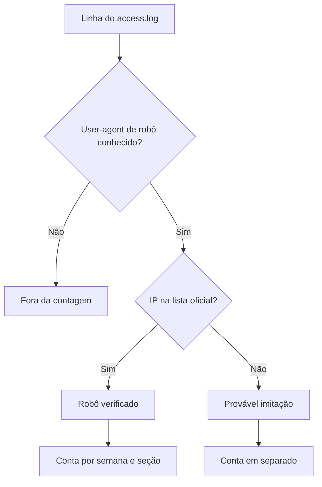
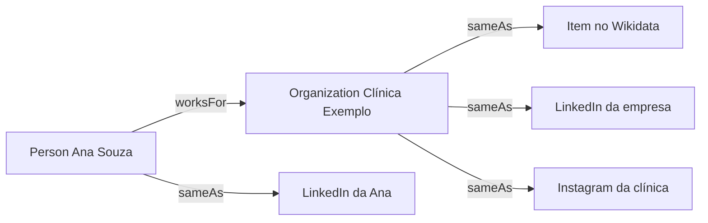
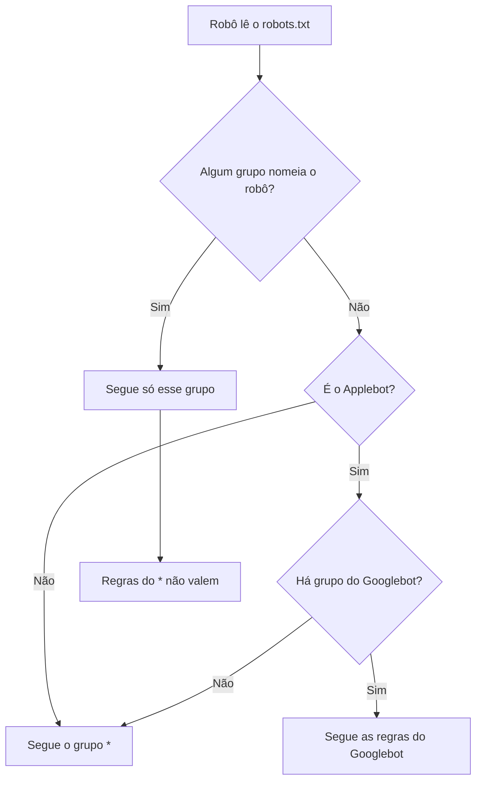
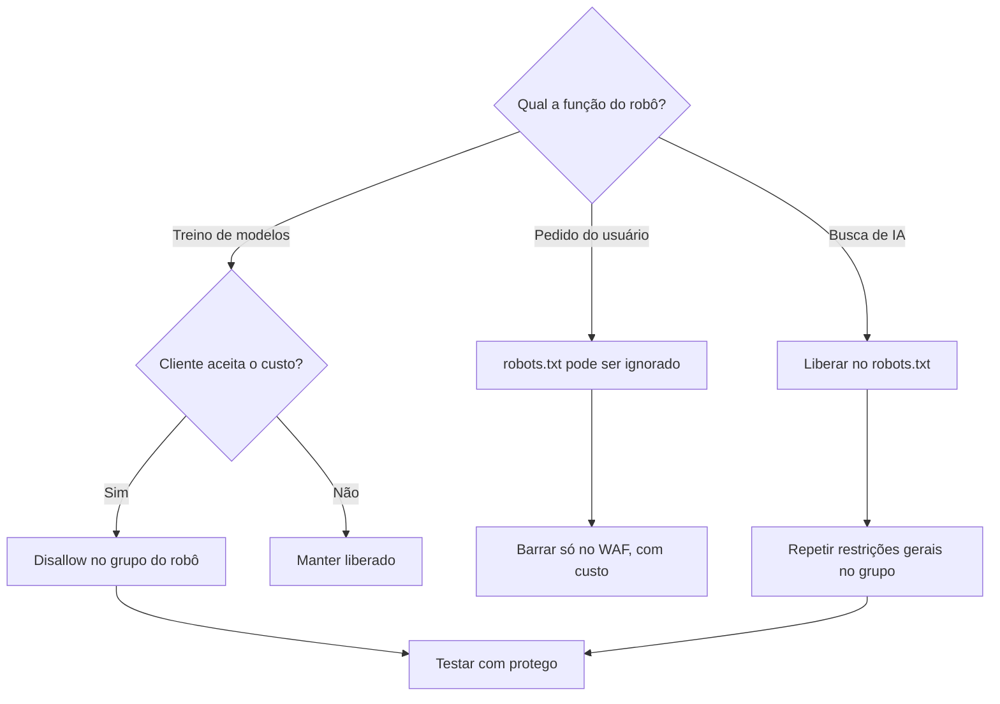
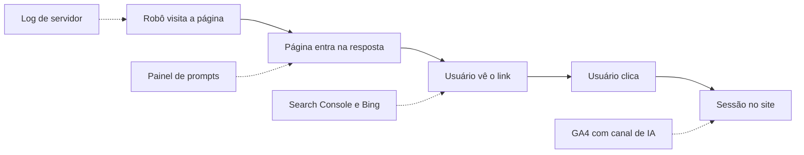
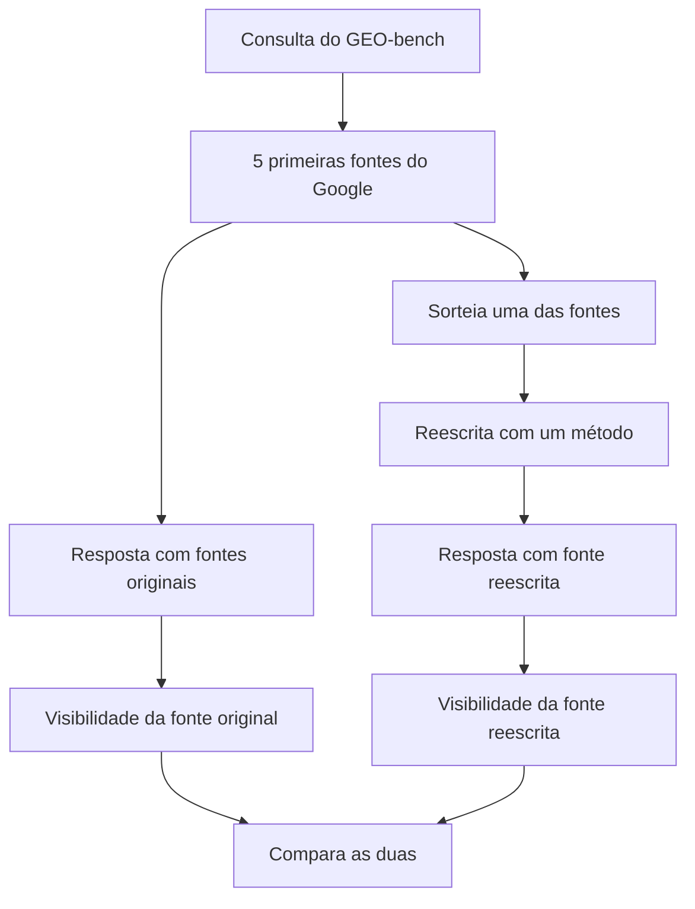

# Aulas · 04 · GEO e busca generativa

Texto de apoio de cada módulo. Leia depois dos vídeos e antes dos exercícios. Onde houver comando ou código, rode no seu computador.

Os fatos sobre robôs, controles e relatórios foram conferidos nas páginas oficiais de cada empresa em outubro de 2026. Essas páginas mudam sem aviso. Antes de levar uma regra para um cliente, abra a fonte de novo.

Os scripts usam Python 3.12. Instale as dependências uma vez.

```bash
python3.12 -m venv .venv
source .venv/bin/activate
pip install requests beautifulsoup4 pandas duckdb protego
export UA="estudo-geo/0.1 (contato: seu-email@exemplo.com)"
```

## Sumário

1. [Como buscadores com IA recuperam e citam](#aula-1-como-buscadores-com-ia-recuperam-e-citam)
2. [AI Overviews e AI Mode do Google](#aula-2-ai-overviews-e-ai-mode-do-google)
3. [ChatGPT, Perplexity, Copilot e Gemini como canais de busca](#aula-3-chatgpt-perplexity-copilot-e-gemini-como-canais-de-busca)
4. [Conteúdo citável, entidades e marca](#aula-4-conteúdo-citável-entidades-e-marca)
5. [llms.txt e controle de acesso de robôs de IA](#aula-5-llmstxt-e-controle-de-acesso-de-robôs-de-ia)
6. [Medir visibilidade em IA](#aula-6-medir-visibilidade-em-ia)
7. [Pesquisa acadêmica sobre GEO](#aula-7-pesquisa-acadêmica-sobre-geo)

## Aula 1. Como buscadores com IA recuperam e citam

### A ideia central

Um buscador generativo é um sistema de RAG (retrieval-augmented generation, geração aumentada por recuperação) em escala de web. Ele busca documentos, recorta trechos, entrega esses trechos ao modelo e o modelo escreve a resposta com links para parte das fontes. O Google descreve os próprios recursos de IA exatamente assim no guia de otimização para IA generativa. Ele chama a etapa de recuperação de grounding (ancoragem da resposta em fontes) e diz que ela usa os sistemas centrais de ranqueamento da Busca.

O modelo mental certo tem uma ordem. Primeiro a página precisa estar no índice. Depois precisa ser recuperada para alguma das consultas que o sistema gerou. Só então pode ser citada. Quem pula para "como ser citado" sem passar por "como ser recuperado" está otimizando a última etapa de um funil que nem começou.

### Como funciona

#### As cinco etapas

1. **Decidir se busca.** O modelo pode responder com o que aprendeu no treino ou disparar uma busca. Respostas sobre fatos recentes, preços e comparações costumam disparar busca. Definições estáveis às vezes vêm só do treino, e aí não há citação nenhuma.
2. **Query fan-out (desdobramento da consulta).** A pergunta vira várias buscas paralelas. O exemplo oficial do Google parte de "how to fix a lawn that's full of weeds" e gera buscas como "best herbicides for lawns" e "how to prevent weeds in lawn". A página do Search Central sobre recursos de IA confirma que AI Overviews e AI Mode podem usar essa técnica.
3. **Recuperação.** Cada subconsulta vai a um índice. O Google usa o próprio índice da Busca. O Copilot se apoia no índice do Bing, e a Microsoft escreveu em fevereiro de 2026 que o grounding dela alimenta quase todos os grandes assistentes do mercado. OpenAI, Anthropic e Perplexity mantêm robôs próprios de busca, que você vai conhecer na aula 3.
4. **Seleção de trechos.** O sistema escolhe pedaços dos documentos que cabem no contexto do modelo. A forma exata é segredo de cada empresa.
5. **Geração e citação.** O modelo escreve e liga frases a fontes. Nem toda fonte recuperada vira citação, e nem toda citação sustenta de fato a frase ao lado dela.

O diagrama abaixo mostra as cinco etapas em ordem, com o desvio que acontece quando o modelo decide não buscar.



#### O que é documentado e o que é hipótese

| Afirmação | Situação |
|---|---|
| Os recursos de IA do Google usam RAG sobre o índice e os sistemas de ranqueamento da Busca | Documentado pelo Google |
| AI Overviews e AI Mode podem usar query fan-out | Documentado pelo Google |
| AI Mode e AI Overviews podem usar modelos diferentes e mostrar links diferentes | Documentado pelo Google |
| O trecho escolhido é o que tem maior similaridade semântica com a subconsulta | Hipótese razoável, sem documentação pública |
| Páginas mais bem ranqueadas na busca clássica são mais citadas | Correlação observada por ferramentas do mercado, sem regra oficial |
| Ser citado é o mesmo que influenciar a resposta | Falso na medição de Zhang, He e Yao (arXiv 2604.25707), que separa citação de absorção do conteúdo |

#### Índice próprio contra índice de terceiros

Isso muda o diagnóstico. Se a plataforma usa índice de terceiros, o seu trabalho passa pelo índice dela. Se usa robô próprio, o acesso desse robô ao seu site entra na conta. Por isso o Bing Webmaster Tools importa para o Copilot, e por isso bloquear o robô de busca de uma plataforma tira você das respostas dela.

O diagrama liga cada plataforma ao índice que ela usa e ao lugar onde o seu trabalho acontece.



#### Variação entre execuções

A mesma pergunta, feita duas vezes, pode trazer fontes diferentes. O fan-out muda, o modelo amostra com temperatura e o índice se atualiza. Qualquer comparação entre plataformas precisa de repetição, assunto da aula 6.

### Exemplo guiado

Você vai simular a etapa de seleção de trechos numa página real. O script divide a página em seções e mede quanto cada seção cobre os termos de cada subconsulta. A pontuação é lexical e simples de propósito. Ela mostra a lógica, sem imitar nenhum sistema real.

Salve como `trechos.py`.

```python
import os
import re
import sys
import time

import requests
from bs4 import BeautifulSoup

UA = os.environ.get("UA", "estudo-geo/0.1 (contato: seu-email@exemplo.com)")


def baixar(url: str) -> str:
    r = requests.get(url, headers={"User-Agent": UA}, timeout=30)
    if r.status_code == 429:
        sys.exit("429 recebido. Pare e tente outro dia.")
    r.raise_for_status()
    time.sleep(5)
    return r.text


def trechos(html: str) -> list[dict]:
    """Um trecho por seção H2 ou H3, com o texto dos parágrafos e listas abaixo dela."""
    soup = BeautifulSoup(html, "html.parser")
    corpo = soup.find("main") or soup.body
    saida, titulo, partes = [], "(início)", []
    for el in corpo.find_all(["h2", "h3", "p", "li"]):
        if el.name in ("h2", "h3"):
            if partes:
                saida.append({"secao": titulo, "texto": " ".join(partes)})
            titulo, partes = el.get_text(" ", strip=True), []
        else:
            partes.append(el.get_text(" ", strip=True))
    if partes:
        saida.append({"secao": titulo, "texto": " ".join(partes)})
    return saida


def termos(texto: str) -> set[str]:
    return {t for t in re.findall(r"\w+", texto.lower()) if len(t) > 3}


def melhor_trecho(consulta: str, lista: list[dict]) -> tuple[float, str]:
    q = termos(consulta)
    pontuados = [(len(q & termos(t["texto"])) / max(len(q), 1), t["secao"]) for t in lista]
    return max(pontuados)


if __name__ == "__main__":
    url = sys.argv[1]
    consultas = [c.strip() for c in sys.argv[2].split(";")]
    lista = trechos(baixar(url))
    print(f"{len(lista)} trechos encontrados")
    for c in consultas:
        nota, secao = melhor_trecho(c, lista)
        print(f"{nota:.2f}  {c!r} -> {secao}")
```

Rode numa página sua com três subconsultas que um fan-out geraria a partir de uma pergunta do seu nicho.

```bash
python trechos.py "https://seusite.com.br/guia" "quanto custa;como funciona;vale a pena"
```

Leia o resultado com olho de editor. Se a melhor seção para "quanto custa" é uma introdução genérica, a página não tem um trecho que responda preço. Depois faça a pergunta original em 4 IAs com busca ativada, registre as fontes num CSV com as colunas `plataforma,dominio` e conte a sobreposição.

```python
import pandas as pd

df = pd.read_csv("fontes.csv")
por_dominio = df.groupby("dominio")["plataforma"].nunique().sort_values(ascending=False)
print(por_dominio.head(15))
print("Citados em 2 ou mais plataformas:", (por_dominio >= 2).sum())
```

### Erros comuns

- **Tratar GEO como disciplina separada do SEO.** A consequência é investir em truques enquanto a página nem é indexada. O jeito certo é conferir indexação e ranqueamento das subconsultas antes de mexer no texto.
- **Concluir a partir de uma execução.** Uma resposta isolada parece regra e é amostra de tamanho um. Repita a pergunta e registre data, plataforma e se a busca estava ativa.
- **Confundir resposta do treino com resposta da busca.** Sem citação, você não sabe de onde veio a frase. Ative a busca e compare.
- **Achar que a citação prova influência.** Uma fonte pode aparecer no rodapé sem ter sustentado nada. Abra a página citada e encontre o trecho que apoia a frase.
- **Ignorar o índice que alimenta a plataforma.** Quem esquece o Bing perde o Copilot. Verifique o site no Bing Webmaster Tools.

### Na prática

Este módulo não tem caso na pasta casos. O cenário a seguir é um exemplo hipotético.

Imagine um blog de receitas que quer aparecer quando alguém pergunta a uma IA "como fazer pão de fermentação natural em casa". A equipe começa reescrevendo a introdução para soar mais "citável". Um consultor faria outra ordem. Primeiro listaria as subconsultas prováveis, como "quanto tempo leva o levain", "qual farinha usar" e "por que o pão ficou denso". Depois veria se o blog ranqueia para cada uma na busca clássica. Se não ranqueia para "por que o pão ficou denso", nenhum ajuste de estilo faz a página ser recuperada para essa parte da resposta. O trabalho certo é escrever a seção que falta e garantir que ela seja encontrada. A reescrita da introdução vem depois, se vier.

### Resumo

- Buscador generativo é RAG em escala de web. Recuperação vem antes de citação.
- Query fan-out é documentado pelo Google. A página concorre em várias subconsultas ao mesmo tempo.
- Cada plataforma recupera de um índice diferente, e isso define onde trabalhar.
- Respostas variam entre execuções, então toda observação precisa de repetição.
- Citação e influência real na resposta são coisas diferentes.

### Para ir além

- Em [videos.md](videos.md), assista a "Query Fan Out" do iPullRank agora, porque ele mostra a etapa 2 com exemplos reais.
- Em [leituras.md](leituras.md), leia "Elevating the Role of Grounding on the AI Web", do blog do Bing, para ver a etapa de recuperação contada por quem opera o índice.
- Em [leituras.md](leituras.md), o capítulo sobre recuperação de "The AI Search Manual" aprofunda o que esta aula resumiu em cinco etapas.

## Aula 2. AI Overviews e AI Mode do Google

### A ideia central

O Google não criou uma porta separada para os recursos de IA. A página oficial "AI features and your website" diz que não há requisito adicional para aparecer em AI Overviews ou AI Mode. Basta a página estar indexada e apta a aparecer na Busca com snippet (trecho de texto no resultado). O guia de otimização para IA generativa, publicado em maio de 2026, repete que a Busca ignora llms.txt e que não existe marcação especial de Schema.org para esses recursos.

O modelo mental é de camadas. Embaixo está a Busca de sempre, com rastreio, indexação e ranqueamento. Por cima, uma camada de geração que lê o que a Busca recuperou. Os controles que você já conhece (robots.txt e controles de snippet) continuam valendo, e em 2026 surgiu um controle novo no Search Console.

### Como funciona

#### Quando o AI Overview aparece

O Google diz que o AI Overview só aparece quando o sistema entende que ele acrescenta algo à busca clássica, e que por isso muitas vezes ele não aparece. O AI Mode é uma experiência separada, voltada a perguntas que pedem exploração e comparação. Os dois podem usar modelos e técnicas diferentes, então os links que mostram também diferem.

Um dado independente ajuda a calibrar a expectativa. O Pew Research Center analisou a navegação de 900 adultos americanos em março de 2025. Cerca de 18% das buscas mostraram resumo de IA. Buscas de uma ou duas palavras geraram resumo em 8% dos casos, e buscas com 10 palavras ou mais, em 53%. Perguntas longas puxam o recurso.

#### Os controles e o que cada um faz

| Controle | Onde | Efeito documentado |
|---|---|---|
| `robots.txt` para Googlebot | Arquivo na raiz | Controla o rastreio para a Busca inteira, recursos de IA incluídos |
| `noindex` | Meta tag ou cabeçalho | Tira a página da Busca e, por consequência, dos recursos de IA |
| `nosnippet` | Meta tag ou cabeçalho | Sem trecho de texto em todos os formatos da Busca, incluindo AI Overviews e AI Mode |
| `max-snippet:[número]` | Meta tag ou cabeçalho | Limita o tamanho do trecho, também nos recursos de IA |
| `data-nosnippet` | Atributo em `div`, `span` ou `section` | Exclui aquele pedaço de texto dos trechos |
| Search generative AI control | Search Console, em Configurações | Inclui ou exclui o site de AI Overviews, AI Mode e recursos de IA do Discover |
| `Google-Extended` | Token no robots.txt | Treino dos modelos Gemini e grounding no app Gemini e no Vertex AI, sem efeito na Busca |

O controle do Search Console é recente. A ajuda oficial diz que ele chegou a todos os sites do mundo em 31 de agosto de 2026. O padrão é incluir. Ao excluir, o site deixa de aparecer como link e de servir de base para respostas nesses recursos, e para de receber impressões e tráfego deles. A mesma página diz que o controle não é sinal de ranqueamento para o resto da Busca e que não afeta treino. Para limitar o treino dos modelos usados nesses recursos, a ajuda manda usar o Google-Extended.

#### O que o Google-Extended controla e o que não controla

A página de rastreadores comuns do Google é clara. O Google-Extended não tem user-agent próprio. O rastreio continua sendo feito pelos robôs de sempre, e o token só serve para declarar a preferência. Ele decide se o conteúdo pode ser usado no treino de futuras gerações do Gemini e no grounding do app Gemini e do Grounding with Google Search no Vertex AI. Ele não muda a inclusão do site na Busca e não é sinal de ranqueamento. Bloquear o Google-Extended, portanto, não tira o site do AI Overview.

O diagrama parte do que você quer evitar e chega ao controle certo e ao efeito dele.



#### Impacto no CTR

Aqui é preciso separar fonte. O mesmo estudo do Pew mostrou que quem viu resumo de IA clicou num resultado tradicional em 8% das visitas, contra 15% de quem não viu. Clique em link dentro do resumo aconteceu em 1% das visitas. O Google, na documentação, afirma que os cliques vindos de páginas com AI Overview são de mais qualidade, com mais tempo no site. Esta segunda frase é declaração da empresa, sem dado público que você possa conferir.

#### Como medir

O Search Console tem desde 2026 um relatório de desempenho em IA generativa. Ele mostra impressões por página, país, dispositivo e data. Não mostra consulta nem clique, e a série começa em maio de 2026. As mesmas impressões continuam somadas ao relatório de desempenho geral, no tipo de busca Web.

### Exemplo guiado

Primeiro, confira os controles de uma página. Salve como `controles.py`.

```python
import os
import sys
import time
from urllib.parse import urljoin
from urllib.robotparser import RobotFileParser

import requests
from bs4 import BeautifulSoup

UA = os.environ.get("UA", "estudo-geo/0.1 (contato: seu-email@exemplo.com)")


def pegar(url: str) -> requests.Response:
    r = requests.get(url, headers={"User-Agent": UA}, timeout=30)
    if r.status_code == 429:
        sys.exit("429 recebido. Pare aqui.")
    time.sleep(5)
    return r


url = sys.argv[1]

rp = RobotFileParser()
rp.parse(pegar(urljoin(url, "/robots.txt")).text.splitlines())
for robo in ("Googlebot", "Google-Extended"):
    print(f"robots.txt libera {robo}? {rp.can_fetch(robo, url)}")

r = pegar(url)
print("Status:", r.status_code)
print("X-Robots-Tag:", r.headers.get("X-Robots-Tag", "(ausente)"))
soup = BeautifulSoup(r.text, "html.parser")
for nome in ("robots", "googlebot"):
    tag = soup.find("meta", attrs={"name": nome})
    print(f"meta {nome}:", tag.get("content") if tag else "(ausente)")
print("Elementos com data-nosnippet:", len(soup.select("[data-nosnippet]")))
```

```bash
python controles.py "https://seusite.com.br/pagina"
```

Um resultado comum é Googlebot liberado e Google-Extended bloqueado. Leia isso corretamente. A página pode aparecer no AI Overview. O que está vetado é o uso no Gemini e no Vertex AI.

Depois, meça a presença do AI Overview numa amostra. Faça 50 buscas do seu nicho em janela anônima, registre num CSV com as colunas `consulta,intencao,tem_aio,dominios_citados` e calcule a taxa.

```python
import pandas as pd

df = pd.read_csv("amostra_aio.csv")
taxa = df.groupby("intencao")["tem_aio"].agg(["mean", "count"])
print(taxa.rename(columns={"mean": "taxa_aio", "count": "buscas"}))
```

Anote o dia, o local e o estado de login. O AI Overview muda com o tempo e com o usuário.

### Erros comuns

- **Prometer marcação para entrar no AI Overview.** O Google diz que não existe. Recomende dados estruturados pelo valor que já têm na Busca.
- **Bloquear o Google-Extended achando que sai do AI Overview.** Não sai. Para sair, use o controle do Search Console ou os controles de snippet, sabendo o custo de cada um.
- **Usar `nosnippet` na página inteira para esconder um parágrafo.** O site perde o trecho em toda a Busca. Use `data-nosnippet` só no pedaço sensível.
- **Atribuir toda queda de CTR ao AI Overview.** Sazonalidade, mudança de SERP e posição explicam muitas quedas. Compare buscas com e sem AI Overview na mesma faixa de posição.
- **Ler o relatório de IA generativa como se mostrasse consulta.** Ele não mostra. Qualquer frase sobre "em quais buscas" é inferência e precisa vir marcada assim.

### Na prática

O roteiro desta trilha traz um caso de loja virtual. Ao abrir o relatório de IA generativa do Search Console, a maior parte das impressões estava na home. A home dessa loja ranqueia quase só por buscas de marca. A leitura tentadora é "o AI Overview aparece na busca pela marca". Ela é plausível. Só que o relatório não mostra a consulta, então a frase não pode sair como fato.

O raciocínio certo junta duas fontes sem misturá-las. O relatório de desempenho geral mostra que a home recebe impressões quase só de consultas de marca. O relatório de IA generativa mostra que a home concentra as impressões em IA. Daí sai uma hipótese, que vai escrita como hipótese no relatório para o cliente. Para testar, faça as buscas de marca manualmente em dias diferentes e registre se o AI Overview aparece. Isso dá evidência direta, ainda que pequena.

### Resumo

- Para o Google, aparecer em IA exige o mesmo que aparecer na Busca com snippet.
- Os controles de snippet valem para AI Overviews e AI Mode.
- O Google-Extended não tira o site da Busca nem do AI Overview.
- Desde 31 de agosto de 2026, o Search Console tem um controle para incluir ou excluir o site dos recursos de IA da Busca.
- O relatório de IA generativa só tem impressões. Consulta e clique ficam fora.

### Para ir além

- Em [leituras.md](leituras.md), leia "Recursos de IA e seu site" e o "Guia do Google para otimizar recursos de IA generativa". São as duas fontes primárias desta aula.
- Em [leituras.md](leituras.md), o artigo do Pew Research Center traz a metodologia completa do dado de clique citado aqui.
- Em [videos.md](videos.md), "How AI Is Changing Google Search and SEO" é a fala oficial do Google sobre a mudança.

## Aula 3. ChatGPT, Perplexity, Copilot e Gemini como canais de busca

### A ideia central

Cada empresa de IA opera mais de um robô, e cada robô tem uma função. Há robô de treino, robô de busca e robô que abre a página porque um usuário pediu. As regras de robots.txt valem por robô. Bloquear o de treino deixa o de busca livre, e o contrário também.

A segunda ideia é sobre prova. User-agent é só um texto no cabeçalho e qualquer um pode copiá-lo. A prova de que um robô real visitou o site é o log do servidor cruzado com os IPs que a empresa publica.

### Como funciona

#### A tabela de robôs

Conferida nas páginas oficiais em outubro de 2026.

| Robô | Operador | Função segundo o operador | robots.txt segundo o operador | IPs publicados |
|---|---|---|---|---|
| GPTBot | OpenAI | Coleta conteúdo que pode entrar no treino dos modelos | Bloquear indica que o conteúdo não deve ir para treino | openai.com/gptbot.json |
| OAI-SearchBot | OpenAI | Mostra sites nos resultados de busca do ChatGPT | Site bloqueado não aparece nas respostas de busca, podendo ainda surgir como link de navegação | openai.com/searchbot.json |
| ChatGPT-User | OpenAI | Visita páginas em ações pedidas por usuários do ChatGPT e de GPTs | A OpenAI diz que as regras podem não se aplicar, por ser ação do usuário | openai.com/chatgpt-user.json |
| OAI-AdsBot | OpenAI | Valida páginas de destino de anúncios no ChatGPT | Só visita páginas enviadas como anúncio | openai.com/adsbot.json |
| ClaudeBot | Anthropic | Coleta conteúdo que pode contribuir para treino | Respeita, e aceita Crawl-delay | claude.com/crawling/bots.json |
| Claude-SearchBot | Anthropic | Indexa conteúdo para melhorar resultados de busca | Respeita | claude.com/crawling/bots.json |
| Claude-User | Anthropic | Acessa sites quando um usuário pergunta ao Claude | Respeita | claude.com/crawling/bots.json |
| PerplexityBot | Perplexity | Mostra e linka sites nos resultados da Perplexity, sem uso para treino de modelos de base | Respeita | perplexity.com/perplexitybot.json |
| Perplexity-User | Perplexity | Visita páginas para responder perguntas de usuários | A Perplexity diz que em geral ignora, por ser pedido do usuário | perplexity.com/perplexity-user.json |
| Google-Extended | Google | Token sem user-agent próprio. Decide uso no treino do Gemini e no grounding do app Gemini e do Vertex AI | É só um token de robots.txt | Usa os IPs dos robôs comuns do Google |
| Bingbot | Microsoft | Rastreia para o índice do Bing, base do Copilot | Respeita | bing.com/toolbox/bingbot.json |
| Applebot | Apple | Busca no Spotlight, Siri e Safari. Pode ser usado em treino e como contexto de respostas de IA | Respeita. Sem regra própria, segue as regras do Googlebot. Não segue Crawl-delay | search.developer.apple.com/applebot.json |
| Applebot-Extended | Apple | Token para recusar o uso no treino dos modelos da Apple | É só um token de robots.txt | Não se aplica |
| CCBot | Common Crawl | Monta o acervo aberto do Common Crawl, usado por terceiros, inclusive em treino de modelos | Respeita | index.commoncrawl.org/ccbot.json |

Três detalhes merecem atenção. A Anthropic avisa que bloquear os IPs dela pode não funcionar como recusa, porque impede o robô de ler o robots.txt. A Apple diz que o `nosnippet` impede o uso da página em respostas de conhecimento geral da Siri e da Busca. E OpenAI e Perplexity dizem que mudanças no robots.txt podem levar cerca de 24 horas para valer.

#### Copilot e Gemini

O Copilot não tem robô de busca próprio na lista acima. Ele se apoia no índice do Bing, então o canal de entrada é o Bingbot e o Bing Webmaster Tools. Em setembro de 2023, para o então Bing Chat, a Microsoft documentou que a meta tag `noarchive` tira o conteúdo das respostas do chat e que `nocache` limita a resposta a URL, título e snippet. Confira na documentação atual do Bing antes de aplicar, porque o produto mudou de nome desde então. O Gemini usa a Busca do Google como grounding, e o Google-Extended decide se o seu conteúdo entra nesse grounding do app Gemini.

#### Verificação por IP

Todas as empresas da tabela publicam listas de IP em JSON, no mesmo formato, com uma lista `prefixes` de blocos `ipv4Prefix` ou `ipv6Prefix`. Google, Apple e Common Crawl também documentam verificação por DNS reverso. O Google, por exemplo, manda fazer a consulta reversa do IP, conferir se o nome termina em `googlebot.com`, `google.com` ou `googleusercontent.com` e fazer a consulta direta do nome para ver se volta o mesmo IP.

#### Tráfego de referência no GA4

Quando a pessoa clica num link dentro do ChatGPT, da Perplexity ou do Copilot, a visita chega com uma origem como `chatgpt.com` ou `perplexity.ai`. No GA4, um agrupamento de canais personalizado com uma regra de regex na origem separa esse tráfego. A regra precisa ficar acima de "Referência" na ordem, porque o GA4 usa a primeira regra que bate. Parte das visitas chega sem referenciador e cai em direto. Esse tráfego é um piso, nunca o total.

A sequência abaixo mostra o caminho entre usuário, plataforma de IA, robô e site, até a visita chegar ao GA4.



### Exemplo guiado

Você vai contar visitas de robôs num log no formato combinado (combined log format) do Apache ou do Nginx e depois verificar os IPs. Salve como `robos.sql`.

```sql
CREATE OR REPLACE TABLE acessos AS
WITH linhas AS (
  SELECT unnest(string_split(content, chr(10))) AS linha
  FROM read_text('access.log')
)
SELECT
  regexp_extract(linha, '^(\S+)', 1)                                        AS ip,
  strptime(regexp_extract(linha, '\[([^\]]+)\]', 1), '%d/%b/%Y:%H:%M:%S %z') AS quando,
  regexp_extract(linha, '"[A-Z]+ (\S+)', 1)                                 AS caminho,
  CAST(regexp_extract(linha, '" (\d{3}) ', 1) AS INTEGER)                    AS status,
  regexp_extract(linha, '"([^"]*)"$', 1)                                    AS ua
FROM linhas
WHERE linha <> '';

CREATE OR REPLACE TABLE robos AS
SELECT *,
  CASE
    WHEN ua ILIKE '%OAI-SearchBot%'    THEN 'OAI-SearchBot'
    WHEN ua ILIKE '%ChatGPT-User%'     THEN 'ChatGPT-User'
    WHEN ua ILIKE '%GPTBot%'           THEN 'GPTBot'
    WHEN ua ILIKE '%Claude-SearchBot%' THEN 'Claude-SearchBot'
    WHEN ua ILIKE '%Claude-User%'      THEN 'Claude-User'
    WHEN ua ILIKE '%ClaudeBot%'        THEN 'ClaudeBot'
    WHEN ua ILIKE '%Perplexity-User%'  THEN 'Perplexity-User'
    WHEN ua ILIKE '%PerplexityBot%'    THEN 'PerplexityBot'
    WHEN ua ILIKE '%Applebot%'         THEN 'Applebot'
    WHEN ua ILIKE '%bingbot%'          THEN 'Bingbot'
    WHEN ua ILIKE '%CCBot%'            THEN 'CCBot'
    WHEN ua ILIKE '%Googlebot%'        THEN 'Googlebot'
  END AS robo
FROM acessos;

SELECT date_trunc('week', quando) AS semana,
       robo,
       split_part(caminho, '/', 2) AS secao,
       count(*) AS visitas,
       count(*) FILTER (WHERE status = 200) AS atendidas
FROM robos
WHERE robo IS NOT NULL
GROUP BY ALL
ORDER BY semana, visitas DESC;

COPY (SELECT ip, robo, count(*) AS visitas
      FROM robos WHERE robo IS NOT NULL GROUP BY ALL)
TO 'ips_robos.csv' (HEADER);
```

```bash
duckdb < robos.sql
```

Se não tiver o binário do DuckDB, rode pelo Python com `duckdb.sql(open("robos.sql").read())`. A ordem do `CASE` importa, porque `ChatGPT-User` e `GPTBot` são testados antes de padrões mais curtos que poderiam pegar o nome errado.

Agora verifique cada IP contra a lista oficial. Salve como `verificar.py`.

```python
import csv
import ipaddress
import os
import sys
import time

import requests

UA = os.environ.get("UA", "estudo-geo/0.1 (contato: seu-email@exemplo.com)")

# Listas oficiais conferidas em outubro de 2026. Confira de novo antes de usar.
LISTAS = {
    "GPTBot": "https://openai.com/gptbot.json",
    "OAI-SearchBot": "https://openai.com/searchbot.json",
    "ChatGPT-User": "https://openai.com/chatgpt-user.json",
    "ClaudeBot": "https://claude.com/crawling/bots.json",
    "Claude-SearchBot": "https://claude.com/crawling/bots.json",
    "Claude-User": "https://claude.com/crawling/bots.json",
    "PerplexityBot": "https://www.perplexity.com/perplexitybot.json",
    "Perplexity-User": "https://www.perplexity.com/perplexity-user.json",
    "Applebot": "https://search.developer.apple.com/applebot.json",
    "Bingbot": "https://www.bing.com/toolbox/bingbot.json",
    "Googlebot": "https://developers.google.com/static/crawling/ipranges/common-crawlers.json",
    "CCBot": "https://index.commoncrawl.org/ccbot.json",
}

cache: dict[str, list] = {}


def redes(url: str) -> list:
    if url not in cache:
        r = requests.get(url, headers={"User-Agent": UA}, timeout=30)
        if r.status_code == 429:
            sys.exit("429 recebido. Pare aqui.")
        r.raise_for_status()
        prefixos = r.json()["prefixes"]
        cache[url] = [
            ipaddress.ip_network(p.get("ipv4Prefix") or p.get("ipv6Prefix"))
            for p in prefixos
        ]
        time.sleep(3)
    return cache[url]


with open(sys.argv[1], newline="") as f:
    for linha in csv.DictReader(f):
        robo, ip = linha["robo"], ipaddress.ip_address(linha["ip"])
        if robo not in LISTAS:
            print(f"{robo:18} {ip!s:18} sem lista oficial nesta tabela")
            continue
        ok = any(ip in rede for rede in redes(LISTAS[robo]) if rede.version == ip.version)
        print(f"{robo:18} {ip!s:18} {'verificado' if ok else 'NAO VERIFICADO'}  visitas={linha['visitas']}")
```

```bash
python verificar.py ips_robos.csv
```

Acessos "não verificados" com user-agent de robô são, na maioria, imitações. Conte os robôs verificados separados dos outros.

O diagrama resume como cada linha do log é classificada.



### Erros comuns

- **Testar acesso com `curl -A "GPTBot"` do seu computador.** O servidor vê o seu IP, não o da OpenAI. O teste prova como o site trata você. Use o log.
- **Bloquear um robô e achar que bloqueou a empresa.** GPTBot bloqueado deixa OAI-SearchBot e ChatGPT-User livres. Escreva uma regra por função.
- **Esperar que robôs acionados por usuário obedeçam ao robots.txt.** OpenAI e Perplexity dizem que podem não obedecer. Se precisar barrar, isso vira trabalho de WAF (firewall de aplicação), com o custo de sumir dessas respostas.
- **Somar visitas pelo user-agent sem verificar IP.** O número infla com robôs falsos. Separe verificados de não verificados.
- **Ler o tráfego de IA no GA4 como total.** Parte chega sem referenciador. Chame de piso no relatório.

### Na prática

O caso 3 da pasta casos começa num diagnóstico de GEO de um portal grande de educação médica. A primeira pergunta era se os robôs de IA conseguiam acessar o site. Ferramentas automáticas de leitura de página recebiam 403. Um teste com o user-agent de robôs de IA, feito do computador da equipe, também recebia 403. A conclusão parecia óbvia. O site bloqueava robôs de IA e todo o resto do projeto teria de esperar.

O teste que resolveu foi ler o log do servidor de um mês e contar as visitas por robô, com os IPs oficiais. O bloqueio valia para IPs não verificados, como o da equipe. Os robôs reais, vindos dos blocos oficiais, eram atendidos. Robôs de busca de IA passavam de mil visitas no mês, e isso contando só uma parte do log. O robots.txt também não bloqueava nenhum robô de IA. O roteiro desta trilha resume um log parecido, de um portal de saúde, com Applebot, Googlebot, Bingbot, OAI-SearchBot, ClaudeBot, GPTBot e PerplexityBot todos atendidos.

O "gate zero" de GEO foi registrado como aberto, com o log como prova, e o projeto seguiu para conteúdo, entidades e dados estruturados. O que fica é a ordem do raciocínio. Um sintoma visto do seu IP gerou uma hipótese. A hipótese só virou conclusão depois do dado de acesso real. Se a equipe tivesse parado no 403, o projeto inteiro teria mudado de rumo por causa de um teste que não media o que parecia medir.

### Resumo

- Cada empresa tem robôs separados para treino, busca e pedido do usuário.
- Regras de robots.txt valem por robô, e robôs acionados por usuário podem ignorá-las.
- Copilot depende do índice do Bing, e Gemini depende da Busca do Google.
- User-agent se falsifica. Prova de acesso é log cruzado com os IPs oficiais.
- O tráfego de IA no GA4 é um piso, por causa das visitas sem referenciador.

### Para ir além

- Em [leituras.md](leituras.md), abra "Overview of OpenAI Crawlers", "Perplexity Crawlers" e a página da Anthropic sobre robôs. São as fontes da tabela e mudam com frequência.
- Em [leituras.md](leituras.md), "Rastreadores comuns do Google" explica o Google-Extended nas palavras do próprio Google.
- Em [videos.md](videos.md), assista a "How Ranking in Google AI Overviews, ChatGPT, and Perplexity are Different", do Ahrefs, para comparar as plataformas antes do exercício da tabela.

## Aula 4. Conteúdo citável, entidades e marca

### A ideia central

Uma IA cita o trecho que responde à subconsulta com clareza e que pode ser atribuído a alguém. Ela também tende a repetir o que a web diz sobre uma marca. Conteúdo citável e entidade bem definida são os dois lados do mesmo trabalho.

O cuidado aqui é separar a orientação oficial das hipóteses do mercado. O Google pede conteúdo útil, original e bem organizado, e diz que não é preciso picotar o texto nem reescrever "para a IA". Boa parte do que circula como técnica de GEO é hipótese com alguma evidência e nenhuma garantia.

### Como funciona

#### O que o Google documenta

O guia de otimização para IA generativa do Google lista o que vale.

- Conteúdo que não é commodity (genérico, que qualquer um escreveria), com ponto de vista próprio e experiência de primeira mão.
- Organização por parágrafos, seções e títulos que ajudam o leitor a navegar.
- Imagens e vídeos de qualidade quando fizerem sentido.
- Nada de criar uma página para cada variação de subconsulta. Fazer isso para manipular resultados viola a política de abuso de conteúdo em escala.

E lista o que dá para ignorar na Busca do Google. Arquivos especiais para IA, "chunking" (dividir o conteúdo em pedacinhos), reescrita só para IA, busca de menções inautênticas e excesso de foco em dados estruturados.

#### O que a pesquisa e o mercado sugerem

| Prática | Evidência | Como tratar |
|---|---|---|
| Resposta direta no começo de cada seção | Bom texto para humanos. Zhang, He e Yao (2026) observaram que páginas de maior influência nas respostas têm mais definições, números, comparações e passos | Hipótese útil, alinhada com escrever bem |
| Incluir números com fonte e citações diretas | Melhorou visibilidade no experimento de Aggarwal et al. (aula 7), num ambiente controlado | Hipótese testável no seu site |
| Menções da marca em sites de terceiros | Estudo do Ahrefs com 75 mil marcas achou correlação de Spearman de 0,664 entre menções e presença em AI Overviews, contra 0,218 para backlinks | Correlação, sem prova de causa |
| Autoria e data visíveis | Ajudam o leitor a avaliar a fonte e combinam com as diretrizes de conteúdo confiável do Google | Boa prática, sem efeito documentado em IA |
| Dados estruturados de Organization e Person | O Google diz que não são necessários para IA. Ajudam a descrever a entidade de forma consistente | Mantenha pelo valor na Busca |

#### Trecho autossuficiente

Um trecho autossuficiente faz sentido lido sozinho, fora da página. Ele nomeia o sujeito em vez de começar com "isso", traz o dado com unidade e data e diz de onde veio o dado. Compare dois começos de seção sobre o mesmo assunto.

Fraco. "Isso costuma variar bastante, dependendo de vários fatores."

Autossuficiente. "O preço da consulta veterinária em capitais brasileiras variava de R$ 150 a R$ 300 em 2026, segundo a tabela publicada pelo conselho regional."

O segundo exemplo é ilustrativo e os números foram inventados para mostrar a forma. Numa página real, cada número precisa de fonte verificável.

#### Entidades

Entidade é a coisa no mundo (a empresa, a pessoa, o produto), separada das palavras que a nomeiam. O Knowledge Graph do Google e o Wikidata guardam entidades com identificadores estáveis. Quando o site, o Wikidata, os perfis oficiais e a imprensa descrevem a marca do mesmo jeito, a chance de uma IA descrever a marca certo aumenta. Essa última frase é hipótese de mercado, coerente com o funcionamento de RAG.

No site, o JSON-LD liga as peças com `@id` e `sameAs`.

```html
<script type="application/ld+json">
{
  "@context": "https://schema.org",
  "@graph": [
    {
      "@type": "Organization",
      "@id": "https://www.exemplo.com.br/#organizacao",
      "name": "Clínica Exemplo",
      "url": "https://www.exemplo.com.br/",
      "logo": "https://www.exemplo.com.br/logo.png",
      "sameAs": [
        "https://www.wikidata.org/wiki/Q000000",
        "https://www.linkedin.com/company/clinica-exemplo",
        "https://www.instagram.com/clinicaexemplo"
      ]
    },
    {
      "@type": "Person",
      "@id": "https://www.exemplo.com.br/equipe/ana-souza#pessoa",
      "name": "Ana Souza",
      "jobTitle": "Médica veterinária",
      "worksFor": { "@id": "https://www.exemplo.com.br/#organizacao" },
      "sameAs": ["https://www.linkedin.com/in/ana-souza-exemplo"]
    }
  ]
}
</script>
```

O `Q000000` é um marcador. Troque pelo identificador real do item no Wikidata, se ele existir.

O diagrama mostra as ligações que esse JSON-LD declara.



### Exemplo guiado

O script abaixo lê uma página e mostra, para cada H2, a primeira frase da seção e três sinais simples. Ele aponta onde olhar. A decisão de reescrever continua sendo sua. Salve como `auditar.py`.

```python
import os
import re
import sys
import time

import requests
from bs4 import BeautifulSoup

UA = os.environ.get("UA", "estudo-geo/0.1 (contato: seu-email@exemplo.com)")

r = requests.get(sys.argv[1], headers={"User-Agent": UA}, timeout=30)
if r.status_code == 429:
    sys.exit("429 recebido. Pare aqui.")
time.sleep(5)
soup = BeautifulSoup(r.text, "html.parser")

autor = soup.find("meta", attrs={"name": "author"})
atualizado = soup.find("meta", attrs={"property": "article:modified_time"})
print("Autor (meta):", autor.get("content") if autor else "(ausente)")
print("Atualização (meta):", atualizado.get("content") if atualizado else "(ausente)")
print("Elementos <time>:", [t.get("datetime") for t in soup.find_all("time")][:3])
print()

for h2 in soup.find_all("h2"):
    p = h2.find_next(["p", "ul", "ol", "table"])
    if p is None:
        continue
    texto = p.get_text(" ", strip=True)
    primeira = re.split(r"(?<=[.!?])\s", texto, maxsplit=1)[0]
    sinais = []
    if re.search(r"\d", primeira):
        sinais.append("número")
    if len(primeira.split()) > 35:
        sinais.append("frase longa")
    if re.match(r"(?i)(isso|isto|ele|ela|esse|essa|este|esta)\b", primeira):
        sinais.append("depende do trecho anterior")
    print(f"## {h2.get_text(strip=True)[:60]}")
    print(f"   {primeira[:140]}")
    print(f"   sinais: {', '.join(sinais) or 'nenhum'}")
```

```bash
python auditar.py "https://seusite.com.br/guia"
```

Depois confira a entidade no Wikidata pela API pública.

```python
import os
import sys

import requests

UA = os.environ.get("UA", "estudo-geo/0.1 (contato: seu-email@exemplo.com)")
r = requests.get(
    "https://www.wikidata.org/w/api.php",
    params={"action": "wbsearchentities", "search": sys.argv[1],
            "language": "pt", "format": "json", "limit": 5},
    headers={"User-Agent": UA}, timeout=30,
)
r.raise_for_status()
for item in r.json()["search"]:
    print(item["id"], "|", item.get("label"), "|", item.get("description", "(sem descrição)"))
```

Se a marca tem item, compare a descrição com a do site e com a que 3 IAs dão quando perguntadas "o que é a marca". Anote cada divergência e a fonte provável dela.

### Erros comuns

- **Picotar a página em blocos curtos "para a IA".** O Google diz que não é preciso, e o leitor sofre. Organize em seções claras e escreva parágrafos completos.
- **Encher o texto de números sem fonte.** Número sem origem é pior que nenhum número, porque pode ser repetido errado. Cite a fonte ao lado do dado.
- **Comprar menções.** O Google diz que menções inautênticas não ajudam, e elas podem violar políticas de spam. Invista em dado próprio que outros queiram citar.
- **Ler correlação como receita.** Marcas muito mencionadas também são grandes, antigas e buscadas. Apresente o estudo do Ahrefs como correlação.
- **Esquecer o Wikidata e os perfis oficiais.** A IA pode montar a descrição da marca a partir de uma fonte desatualizada. Mantenha as fontes de terceiros sob seu controle coerentes entre si.

### Na prática

Este módulo não tem caso na pasta casos. O cenário a seguir é um exemplo hipotético.

Imagine uma rede de clínicas veterinárias que pergunta a três IAs "o que é a rede X" e recebe respostas com o número de unidades errado. O impulso é reescrever a página "Sobre". Um consultor começaria procurando a origem do erro. Pediria às IAs com busca ativada as fontes da resposta e encontraria, por exemplo, uma matéria antiga de jornal e um diretório desatualizado. O site estava certo. O que estava errado era o resto da web. O plano então teria três frentes. Atualizar o Wikidata e os perfis oficiais. Publicar no site uma página com os números atuais, data de atualização e autoria. E pedir correção ao diretório. A reescrita da página "Sobre" entraria só como ajuste, porque ela não era a causa.

### Resumo

- O Google pede conteúdo original e bem organizado e dispensa chunking e reescrita para IA.
- Trecho autossuficiente é texto claro que faz sentido fora da página, com dado e fonte.
- Menção de marca em terceiros correlaciona com presença em AI Overviews, sem prova de causa.
- Entidade consistente entre site, Wikidata, perfis e imprensa reduz descrições erradas.
- Dados estruturados descrevem a entidade e não são requisito para IA.

### Para ir além

- Em [leituras.md](leituras.md), "Como criar conteúdo útil, confiável e que prioriza as pessoas" é a base que o Google aponta para os recursos de IA.
- Em [leituras.md](leituras.md), leia o estudo do Ahrefs com 75 mil marcas prestando atenção na seção de método, para saber o que uma correlação de Spearman permite dizer.
- Em [videos.md](videos.md), "Lily Ray on AI Slop, GEO, and What Actually Works" é um contraponto útil depois de tanta tática.

## Aula 5. llms.txt e controle de acesso de robôs de IA

### A ideia central

O llms.txt e o robots.txt resolvem problemas diferentes. O robots.txt diz a robôs automáticos o que eles podem rastrear. O llms.txt é uma proposta de arquivo em Markdown que oferece a um agente um mapa curto do site, com links para versões limpas das páginas. Um não substitui o outro.

O controle de acesso de verdade continua no robots.txt, nos cabeçalhos HTTP e no WAF ou na CDN. O llms.txt não bloqueia nada e não garante citação. Para a Busca do Google, o guia de maio de 2026 diz que o arquivo é ignorado e que criá-lo não ajuda nem atrapalha.

### Como funciona

#### O que diz a especificação

A proposta é de Jeremy Howard, da Answer.AI, publicada em 3 de setembro de 2024 e revisada como v2 em agosto de 2026. Pontos centrais.

- O arquivo fica em `/llms.txt` ou num subcaminho, como `/docs/llms.txt`, e cobre as páginas abaixo daquele caminho.
- A única seção obrigatória é um H1 com o nome do site ou projeto.
- Depois vêm, nesta ordem, um resumo em citação de Markdown, seções livres sem títulos e seções com H2 contendo listas de links no formato `[nome](url)`, com notas opcionais.
- Uma seção chamada "Optional" agrupa links secundários, por convenção.
- A v2 recomenda versões em Markdown das páginas na mesma URL com `.md` e links `rel="alternate" type="text/markdown"` e `rel="describedby"` para o agente achar os arquivos.

O `llms-full.txt`, com o conteúdo inteiro do site num arquivo só, não aparece no texto da proposta. É uma convenção adotada por algumas plataformas de documentação. O próprio autor diz que o uso mais forte do llms.txt é em documentação de software lida por agentes de programação.

#### Quem lê o arquivo

| Plataforma | Situação conferida |
|---|---|
| Busca do Google, incluindo AI Overviews e AI Mode | Documentado que ignora |
| OpenAI, Anthropic, Perplexity, Microsoft, Apple | As páginas de robôs conferidas não falam em llms.txt |
| Agentes de programação e assistentes que leem documentação | Uso relatado pelo autor da proposta, sem números públicos por plataforma |

A conclusão honesta para um gestor cabe em três frases. O arquivo é barato de manter. Ele pode ajudar agentes que o procuram. Nenhuma das grandes plataformas de busca documenta que o use para escolher fontes.

#### robots.txt por robô

Pela norma RFC 9309, um robô segue o grupo do robots.txt que nomeia o seu token. Se nenhum grupo o nomeia, ele segue o grupo `*`. Isso tem uma consequência. Um robô com grupo próprio ignora as regras do `*`, então regras gerais (como bloquear `/admin/`) precisam ser repetidas nos grupos específicos. A Apple adiciona um detalhe. Se o arquivo não fala em Applebot e fala em Googlebot, o Applebot segue as regras do Googlebot.

O diagrama mostra qual grupo do robots.txt cada robô segue.



#### Sinais que estão surgindo

A Cloudflare propôs em 2025 a Content Signals Policy, uma linha no robots.txt como `Content-Signal: search=yes, ai-train=no`, com três sinais (search, ai-input e ai-train). É uma proposta de um fornecedor de CDN. As páginas de robôs que conferimos não dizem se respeitam esse sinal, então trate o efeito como hipótese. A Cloudflare também oferece bloqueio de robôs de IA na borda e um modelo de cobrança por rastreio, descritos nas leituras.

#### Páginas legíveis por agente

O guia do Google cita agentes de navegador que olham capturas de tela, a estrutura do DOM e a árvore de acessibilidade. HTML semântico, botões com nome acessível e texto fora de imagem ajudam esses agentes e ajudam leitores de tela, que é o argumento mais sólido para fazer.

### Exemplo guiado

Primeiro, escreva um robots.txt que libera busca de IA e bloqueia treino. Salve como `robots.txt`.

```text
# Busca de IA liberada
User-agent: OAI-SearchBot
User-agent: Claude-SearchBot
User-agent: PerplexityBot
Allow: /
Disallow: /admin/

# Treino de modelos bloqueado
User-agent: GPTBot
User-agent: ClaudeBot
User-agent: Google-Extended
User-agent: Applebot-Extended
User-agent: CCBot
Disallow: /

# Todos os outros, incluindo Googlebot, Bingbot e Applebot
User-agent: *
Disallow: /admin/

Sitemap: https://www.exemplo.com.br/sitemap.xml
```

Pese o custo antes de copiar. Bloquear o Google-Extended também tira o conteúdo do grounding no app Gemini. Bloquear o CCBot tira o site do acervo aberto do Common Crawl, usado também em pesquisa. Decida com o cliente.

A árvore abaixo resume a decisão de bloqueio por função do robô, antes de escrever a regra.



Teste cada regra com a biblioteca `protego`. Salve como `testar_robots.py`.

```python
from protego import Protego

regras = Protego.parse(open("robots.txt", encoding="utf-8").read())

casos = [
    ("OAI-SearchBot", "/artigos/x", True),
    ("Claude-SearchBot", "/artigos/x", True),
    ("PerplexityBot", "/admin/painel", False),
    ("GPTBot", "/artigos/x", False),
    ("ClaudeBot", "/artigos/x", False),
    ("Google-Extended", "/artigos/x", False),
    ("Applebot-Extended", "/artigos/x", False),
    ("CCBot", "/artigos/x", False),
    ("Googlebot", "/artigos/x", True),
    ("Applebot", "/artigos/x", True),
    ("Googlebot", "/admin/painel", False),
]

falhas = 0
for robo, caminho, esperado in casos:
    obtido = regras.can_fetch("https://www.exemplo.com.br" + caminho, robo)
    marca = "ok" if obtido == esperado else "FALHOU"
    falhas += obtido != esperado
    print(f"{marca:6} {robo:18} {caminho:15} pode={obtido}")
raise SystemExit(falhas)
```

O script sai com código diferente de zero se alguma regra falhar, então dá para colocá-lo num teste automático do repositório.

Depois, verifique se sites do seu nicho já têm llms.txt e se os links funcionam. Salve como `llms_check.py`.

```python
import os
import re
import sys
import time

import requests

UA = os.environ.get("UA", "estudo-geo/0.1 (contato: seu-email@exemplo.com)")
PAUSA = 6


def pedir(url: str) -> requests.Response:
    r = requests.get(url, headers={"User-Agent": UA}, timeout=30, allow_redirects=True)
    time.sleep(PAUSA)
    if r.status_code == 429:
        sys.exit(f"429 em {url}. Parei. Retome outro dia.")
    return r


for site in sys.argv[1:]:
    for arquivo in ("/llms.txt", "/llms-full.txt"):
        r = pedir(site.rstrip("/") + arquivo)
        tipo = r.headers.get("Content-Type", "")
        print(f"{site}{arquivo}  {r.status_code}  {tipo}")
        if arquivo != "/llms.txt" or r.status_code != 200:
            continue
        texto = r.text
        print("  começa com H1?", texto.lstrip("").startswith("# "))
        links = re.findall(r"\]\((https?://[^)\s]+)\)", texto)
        print(f"  {len(links)} links. Conferindo os 10 primeiros.")
        for link in links[:10]:
            print("   ", pedir(link).status_code, link)
```

```bash
python llms_check.py https://site1.com.br https://site2.com.br
```

Olhe o `Content-Type`. Um 200 com `text/html` costuma ser a página de erro do site respondendo no lugar do arquivo.

### Erros comuns

- **Vender llms.txt como garantia de citação.** Nenhuma grande plataforma de busca documenta esse uso, e o Google documenta que ignora. Apresente como complemento barato.
- **Criar o arquivo sem procurar um existente.** Plugins e plataformas geram o seu próprio. Rode o verificador antes.
- **Bloquear robôs pelo IP para recusar treino.** A Anthropic avisa que isso pode impedir a leitura do robots.txt. Recuse pelo robots.txt.
- **Esquecer que grupo específico ignora o `*`.** O robô de busca liberado acaba entrando em `/admin/`. Repita as restrições gerais em cada grupo.
- **Confiar só no robots.txt quando o WAF bloqueia.** O arquivo libera e a CDN devolve 403. Confira no log, como na aula 3.

### Na prática

O roteiro desta trilha conta um caso de portal. Existia um llms.txt esquecido, gerado por um plugin que já tinha sido desinstalado, apontando para páginas que davam 404. Ninguém na equipe sabia que o arquivo estava no ar. Qualquer agente que o lesse seria mandado para páginas mortas.

O raciocínio tem duas partes. A primeira é inventário. Antes de propor um llms.txt, procure se já existe um e descubra quem o gera. O roteiro lembra que lojas em Shopify já recebem um gerado pela plataforma, então "criar" ali significa revisar o que a plataforma publica. A segunda é proporção. O arquivo quebrado não derrubava o site no Google, que ignora o llms.txt. O conserto entrou como higiene, com prioridade baixa e custo baixo, sem promessa de efeito.

O caso 3 da pasta casos traz o complemento. Ali o robots.txt não bloqueava nenhum robô de IA, e mesmo assim um teste local sugeria bloqueio. Arquivo de regra e acesso real são coisas diferentes. Os dois precisam ser conferidos.

### Resumo

- llms.txt é proposta de mapa para agentes. robots.txt é regra de rastreio.
- A Busca do Google ignora llms.txt. Criar o arquivo não ajuda nem atrapalha lá.
- Um robô com grupo próprio no robots.txt ignora as regras do `*`.
- Bloquear treino tem custo, como sair do grounding do app Gemini ao bloquear o Google-Extended.
- Antes de criar um llms.txt, procure o que já existe e quem o gera.

### Para ir além

- Em [leituras.md](leituras.md), leia "The /llms.txt file, v2" inteira antes de escrever o seu. A seção de formato é curta.
- Em [leituras.md](leituras.md), "Giving users choice with Cloudflare's new Content Signals Policy" mostra a proposta de sinais por uso.
- Em [videos.md](videos.md), "Analysing Robots.txt at scale with HTTP Archive and BigQuery" mostra como robots.txt reais tratam robôs de IA.

## Aula 6. Medir visibilidade em IA

### A ideia central

Nenhuma fonte sozinha mede GEO. O Search Console vê impressões no Google e não vê consulta. O GA4 vê quem clicou e perde quem chegou sem referenciador. O log vê robôs e não vê respostas. O monitoramento de prompts vê respostas e depende de amostra. A medição honesta junta os quatro e diz o limite de cada um.

O segundo pilar é estatística. Respostas de IA variam entre execuções, então uma taxa de citação é uma estimativa com margem de erro. Diferença menor que a margem é ruído.

### Como funciona

#### As fontes e seus limites

| Fonte | O que mostra | O que esconde |
|---|---|---|
| Relatório de IA generativa do Search Console | Impressões em AI Overviews, AI Mode e Discover, por página, país, dispositivo e data, desde maio de 2026 | Consulta e clique |
| Relatórios de IA do Bing Webmaster Tools | Visibilidade e citações em experiências de IA da Microsoft, lançados em 2026 | Outras plataformas |
| GA4 com canal de IA | Sessões e conversões de quem clicou num link de IA | Quem não clicou e quem chegou sem referenciador |
| Log de servidor | Visitas verificadas de robôs de busca de IA, por seção | Se a visita virou citação |
| Painel de prompts fixos | Se a marca aparece, com que link e ao lado de quem | Volume real de perguntas e personalização |

O diagrama mostra o caminho de uma citação até a visita e qual fonte enxerga cada etapa.



#### Por que a variação importa

Dois estudos mostram o tamanho do problema. A SparkToro pôs 600 voluntários para rodar 12 prompts em ChatGPT, Claude e no AI Overview do Google, num total de 2.961 execuções. A chance de o ChatGPT ou a IA do Google repetirem a mesma lista de marcas em duas respostas ficou abaixo de 1 em 100. Um artigo de 2026 no arXiv (2603.08924) repetiu buscas na Perplexity, no SearchGPT e no Gemini. As citações seguiram uma distribuição de cauda longa e muitas diferenças entre domínios ficaram dentro do ruído da medição.

A consequência prática é repetir cada prompt e reportar intervalo de confiança. Para proporções, o intervalo de Wilson funciona bem mesmo com amostras pequenas.

#### Série curta

As ferramentas de visibilidade em IA começaram as séries entre 2025 e 2026. O relatório do Search Console começa em maio de 2026. Em outubro de 2026, quase nada tem ano contra ano. Trabalhe com tendência de curto prazo e diga isso.

### Exemplo guiado

Monte o arquivo `respostas.csv` com uma linha por execução e as colunas abaixo.

```text
data,plataforma,modelo,busca_ativa,logado,prompt_id,execucao,marca_citada,link_marca,dominios
2026-10-05,chatgpt,,true,false,P01,1,true,false,exemplo.com.br;concorrente.com.br
```

O script calcula a taxa semanal por plataforma com intervalo de Wilson e o tamanho de amostra para detectar uma mudança. Salve como `taxa.py`.

```python
import math

import duckdb


def wilson(sucessos: int, n: int, z: float = 1.96) -> tuple[float, float]:
    if n == 0:
        return (float("nan"), float("nan"))
    p = sucessos / n
    centro = (p + z * z / (2 * n)) / (1 + z * z / n)
    margem = z * math.sqrt(p * (1 - p) / n + z * z / (4 * n * n)) / (1 + z * z / n)
    return centro - margem, centro + margem


tabela = duckdb.sql("""
    SELECT date_trunc('week', CAST(data AS DATE)) AS semana,
           plataforma,
           count(*) AS execucoes,
           count(*) FILTER (WHERE marca_citada) AS citacoes
    FROM read_csv('respostas.csv', header = true)
    WHERE busca_ativa
    GROUP BY ALL
    ORDER BY plataforma, semana
""").fetchall()

for semana, plataforma, n, k in tabela:
    baixo, alto = wilson(k, n)
    print(f"{semana} {plataforma:11} {k:3}/{n:3} = {k / n:5.1%}  IC95% [{baixo:5.1%}, {alto:5.1%}]")


def execucoes_por_grupo(p1: float, p2: float) -> int:
    """Amostra por grupo para detectar p1 contra p2 com alfa 5% bicaudal e poder de 80%."""
    z_a, z_b = 1.96, 0.84
    return math.ceil((z_a + z_b) ** 2 * (p1 * (1 - p1) + p2 * (1 - p2)) / (p1 - p2) ** 2)


print("Para ver 30% virar 40%:", execucoes_por_grupo(0.30, 0.40), "execuções em cada semana")
```

```bash
python taxa.py
```

Para sentir o ruído, rodamos o script com dados simulados. A taxa verdadeira foi fixada em 30% para uma plataforma, com 30 prompts e 3 execuções por semana (90 execuções). As taxas semanais observadas foram 24,4%, 35,6%, 18,9% e 25,6%, com intervalos de 16 a 20 pontos de largura. Nada mudou de verdade, e mesmo assim a série parecia ter subido e caído. Essa é a razão para não comemorar nem lamentar uma semana isolada.

O mesmo script mostra que detectar uma mudança de 30% para 40% pede cerca de 353 execuções por semana em cada lado da comparação. Com 90 execuções, só diferenças grandes aparecem. Há ainda um cuidado extra. Execuções do mesmo prompt não são independentes, então a amostra efetiva é menor que o número de linhas. Para relatórios importantes, calcule a taxa por prompt primeiro e só depois a média.

Para o painel, junte por semana as três outras fontes ao lado dessa taxa. Impressões em IA do Search Console (exportadas da interface), sessões do canal de IA no GA4 e visitas verificadas de robôs de busca de IA, vindas da aula 3. Mantenha uma coluna de observações para mudanças de site e de plataforma.

### Erros comuns

- **Medir com uma execução por prompt.** A taxa oscila sozinha e o relatório inventa tendência. Repita cada prompt e mostre o intervalo.
- **Reportar posição na resposta como ranking.** A ordem muda quase a cada execução. Prefira taxa de citação e presença de link.
- **Mudar o conjunto de prompts no meio da série.** A série quebra e a comparação perde sentido. Versione o arquivo de prompts e crie série nova quando mudar.
- **Esconder o estado de login e a busca ativa.** Respostas com e sem busca são populações diferentes. Registre os dois campos e filtre.
- **Prometer comparação ano contra ano.** Quase nenhuma série tem um ano. Diga isso no relatório.

### Na prática

O roteiro desta trilha registra uma lição que aparece em todo relatório de GEO de 2026. As ferramentas de visibilidade em IA começaram suas séries entre 2025 e 2026, então quase nenhuma tem comparação ano contra ano.

O raciocínio de consultor começa pelo pedido. O gestor quer saber se a visibilidade em IA "cresceu em relação ao ano passado". Não existe ano passado nessa série. Em vez de improvisar uma comparação com outra fonte, o relatório faz três coisas. Diz em uma frase que a série é curta e desde quando ela existe. Mostra a tendência das últimas semanas com intervalo de confiança. E combina a métrica de IA com o tráfego orgânico clássico, que tem histórico longo, para dar contexto. Assim o gestor recebe o que dá para afirmar e o que ainda não dá, e o próximo relatório já nasce com mais semanas na série.

### Resumo

- Search Console, Bing Webmaster Tools, GA4, log e prompts medem coisas diferentes. Use todos e diga o limite de cada um.
- Taxa de citação é estimativa. Reporte com intervalo de Wilson.
- Detectar 10 pontos de diferença pede centenas de execuções por período.
- Versione os prompts e registre data, plataforma, busca ativa e login.
- Em 2026, quase nenhuma série tem ano contra ano.

### Para ir além

- Em [leituras.md](leituras.md), "Quantifying Uncertainty in AI Visibility" traz a estatística desta aula com dados reais e sugestões de tamanho de amostra.
- Em [leituras.md](leituras.md), o artigo da SparkToro sobre inconsistência das IAs mostra o método dos voluntários e os gráficos de variação.
- Em [videos.md](videos.md), "Google Search Gen AI Reports, Search Profiles & more" é a apresentação oficial do relatório do Search Console.
- Em [videos.md](videos.md), "How to Build a Prompt Set for AI Search", com Lily Ray, ajuda a montar o conjunto de 30 prompts.

## Aula 7. Pesquisa acadêmica sobre GEO

### A ideia central

O termo GEO vem do artigo sobre Generative Engine Optimization de Pranjal Aggarwal, Vishvak Murahari, Tanmay Rajpurohit, Ashwin Kalyan, Karthik Narasimhan e Ameet Deshpande. A primeira versão saiu no arXiv (2311.09735) em novembro de 2023, e o artigo foi aceito no KDD 2024. Ele criou o benchmark GEO-bench, propôs métricas de visibilidade e testou nove formas de reescrever uma fonte.

Ler o artigo protege contra promessa. O famoso "até 40%" existe, num ambiente controlado e com condições que quase nunca valem fora do laboratório. Trabalhos seguintes reduziram bastante o entusiasmo.

### Como funciona

#### O desenho do experimento

O buscador generativo do artigo tem duas etapas. Para cada consulta, ele pega as 5 primeiras fontes do Google. Depois o modelo gpt-3.5-turbo escreve a resposta citando essas fontes. Cada resposta é amostrada 5 vezes com temperatura 0,7 para reduzir o acaso.

Para cada consulta, uma das 5 fontes é sorteada. Um modelo de linguagem reescreve essa fonte aplicando um método por vez. Os autores comparam a visibilidade da fonte reescrita com a da versão original.

O diagrama mostra o desenho do experimento, da consulta até a comparação.



O GEO-bench tem 10 mil consultas (8 mil de treino, mil de validação e mil de teste) vindas de nove origens, entre elas MS MARCO, ORCAS-I, Natural Questions, ELI5, a seção Discover da Perplexity e consultas geradas pelo GPT-4. São 80% de consultas informacionais e 10% de cada tipo transacional e navegacional, em 25 domínios.

#### As métricas

- **Word Count.** A fração das palavras da resposta que está em frases que citam a fonte. Frase com várias citações divide as palavras entre elas.
- **Position-Adjusted Word Count.** A mesma conta com peso que cai exponencialmente conforme a frase aparece mais para o fim da resposta.
- **Subjective Impression.** Uma nota dada pelo GPT-3.5 no estilo G-Eval, somando sete aspectos (relevância, influência, unicidade, posição percebida, quantidade percebida, chance de clique e diversidade), normalizada para a escala da métrica anterior.

#### Os nove métodos, como o artigo os descreve

| Método | O que a reescrita faz |
|---|---|
| Authoritative | Deixa o texto mais persuasivo e com tom de autoridade |
| Statistics Addition | Troca discussão qualitativa por estatísticas sempre que possível |
| Keyword Stuffing | Acrescenta mais palavras da consulta, como no SEO clássico |
| Cite Sources | Acrescenta citações a fontes confiáveis |
| Quotation Addition | Acrescenta citações diretas de fontes confiáveis |
| Easy-to-Understand | Simplifica a linguagem |
| Fluency Optimization | Melhora a fluência do texto |
| Unique Words | Acrescenta palavras incomuns quando possível |
| Technical Terms | Acrescenta termos técnicos quando possível |

#### Os resultados

No GEO-bench, os melhores foram Cite Sources, Quotation Addition e Statistics Addition, com ganho relativo de 30% a 40% na Position-Adjusted Word Count e de 15% a 30% na Subjective Impression. Fluency Optimization e Easy-to-Understand também melhoraram, entre 15% e 30%. Para o tom de autoridade, o texto do artigo diz que não houve melhora significativa. Keyword Stuffing trouxe pouca ou nenhuma melhora e ficou abaixo da linha de base na Position-Adjusted Word Count. Unique Words também ficou entre os que não funcionaram.

Três achados ajudam a interpretar. O efeito muda por domínio. Authoritative foi melhor em perguntas de debate e de história, Cite Sources em perguntas factuais e Statistics Addition em direito e governo. Fontes mais baixas no ranking do Google ganharam mais. Na análise por posição, Cite Sources aumentou em 115,1% a visibilidade da fonte que estava em quinto lugar, enquanto a fonte em primeiro lugar perdeu 30,3% em média. Na Perplexity, testada como buscador real, Quotation Addition melhorou 22% na Position-Adjusted Word Count, Statistics Addition chegou a 37% na Subjective Impression e Keyword Stuffing ficou 10% pior que a base.

#### Os limites

O próprio artigo lista alguns. Buscadores generativos mudam, consultas mudam, e os autores não avaliaram o efeito das reescritas no ranking da busca. Há um limite maior, apontado pela revisão crítica de Olivier Martinez (arXiv 2607.14035, julho de 2026). Os ganhos valem para uma fonte que já está dentro de um contexto fixo de 5 fontes. Eles não mostram que a página passa a ser encontrada, nem que ganha tráfego de forma duradoura.

#### Depois do artigo

| Trabalho | O que acrescenta |
|---|---|
| C-SEO Bench, Puerto et al. (NeurIPS 2025, Datasets and Benchmarks) | A maioria dos métodos de otimização conversacional foi ineficaz e muitas vezes piorou a posição do documento. Estratégias de SEO tradicional, que melhoram a posição da fonte no contexto, funcionaram melhor. O ganho cai quando mais concorrentes adotam a mesma técnica |
| Martinez (2026), revisão de 45 estudos | Relevância temática e posição no contexto são as alavancas mais reproduzíveis. Nenhuma técnica mostrou efeito causal estável, longitudinal e entre plataformas na descoberta orgânica |
| Zhang, He e Yao (2026) | Com 602 prompts em ChatGPT, Google e Perplexity, separa ser citado de ser absorvido na resposta |
| Tow Center, Columbia Journalism Review (2025) | Oito buscadores com IA erraram a resposta em mais de 60% das consultas sobre notícias, de 37% na Perplexity a 94% no Grok 3 |

A leitura de conjunto é prudente. Clareza, dado com fonte e citação direta são boas práticas de texto que também ajudaram em laboratório. Nenhuma delas garante aparecer numa resposta real.

### Exemplo guiado

Você vai replicar em escala pequena a medida do artigo com um modelo aberto rodando local pelo Ollama. Primeiro, a métrica. Salve como `pawc.py`. A contagem da primeira frase como posição zero é a nossa leitura da fórmula.

```python
import math
import re
from collections import defaultdict


def visibilidade(resposta: str) -> dict[int, dict[str, float]]:
    """Word Count e Position-Adjusted Word Count de cada fonte, como definidos
    em Aggarwal et al. (2024). Cada frase cita fontes no formato [1], [2]..."""
    frases = [f for f in re.split(r"(?<=[.!?])\s+", resposta.strip()) if f]
    total_palavras = sum(len(re.sub(r"\[\d+\]", "", f).split()) for f in frases)
    n = len(frases)
    wc, pwc = defaultdict(float), defaultdict(float)
    for pos, frase in enumerate(frases):
        fontes = {int(x) for x in re.findall(r"\[(\d+)\]", frase)}
        if not fontes:
            continue
        palavras = len(re.sub(r"\[\d+\]", "", frase).split()) / len(fontes)
        for fonte in fontes:
            wc[fonte] += palavras
            pwc[fonte] += palavras * math.exp(-pos / n)
    return {
        f: {"wc": wc[f] / total_palavras, "pwc": pwc[f] / total_palavras}
        for f in sorted(wc)
    }
```

Depois, o experimento. Monte `casos.json` com 10 perguntas. Cada uma tem 5 fontes, o número da fonte que será modificada e a versão modificada com uma tática.

```json
[
  {
    "pergunta": "Quanto chocolate os suíços consomem por ano?",
    "fontes": ["texto da fonte 1", "texto da fonte 2", "texto da fonte 3", "texto da fonte 4", "texto da fonte 5"],
    "alvo": 3,
    "versao_modificada": "texto da fonte 3 com estatísticas e a fonte de cada número"
  }
]
```

Salve como `experimento.py`, no mesmo diretório de `pawc.py`.

```python
import json
import os
import urllib.request

from pawc import visibilidade

MODELO = os.environ.get("MODELO", "llama3.1:8b")

PROMPT = """Responda a pergunta usando só as fontes abaixo.
Cite a fonte no fim de cada frase no formato [n]. Escreva em português.

Pergunta: {pergunta}

{fontes}"""


def responder(pergunta: str, fontes: list[str], temperatura: float = 0.7) -> str:
    bloco = "\n\n".join(f"Fonte [{i}]\n{t}" for i, t in enumerate(fontes, start=1))
    corpo = json.dumps({
        "model": MODELO,
        "prompt": PROMPT.format(pergunta=pergunta, fontes=bloco),
        "stream": False,
        "options": {"temperature": temperatura},
    }).encode()
    req = urllib.request.Request("http://localhost:11434/api/generate", data=corpo,
                                 headers={"Content-Type": "application/json"})
    with urllib.request.urlopen(req, timeout=300) as r:
        return json.loads(r.read())["response"]


def media_pwc(pergunta: str, fontes: list[str], alvo: int, rodadas: int = 5) -> float:
    valores = [visibilidade(responder(pergunta, fontes)).get(alvo, {}).get("pwc", 0.0)
               for _ in range(rodadas)]
    return sum(valores) / len(valores)


if __name__ == "__main__":
    casos = json.load(open("casos.json", encoding="utf-8"))
    for caso in casos:
        alvo = caso["alvo"]  # número da fonte modificada, de 1 a 5
        original = media_pwc(caso["pergunta"], caso["fontes"], alvo)
        fontes_mod = list(caso["fontes"])
        fontes_mod[alvo - 1] = caso["versao_modificada"]
        modificada = media_pwc(caso["pergunta"], fontes_mod, alvo)
        print(f"{caso['pergunta'][:50]:50}  antes={original:.3f}  depois={modificada:.3f}")
```

```bash
ollama pull llama3.1:8b
python experimento.py
```

Varie a posição da fonte modificada entre as perguntas. Se você sempre puser a fonte alvo em primeiro, vai medir o efeito da posição junto com o da tática. Com 10 perguntas, trate o resultado como exploração.

### Erros comuns

- **Repetir "GEO aumenta a visibilidade em 40%".** O número vale para uma fonte já dentro de um contexto fixo, num buscador de laboratório de 2023. Cite o contexto junto.
- **Achar que as táticas funcionam igual em todo assunto.** O próprio artigo mostra efeito por domínio. Teste no seu.
- **Ignorar a competição.** Quando todos otimizam, o ganho cai, como mostra o C-SEO Bench. Prefira o que é difícil de copiar, como dado próprio.
- **Ler só o resumo.** O resumo não traz o desenho do experimento nem os limites. Leia as seções de método e de limitações.
- **Confundir citação com acerto.** O Tow Center mostrou que buscadores com IA erram muito a fonte. Ser citado não garante ser citado corretamente.

### Na prática

Este módulo não tem caso na pasta casos. O cenário a seguir é um exemplo hipotético.

Imagine que um fornecedor oferece a uma editora de livros técnicos um pacote de "otimização GEO comprovada por pesquisa", prometendo 40% mais visibilidade em IA. O consultor abre o artigo e faz quatro perguntas. Qual era o buscador testado? Um gpt-3.5-turbo lendo 5 fontes do Google, em 2023. A fonte otimizada precisava estar no contexto? Sim, sempre estava. O efeito foi medido em tráfego? Não, foi medido em palavras da resposta. O resultado se repetiu em estudos independentes? O C-SEO Bench achou a maioria dos métodos ineficaz. A resposta ao cliente sai em duas partes. As táticas de citar fontes e incluir dados são boas práticas editoriais e podem ser testadas em 10 páginas com o painel da aula 6 por pelo menos 4 semanas. A promessa de 40% não tem base para o caso dele.

### Resumo

- O artigo GEO (arXiv 2311.09735, KDD 2024) testou nove reescritas num buscador de laboratório com 5 fontes do Google.
- Citar fontes, incluir citações diretas e incluir estatísticas foram os melhores. Keyword Stuffing não ajudou, e tom de autoridade não teve melhora significativa.
- Os ganhos valem para fontes já presentes no contexto e mudam por domínio.
- Replicações e revisões posteriores acharam efeitos menores, instáveis ou negativos.
- Use a pesquisa para filtrar promessas e desenhar testes no seu site.

### Para ir além

- Em [leituras.md](leituras.md), leia o artigo de Aggarwal e colegas pelas seções de método, resultados e limitações, com a tabela de métodos desta aula ao lado.
- Em [leituras.md](leituras.md), "C-SEO Bench" é a replicação independente que mais muda a leitura do artigo original.
- Em [leituras.md](leituras.md), a revisão crítica de Olivier Martinez organiza 45 estudos e explica por que o ganho de 40% não se transfere para a busca real.
- Em [videos.md](videos.md), "Can LLMs be SEO'd?", da SE Ranking, discute manipulação e defesas, o próximo passo natural depois desta aula.
