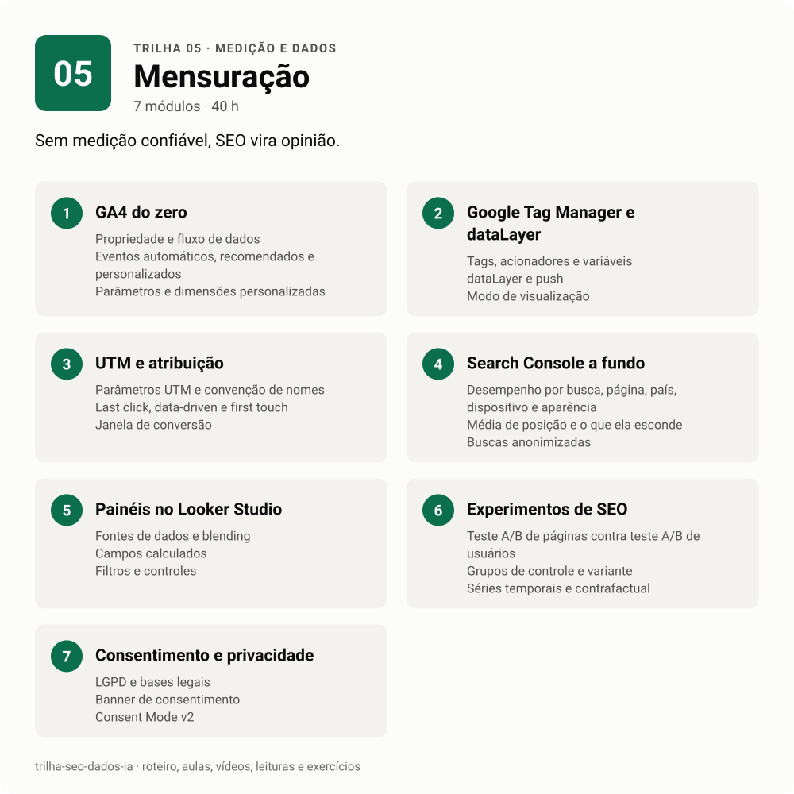

# 05 · Mensuração

<!-- infografico:trilha-05 -->
<picture>
  <source media="(prefers-color-scheme: dark)" srcset="../../imagens/trilha-05-escuro.svg">
  
</picture>
<!-- /infografico -->

Sem medição confiável, SEO vira opinião. Esta trilha ensina a coletar, conferir e ler os números que sustentam decisões. GA4, Tag Manager, UTM, Search Console, painéis e experimentos. E, principalmente, a não se enganar com o próprio dado.

**Pré-requisitos.** Trilha 00, módulos 1, 3 e 6.
**Carga estimada.** 40 h.

**Ao terminar, você consegue**
- implementar e auditar um GA4 com eventos e conversões que fazem sentido para o negócio;
- montar um Tag Manager com dataLayer, inclusive em aplicações de página única;
- manter uma taxonomia de UTM e explicar os limites de cada modelo de atribuição;
- extrair tudo do Search Console e saber o que cada número significa;
- desenhar um teste de SEO e ler o resultado com honestidade estatística.

## Roteiro

### 1. GA4 do zero

GA4 é um modelo de eventos. Tudo é evento, e conversão é um evento marcado como importante. A configuração inicial decide se os dados vão servir daqui a um ano.

**Conceitos-chave.** Propriedade e fluxo de dados. Eventos automáticos, recomendados e personalizados. Parâmetros e dimensões personalizadas. Eventos-chave. Agrupamento de canais. Explorações. Limites de cardinalidade e "(other)". Retenção de dados.

**Na prática.** Defina com o negócio o que é lead antes de configurar qualquer evento. Num cliente, o envio do formulário já era o lead qualificado, e separar as duas etapas no funil teria criado uma perda que não existia.

- [ ] Configurei uma propriedade GA4 de teste com 3 eventos personalizados
- [ ] Criei uma exploração de funil e uma de caminho
- [ ] Criei um agrupamento de canal personalizado

### 2. Google Tag Manager e dataLayer

O Tag Manager separa a implementação de tags do código do site. O dataLayer é o contrato entre o site e as tags. Quando o contrato é bom, a medição sobrevive a redesign.

**Conceitos-chave.** Tags, acionadores e variáveis. dataLayer e `push`. Modo de visualização. Eventos de e-commerce do GA4. Aplicações de página única e mudança de histórico. Server-side tagging.

**Na prática.** Em checkout feito como aplicação de página única, a página não recarrega entre as etapas. A saída foi uma ponte que lê o estado da aplicação e empurra eventos para o dataLayer em cada rota do fluxo. Teste cada etapa no modo de visualização antes de publicar.

- [ ] Instalei o GTM num site de teste e disparei um evento a partir do dataLayer
- [ ] Implementei os eventos de e-commerce do GA4 numa loja de teste
- [ ] Documentei o dataLayer de um site como contrato para o time de desenvolvimento

### 3. UTM e atribuição

Atribuição é escolher uma história para dividir o crédito de uma venda. Nenhum modelo é a verdade. UTM bem feito é o que permite contar alguma história.

**Conceitos-chave.** Parâmetros UTM e convenção de nomes. Last click, data-driven e first touch. Janela de conversão. Tráfego direto e "não atribuído". Cruzamento entre GA4 e CRM. Atribuição offline.

**Na prática.** Num grupo de educação, mais da metade da receita estava marcada como "offline" no CRM, e quase todos esses contatos tinham navegação registrada no site. A causa era a origem do cadastro (importação e integração), que sobrescrevia a fonte. Antes de concluir que um canal não vende, confira como o CRM grava a origem.

- [ ] Escrevi uma convenção de UTM com exemplos e regras de minúscula
- [ ] Comparei a mesma conversão em 3 modelos de atribuição
- [ ] Cruzei GA4 com uma base de CRM de exemplo e medi o balde sem origem

### 4. Search Console a fundo

O Search Console é a única fonte de dado do próprio Google sobre a sua busca orgânica. Saber os limites dele é tão importante quanto saber os relatórios.

**Conceitos-chave.** Desempenho por busca, página, país, dispositivo e aparência. Média de posição e o que ela esconde. Buscas anonimizadas. Limite de mil linhas na interface. API e exportação em massa para BigQuery. Dezesseis meses de histórico. Agregação por propriedade contra por página.

**Na prática.** O Search Console publica a série diária até dois dias antes, e o dia publicado já vem fechado. Comparar duas coletas mostrou os mesmos números nos dias em comum. Então "o dado ainda está entrando" não explica uma queda nos últimos dias. Se impressões estão estáveis e cliques caíram, é queda de CTR, não coleta incompleta.

- [ ] Ativei a exportação em massa para BigQuery num site de teste
- [ ] Calculei quanto dos cliques vem de buscas anonimizadas
- [ ] Comparei duas coletas para provar que os dias publicados não mudam

### 5. Painéis no Looker Studio

Painel é ferramenta de decisão. O melhor painel responde poucas perguntas, sempre as mesmas, com filtros que o gestor usa sozinho. O Looker Studio voltou a se chamar Data Studio na documentação do Google, então você vai encontrar os dois nomes no material.

**Conceitos-chave.** Fontes de dados e blending. Campos calculados. Filtros e controles. Comparação de períodos. Desempenho com fontes grandes. Painel contra relatório narrativo.

**Na prática.** Comparação diária mês contra mês precisa alinhar pelo dia da semana. Sem isso, um domingo de um mês é comparado com uma terça do outro e o gráfico inventa viradas. Num caso real, uma alta de 162% virou queda de 2% depois do alinhamento. Confira também feriados na janela.

- [ ] Montei um painel de SEO com Search Console e GA4 lado a lado
- [ ] Fiz uma comparação mês contra mês alinhada por dia da semana
- [ ] Cortei o painel para no máximo 6 gráficos que respondem perguntas do gestor

### 6. Experimentos de SEO

Mudança de SEO quase nunca tem grupo de controle natural. Teste de SEO divide páginas parecidas em dois grupos, muda um deles e compara com o que se esperava.

**Conceitos-chave.** Teste A/B de páginas (split testing de SEO) contra teste A/B de usuários. Grupos de controle e variante. Séries temporais e contrafactual. CausalImpact. Diferença em diferenças. Teste de placebo. Poder estatístico e tamanho do efeito.

**Na prática.** Numa análise de Core Web Vitals contra receita, a correlação parecia forte, mas com só seis pontos o intervalo de confiança ia de quase nada a quase tudo. Um teste de placebo mostrou que o mês "do problema" era só o quarto pior entre doze cortes possíveis. O achado foi exatamente esse, que o dado não sustentava o business case. A saída foi usar âncoras publicadas e uma faixa de estimativa.

- [ ] Desenhei um teste de SEO com grupos de controle e variante
- [ ] Rodei CausalImpact ou uma diferença em diferenças com dados de exemplo
- [ ] Fiz um teste de placebo para ver se o efeito é maior que a variação normal

### 7. Consentimento e privacidade

A LGPD e o Consent Mode mudaram o que se mede e como. Banner de cookies mal feito pode zerar a medição ou expor a empresa.

**Conceitos-chave.** LGPD e bases legais. Banner de consentimento. Consent Mode v2 (básico e avançado). Modelagem de conversões. Dados pessoais em URL e em evento (nunca).

- [ ] Configurei Consent Mode num site de teste e vi o efeito no GA4
- [ ] Procurei e-mail ou CPF em parâmetros de URL nos relatórios de um site

## Material

- [Aulas](aulas.md)
- [Vídeos](videos.md)
- [Leituras](leituras.md)
- [Exercícios e projeto da trilha](exercicios.md)

**Próxima trilha.** [06 Engenharia de dados](../06-engenharia-de-dados).
