# Aulas · 05 · Mensuração

Texto de apoio de cada módulo. Leia depois dos vídeos e antes dos exercícios. Onde houver comando ou código, rode no seu computador.

## Sumário

1. [GA4 do zero](#aula-1-ga4-do-zero)
2. [Google Tag Manager e dataLayer](#aula-2-google-tag-manager-e-datalayer)
3. [UTM e atribuição](#aula-3-utm-e-atribuição)
4. [Search Console a fundo](#aula-4-search-console-a-fundo)
5. [Painéis no Looker Studio](#aula-5-painéis-no-looker-studio)
6. [Experimentos de SEO](#aula-6-experimentos-de-seo)
7. [Consentimento e privacidade](#aula-7-consentimento-e-privacidade)

## Aula 1. GA4 do zero

### A ideia central

O GA4 registra eventos. Uma visualização de página é um evento. Uma rolagem é um evento. Uma compra é um evento com valor e itens. Sessão e usuário são agrupamentos calculados a partir desses eventos. Quando você entende isso, o GA4 deixa de parecer confuso. Ele é uma tabela longa de acontecimentos, cada um com nome, data, usuário e uma lista de parâmetros.

Conversão, que hoje o GA4 chama de evento-chave, é só um evento marcado como importante. A marcação é fácil. O difícil é decidir o que marcar. Essa decisão é de negócio e vem antes de qualquer configuração. Uma propriedade montada com pressa produz relatório bonito e inútil. Uma propriedade montada com uma definição clara de lead ou de venda ainda serve daqui a um ano.

### Como funciona

#### Propriedade e fluxo de dados

A hierarquia é conta, propriedade e fluxo de dados. A propriedade guarda os dados e as configurações. O fluxo é a origem dos eventos (um site, um app iOS, um app Android). Cada fluxo da web tem um ID de medição no formato `G-XXXXXXXXXX`. Use uma propriedade por produto ou negócio e vários fluxos quando o mesmo produto tem site e app.

O fluxograma mostra a hierarquia de um produto com site e dois apps.

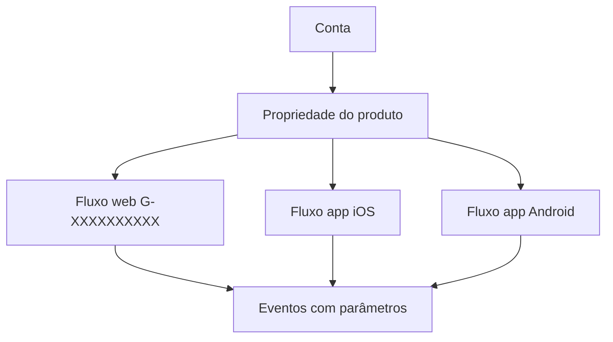

#### Os quatro tipos de evento

| Tipo | Quem cria | Exemplos |
|---|---|---|
| Automático | O próprio GA4, sem configuração | `first_visit`, `session_start`, `user_engagement` |
| Medição otimizada | O GA4, ligado por chave no fluxo | `page_view`, `scroll`, `click` (saída), `view_search_results`, `file_download`, `form_start`, `form_submit`, `video_start` |
| Recomendado | Você, com nome e parâmetros definidos pelo Google | `generate_lead`, `sign_up`, `login`, `add_to_cart`, `purchase` |
| Personalizado | Você, com nome livre | `clique_whatsapp`, `rolagem_90`, `envio_formulario` |

Algumas regras da medição otimizada valem conhecer de cor. O `scroll` dispara uma vez por página, quando 90% da altura fica visível. O `view_search_results` depende de parâmetro de busca na URL (por padrão `q`, `s`, `search`, `query` e `keyword`). O `form_submit` dispara no envio do formulário e não sabe se o servidor aceitou o cadastro. Para lead, prefira um evento disparado na tela de confirmação ou na resposta do servidor.

Antes de inventar um evento personalizado, procure na lista de eventos recomendados. Usar `generate_lead` em vez de `lead_enviado` deixa a propriedade compatível com relatórios e integrações que o Google já espera.

#### Parâmetros e dimensões personalizadas

Cada evento leva parâmetros. O GA4 aceita até 25 parâmetros por evento, nome de evento e de parâmetro com até 40 caracteres e valor de parâmetro com até 100 caracteres (`page_location` vai até 1.000). Esses números estão na página de limites de coleta da ajuda do GA4.

Um parâmetro enviado aparece no DebugView na hora. Nos relatórios ele só aparece depois de registrado como dimensão ou métrica personalizada, em Admin, definições personalizadas. Depois do registro, o Google diz que leva de 24 a 48 horas para começar a reportar. Registre no mesmo dia em que o parâmetro começa a ser enviado e não conte com o passado. Uma propriedade padrão tem 50 dimensões no escopo de evento, 25 no escopo de usuário e 50 métricas personalizadas. É pouco. Escolha o que entra.

#### Eventos-chave

Evento-chave é a conversão do ponto de vista do GA4. Uma propriedade padrão aceita até 30. A conversão do Google Ads é outra coisa. Ela pode nascer de um evento-chave e serve para lance e públicos. Ela não aparece nos relatórios padrão do GA4. Quando alguém disser "conversão", pergunte de qual sistema está falando.

#### Cardinalidade e a linha "(other)"

Cardinalidade é o número de valores distintos de uma dimensão. Quando uma tabela passa do limite de linhas, o GA4 mostra os valores mais comuns e junta o resto numa linha chamada "(other)". A ajuda do GA4 trata dimensões com mais de 500 valores como de alta cardinalidade. O limite exato varia por relatório e tipo de propriedade. Relatório com uma dimensão raramente sofre. Exploração com dimensão secundária, filtro e comparação sofre muito.

A regra prática é simples. Nunca registre como dimensão um identificador por usuário, um ID de pedido ou uma URL completa com parâmetros. Esses valores podem ir como parâmetro sem registro e continuam disponíveis no BigQuery.

O fluxograma mostra onde um parâmetro aparece conforme o registro e a cardinalidade.

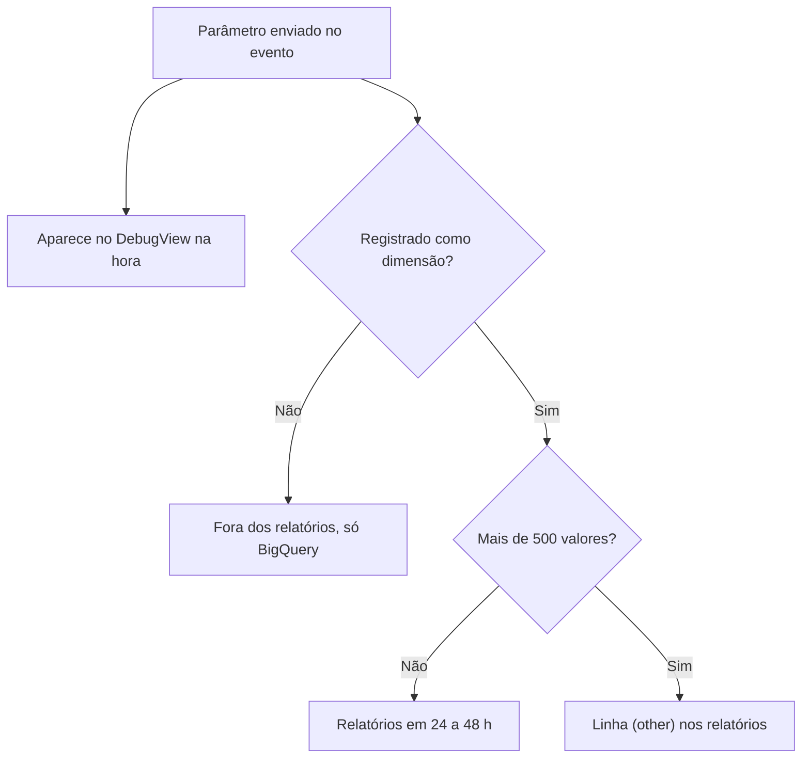

#### Retenção de dados

A retenção decide por quanto tempo o dado no nível de evento fica disponível para Explorações e relatórios de funil. Numa propriedade padrão as opções são 2 ou 14 meses. Os relatórios padrão, que usam tabelas agregadas, não são afetados. Confira a configuração no primeiro dia e coloque 14 meses. Se ficar em 2, a exploração de funil de um ano atrás simplesmente não existe.

#### Agrupamento de canais

O agrupamento padrão decide em qual canal cada sessão cai, a partir de origem, mídia e campanha. Você pode criar agrupamentos personalizados, por exemplo para separar as visitas que vêm de chatgpt.com, perplexity.ai, gemini.google.com e copilot.microsoft.com do resto do "Referral". Copie o agrupamento padrão e acrescente a regra acima da regra de referência, porque a ordem das regras decide o canal.

### Exemplo guiado

Use o conjunto público do GA4 no BigQuery. Ele cobre de 1º de novembro de 2020 a 31 de janeiro de 2021, é de uma loja real com dados ofuscados e roda no sandbox gratuito. A documentação avisa que alguns campos trazem valores de preenchimento como `<Other>`, `NULL` e texto vazio, e que a consistência interna é limitada. Serve para aprender a consulta, não para tirar conclusão de negócio.

1. Abra o console do BigQuery com uma conta Google e ative o sandbox.
2. Rode o funil aberto, que conta usuários que fizeram cada etapa em qualquer ordem.

```sql
-- Funil aberto. Usuários por etapa em dezembro de 2020.
SELECT
  event_name,
  COUNT(DISTINCT user_pseudo_id) AS usuarios
FROM `bigquery-public-data.ga4_obfuscated_sample_ecommerce.events_*`
WHERE _TABLE_SUFFIX BETWEEN '20201201' AND '20201231'
  AND event_name IN ('view_item', 'add_to_cart', 'begin_checkout', 'purchase')
GROUP BY event_name
ORDER BY usuarios DESC;
```

3. Rode a versão fechada, que só conta quem fez as etapas na ordem. É uma aproximação, porque olha a primeira vez de cada evento por usuário.

```sql
WITH primeira_vez AS (
  SELECT
    user_pseudo_id,
    MIN(IF(event_name = 'view_item', event_timestamp, NULL)) AS t_item,
    MIN(IF(event_name = 'add_to_cart', event_timestamp, NULL)) AS t_carrinho,
    MIN(IF(event_name = 'begin_checkout', event_timestamp, NULL)) AS t_checkout,
    MIN(IF(event_name = 'purchase', event_timestamp, NULL)) AS t_compra
  FROM `bigquery-public-data.ga4_obfuscated_sample_ecommerce.events_*`
  WHERE _TABLE_SUFFIX BETWEEN '20201201' AND '20201231'
  GROUP BY user_pseudo_id
)
SELECT
  COUNTIF(t_item IS NOT NULL) AS viu_item,
  COUNTIF(t_carrinho > t_item) AS carrinho_em_ordem,
  COUNTIF(t_checkout > t_carrinho AND t_carrinho > t_item) AS checkout_em_ordem,
  COUNTIF(t_compra > t_checkout AND t_checkout > t_carrinho AND t_carrinho > t_item) AS compra_em_ordem
FROM primeira_vez;
```

4. Compare as duas saídas. A diferença entre funil aberto e fechado mostra quantas pessoas pulam etapas, por exemplo quem compra direto sem passar por `view_item` registrado. Depois monte a mesma exploração de funil na conta de demonstração do GA4 e veja se a etapa de maior perda é a mesma.

O `event_timestamp` vem em microssegundos e em UTC. O `event_date` vem no fuso da propriedade. Misturar os dois desloca eventos de um dia para o outro perto da meia-noite.

### Erros comuns

- **Configurar eventos antes de definir o que é lead ou venda.** O resultado é uma lista de eventos que ninguém usa. Escreva a definição com o dono do negócio primeiro.
- **Deixar a retenção em 2 meses.** Explorações de períodos antigos ficam vazias e não há como recuperar. Mude para 14 meses no primeiro dia.
- **Enviar parâmetro e esquecer de registrar.** O dado aparece no DebugView e some do relatório. Registre a dimensão no mesmo dia.
- **Registrar ID de pedido ou URL completa como dimensão.** A cardinalidade explode e os relatórios se enchem de "(other)". Mande como parâmetro sem registro e consulte no BigQuery.
- **Contar `form_submit` como lead.** Ele dispara mesmo quando o envio falha. Dispare o evento de lead na confirmação.
- **Criar nomes com maiúscula e minúscula misturadas.** `Envio_Form` e `envio_form` viram dois eventos. Use sempre minúsculas e sublinhado.

### Na prática

Num cliente de geração de leads, a primeira proposta de medição tinha duas etapas no funil. A pessoa envia o formulário e, depois, vira lead qualificado. Parecia mais rigoroso. A conversa com o negócio mostrou que o envio do formulário já era o lead qualificado. Não havia triagem entre uma coisa e outra. Separar as duas etapas teria criado no painel uma perda entre "envio" e "lead" que não existia na vida real, e alguém iria gastar tempo tentando reduzir essa perda.

O raciocínio vale para qualquer propriedade. Cada etapa de funil precisa corresponder a uma decisão ou a uma ação diferente de alguém. Se duas etapas são o mesmo acontecimento, elas são uma etapa só. A pergunta a fazer antes de configurar é "o que acontece com essa pessoa entre esta etapa e a próxima?". Se a resposta for "nada", junte.

### Resumo

- Tudo no GA4 é evento. Evento-chave é um evento marcado como importante.
- Prefira eventos recomendados e registre os parâmetros como dimensões no mesmo dia.
- Respeite os limites de 25 parâmetros por evento, 50 dimensões de evento e 30 eventos-chave numa propriedade padrão.
- Retenção em 14 meses desde o início e nada de alta cardinalidade registrada.
- Defina lead e venda com o negócio antes de abrir o Admin.

### Para ir além

- O curso "Google Analytics 4 tutorial for beginners (2025)" da Analytics Mania, em [vídeos](videos.md), para ver a instalação e as explorações enquanto você monta a propriedade de teste.
- "Como fazer detalhamento de funil no Google Analytics 4", da Adtail, em [vídeos](videos.md), antes do exercício de funil aberto e fechado.
- "Eventos recomendados", do Google for Developers, em [leituras](leituras.md), para consultar nomes e parâmetros antes de criar qualquer evento.

## Aula 2. Google Tag Manager e dataLayer

### A ideia central

O Google Tag Manager (GTM) tira as tags do código do site. O time de desenvolvimento instala um contêiner uma vez e o time de marketing configura o que dispara e quando. Isso só funciona se existir um acordo entre os dois lados sobre que informação o site expõe. Esse acordo é o dataLayer.

Pense no dataLayer como um contrato. O site promete empurrar um evento `add_to_cart` com moeda, valor e itens, sempre no mesmo formato. O GTM promete ler esse formato. Se o site for redesenhado e o contrato for mantido, a medição continua de pé. Se a medição depende de seletor CSS e texto de botão, ela quebra no primeiro ajuste de layout.

### Como funciona

#### Tag, acionador e variável

Tag é o que executa (por exemplo, a tag de evento do GA4). Acionador é a condição que manda executar (por exemplo, um evento personalizado chamado `clique_cta`). Variável é o valor lido na hora (por exemplo, a variável de camada de dados `posicao`). No clique de um botão, o site empurra o evento, o acionador reconhece o nome, a tag do GA4 dispara e lê a variável para preencher o parâmetro.

A sequência mostra o clique do botão passando por cada peça do GTM.

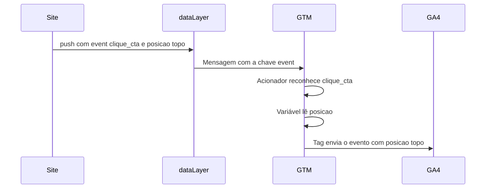

#### Como o dataLayer funciona por dentro

O `dataLayer` é um array global do JavaScript. O site chama `dataLayer.push({...})` e o GTM processa cada mensagem. Um `push` feito antes do snippet do GTM carregar fica guardado no array, e o GTM lê o que já estava lá quando carrega. Por isso a declaração `window.dataLayer = window.dataLayer || []` vem antes do snippet.

O GTM mantém um modelo de dados interno que junta cada `push` ao estado anterior. Uma chave enviada uma vez continua valendo até ser sobrescrita. Isso explica a linha que a documentação do GA4 coloca antes de cada evento de e-commerce. O `dataLayer.push({ ecommerce: null })` limpa o objeto anterior. Sem ela, itens de um `view_item_list` podem vazar para o `add_to_cart` seguinte.

A sequência mostra o modelo de dados do GTM antes e depois da limpeza do `ecommerce`.

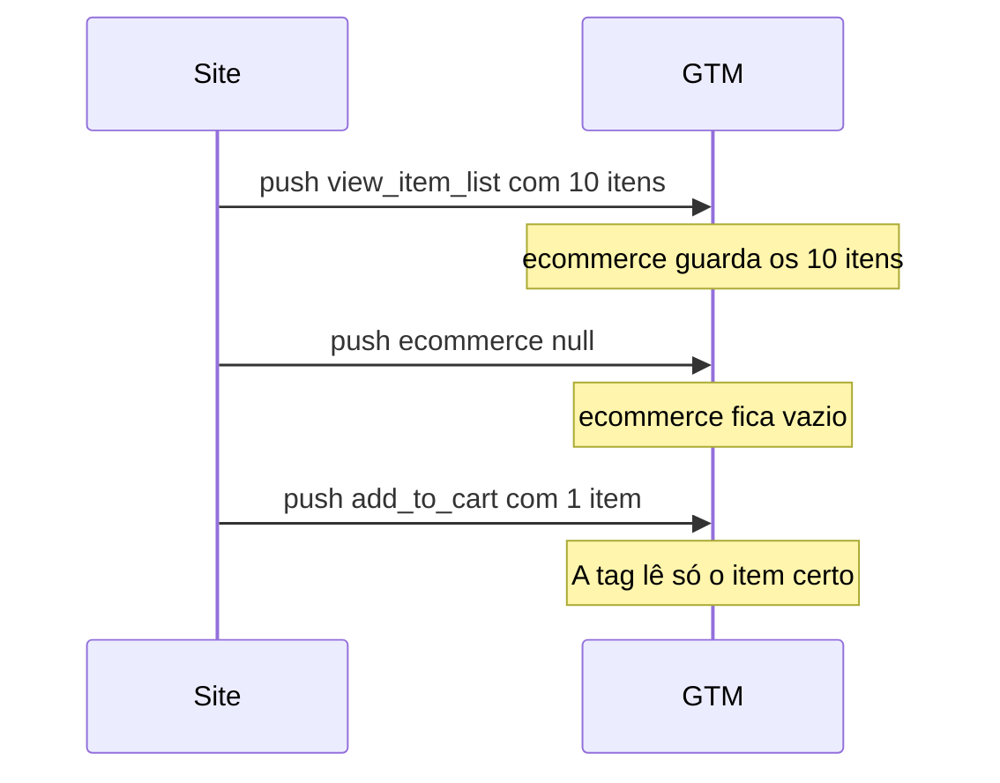

A ordem importa por outro motivo. O acionador de evento personalizado avalia no momento do `push` que contém a chave `event`. Se os dados chegarem num `push` posterior ao do evento, a tag dispara com a variável vazia. Mande dados e evento no mesmo `push`.

#### Eventos de e-commerce do GA4

O GA4 tem uma lista de eventos recomendados para loja. Os principais seguem o caminho da compra, `view_item_list`, `select_item`, `view_item`, `add_to_cart`, `view_cart`, `begin_checkout`, `add_shipping_info`, `add_payment_info` e `purchase`, além de `remove_from_cart` e `refund`. A documentação traz três regras que mais derrubam implementações. Cada item precisa de `item_id` ou `item_name` (os dois é melhor). O `transaction_id` é obrigatório em `purchase` e `refund`. E, quando houver `value`, a moeda vai em `currency` no nível do evento.

Este é o formato da documentação do GA4 para o GTM, com valores de uma loja brasileira.

```javascript
dataLayer.push({ ecommerce: null });  // limpa o objeto ecommerce anterior
dataLayer.push({
  event: "purchase",
  ecommerce: {
    transaction_id: "T_12345",
    value: 259.80,          // soma de price * quantity dos itens
    tax: 0,
    shipping: 19.90,
    currency: "BRL",
    coupon: "PRIMAVERA",
    items: [
      {
        item_id: "SKU_001",
        item_name: "Caderno pautado",
        item_brand: "Marca X",
        item_category: "Papelaria",
        price: 49.90,
        quantity: 2
      },
      {
        item_id: "SKU_002",
        item_name: "Mochila",
        item_category: "Acessórios",
        price: 160.00,
        quantity: 1
      }
    ]
  }
});
```

Repare que `value` é 49,90 vezes 2 mais 160, sem o frete. É assim que o comentário da documentação define o campo.

#### Aplicações de página única

Numa aplicação de página única (SPA, single page application), a URL muda e a página não recarrega. Há duas formas de medir a troca de tela. A primeira é a mudança de histórico do navegador, que o GA4 capta na medição otimizada e o GTM capta com o acionador de mudança de histórico. A segunda é um evento personalizado empurrado pela própria aplicação a cada rota. A documentação do GA4 avisa que, com tags configuradas pelo GTM, ligar também a captura automática de histórico no GA4 pode contar visualização em dobro. Escolha um caminho só.

A mudança de histórico tem outro risco. Ela dispara quando a URL muda, mesmo que o conteúdo ainda não tenha carregado, e alguns roteadores mudam a URL mais de uma vez na mesma navegação. O evento personalizado é mais trabalhoso e mais confiável, porque a aplicação sabe quando a tela está pronta.

#### Modo de visualização e server-side

O modo de visualização abre o site conectado ao Tag Assistant e mostra, para cada mensagem do dataLayer, quais tags dispararam e o valor de cada variável. Nada vai para produção sem passar por ele. O server-side tagging move parte do processamento para um servidor seu, que recebe os eventos e repassa para as ferramentas. Ele dá mais controle sobre o que sai do navegador. Também custa infraestrutura e manutenção, então só vale quando você já domina o contêiner da web.

### Exemplo guiado

1. Crie uma pasta e, dentro dela, um arquivo `index.html`.

```html
<!doctype html>
<html lang="pt-BR">
<head>
  <meta charset="utf-8">
  <title>Teste de dataLayer</title>
  <script>
    window.dataLayer = window.dataLayer || [];
    window.dataLayer.push({ tipo_pagina: "teste" });
  </script>
  <!-- Cole aqui o snippet do head do seu contêiner GTM de teste -->
</head>
<body>
  <!-- Cole aqui o snippet do body (noscript) do contêiner -->
  <button id="cta">Quero saber mais</button>
  <script>
    document.getElementById("cta").addEventListener("click", function () {
      window.dataLayer.push({ event: "clique_cta", posicao: "topo" });
    });
  </script>
</body>
</html>
```

2. Sirva a pasta com `python -m http.server 8000` e abra `http://localhost:8000`.
3. No GTM, crie a variável de camada de dados `posicao`, o acionador de evento personalizado com nome `clique_cta` e uma tag de evento do GA4 com o parâmetro `posicao` apontando para a variável.
4. Clique em Visualizar, informe `http://localhost:8000` e clique no botão. No Tag Assistant, selecione a mensagem `clique_cta` e confira se a tag disparou e se a variável vale `topo`.
5. Abra o DebugView do GA4 e confirme o evento com o parâmetro.
6. Só então publique a versão, com um nome que diga o que mudou.

### Erros comuns

- **Medir clique por texto ou classe CSS.** Um redesenho troca o texto e a medição para em silêncio. Peça ao time de desenvolvimento um `push` com nome de evento estável.
- **Esquecer o `ecommerce: null`.** Itens de um evento aparecem no seguinte e a receita por produto fica errada. Limpe antes de cada evento de e-commerce.
- **Mandar o evento num `push` e os dados no seguinte.** A tag dispara com variável vazia. Mande tudo junto.
- **Ligar a captura automática de histórico e o acionador do GTM ao mesmo tempo.** A SPA conta visualização em dobro. Escolha um caminho.
- **Publicar sem o modo de visualização.** O erro só aparece semanas depois, no relatório. Teste cada evento e registre a captura.
- **Não documentar o contrato.** O próximo desenvolvedor remove o `push` sem saber. Escreva o dataLayer como documento, com tipo de cada campo e exemplo de JSON.

### Na prática

Um checkout foi construído como aplicação de página única. Entre carrinho, entrega e pagamento, a página não recarregava. As tags configuradas para disparar no carregamento só viam a primeira tela, e o funil de checkout terminava na etapa um.

A saída foi uma ponte. Um trecho de código lê o estado da aplicação a cada troca de rota e empurra para o dataLayer o evento da etapa correspondente, com os dados que a própria aplicação já tem (itens, valor, moeda). O esboço abaixo mostra a ideia. A guarda com `Set` evita que o botão de voltar do navegador dispare a mesma etapa duas vezes para o mesmo pedido.

```javascript
window.dataLayer = window.dataLayer || [];
const etapasEnviadas = new Set();
const eventoDaRota = {
  "/checkout/identificacao": "begin_checkout",
  "/checkout/entrega": "add_shipping_info",
  "/checkout/pagamento": "add_payment_info"
};

// Chame esta função no ponto em que o roteador da aplicação termina de trocar de tela.
function aoTrocarDeRota(rota, estado) {
  const evento = eventoDaRota[rota];
  if (!evento) return;
  const chave = estado.pedidoId + ":" + evento;
  if (etapasEnviadas.has(chave)) return;
  etapasEnviadas.add(chave);
  window.dataLayer.push({ ecommerce: null });
  window.dataLayer.push({
    event: evento,
    ecommerce: { currency: "BRL", value: estado.total, items: estado.itens }
  });
}
```

O ponto de método é testar cada etapa no modo de visualização antes de publicar, inclusive voltando e avançando pelo navegador. Uma etapa que dispara duas vezes infla o funil tanto quanto uma que não dispara o esvazia.

### Resumo

- O dataLayer é o contrato entre o site e as tags. Documente como contrato.
- Um `push` antes do GTM não se perde. Dados e evento vão no mesmo `push`.
- Limpe o objeto `ecommerce` antes de cada evento de e-commerce e siga os nomes do GA4.
- Em SPA, escolha entre histórico e evento personalizado, nunca os dois.
- Nada sai sem passar pelo modo de visualização.

### Para ir além

- "Google Tag Manager tutorial for beginners 2025", da Analytics Mania, em [vídeos](videos.md), para ver o caminho do contêiner vazio à publicação antes do exercício prático.
- "The Data Layer", de Simo Ahava, em [leituras](leituras.md), para entender o modelo de dados interno e por que a limpeza do `ecommerce` é necessária.
- "Camada de dados", do Google for Developers, em [leituras](leituras.md), como referência oficial quando for escrever o contrato do dataLayer.

## Aula 3. UTM e atribuição

### A ideia central

Atribuição é escolher uma história para dividir o crédito de uma venda entre os canais que a pessoa usou. Nenhuma história é a verdade. O último clique favorece quem fecha. O primeiro contato favorece quem apresenta. O modelo baseado em dados distribui por estatística, dentro do que o Google consegue ver. Cada modelo responde a uma pergunta diferente.

UTM é o que permite contar alguma história. Sem parâmetro de campanha, um e-mail vira "Direct", um post de parceiro vira "Referral" genérico e uma campanha de mídia some num balde que ninguém consegue abrir. A disciplina do UTM é chata e é ela que sustenta toda leitura de canal.

### Como funciona

#### Os parâmetros

A ajuda do GA4 lista nove parâmetros. Os cinco clássicos são `utm_source` (quem mandou o tráfego), `utm_medium` (o tipo de canal), `utm_campaign` (a campanha), `utm_term` (palavra-chave paga) e `utm_content` (a variação do criativo). Há também `utm_id`, `utm_source_platform`, `utm_creative_format` e `utm_marketing_tactic`, e a ajuda informa que os dois últimos ainda não aparecem nos relatórios. O Google recomenda sempre usar origem, mídia e campanha. O que faltar aparece como "(not set)".

A ajuda também diz que os valores diferenciam maiúscula de minúscula. `utm_source=google` e `utm_source=Google` viram duas origens. `Email`, `email` e `e-mail` viram três linhas. As regras do agrupamento de canais padrão leem principalmente origem e mídia, então uma mídia fora do padrão manda a sessão para o canal errado ou para "Unassigned".

#### Convenção de nomes

Uma convenção boa cabe numa página e tem quatro regras.

1. Tudo em minúsculas.
2. Um separador só, de preferência o sublinhado.
3. Lista fechada de valores para `utm_medium` (por exemplo `email`, `social`, `cpc`, `display`, `affiliate`, `referral`).
4. Campanha com padrão que ordena bem, como `2026_10_black_friday`.

Monte os links no Campaign URL Builder e guarde todos numa planilha com data, dono e destino. Nunca use UTM em link interno do próprio site. O GA4 passa a registrar o próprio site como origem dali em diante, e o crédito da conversão sai do canal que trouxe a pessoa.

#### Modelos de atribuição no GA4

Desde novembro de 2023, o GA4 tem três modelos para os relatórios de atribuição. Baseado em dados, último clique pago e orgânico, e último clique nos canais pagos do Google. Primeiro clique, linear, decaimento no tempo e baseado em posição saíram. A configuração fica em Admin, configurações de atribuição, junto com a janela de conversão, que define quantos dias antes do evento-chave um contato ainda pode receber crédito.

O primeiro contato continua visível nas dimensões de "primeiro usuário", como "Origem/mídia do primeiro usuário". Isso é diferente de um modelo de atribuição. A dimensão de primeiro usuário diz por onde a pessoa chegou na primeira vez e não divide o crédito de cada conversão.

No BigQuery acontece algo parecido. O registro `traffic_source` da exportação do GA4 guarda, segundo a documentação do esquema, a origem que adquiriu o usuário pela primeira vez. Somar receita por `traffic_source` é uma leitura de primeiro contato. O relatório de aquisição de tráfego usa a sessão. Os dois números não batem, e não deveriam bater.

O fluxograma mostra a mesma compra creditada a canais diferentes conforme o escopo.

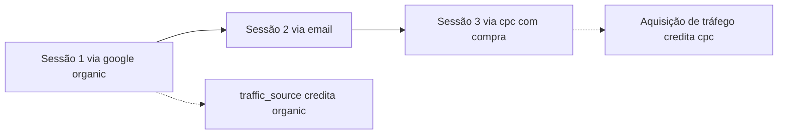

#### Direct e Unassigned

Uma sessão cai em "Direct" quando o GA4 não encontra origem. Isso acontece com quem digita o endereço, com link aberto a partir de aplicativo que não passa referência, com redirecionamento que perde os parâmetros e com navegação de HTTPS para HTTP. "Unassigned" é diferente. A sessão tem origem e mídia, mas nenhuma regra do agrupamento de canais reconhece a combinação. Quase sempre é UTM fora da convenção.

O fluxograma mostra como uma sessão termina em Direct ou em Unassigned.

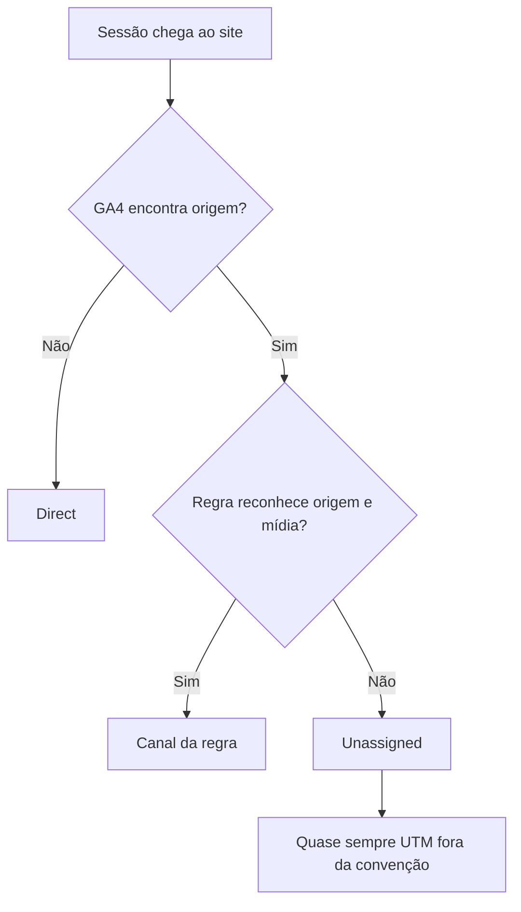

#### Cruzamento com CRM e atribuição offline

A venda costuma acontecer no CRM, longe do GA4. Para cruzar, o formulário precisa guardar um identificador que ligue o lead à navegação (o ID do cliente do GA4, o `gclid` ou os UTM da sessão em campos ocultos). Sem isso, a única ponte é o e-mail, e o e-mail não pode ir para o GA4 (veja a Aula 7). O CRM também grava a sua própria origem, com regras que nem sempre combinam com as do GA4. É aí que nascem os baldes sem origem.

### Exemplo guiado

No BigQuery, com o conjunto público do GA4, some compras e receita pela origem de primeiro contato.

```sql
-- Compras e receita pela origem que adquiriu o usuário (primeiro contato).
SELECT
  traffic_source.source AS origem,
  traffic_source.medium AS midia,
  COUNT(*) AS compras,
  ROUND(SUM(ecommerce.purchase_revenue), 2) AS receita
FROM `bigquery-public-data.ga4_obfuscated_sample_ecommerce.events_*`
WHERE _TABLE_SUFFIX BETWEEN '20201101' AND '20210131'
  AND event_name = 'purchase'
GROUP BY origem, midia
ORDER BY receita DESC;
```

Depois abra a conta de demonstração do GA4, vá em aquisição de tráfego e olhe a mesma janela. Anote três diferenças e explique cada uma pelo modelo (primeiro contato contra sessão), pela ofuscação do conjunto público ou por valores como `(data deleted)` e `<Other>`.

Para medir o balde sem origem numa base de CRM, a conta é curta. Troque os nomes das colunas pelos da sua base.

```python
import pandas as pd

leads = pd.read_csv("leads.csv")      # uma linha por lead, com a coluna "origem"
vendas = pd.read_csv("vendas.csv")    # uma linha por venda, com "lead_id" e "receita"

base = vendas.merge(leads, on="lead_id", how="left")
sem_origem = base["origem"].isna() | base["origem"].str.lower().isin(["unknown", "offline", "(not set)", ""])
print(f"Vendas sem origem {sem_origem.mean():.1%}")
print(f"Receita sem origem {base.loc[sem_origem, 'receita'].sum() / base['receita'].sum():.1%}")
```

### Erros comuns

- **Aceitar qualquer valor em `utm_medium`.** As sessões caem em "Unassigned" e o canal some do relatório. Use lista fechada e revise todo link antes de sair.
- **Pôr UTM em link interno.** O crédito sai do canal que trouxe a pessoa e vai para o próprio site. Use UTM só em link que vem de fora.
- **Comparar primeiro contato com sessão e chamar de erro.** São perguntas diferentes. Diga sempre qual modelo e qual escopo está na tabela.
- **Cortar verba de um canal com base num CRM que sobrescreve origem.** O canal que vende pode estar escondido no balde sem origem. Meça o balde antes de decidir.
- **Mandar o e-mail para o GA4 para cruzar com o CRM.** Viola a política do Google Analytics. Use um identificador sem dado pessoal.

### Na prática

Num diagnóstico de atribuição para um grupo de educação, a pergunta era quanto o conteúdo orgânico contribuía para matrículas. Mais da metade da receita aparecia no CRM com origem "offline". A primeira hipótese era razoável. Muitas vendas aconteceriam por telefone e atendimento presencial, sem passar pelo site.

O teste foi cruzar os contatos "offline" com o histórico de navegação que o próprio CRM registrava. Quase todos tinham navegado no site, com dezenas de páginas vistas em média. A origem "offline" vinha da forma como o contato entrava no CRM, por importação de planilha, integração entre sistemas ou API. Essas entradas sobrescreviam a fonte original.

Com a origem quebrada, a análise passou a olhar comportamento. Apareceu uma curva de dose e resposta. Quanto mais páginas lidas, maior a conversão. Quem leu mais de 50 páginas converteu de cinco a treze vezes mais que quem não leu nenhuma. Um score de lead baseado em conteúdo separou leads que valiam quase vinte vezes mais que outros. A correção da origem foi para o backlog do time de dados.

O raciocínio que fica é de ordem. Antes de concluir que um canal não vende, descubra como o sistema grava a origem. Quando a origem está quebrada, o comportamento ainda conta a história.

### Resumo

- Atribuição é escolha de história. Diga sempre qual modelo e qual escopo você usou.
- Origem, mídia e campanha sempre, em minúsculas, com lista fechada de mídias.
- O GA4 tem baseado em dados e variantes de último clique. Primeiro contato aparece só como dimensão de primeiro usuário.
- `traffic_source` no BigQuery é primeiro contato. Não espere que bata com a aquisição de tráfego.
- Meça o balde sem origem do CRM antes de julgar qualquer canal.

### Para ir além

- "GA4 Attribution Models", da Two Octobers, em [vídeos](videos.md), para fixar por que usuário, sessão e evento atribuem diferente antes do exercício no BigQuery.
- "Grupo de canais padrão", da ajuda do Google Analytics, em [leituras](leituras.md), para escrever a sua lista de `utm_medium` já compatível com as regras.
- "A Guide to UTM Parameters in Google Analytics 4", da Analytics Mania, em [leituras](leituras.md), quando for redigir a convenção.

## Aula 4. Search Console a fundo

### A ideia central

O Search Console é a única fonte do próprio Google sobre como o seu site aparece na busca. Nenhuma ferramenta de terceiros sabe as impressões reais. Isso dá a ele uma autoridade que nenhum outro número tem. E é justamente por isso que você precisa saber o que ele esconde.

Os limites são conhecidos. A interface mostra no máximo 1.000 linhas e guarda 16 meses. Uma parte das buscas é anonimizada por privacidade. A posição é uma média. A agregação por propriedade e por página dá totais diferentes. Quem conhece esses limites usa o Search Console com segurança. Quem não conhece tira conclusão de ruído.

### Como funciona

#### As quatro métricas

Clique é cada clique que leva a pessoa para fora do Google até o seu site. Impressão é cada vez que um link do site aparece num resultado de busca para a pessoa. CTR é cliques divididos por impressões. Posição é a posição mais alta do site naquele resultado, e o número que você vê é a média dessas posições ponderada pelas impressões.

A média esconde a distribuição. Uma página com posição média 4,2 pode estar sempre entre 4 e 5. Ou pode estar em 1 para metade das impressões e em 7 ou 8 para a outra metade, o que pede outra ação. Sempre que a posição importar, quebre por busca e por dia.

#### Buscas anonimizadas e totais que não batem

Buscas muito raras não aparecem com o texto, para proteger a privacidade de quem buscou. O clique delas entra no total do gráfico e não entra na tabela por busca. Por isso a soma das linhas por busca é menor que o total. A diferença é a parcela anonimizada, e em sites de cauda longa ela costuma ser grande.

A agregação também muda o total. Por propriedade, o Google conta um clique ou uma impressão por resultado, mesmo que duas páginas do site apareçam juntas. Por página, cada URL conta separado. Some sempre na mesma agregação que o gestor vê.

#### A série diária fecha em cerca de dois dias

O Search Console publica a série diária até cerca de dois dias antes de hoje. O dia publicado já vem fechado e não muda depois. A consequência prática é forte. "O dado ainda está entrando" não explica uma queda em dias que já estão publicados.

#### A API

O método `searchanalytics.query` devolve até 25.000 linhas por requisição (o padrão é 1.000) e pagina com `startRow`. O parâmetro `dataState` aceita `final` (só dado finalizado, o padrão), `all` (inclui dado recente, que pode estar incompleto) e `hourly_all` (quebra por hora). O `aggregationType` aceita `auto`, `byPage` e `byProperty`, entre outros. As dimensões incluem `date`, `hour`, `query`, `page`, `country`, `device` e `searchAppearance`. A própria documentação avisa que a API não garante devolver todas as linhas, só as principais. Para o dado completo no nível de linha, use a exportação em massa.

#### Exportação em massa para o BigQuery

A exportação em massa manda, uma vez por dia, os dados de desempenho da propriedade para um projeto seu no BigQuery. Os passos da ajuda do Search Console são estes.

1. No Google Cloud, crie ou escolha um projeto com faturamento e ative a BigQuery API e a BigQuery Storage API.
2. Em IAM, dê à conta de serviço `search-console-data-export@system.gserviceaccount.com` os papéis BigQuery Job User e BigQuery Data Editor.
3. No Search Console, abra Configurações, Exportação de dados em massa, informe o ID do projeto (não o número), o nome do conjunto de dados e o local.

O conjunto se chama `searchconsole` por padrão e o nome sempre começa com essa palavra. O local é fixado na primeira exportação e não muda com facilidade. A primeira carga chega em até 48 horas. Não há carga do passado, então o histórico anterior à ativação só existe na API e na interface. Ative cedo. Como exige faturamento, o sandbox gratuito não serve. Há uma cota gratuita, e armazenamento e consulta acima dela são cobrados.

Chegam três tabelas. `searchdata_site_impression` é agregada por propriedade. `searchdata_url_impression` é agregada por URL e traz colunas booleanas de aparência no resultado. `ExportLog` registra cada exportação bem-sucedida. As tabelas são particionadas por `data_date`, que está no horário do Pacífico.

O fluxograma compara os três caminhos para tirar dados de desempenho do Search Console.

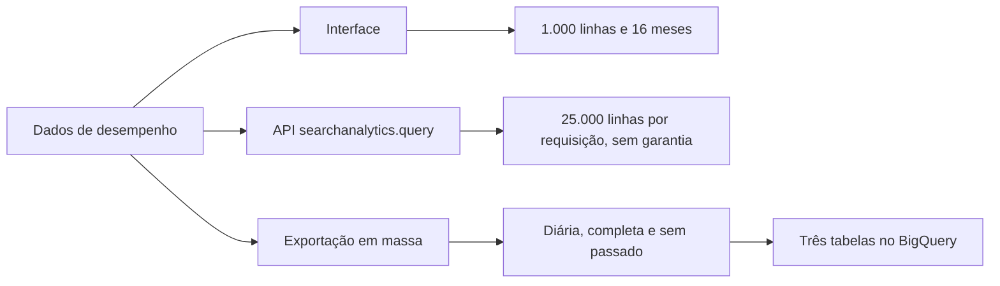

Três cuidados da documentação. A posição é guardada a partir de zero, então a média é `SUM(sum_top_position) / SUM(impressions) + 1` na tabela por propriedade e usa `sum_position` na tabela por URL. A busca anonimizada chega como texto vazio, com `is_anonymized_query` verdadeiro. E toda consulta deve filtrar `data_date`, porque cada consulta é cobrada pelo volume lido. Os dados ficam para sempre por padrão. Se quiser expiração, ponha nas partições e nunca na tabela inteira, que apagaria tudo.

### Exemplo guiado

1. Crie uma conta de serviço no Google Cloud, baixe a chave JSON e adicione o e-mail da conta como usuário da propriedade no Search Console. Instale `pip install google-api-python-client google-auth pandas`.
2. Colete os últimos 28 dias publicados e grave com a data da coleta.

```python
import datetime as dt
import os

import pandas as pd
from google.oauth2 import service_account
from googleapiclient.discovery import build

SITE = os.environ["GSC_SITE"]                # por exemplo sc-domain:seusite.com.br
cred = service_account.Credentials.from_service_account_file(
    os.environ["GSC_CREDENCIAIS"],           # caminho do JSON, fora do repositório
    scopes=["https://www.googleapis.com/auth/webmasters.readonly"],
)
gsc = build("searchconsole", "v1", credentials=cred)

hoje = dt.date.today()
fim = hoje - dt.timedelta(days=3)
corpo = {
    "startDate": (fim - dt.timedelta(days=27)).isoformat(),
    "endDate": fim.isoformat(),
    "dimensions": ["date"],
    "type": "web",
    "dataState": "final",
    "rowLimit": 25000,
}
resp = gsc.searchanalytics().query(siteUrl=SITE, body=corpo).execute()
df = pd.DataFrame(
    [{"data": r["keys"][0], "cliques": r["clicks"], "impressoes": r["impressions"]}
     for r in resp.get("rows", [])]
)
df["coletado_em"] = hoje.isoformat()
df.to_csv(f"gsc_diario_{hoje:%Y%m%d}.csv", index=False)
print(df.tail())
```

3. Uma semana depois, rode de novo e compare os dias em comum.

```python
import pandas as pd

a = pd.read_csv("gsc_diario_20261001.csv")
b = pd.read_csv("gsc_diario_20261008.csv")
comum = a.merge(b, on="data", suffixes=("_1", "_2"))
mudou = comum[(comum["cliques_1"] != comum["cliques_2"]) |
              (comum["impressoes_1"] != comum["impressoes_2"])]
print(len(comum), "dias em comum,", len(mudou), "com diferença")
```

O fluxograma mostra a ordem de diagnóstico de uma queda de cliques, começando pela comparação acima.

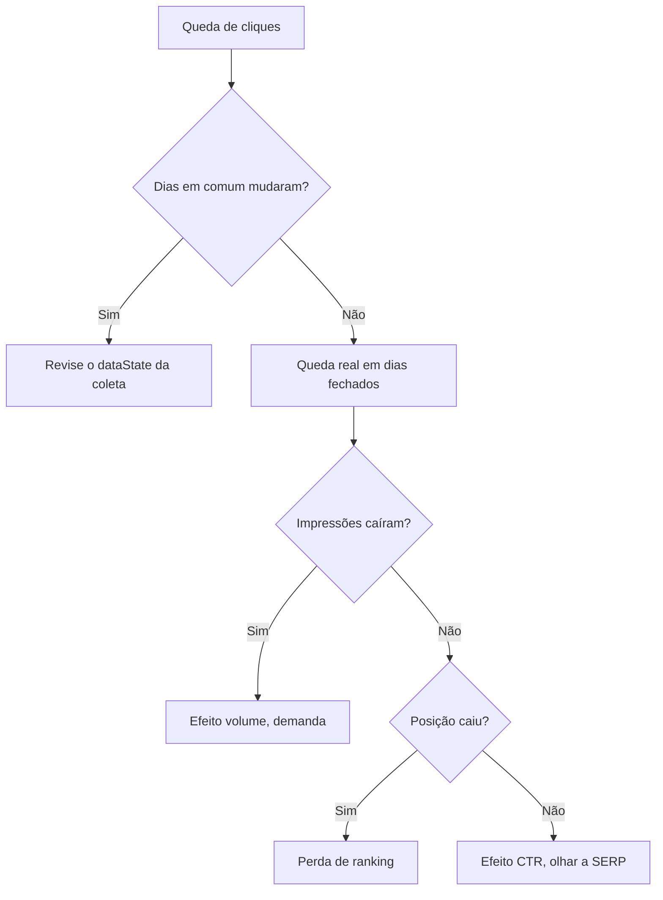

4. Com a exportação em massa ativa, meça a parcela anonimizada direto no BigQuery. Troque `meu-projeto` pelo ID do seu projeto.

```sql
SELECT
  SUM(clicks) AS cliques,
  SUM(IF(is_anonymized_query, clicks, 0)) AS cliques_anonimizados,
  SAFE_DIVIDE(SUM(IF(is_anonymized_query, clicks, 0)), SUM(clicks)) AS parcela
FROM `meu-projeto.searchconsole.searchdata_url_impression`
WHERE search_type = 'WEB'
  AND data_date BETWEEN DATE_SUB(CURRENT_DATE(), INTERVAL 90 DAY) AND CURRENT_DATE();
```

### Erros comuns

- **Somar cliques da tabela por busca e chamar de total.** A parcela anonimizada some. Use o total do gráfico ou some com a busca vazia incluída.
- **Ler posição média sem distribuição.** A mesma média esconde cenários que pedem ações opostas. Quebre por busca e por dia.
- **Atribuir queda recente a "dado entrando".** Dia publicado não muda. Procure a causa nos dias que já fecharam.
- **Ativar a exportação em massa só quando precisar.** Ela não traz o passado. Ative no primeiro dia de projeto.
- **Consultar a exportação sem filtro de data.** Cada consulta lê a tabela inteira e a conta sobe. Filtre `data_date` sempre.
- **Esquecer o +1 na posição da exportação.** Todas as posições ficam uma casa melhores do que são. Siga a fórmula da documentação.

### Na prática

Num cliente de saúde, um painel semanal acompanhava os leads da busca orgânica. Numa semana os leads caíram e a gestora perguntou o motivo. Não havia mudança no site. A primeira hipótese foi perda de posição por atualização de algoritmo. A segunda, sempre presente, foi "o dado ainda está entrando".

A segunda caiu primeiro. O Search Console publica a série até cerca de dois dias antes e o dia publicado não muda. Comparar duas coletas mostrou os mesmos números nos dias em comum. A queda estava em dias fechados.

Para a primeira, a conta foi decompor a variação de cliques das buscas de compra em dois efeitos. O efeito volume é a variação de impressões vezes o CTR anterior. O efeito CTR é a impressão atual vezes a variação de CTR. A soma dos dois dá exatamente a variação total. O código abaixo mostra a conta com números hipotéticos.

```python
import pandas as pd

# Números HIPOTÉTICOS, só para mostrar a conta.
d = pd.DataFrame({
    "busca": ["comprar produto x", "preco produto x"],
    "imp_0": [40000, 12000], "cli_0": [2000, 480],   # semana anterior
    "imp_1": [40400, 11800], "cli_1": [1697, 472],   # semana atual
})
d["ctr_0"] = d["cli_0"] / d["imp_0"]
d["ctr_1"] = d["cli_1"] / d["imp_1"]
d["efeito_volume"] = (d["imp_1"] - d["imp_0"]) * d["ctr_0"]
d["efeito_ctr"] = d["imp_1"] * (d["ctr_1"] - d["ctr_0"])
d["variacao"] = d["cli_1"] - d["cli_0"]
print(d[["busca", "variacao", "efeito_volume", "efeito_ctr"]].round(1).to_string(index=False))
```

No caso real, impressões e posição média das mesmas buscas estavam estáveis e o CTR tinha caído. A procura não mudou e o ranking também não. O que mudou foi a página de resultados, com elementos novos interceptando o clique. A decomposição entrou fixa no painel, logo abaixo dos leads, com os períodos rotulados em cada bloco. As ações foram revisar títulos e descrições das páginas de compra e acompanhar os elementos da SERP.

Queda de cliques tem três causas possíveis, demanda, posição e CTR. Cada uma pede uma ação diferente, e separar as três é uma conta de cinco linhas.

### Resumo

- O Search Console é a fonte do Google. Use sabendo o que ele esconde.
- Interface com 1.000 linhas e 16 meses. API com até 25.000 linhas por requisição e sem garantia de todas.
- Dia publicado não muda. "Dado entrando" não explica queda em dia fechado.
- Exportação em massa é diária, sem passado, com posição a partir de zero e busca anonimizada como texto vazio.
- Decomponha a variação de cliques em volume e CTR antes de culpar o algoritmo.

### Para ir além

- "Intro to Search Console bulk data export" e o episódio seguinte, sobre tabelas e dicas da exportação, do Google Search Central, em [vídeos](videos.md), antes de ativar a exportação.
- "Detalhes sobre os limites e a filtragem de dados de desempenho do Search Console", do Google Search Central Blog, em [leituras](leituras.md), para entender por que os totais não batem.
- "SQL for SEO", de Trevor Fox, em [vídeos](videos.md), quando as primeiras tabelas chegarem.

## Aula 5. Painéis no Looker Studio

### A ideia central

Painel é ferramenta de decisão. Ele existe para que alguém olhe, entenda e aja sem precisar chamar o analista. O melhor painel responde poucas perguntas, sempre as mesmas, com filtros que o gestor usa sozinho. Cada gráfico a mais compete pela atenção dos que importam.

A ferramenta mudou de nome de novo. O Looker Studio voltou a se chamar Data Studio na documentação do Google, então você vai encontrar os dois nomes no material. Os conceitos são os mesmos.

### Como funciona

#### Fontes de dados e conectores

Cada gráfico lê uma fonte de dados. O conector do Search Console oferece duas tabelas. "Site Impression" agrega por propriedade e serve para totais do site. "URL Impression" agrega por página e serve para análise de URL. Uma fonte usa um método só. Para comparar os dois, crie duas fontes no mesmo relatório.

Para o GA4, o conector nativo consulta a API do GA4 e está sujeito às cotas dela, o que deixa painéis pesados lentos ou com erro. Com muito volume, a saída é ler da exportação do GA4 no BigQuery, de preferência de uma tabela já agregada por dia.

#### Combinações (blending)

Uma combinação junta até cinco fontes. O Data Studio aceita junção interna, externa à esquerda, externa à direita, externa completa e cruzada, e a condição de junção só aceita igualdade. Esse detalhe pesa no cruzamento de Search Console com GA4 por página. `https://site.com/pagina`, `https://site.com/pagina/` e `https://site.com/pagina?utm_source=x` são três chaves diferentes. Normalize antes de juntar, com um campo calculado.

```text
REGEXP_REPLACE(REGEXP_REPLACE(LOWER(Landing page), "[?#].*$", ""), "/$", "")
```

A expressão põe tudo em minúsculas, corta parâmetros e âncora e tira a barra final. Crie o mesmo campo nas duas fontes e junte por ele.

O fluxograma mostra a combinação com a chave normalizada dos dois lados.

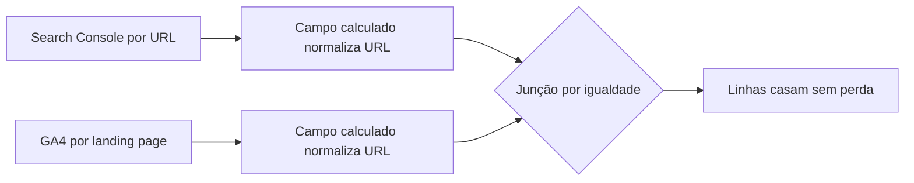

#### Campos calculados, filtros e controles

Campo calculado resolve o que a fonte não traz pronto, como CTR recalculado a partir de soma de cliques e soma de impressões. Nunca faça média de CTR de linhas, que dá peso igual a uma página com 10 impressões e outra com 10 mil. Controle é o filtro que o gestor mexe (período, dispositivo, seção do site). Dê ao gestor os controles que ele usaria e mais nenhum.

#### Comparação de períodos

A comparação de período embutida compara datas iguais do calendário. Para séries com sazonalidade semanal, isso engana. Se o mês atual começa numa terça e o anterior começou num domingo, o gráfico diário compara terça com domingo. A correção é comparar cada dia com o mesmo dia da semana. A forma mais simples é olhar 28 dias antes, que são quatro semanas cheias.

#### Painel contra relatório narrativo

Painel serve para pergunta recorrente com resposta numérica. Relatório narrativo serve para pergunta nova, que pede contexto, hipótese e recomendação. Quando o gestor pede sempre a mesma explicação, ela vira bloco fixo do painel. Quando um painel precisa de texto para ser entendido, ele está tentando ser relatório.

### Exemplo guiado

O código abaixo usa dados sintéticos de leads diários, com dia útil forte e fim de semana fraco. Ele monta as duas comparações e mostra o tamanho do erro da versão ingênua. Rode com Python 3.12 e pandas.

```python
# Dados SINTÉTICOS, gerados só para o exemplo.
import numpy as np
import pandas as pd

rng = np.random.default_rng(7)
datas = pd.date_range("2026-08-01", "2026-09-30", freq="D")
base = {0: 250, 1: 260, 2: 255, 3: 250, 4: 230, 5: 130, 6: 100}  # segunda=0 ... domingo=6
leads = [base[d.day_of_week] + rng.normal(0, 8) for d in datas]
serie = pd.Series(np.round(leads), index=datas, name="leads")

atual = serie["2026-09-01":"2026-09-30"].to_frame()
atual["dia_semana"] = atual.index.day_name()

# Versão ingênua: mesmo dia do mês anterior.
atual["anterior_ingenuo"] = [serie.get(d - pd.DateOffset(months=1)) for d in atual.index]
# Versão alinhada: mesmo dia da semana, 4 semanas antes.
atual["anterior_alinhado"] = [serie.get(d - pd.Timedelta(days=28)) for d in atual.index]

atual["var_ingenua_%"] = (atual["leads"] / atual["anterior_ingenuo"] - 1) * 100
atual["var_alinhada_%"] = (atual["leads"] / atual["anterior_alinhado"] - 1) * 100

feriados = {pd.Timestamp("2026-09-07"): "Independência"}
atual["feriado"] = [feriados.get(d, "") for d in atual.index]

print(atual.head(8).round(1).to_string())
print("Maior diferença entre as duas leituras:",
      (atual["var_ingenua_%"] - atual["var_alinhada_%"]).abs().max().round(1), "p.p.")
```

Na saída, 1º de setembro de 2026 é uma terça. A versão ingênua compara com 1º de agosto, um sábado, e mostra alta de quase 97%. A versão alinhada compara com a terça de quatro semanas antes e mostra cerca de 1%. Repare também no dia 7, feriado nacional. Nos dados sintéticos ele se comporta como segunda comum. Num site real, ele precisa de nota na legenda, porque nenhum alinhamento corrige feriado.

O fluxograma mostra as duas comparações do dia 1º de setembro.

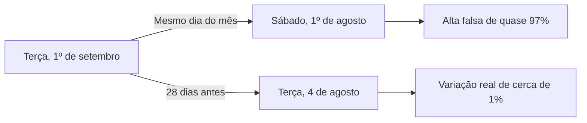

Se o painel lê do BigQuery, a mesma lógica cabe numa consulta.

```sql
SELECT
  a.data,
  a.leads,
  b.leads AS leads_4_semanas_antes,
  ROUND(100 * SAFE_DIVIDE(a.leads, b.leads) - 100, 1) AS variacao_pct
FROM `meu-projeto.painel.leads_diarios` AS a
LEFT JOIN `meu-projeto.painel.leads_diarios` AS b
  ON b.data = DATE_SUB(a.data, INTERVAL 28 DAY)
ORDER BY a.data;
```

### Erros comuns

- **Comparar dia do mês com dia do mês.** O gráfico inventa altas e quedas que são só calendário. Alinhe pelo dia da semana e marque os dias sem par nas pontas.
- **Usar URL Impression para total do site.** O total fica diferente do que o Search Console mostra. Use Site Impression para totais.
- **Juntar fontes por URL crua.** Barra final, maiúscula e parâmetro derrubam linhas sem aviso. Normalize num campo calculado.
- **Fazer média de CTR por linha.** Páginas pequenas pesam igual às grandes. Recalcule com soma sobre soma.
- **Bloco sem período no título.** O gestor compara semana com mês sem perceber. Escreva o período em cada bloco.
- **Painel com quinze gráficos.** Ninguém olha. Corte para no máximo seis, cada um respondendo uma pergunta escrita.

### Na prática

Num cliente de saúde, um deck semanal comparava os leads diários do mês atual com o mês anterior, dia contra dia. Um dia apareceu com alta de 162% sobre o mesmo dia do mês anterior. Parecia uma virada, e a primeira hipótese foi que alguma ação de marketing ou de SEO tinha funcionado.

O teste foi olhar o dia da semana de cada lado. Os dois meses começavam em dias diferentes. A comparação punha uma terça, com cerca de 260 leads, contra um domingo, com cerca de 100. Contra a terça equivalente do mês anterior, com cerca de 265, a variação era de 2% para baixo. A virada não existia.

A comparação diária passou a alinhar pelo dia da semana, com os dias sem par nas pontas sinalizados na legenda. Semanal e acumulado continuaram por data, lidos nos marcos de semana cheia. Feriados da janela entraram como nota. O ponto de método é que toda série com sazonalidade semanal pede comparação pareada. Sem isso, alguém toma decisão em cima de uma tendência que o calendário criou.

### Resumo

- Painel responde poucas perguntas recorrentes. O resto é relatório.
- Site Impression para totais, URL Impression para páginas.
- Combinação só junta por igualdade. Normalize URLs antes.
- Compare dias pelo dia da semana e anote feriados.
- No máximo seis gráficos, com período no título de cada bloco.

### Para ir além

- "Connect Google Search Console to Looker Studio (2026)", de Niklas Buschner, em [vídeos](videos.md), para montar a primeira página do painel.
- "Como as combinações funcionam no Data Studio", do Google Cloud, em [leituras](leituras.md), antes do desafio de blending entre Search Console e GA4.
- "Como monitorar o tráfego da Pesquisa (e muito mais) com o Data Studio", do Google Search Central Blog, em [leituras](leituras.md), como modelo de painel para comparar com o seu.

## Aula 6. Experimentos de SEO

### A ideia central

Toda mudança de SEO vem com a pergunta "funcionou?". A resposta honesta é difícil, porque o tráfego orgânico muda sozinho o tempo todo. Sazonalidade, atualização de algoritmo, concorrente e mudança na página de resultados mexem no número na mesma semana da sua alteração. Comparar antes e depois mistura tudo.

O que separa efeito de ruído é um contrafactual, uma estimativa do que teria acontecido sem a mudança. Em SEO, o jeito mais limpo de construir esse contrafactual é dividir páginas parecidas em dois grupos, mudar um deles e usar o outro como controle. O resto da aula é sobre fazer isso bem e ler o resultado sem se enganar.

### Como funciona

#### Teste de páginas contra teste de usuários

Uma ferramenta de CRO divide pessoas. Metade vê a versão A e metade vê a B. Isso não serve para SEO, porque o Googlebot é um visitante só e indexa uma versão da página. O efeito de SEO acontece no nível da página. O teste de SEO, também chamado de split testing de SEO, divide páginas. Um grupo de páginas do mesmo modelo recebe a mudança para todo mundo, robô e gente. O outro fica como estava.

A documentação do Google sobre testes na Busca dá as regras para não atrapalhar rastreamento e indexação. Não mostre ao robô algo diferente do que mostra às pessoas, use `rel="canonical"` nas variantes de URL, use redirecionamento 302 quando o teste redireciona e encerre o teste assim que tiver a resposta.

#### Montando os grupos

Escolha páginas do mesmo modelo, como fichas de produto ou páginas de categoria. Ordene pelo tráfego, forme pares ou blocos de páginas parecidas e sorteie dentro de cada bloco. Isso é a estratificação. Sem ela, o sorteio pode pôr as dez maiores páginas no mesmo grupo e o resultado vira efeito do sorteio.

O fluxograma mostra a montagem estratificada dos dois grupos.

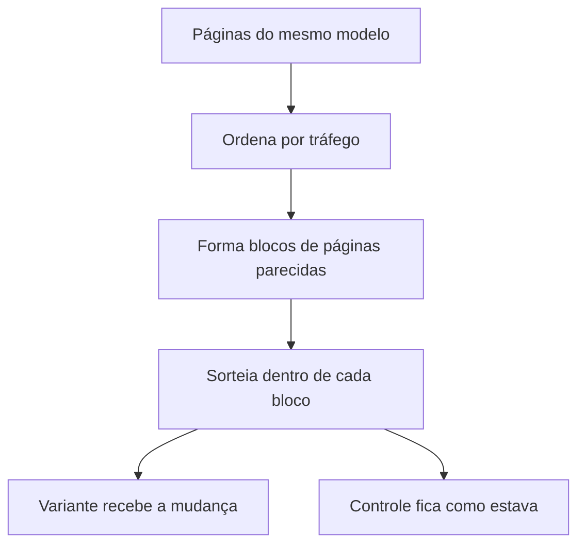

#### Diferença em diferenças

A diferença em diferenças compara a variação do grupo variante com a variação do grupo controle no mesmo período. Se o controle subiu 5% por sazonalidade e o variante subiu 13%, a estimativa do efeito é a diferença entre essas variações. A premissa é que, sem a mudança, os dois grupos andariam em paralelo. Confira no gráfico do período anterior antes de confiar.

O fluxograma mostra a conta com os números do parágrafo acima e a checagem de placebo.

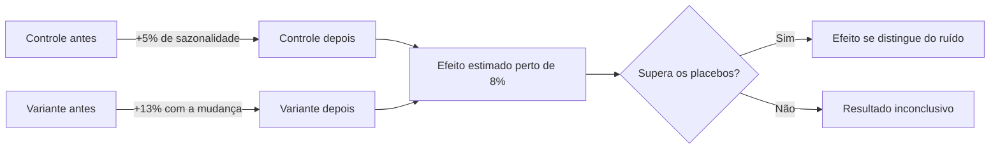

Na forma de regressão, a estimativa é o coeficiente da interação entre "é variante" e "é depois", com efeito fixo de página e de dia. O efeito fixo de página absorve o tamanho de cada página. O de dia absorve a sazonalidade comum. O erro padrão deve ser agrupado por página, porque os dias de uma mesma página não são independentes.

#### CausalImpact

O CausalImpact é um pacote do Google, em R, baseado no artigo de Brodersen e colegas de 2015 sobre séries temporais estruturais bayesianas. Ele aprende, no período anterior, a relação entre a série tratada e séries de controle e projeta o que teria acontecido depois. A distância entre o observado e o projetado é o efeito, com intervalo de credibilidade. No R, a chamada básica é `CausalImpact(dados, pre.period, post.period)`, com a série tratada na primeira coluna e os controles nas seguintes. Em Python existe a adaptação `tfcausalimpact`.

Ele funciona quando há controles que acompanham bem a série no período anterior. Sem bons controles, a projeção é chute com intervalo bonito.

#### Placebo, poder e tamanho do efeito

O teste de placebo aplica o mesmo método a datas em que nada aconteceu. Se os efeitos falsos são tão grandes quanto o verdadeiro, o verdadeiro não se distingue do ruído.

Poder estatístico é a chance de detectar um efeito que existe. Ele depende do tamanho do efeito, do número de páginas, da duração e do quanto o tráfego oscila. Antes de começar, defina o efeito mínimo que vale a pena detectar. Se o seu ruído normal semana a semana é de 10%, um teste desenhado para achar 2% vai terminar inconclusivo.

### Exemplo guiado

O script abaixo gera dados sintéticos de 40 páginas por 180 dias, com efeito verdadeiro de 8% no grupo variante a partir de 1º de maio. Ele estima o efeito com diferença em diferenças e roda 12 placebos no período anterior. Instale `pip install pandas numpy statsmodels`.

```python
# Dados SINTÉTICOS, gerados só para o exemplo. O efeito verdadeiro é conhecido (+8%).
import numpy as np
import pandas as pd
import statsmodels.formula.api as smf

rng = np.random.default_rng(42)
datas = pd.date_range("2026-01-01", periods=180, freq="D")
inicio = pd.Timestamp("2026-05-01")          # data da mudança no grupo variante
EFEITO = 0.08                                # +8% de cliques, só no variante

linhas = []
for p in range(40):                          # 40 páginas do mesmo modelo
    grupo = "variante" if p % 2 else "controle"
    nivel = rng.lognormal(4, 0.5)            # páginas com tamanhos diferentes
    for d in datas:
        sazonal = 1 + 0.15 * np.sin(2 * np.pi * d.day_of_year / 365) + (0.25 if d.day_of_week < 5 else 0)
        efeito = 1 + EFEITO if (grupo == "variante" and d >= inicio) else 1
        linhas.append({"pagina": p, "data": d, "grupo": grupo,
                       "cliques": rng.poisson(nivel * sazonal * efeito)})
df = pd.DataFrame(linhas)

def diferenca_em_diferencas(df, corte):
    d = df.copy()
    d["tratado"] = (d["grupo"] == "variante").astype(int)
    d["depois"] = (d["data"] >= corte).astype(int)
    d["log_cliques"] = np.log1p(d["cliques"])
    m = smf.ols("log_cliques ~ tratado:depois + C(pagina) + C(data)", data=d).fit(
        cov_type="cluster", cov_kwds={"groups": d["pagina"]})
    return m.params["tratado:depois"], m.conf_int().loc["tratado:depois"].tolist()

est, ic = diferenca_em_diferencas(df, inicio)
print(f"Efeito estimado {np.expm1(est):+.1%}  IC95% {np.expm1(ic[0]):+.1%} a {np.expm1(ic[1]):+.1%}")

# Teste de placebo. Só o período ANTES da mudança, com 12 datas falsas.
antes = df[df["data"] < inicio]
falsas = pd.date_range("2026-02-01", "2026-04-01", periods=12).normalize()
placebos = [np.expm1(diferenca_em_diferencas(antes, f)[0]) for f in falsas]
print("Placebos:", " ".join(f"{x:+.1%}" for x in sorted(placebos)))
maior = max(abs(x) for x in placebos)
print(f"Maior placebo em módulo {maior:.1%}. O efeito real {'supera' if abs(np.expm1(est)) > maior else 'não supera'} todos.")
```

Com essa semente, o efeito estimado sai perto de 8%, com intervalo de cerca de 7% a 9%, e nenhum placebo passa de 1% em módulo. É o cenário fácil, com 40 páginas, tráfego razoável e efeito grande. Agora mude `EFEITO` para `0.02`, `range(40)` para `range(10)` e `rng.lognormal(4, 0.5)` para `rng.lognormal(1, 0.5)`, que dá páginas com poucos cliques por dia. Rode com as sementes 42, 1 e 2. O intervalo abre, os placebos ficam do tamanho do efeito e, com a semente 2, a estimativa sai negativa e com intervalo que não cruza o zero, mesmo com o efeito verdadeiro positivo. Essa é a sensação de um teste sem poder. Um resultado isolado não basta, e o desenho tem que vir antes do teste.

### Erros comuns

- **Ler antes e depois sem controle.** Sazonalidade e atualização de algoritmo entram como efeito. Use grupo de controle ou séries de controle.
- **Sortear sem estratificar.** As páginas grandes caem todas num grupo. Forme blocos por tráfego e sorteie dentro deles.
- **Rodar sem efeito mínimo definido.** O teste termina inconclusivo e ninguém sabe se faltou tempo ou não havia efeito. Calcule o ruído normal antes e defina a duração a partir dele.
- **Pular o placebo.** Um efeito igual ao ruído vira "vitória" no relatório. Rode o método em datas falsas e compare.
- **Mostrar ao robô uma versão diferente da que as pessoas veem.** Isso é cloaking e pode prejudicar o site. Siga as regras de teste da documentação do Google.

### Na prática

Num varejo online, a pergunta era quanto de receita a melhoria de Core Web Vitals poderia trazer, para justificar o investimento de desenvolvimento. A correlação entre LCP no celular e receita mensal era forte e estatisticamente significativa. A primeira hipótese era usar essa regressão para projetar o ganho de cada milissegundo.

Três verificações mudaram a conclusão. A primeira foi o tamanho da amostra. A API pública do CrUX guarda poucas semanas, então só havia seis meses de sobreposição com a receita. A segunda foi o intervalo de confiança da correlação. Para ter uma ideia da ordem de grandeza, faça a conta com um exemplo de seis pontos e correlação de 0,8.

```python
import numpy as np

r, n = 0.8, 6                      # exemplo, não é o número do caso
z, ep = np.arctanh(r), 1 / np.sqrt(n - 3)
print(np.tanh([z - 1.96 * ep, z + 1.96 * ep]).round(2))   # intervalo de 95%
```

O intervalo vai de cerca de zero a quase 1. No caso real foi assim também, de quase nada a quase perfeito. A terceira verificação foi um teste de placebo. A mesma variação de conversão foi calculada em todos os cortes possíveis da série. O mês em que a métrica de interação piorou foi só o quarto pior entre doze, e os piores meses não tinham nenhum evento técnico. A mesma regressão em diferenças dava resultados absurdos.

A correlação existia e não servia. Com seis pontos, qualquer tendência sazonal produz correlação forte. O número entregue saiu de âncoras publicadas, estudos de caso com efeito medido de melhoria de performance em conversão, aplicadas ao tráfego e à receita do próprio site, com uma faixa de mínimo a máximo. O deck mostrou a correlação e explicou por que ela não foi usada. Dizer que o dado não sustenta a conclusão também é um achado, e protege quem entrega quando o resultado vier diferente da projeção.

### Resumo

- Efeito é a distância entre o observado e um contrafactual. Antes e depois não é contrafactual.
- Teste de SEO divide páginas, com grupos estratificados por tráfego.
- Diferença em diferenças exige tendências paralelas antes da mudança. CausalImpact exige bons controles.
- Placebo e poder dizem se o efeito se distingue do ruído.
- Correlação com poucos pontos não sustenta business case. Mostre a incerteza.

### Para ir além

- "SEO Testing 101 with Will Critchlow", da Growth Memo, em [vídeos](videos.md), para ver o desenho por grupos de páginas antes do desafio escrito.
- "Understanding the effect of your SEO changes with Causal Impact Analysis", de Omi Sido, em [vídeos](videos.md), antes do exercício com a API da Wikimedia.
- "Inferring causal impact using Bayesian structural time-series models", de Brodersen et al., em [leituras](leituras.md), para entender o que o modelo assume.
- "Trustworthy Online Controlled Experiments", em [leituras](leituras.md), pelas armadilhas estatísticas que valem para qualquer teste.

## Aula 7. Consentimento e privacidade

### A ideia central

Medir é tratar dado de pessoas. A LGPD define regras para isso e o Google define as dele para quem usa as ferramentas. Um banner de cookies mal feito pode zerar a medição ou expor a empresa. Os dois erros são comuns, e o segundo costuma passar despercebido até alguém olhar os relatórios com atenção.

O modelo mental certo tem duas camadas. A primeira é o que a pessoa autorizou, registrado pelo banner e comunicado às tags pelo Consent Mode. A segunda é o que nunca pode sair do site em hipótese nenhuma, como e-mail, telefone e CPF em URL ou em evento. A primeira camada depende de escolha. A segunda é regra fixa.

### Como funciona

#### LGPD e bases legais

A LGPD (Lei 13.709 de 2018) lista no artigo 7º as hipóteses em que o tratamento de dado pessoal é permitido, as chamadas bases legais. Para medição e publicidade, as discutidas com mais frequência são o consentimento e o legítimo interesse. A escolha da base é decisão jurídica da empresa e não do analista. O papel do analista é implementar a escolha de forma que a medição respeite o que foi decidido. O guia de cookies da ANPD, que está nas leituras, é a referência brasileira para o banner.

#### Os sinais do Consent Mode

O Consent Mode é a forma de o site dizer às tags do Google o que a pessoa autorizou. A documentação lista sete tipos de consentimento.

| Tipo | O que controla |
|---|---|
| `ad_storage` | Armazenamento ligado a anúncios, como cookies |
| `analytics_storage` | Armazenamento ligado a análise, como duração da visita |
| `ad_user_data` | Envio de dados do usuário ao Google para publicidade |
| `ad_personalization` | Publicidade personalizada, como remarketing |
| `functionality_storage` | Armazenamento de funcionalidade, como idioma |
| `personalization_storage` | Armazenamento de personalização, como recomendações |
| `security_storage` | Armazenamento de segurança, como autenticação |

Os quatro primeiros são os do Consent Mode v2. Segundo a documentação, o Consent Mode foi atualizado em novembro de 2023 com dois parâmetros novos, `ad_user_data` e `ad_personalization`, que se somaram a `ad_storage` e `analytics_storage`. O Google ligou essa atualização ao reforço da sua política de consentimento de usuários da União Europeia, então ela pesa mais para quem tem tráfego do Espaço Econômico Europeu e usa recursos de publicidade.

#### Básico e avançado

| | Básico | Avançado |
|---|---|---|
| Carregamento das tags | Bloqueadas até a pessoa responder ao banner | Carregam ao abrir a página, com padrão negado |
| Sem consentimento | Nada vai para o Google, nem o estado do consentimento | Vão pings sem cookies |
| Com consentimento | Medição completa | Medição completa |
| Modelagem de conversões | Modelo geral | Modelo específico do anunciante |

Os pings sem cookies do modo avançado não gravam nem leem cookie do Analytics. Eles levam dimensões grosseiras e servem para a modelagem que preenche a lacuna de quem negou.

O fluxograma compara o que sai para o Google nos modos básico e avançado.

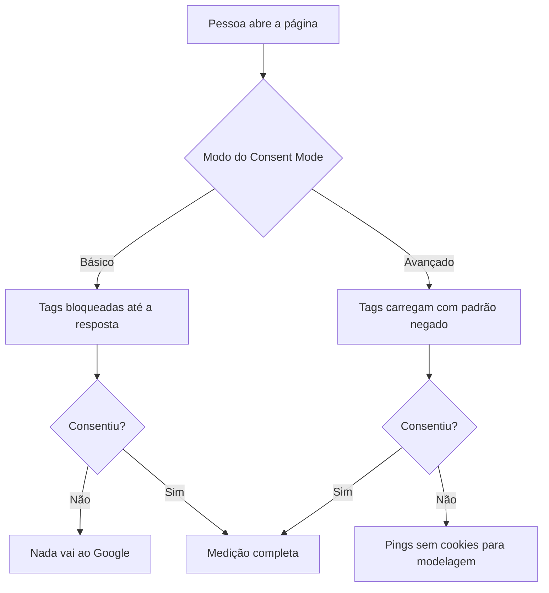

#### Modelagem comportamental no GA4

O GA4 só liga a modelagem comportamental para consentimento quando a propriedade cumpre requisitos. Consent Mode em todas as páginas, com as tags carregando antes do banner. Pelo menos 1.000 eventos por dia com `analytics_storage` negado por pelo menos 7 dias. Pelo menos 1.000 usuários por dia com `analytics_storage` concedido em pelo menos 7 dos 28 dias anteriores. Cumprir os requisitos não garante elegibilidade. Quando a modelagem liga, o dado modelado aparece com a identidade de relatório "Combinada" (Blended). Site pequeno não chega nesses números e fica só com o dado de quem consentiu.

#### A ordem do código

A documentação diz que a ordem do código é vital. O padrão de consentimento precisa ser declarado em toda página, antes de qualquer comando que envie dado. Depois, quando a pessoa responde ao banner, o site manda uma atualização. O parâmetro `wait_for_update` dá alguns milissegundos para o banner responder antes de as tags dispararem.

A sequência mostra a ordem correta entre o padrão, as tags e o banner no modo avançado.

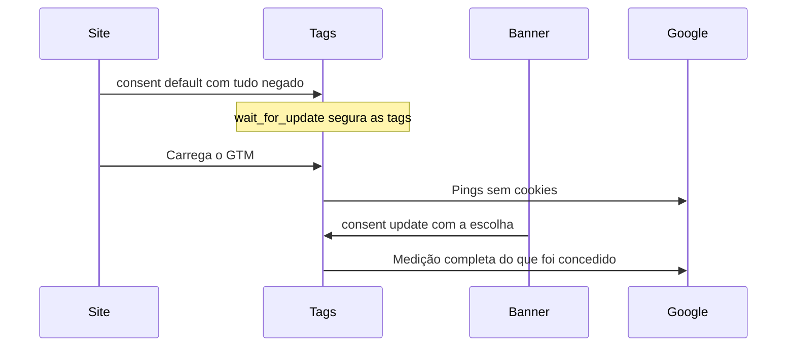

#### Dado pessoal em URL e em evento

A política do Google Analytics proíbe enviar ao Google qualquer dado que ele possa usar ou reconhecer como informação de identificação pessoal. A ajuda do GA4 lembra que a URL e o título da página são as portas mais comuns, e que tanto o caminho quanto os parâmetros precisam estar limpos. Formulário com método GET coloca os campos na URL da página seguinte. Redirecionamento pode carregar o e-mail num parâmetro. Uma busca interna pode receber um CPF digitado.

O GA4 tem redação de dados, que remove e-mails por melhor esforço e tira parâmetros de URL que você listar. Isso é rede de segurança. A correção é na origem.

### Exemplo guiado

1. Na página de teste da Aula 2, coloque o padrão negado antes do snippet do GTM.

```html
<script>
  window.dataLayer = window.dataLayer || [];
  function gtag(){dataLayer.push(arguments);}
  gtag('consent', 'default', {
    'ad_storage': 'denied',
    'ad_user_data': 'denied',
    'ad_personalization': 'denied',
    'analytics_storage': 'denied',
    'wait_for_update': 500
  });
</script>
<!-- Snippet do GTM logo depois -->
```

2. Crie dois botões no banner e mande a atualização conforme a escolha.

```javascript
function aceitarTudo() {
  gtag('consent', 'update', {
    'ad_storage': 'granted',
    'ad_user_data': 'granted',
    'ad_personalization': 'granted',
    'analytics_storage': 'granted'
  });
}

function aceitarSoMedicao() {
  gtag('consent', 'update', { 'analytics_storage': 'granted' });
}
```

Num site real, guarde a escolha e repita a atualização em cada página logo depois do padrão. A maioria das plataformas de gestão de consentimento já faz isso e tem modelo pronto na galeria do GTM.

3. Abra o modo de visualização do GTM e confira, na aba de consentimento, o estado antes e depois do clique.
4. Abra o painel de rede do navegador, filtre por `collect` e olhe o parâmetro `gcs`. Ele carrega as escolhas de `ad_storage` e `analytics_storage` no formato `G1` seguido de dois dígitos, o primeiro para anúncios e o segundo para análise. `G100` é tudo negado, `G101` só análise concedida e `G111` tudo concedido. O parâmetro `gcd`, mais detalhado, vai sempre.
5. Para caçar dado pessoal, crie no GA4 uma exploração livre com a dimensão `page_location` e um filtro "corresponde à expressão regular" com `@` para e-mail. Repita com `\d{3}\.?\d{3}\.?\d{3}-?\d{2}` para CPF. Anote cada URL encontrada e descubra por onde o dado entrou.

### Erros comuns

- **Banner que só aparece e não bloqueia nada.** As tags disparam antes da escolha e o banner vira enfeite. Declare o padrão negado antes do GTM e teste no modo de visualização.
- **Padrão declarado depois das tags.** A documentação avisa que, fora de ordem, o padrão não funciona. Coloque o `gtag('consent', 'default', ...)` antes de tudo.
- **Esperar modelagem num site pequeno.** O GA4 exige mil eventos negados e mil usuários concedidos por dia. Explique ao gestor que o número vai cair e não vai ser preenchido.
- **Formulário com método GET.** O e-mail vai para a URL e dali para o GA4. Use POST e confira a URL da página de obrigado.
- **Confiar só na redação de dados.** Ela trata e-mail por melhor esforço e só remove os parâmetros que você listar. Corrija a origem e mantenha um teste automatizado.

### Na prática

O módulo não tem caso na pasta de casos, então vale um exemplo hipotético. Imagine uma clínica com formulário de agendamento. O formulário usa método GET e leva para uma página de obrigado. A URL da página de obrigado traz nome, e-mail e telefone como parâmetros. Ninguém percebe, porque o relatório padrão mostra o caminho da página e esconde os parâmetros.

Numa auditoria, a exploração com filtro de `@` em `page_location` devolve centenas de linhas. O raciocínio a seguir tem quatro passos. Primeiro, corrigir a origem, trocando o método do formulário para POST e conferindo que a página de obrigado não recebe nada na URL. Segundo, impedir que volte, com uma variável no GTM que limpa parâmetros sensíveis de `page_location` e com um teste automatizado que preenche o formulário e falha se a URL tiver `@`. Terceiro, tratar o que já foi coletado, com a solicitação de exclusão de dados da propriedade no Admin do GA4. Quarto, registrar o incidente e avisar o responsável pela proteção de dados da empresa, que decide se há algo a comunicar.

O mesmo roteiro vale para qualquer dado pessoal achado em URL, evento ou título. A ordem importa. Excluir o passado sem corrigir a origem só adia o problema para o próximo mês.

### Resumo

- A LGPD define as bases legais. A escolha é jurídica e a implementação é sua.
- Consent Mode v2 tem quatro sinais principais e foi atualizado em novembro de 2023.
- No básico, nada vai sem consentimento. No avançado, vão pings sem cookies para modelagem.
- A modelagem do GA4 exige volume diário mínimo e não chega para site pequeno.
- Dado pessoal nunca vai em URL nem em evento. Corrija na origem e teste.

### Para ir além

- "Set up Consent Mode V2 with any cookiebanner in GTM", de Leon Korteweg, em [vídeos](videos.md), para acompanhar a implementação manual enquanto faz o exercício.
- "Visão geral do modo de consentimento", do Google for Developers, em [leituras](leituras.md), para conferir a diferença entre básico e avançado na fonte.
- "Guia Orientativo Cookies e Proteção de Dados Pessoais", da ANPD, em [leituras](leituras.md), antes de desenhar o banner.
