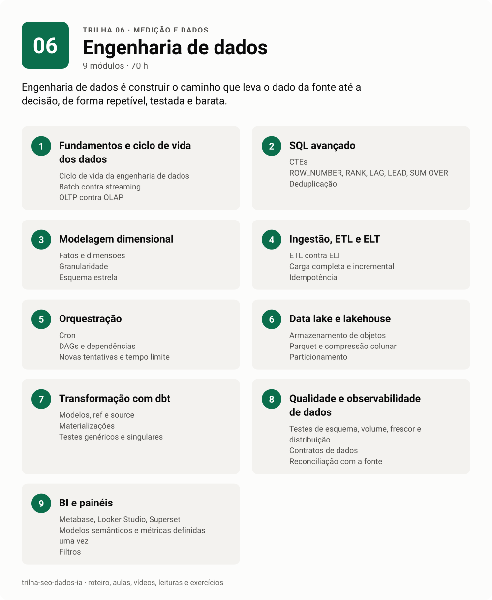

# 06 · Engenharia de dados

<!-- infografico:trilha-06 -->
<picture>
  <source media="(prefers-color-scheme: dark)" srcset="../../imagens/trilha-06-escuro.svg">
  
</picture>
<!-- /infografico -->

Engenharia de dados é construir o caminho que leva o dado da fonte até a decisão, de forma repetível, testada e barata. Para quem vem de SEO e marketing, é o que transforma exportação manual de planilha em pipeline que roda sozinho todo dia.

**Pré-requisitos.** Trilha 00 completa, em especial Python e SQL. Trilha 05 ajuda a ter fontes reais para praticar.
**Carga estimada.** 70 h.

**Ao terminar, você consegue**
- desenhar um pipeline de ponta a ponta, da API ao painel;
- escrever SQL analítico com CTEs e funções de janela;
- modelar dados em fatos e dimensões;
- orquestrar tarefas com agendamento, novas tentativas e alertas;
- montar um data lake simples com Parquet e consultá-lo com DuckDB ou Athena;
- transformar e testar dados com dbt;
- entregar painéis que o negócio usa.

## Roteiro

### 1. Fundamentos e ciclo de vida dos dados

O ciclo é sempre o mesmo. Gerar, ingerir, armazenar, transformar e servir. Por baixo, segurança, governança, orquestração e qualidade. Entender o ciclo evita escolher ferramenta antes de entender o problema.

**Conceitos-chave.** Ciclo de vida da engenharia de dados. Batch contra streaming. OLTP contra OLAP. Data warehouse, data lake e lakehouse. Custo de armazenamento contra custo de processamento.

- [ ] Desenhei o ciclo de vida de um dado do meu trabalho, da origem ao painel
- [ ] Sei explicar a diferença entre banco transacional e analítico

### 2. SQL avançado

SQL analítico é onde se passa a maior parte do tempo. CTEs deixam a consulta legível. Funções de janela resolvem ranking, acumulado, variação e deduplicação sem gambiarra.

**Conceitos-chave.** CTEs. `ROW_NUMBER`, `RANK`, `LAG`, `LEAD`, `SUM() OVER`. Deduplicação. Granularidade e o perigo do join que multiplica linhas. `EXPLAIN` e plano de execução. Particionamento e poda.

**Na prática.** Num Metabase ligado ao Athena, o driver trocava todo `?` da consulta, inclusive os que estavam dentro de expressões regulares, e a consulta quebrava sem explicação clara. Painéis pesados davam tempo esgotado e foram divididos em abas menores. Conheça as manias do driver e do motor que você usa.

- [ ] Resolvi 10 exercícios de funções de janela
- [ ] Dedupliquei uma tabela mantendo a linha mais recente por chave
- [ ] Li o plano de execução de uma consulta lenta e reduzi o dado lido

### 3. Modelagem dimensional

Modelagem é decidir a granularidade e separar o que se mede (fatos) de como se corta (dimensões). Modelo bom faz a consulta certa ser a fácil.

**Conceitos-chave.** Fatos e dimensões. Granularidade. Esquema estrela. Chaves substitutas. Dimensões que mudam com o tempo (SCD tipo 1 e 2). Tabelas largas e One Big Table. Camadas bronze, prata e ouro.

- [ ] Modelei Search Console, GA4 e CRM num esquema estrela
- [ ] Defini a granularidade de cada fato por escrito

### 4. Ingestão, ETL e ELT

Ingerir é trazer o dado de onde ele está, respeitando limites, sem perder nada e sem duplicar. Em ELT, carrega-se primeiro e transforma-se depois, dentro do banco.

**Conceitos-chave.** ETL contra ELT. Carga completa e incremental. Idempotência. Paginação e cotas de API. Limitador (429) e espera progressiva. Formatos (CSV, JSON, Parquet). Ferramentas como dlt e Airbyte.

**Na prática.** Fonte com limitador se respeita. Pare no primeiro 429, guarde de onde parou e retome depois. Um pipeline idempotente pode rodar duas vezes no mesmo dia sem duplicar nada, e isso salva muita madrugada.

- [ ] Escrevi uma ingestão incremental de uma API pública com Python
- [ ] Rodei a mesma carga duas vezes e provei que não duplicou
- [ ] Gravei a saída em Parquet particionado por data

### 5. Orquestração

Orquestrar é rodar as tarefas na ordem certa, na hora certa, com novas tentativas e aviso quando falha. Comece com cron. Mude de ferramenta quando a dor aparecer.

**Conceitos-chave.** Cron. DAGs e dependências. Novas tentativas e tempo limite. Backfill. Alertas. Airflow, Kestra, Prefect e Dagster. Ambientes e segredos.

**Na prática.** Rotina agendada que precisa de permissão fica parada esperando alguém aprovar, e ninguém percebe. Rode a primeira execução com alguém olhando e tenha um alerta para "não rodou", além do alerta para "falhou".

- [ ] Agendei um pipeline com cron e registrei cada execução num log
- [ ] Reescrevi o mesmo pipeline num orquestrador com novas tentativas e alerta
- [ ] Fiz um backfill de 30 dias

### 6. Data lake e lakehouse

Para volumes médios, arquivos Parquet num bucket e um motor de consulta resolvem quase tudo, e custam pouco. Lakehouse acrescenta transações e versionamento por cima.

**Conceitos-chave.** Armazenamento de objetos (S3, GCS). Parquet e compressão colunar. Particionamento. Athena e o custo por dado lido. DuckDB local. Databricks, Delta Lake e Iceberg. Catálogo de dados.

- [ ] Montei um mini data lake local com Parquet particionado e consultei com DuckDB
- [ ] Estimei o custo de uma consulta no Athena antes e depois de particionar
- [ ] Fiz o curso gratuito introdutório de uma plataforma lakehouse

### 7. Transformação com dbt

O dbt traz práticas de engenharia de software para o SQL. Modelos versionados, dependências explícitas, testes e documentação gerada.

**Conceitos-chave.** Modelos, `ref` e `source`. Materializações (view, tabela, incremental). Testes genéricos e singulares. Documentação e linhagem. Seeds e snapshots. Camadas staging, intermediate e marts.

- [ ] Criei um projeto dbt com DuckDB e 3 camadas de modelos
- [ ] Escrevi testes de unicidade, não nulo e relacionamento
- [ ] Gerei a documentação com o grafo de linhagem

### 8. Qualidade e observabilidade de dados

Dado errado que chega no painel destrói confiança mais rápido que dado nenhum. Qualidade é testar o dado como se testa código e saber antes do gestor quando algo quebrou.

**Conceitos-chave.** Testes de esquema, volume, frescor e distribuição. Contratos de dados. Reconciliação com a fonte (a soma bate?). Alertas de anomalia. Linhagem.

**Na prática.** Sempre reconcilie o total da sua tabela com o total da fonte. Num levantamento de Search Console, a soma dos cortes ficou abaixo do total do painel, e foi essa pequena diferença que apontou exatamente as 3 URLs que tinham ficado de fora.

- [ ] Escrevi um teste de frescor que falha se o dado tem mais de 2 dias
- [ ] Reconciliei uma tabela transformada com o total da fonte
- [ ] Criei um alerta de volume que dispara com queda acima de 30%

### 9. BI e painéis

Painel é o produto final do pipeline. Pense nele como produto. Quem usa, que pergunta responde, com que frequência, e o que a pessoa faz depois de olhar.

**Conceitos-chave.** Metabase, Looker Studio, Superset. Modelos semânticos e métricas definidas uma vez. Filtros. Desempenho e cache. Permissões. Painel de TV e painel analítico.

**Na prática.** Painel é dado, não comentário. Gestor que olha painel toda semana quer gráfico e filtro, não parágrafo explicando o gráfico. A narrativa vai para o relatório.

- [ ] Montei um painel no Metabase ou Looker Studio sobre o meu modelo do dbt
- [ ] Defini cada métrica uma vez, num só lugar

## Material

- [Aulas](aulas.md)
- [Vídeos](videos.md)
- [Leituras](leituras.md)
- [Exercícios e projeto da trilha](exercicios.md)

**Próxima trilha.** [07 IA aplicada](../07-ia-aplicada).
