# Aulas · 06 · Engenharia de dados

Texto de apoio de cada módulo. Leia depois dos vídeos e antes dos exercícios. Onde houver comando ou código, rode no seu computador.

Os exemplos foram testados em outubro de 2026 com Python 3.12, DuckDB 2.0, dbt Core 1.12 com `dbt-duckdb` 1.11 e dbt 2.0. Para acompanhar, crie um ambiente uma vez só.

```bash
python3.12 -m venv .venv
source .venv/bin/activate
pip install duckdb pandas pyarrow requests dbt-core dbt-duckdb
```

## Sumário

1. [Fundamentos e ciclo de vida dos dados](#aula-1-fundamentos-e-ciclo-de-vida-dos-dados)
2. [SQL avançado](#aula-2-sql-avançado)
3. [Modelagem dimensional](#aula-3-modelagem-dimensional)
4. [Ingestão, ETL e ELT](#aula-4-ingestão-etl-e-elt)
5. [Orquestração](#aula-5-orquestração)
6. [Data lake e lakehouse](#aula-6-data-lake-e-lakehouse)
7. [Transformação com dbt](#aula-7-transformação-com-dbt)
8. [Qualidade e observabilidade de dados](#aula-8-qualidade-e-observabilidade-de-dados)
9. [BI e painéis](#aula-9-bi-e-painéis)

## Aula 1. Fundamentos e ciclo de vida dos dados

### A ideia central

Todo dado que chega num painel passou por cinco etapas. Alguém o gerou, alguém o trouxe, ele ficou guardado em algum lugar, foi transformado e alguém o serviu. A engenharia de dados cuida desse caminho inteiro, de forma que ele rode sozinho, seja testado e custe pouco.

O modelo mental certo é pensar no caminho antes da ferramenta. Quem começa escolhendo "vamos usar Airflow" ou "vamos para o Databricks" costuma resolver um problema que não tem e deixar de lado o que tem. Quem desenha o ciclo primeiro descobre onde o dado se perde, onde ele atrasa e onde ele é reescrito. Quase sempre o problema está numa dessas três coisas.

### Como funciona

#### As cinco etapas

O livro de Joe Reis e Matt Housley organiza a área em cinco etapas. Geração, armazenamento, ingestão, transformação e servir. O armazenamento atravessa todas, porque o dado fica guardado em cada passagem.

| Etapa | A pergunta que ela responde | Exemplo em SEO e marketing |
|---|---|---|
| Geração | Onde o dado nasce e quem controla o sistema? | Search Console, GA4, CRM, log do servidor, crawler |
| Ingestão | Como ele sai da fonte e com que frequência? | API do Search Console uma vez por dia, exportação do GA4 para o BigQuery |
| Armazenamento | Onde ele fica e em que formato? | Parquet num bucket, tabela no BigQuery, arquivo DuckDB |
| Transformação | Que regra transforma o bruto em métrica? | Deduplicar leads, juntar página do GA4 com página do Search Console |
| Servir | Quem consome e para decidir o quê? | Painel semanal, planilha do time comercial, modelo de score de lead |

A etapa de geração é a mais subestimada. Você quase nunca controla o sistema de origem, então precisa conhecer as regras dele. Dois exemplos documentados. O Search Console registra as datas no horário do Pacífico, e a API só devolve dados finalizados se você não pedir o contrário (`dataState` em `final`). O GA4 grava a exportação diária para o BigQuery no fuso da propriedade e pode atualizar a tabela de um dia por até dois dias corridos depois, além do dia atual. Quem ignora isso compara dias que não fecham.

#### As correntes por baixo

Por baixo das etapas correm seis assuntos que o livro chama de correntes subjacentes. Segurança, gestão de dados (governança, catálogo, qualidade), DataOps, arquitetura de dados, orquestração e engenharia de software. Elas ficam fora do diagrama e decidem se o pipeline sobrevive ao primeiro mês. Credencial em variável de ambiente, teste automático, agendamento com alerta e código versionado no Git são exemplos de correntes bem cuidadas.

#### OLTP contra OLAP

Banco transacional (OLTP, de *online transaction processing*) é feito para gravar e ler poucas linhas por vez, muito rápido. O CRM e o banco do e-commerce são OLTP. Banco analítico (OLAP, de *online analytical processing*) é feito para ler milhões de linhas e agregar poucas colunas. BigQuery, Athena e DuckDB são OLAP.

| | OLTP | OLAP |
|---|---|---|
| Pergunta típica | Qual é o status do pedido 4521? | Quanto cada canal vendeu por semana no último ano? |
| Armazenamento | Por linha | Por coluna |
| Escrita | Muitas pequenas, com transação | Cargas em lote |
| Pior uso | Somar um ano de pedidos durante o horário de pico | Atualizar uma linha por vez |

A diferença física explica tudo. No armazenamento por coluna, somar a receita lê só a coluna de receita. No armazenamento por linha, o banco precisa passar por todas as colunas de todas as linhas. Por isso rodar relatório pesado direto no banco do CRM deixa o sistema lento para quem está atendendo cliente.

#### Batch contra streaming

Batch processa em lotes, por exemplo uma vez por dia. Streaming processa evento a evento, com segundos de atraso. A maior parte do dado de SEO é batch por natureza. O Search Console publica a série diária até cerca de dois dias antes. A exportação diária do GA4 costuma chegar à tarde, no fuso da propriedade. Montar streaming em cima de uma fonte que atualiza uma vez por dia só aumenta o custo.

Streaming se paga quando a decisão precisa acontecer em minutos. Um site fora do ar, um pico de erro 5xx no log, uma campanha que estourou o orçamento. Para "como foi a semana", batch resolve.

O fluxograma mostra as duas perguntas que decidem entre batch e streaming.

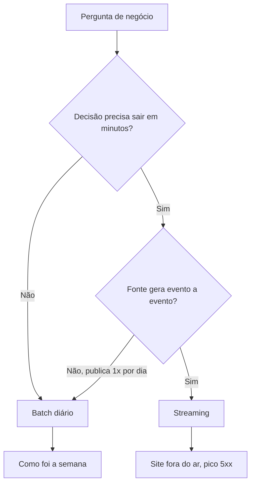

#### Data warehouse, data lake e lakehouse

| | Data warehouse | Data lake | Lakehouse |
|---|---|---|---|
| O que é | Banco analítico gerenciado | Arquivos num armazenamento de objetos | Arquivos abertos com uma camada de tabela por cima |
| Formato | Interno do fornecedor | Parquet, JSON, CSV | Parquet com Delta Lake ou Iceberg |
| Exemplo | BigQuery, Snowflake | S3 com Athena, pasta local com DuckDB | Databricks, Iceberg com Athena |
| Força | Simples de usar e de dar permissão | Barato e aberto | Transação e versão sobre arquivos abertos |

#### Custo de armazenamento contra custo de processamento

Guardar é barato. Ler é o que custa. No BigQuery, a consulta sob demanda custa US$ 6,25 por TiB processado, com o primeiro TiB do mês gratuito, e os primeiros 10 GiB de armazenamento por mês também são gratuitos. No Athena, os exemplos da página oficial usam US$ 5 por TB lido, com mínimo de 10 MB por consulta. Nos dois, o que pesa é quanto dado cada consulta lê. Formato colunar, partição e seleção de colunas cortam esse volume, e a aula 6 mostra quanto. Confira sempre a página de preços da sua região antes de estimar.

Para estudar, o DuckDB local custa zero e lê os mesmos arquivos Parquet que o Athena leria. O sandbox do BigQuery também é gratuito, com limite vitalício de 10 GiB de armazenamento, tabelas que expiram em 60 dias e sem comandos de alteração de dados (DML).

### Exemplo guiado

Desenhe o ciclo de vida dos cliques do Search Console do seu site, do jeito que eles chegam hoje ao seu relatório. Se você ainda exporta planilha à mão, desenhe isso mesmo. O objetivo é enxergar o caminho real.

1. Crie um arquivo `ciclo.md` e cole o diagrama abaixo. O GitHub renderiza Mermaid direto no Markdown.

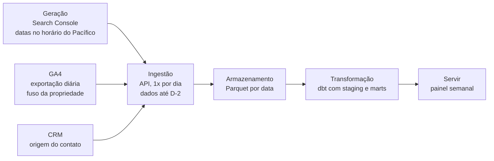

2. Para cada caixa, preencha uma linha nesta ficha.

| Etapa | Onde o dado fica | Quem transforma | Frequência | Atraso em relação ao fato |
|---|---|---|---|---|
| Geração | | | | |
| Ingestão | | | | |
| Armazenamento | | | | |
| Transformação | | | | |
| Servir | | | | |

3. Marque com um asterisco toda etapa em que uma pessoa faz algo à mão. Cada asterisco é um ponto de falha e um candidato a automação nas próximas aulas.
4. Marque com dois asteriscos toda etapa em que um sistema pode reescrever um campo que já existia. Essa é a pergunta que a seção "Na prática" vai mostrar por que importa.
5. Compare o atraso total com a frequência em que o painel é olhado. Se o painel é semanal e o dado atrasa dois dias, não há motivo para streaming.

### Erros comuns

- **Escolher a ferramenta antes de desenhar o ciclo.** A consequência é infraestrutura cara para um problema que uma planilha agendada resolveria. Desenhe primeiro e escolha a ferramenta pela dor que apareceu.
- **Rodar análise pesada no banco transacional.** O CRM fica lento para quem atende cliente e a consulta demora. Copie o dado para um banco analítico e consulte lá.
- **Ignorar o fuso e o atraso de cada fonte.** O dia do Search Console e o dia do GA4 podem não ser o mesmo dia. Anote o fuso e o atraso de cada fonte na ficha e alinhe antes de cruzar.
- **Montar streaming para dado diário.** Custa mais e não entrega nada que o batch não entregue. Use streaming só quando a decisão precisa acontecer em minutos.
- **Tratar o campo da fonte como verdade sem saber como ele é gravado.** O número parece certo e está errado. Descubra quem escreve cada campo e quando ele pode ser sobrescrito.

### Na prática

O caso 7 da pasta [casos](../../casos/07-metade-da-receita-sem-origem.md) é uma aula de ciclo de vida. Num diagnóstico de atribuição em educação, mais da metade da receita aparecia no CRM com origem "offline". A primeira leitura foi a óbvia. Muita venda por telefone e atendimento presencial, sem passar pelo site.

O raciocínio que virou o jogo foi perguntar em que etapa do ciclo aquele campo era escrito. O teste foi cruzar os contatos "offline" com o histórico de navegação que o próprio CRM registrava. Quase todos tinham navegado no site, com dezenas de páginas vistas em média. A origem "offline" registrava o jeito como o contato tinha entrado no CRM, por importação de planilha, integração entre sistemas ou API. Essa entrada sobrescrevia a fonte original.

Em termos de ciclo de vida, o dado nasceu certo na geração e foi corrompido na ingestão entre sistemas. Nenhum teste de "campo não nulo" pegaria isso, porque o campo estava preenchido. Só quem desenhou o caminho e perguntou "quem escreve isso e quando" achou a causa.

A análise passou a usar o comportamento no lugar da origem declarada, e apareceu uma curva de dose e resposta. Quem leu mais de 50 páginas converteu de cinco a treze vezes mais que quem não leu nenhuma. Um score de lead baseado em conteúdo separou leads que valiam quase vinte vezes mais que outros. A correção da origem no CRM foi para o backlog do time de dados.

A lição para o seu diagrama é o passo 4 do exemplo guiado. Toda etapa que pode reescrever um campo precisa de um aviso, e o campo original precisa ser guardado antes da reescrita. A aula 3 mostra como modelar isso.

### Resumo

- O ciclo tem cinco etapas (geração, ingestão, armazenamento, transformação e servir) e seis correntes por baixo.
- Banco transacional grava linha a linha. Banco analítico lê colunas em massa. Cada um faz mal o trabalho do outro.
- Dado de SEO é diário e atrasado por natureza. Batch resolve quase tudo.
- Guardar é barato e ler é caro. Custo de consulta depende de quanto dado ela lê.
- Antes de confiar num campo, descubra quem o escreve e quando ele pode ser sobrescrito.

### Para ir além

- Vídeo "Fundamentals of Data Engineering • Matt Housley & Joe Reis • GOTO 2025", em [videos.md](videos.md). Os autores explicam o ciclo de vida em meia hora, bom para fixar o vocabulário desta aula.
- Livro "Fundamentos de Engenharia de Dados", em [leituras.md](leituras.md). É a fonte das cinco etapas e das correntes. Leia os capítulos de ciclo de vida agora e volte ao resto ao longo da trilha.
- "The Analytics Setup Guidebook", em [leituras.md](leituras.md). Ajuda a fazer o desafio da arquitetura mais barata, com bom senso de custo.

## Aula 2. SQL avançado

### A ideia central

Quem trabalha com dados passa a maior parte do tempo escrevendo SQL analítico. Duas ferramentas resolvem quase tudo. CTEs (*common table expressions*, as consultas nomeadas com `WITH`) quebram a lógica em passos que dá para ler e testar um por um. Funções de janela calculam ranking, acumulado, variação e deduplicação sem precisar juntar a tabela com ela mesma.

O modelo mental certo tem duas partes. A primeira é saber a granularidade de cada tabela, ou seja, o que uma linha representa. A segunda é saber em que ordem o banco executa cada cláusula. Quase todo número errado em SQL vem de errar uma dessas duas coisas.

### Como funciona

#### CTEs deixam cada passo com nome

Uma CTE é uma subconsulta com nome, declarada antes da consulta principal. Cada passo vira um bloco que você pode rodar sozinho para conferir. Compare com subconsultas aninhadas três níveis para dentro, que ninguém consegue revisar.

Prepare uma tabela de exemplo no formato do Search Console. Rode tudo desta aula no DuckDB, pela linha de comando ou por `duckdb.sql()` no Python.

```sql
CREATE OR REPLACE TABLE gsc AS
SELECT CAST(DATE '2026-09-01' + INTERVAL (d) DAY AS DATE) AS data,
       'https://exemplo.com.br/' || p AS pagina,
       (abs(hash(d, p)) % 400 + 50)::INTEGER AS impressoes,
       (abs(hash(p, d)) % 40)::INTEGER AS cliques
FROM range(42) AS t(d),
     (VALUES ('guia-seo'), ('curso-dados'), ('blog/ga4')) AS v(p);
```

#### Anatomia de uma função de janela

Uma função de janela calcula um valor para cada linha olhando para um conjunto de linhas relacionadas, sem colapsar o resultado como o `GROUP BY` faz. A sintaxe tem três partes dentro do `OVER`.

| Parte | O que faz | Exemplo |
|---|---|---|
| `PARTITION BY` | Separa as linhas em grupos independentes | Um ranking por dia |
| `ORDER BY` | Ordena dentro de cada grupo | Do maior para o menor clique |
| Moldura (*frame*) | Diz quais linhas vizinhas entram na conta | As 6 anteriores mais a atual |

As funções mais usadas.

| Função | Para que serve |
|---|---|
| `ROW_NUMBER()` | Numera 1, 2, 3 sem empate. Base da deduplicação |
| `RANK()` | Empate recebe o mesmo número e pula o seguinte (1, 1, 3) |
| `DENSE_RANK()` | Empate recebe o mesmo número sem pular (1, 1, 2) |
| `LAG(x, n)` e `LEAD(x, n)` | Valor de n linhas antes ou depois |
| `SUM(x) OVER (...)` | Soma do grupo ou soma acumulada, conforme a moldura |
| `AVG(x) OVER (... ROWS BETWEEN 6 PRECEDING AND CURRENT ROW)` | Média móvel de 7 linhas |

#### A ordem de execução decide o resultado

O banco executa `FROM` e `WHERE` primeiro, depois `GROUP BY` e `HAVING`, depois as janelas, depois `QUALIFY` e por último `ORDER BY` e `LIMIT`. Isso tem uma consequência prática. Um `WHERE data = '2026-10-12'` na mesma consulta da janela corta as linhas antes de a janela rodar, e o "acumulado" vira o valor do próprio dia. Para filtrar depois da janela, calcule numa CTE e filtre fora dela.

O fluxograma mostra a ordem lógica de execução e os dois pontos em que dá para filtrar.

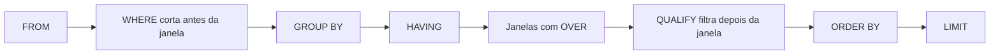

```sql
WITH por_pagina AS (
    SELECT data, pagina, SUM(cliques) AS cliques
    FROM gsc
    GROUP BY ALL
),
com_janela AS (
    SELECT data, pagina, cliques,
           RANK() OVER (PARTITION BY data ORDER BY cliques DESC)             AS posicao_no_dia,
           round(100.0 * cliques / SUM(cliques) OVER (PARTITION BY data), 1) AS pct_do_dia,
           SUM(cliques) OVER (PARTITION BY pagina ORDER BY data)             AS acumulado
    FROM por_pagina
)
SELECT *
FROM com_janela
WHERE data = DATE '2026-10-12'
ORDER BY posicao_no_dia;
```

#### Variação contra o mesmo dia da semana

Tráfego de busca tem ciclo semanal. Comparar segunda com domingo cria variação que não existe. `LAG(cliques, 7)` busca o valor de sete linhas antes, que é o mesmo dia da semana anterior, desde que a série não tenha buracos. Se faltar algum dia, gere o calendário completo antes e preencha com zero.

```sql
WITH diario AS (
    SELECT data, SUM(cliques) AS cliques
    FROM gsc
    GROUP BY ALL
)
SELECT data,
       dayname(data) AS dia_semana,
       cliques,
       LAG(cliques, 7) OVER (ORDER BY data) AS mesmo_dia_semana_anterior,
       round(100.0 * (cliques - LAG(cliques, 7) OVER (ORDER BY data))
             / NULLIF(LAG(cliques, 7) OVER (ORDER BY data), 0), 1) AS variacao_pct,
       round(AVG(cliques) OVER (ORDER BY data
             ROWS BETWEEN 6 PRECEDING AND CURRENT ROW), 1) AS media_movel_7d
FROM diario
ORDER BY data DESC
LIMIT 7;
```

#### Deduplicação mantendo a linha mais recente

Toda carga que coleta o mesmo registro mais de uma vez gera duplicata. A receita é numerar as linhas de cada chave da mais nova para a mais antiga e ficar com a primeira. O DuckDB, o BigQuery e o Snowflake aceitam `QUALIFY`, que filtra pelo resultado da janela. No Postgres, que não tem `QUALIFY`, use uma CTE e filtre `WHERE rn = 1`.

O fluxograma mostra a janela particionada agindo sobre as três coletas do lead 101 do exemplo abaixo.

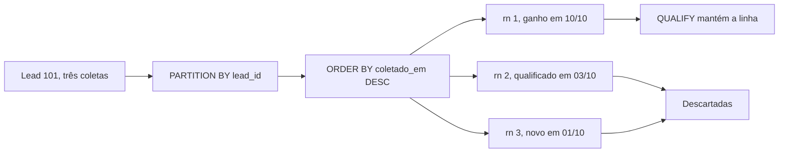

```sql
CREATE OR REPLACE TABLE leads_brutos AS
SELECT * FROM (VALUES
    (101, 'novo',        TIMESTAMP '2026-10-01 08:00'),
    (101, 'qualificado', TIMESTAMP '2026-10-03 09:30'),
    (101, 'ganho',       TIMESTAMP '2026-10-10 17:45'),
    (102, 'novo',        TIMESTAMP '2026-10-02 10:00')
) AS t(lead_id, status, coletado_em);

SELECT *
FROM leads_brutos
QUALIFY ROW_NUMBER() OVER (PARTITION BY lead_id ORDER BY coletado_em DESC) = 1;
```

Use `ROW_NUMBER` e nunca `RANK` aqui. Com empate no `coletado_em`, o `RANK` devolve duas linhas com número 1 e a duplicata volta.

#### O join que multiplica linhas

Juntar uma tabela diária de cliques com uma tabela que tem mais de uma linha por página multiplica os cliques dessa página. Ao mesmo tempo, o `JOIN` interno descarta as páginas sem par. O total sai errado nos dois sentidos.

```sql
CREATE OR REPLACE TABLE categorias AS
SELECT * FROM (VALUES
    ('https://exemplo.com.br/guia-seo',    'seo'),
    ('https://exemplo.com.br/guia-seo',    'iniciante'),
    ('https://exemplo.com.br/curso-dados', 'dados')
) AS t(pagina, categoria);

SELECT
    (SELECT SUM(cliques) FROM gsc)                                     AS total_real,
    (SELECT SUM(g.cliques) FROM gsc g JOIN categorias c USING (pagina)) AS total_depois_do_join;

-- Detecte antes de juntar. Toda chave do lado "dimensão" precisa ser única.
SELECT pagina, COUNT(*) AS linhas
FROM categorias
GROUP BY pagina
HAVING COUNT(*) > 1;
```

A regra é conferir a unicidade da chave do lado que deveria ter uma linha por item, e comparar o total antes e depois do join. Se mudou, alguém multiplicou ou perdeu linhas.

#### Plano de execução e poda

`EXPLAIN` mostra o plano que o banco pretende seguir. `EXPLAIN ANALYZE` executa e mostra quanto tempo e quanto dado cada etapa usou. Em dados particionados, o plano mostra quantos arquivos foram lidos. Um filtro na coluna crua da partição permite pular arquivos (a poda). Um filtro numa coluna transformada, como `CAST(data AS VARCHAR) LIKE '2026-10%'`, costuma impedir a poda, porque o banco não consegue comparar o filtro com as estatísticas guardadas. A aula 6 mede isso com números.

### Exemplo guiado

Vamos usar as viagens de táxi amarelo de Nova York, publicadas em Parquet pela prefeitura. O DuckDB lê direto da URL. O arquivo de janeiro de 2024 tem perto de 50 MB.

```sql
CREATE OR REPLACE TABLE viagens AS
SELECT tpep_pickup_datetime, PULocationID, total_amount
FROM read_parquet('https://d37ci6vzurychx.cloudfront.net/trip-data/yellow_tripdata_2024-01.parquet')
WHERE tpep_pickup_datetime >= TIMESTAMP '2024-01-01'
  AND tpep_pickup_datetime <  TIMESTAMP '2024-02-01';

-- 1. Viagens por dia, variação contra o dia anterior e contra o mesmo dia da semana, receita acumulada
WITH por_dia AS (
    SELECT CAST(tpep_pickup_datetime AS DATE) AS dia,
           COUNT(*)          AS viagens,
           SUM(total_amount) AS receita
    FROM viagens
    GROUP BY ALL
)
SELECT dia,
       dayname(dia) AS dia_semana,
       viagens,
       viagens - LAG(viagens)    OVER (ORDER BY dia) AS var_dia_anterior,
       viagens - LAG(viagens, 7) OVER (ORDER BY dia) AS var_mesmo_dia_semana,
       round(SUM(receita) OVER (ORDER BY dia) / 1e6, 2) AS receita_acumulada_mi
FROM por_dia
ORDER BY dia;

-- 2. As 3 zonas de embarque com mais viagens em cada dia e a participação de cada uma
WITH zona_dia AS (
    SELECT CAST(tpep_pickup_datetime AS DATE) AS dia,
           PULocationID AS zona,
           COUNT(*)     AS viagens
    FROM viagens
    GROUP BY ALL
)
SELECT dia, zona, viagens,
       round(100.0 * viagens / SUM(viagens) OVER (PARTITION BY dia), 1) AS pct_do_dia
FROM zona_dia
QUALIFY ROW_NUMBER() OVER (PARTITION BY dia ORDER BY viagens DESC) <= 3
ORDER BY dia, viagens DESC;
```

Na execução de teste, 1º de janeiro de 2024 caiu numa segunda e teve 81.013 viagens. Repare em duas coisas no resultado. As primeiras sete linhas de `var_mesmo_dia_semana` vêm nulas, porque não há semana anterior dentro da tabela. E a variação contra o dia anterior oscila muito mais que a variação contra o mesmo dia da semana, porque mistura o ciclo semanal com a mudança real. Escreva as outras perguntas do exercício (média móvel, receita por zona, variação semanal) no mesmo molde, uma CTE por passo.

### Erros comuns

- **Filtrar no `WHERE` antes da janela.** O acumulado e a participação saem calculados só sobre as linhas filtradas. Calcule a janela numa CTE e filtre fora.
- **Usar `RANK` para deduplicar.** Empates devolvem mais de uma linha por chave. Use `ROW_NUMBER` com um critério de desempate no `ORDER BY`.
- **Juntar sem conferir a granularidade.** O total multiplica ou encolhe sem aviso. Teste a unicidade da chave e compare o total antes e depois do join.
- **Usar `LAG(x, 7)` em série com buracos.** Sete linhas antes deixa de ser sete dias antes. Gere o calendário completo e faça `LEFT JOIN` antes da janela.
- **Média de razões.** Fazer `AVG(ctr)` de vários dias dá peso igual a dia com 10 e com 10 mil impressões. Some cliques e impressões e divida no fim.
- **Filtrar partição por coluna transformada.** O banco lê tudo e a consulta fica lenta e cara. Filtre a coluna da partição do jeito que ela está gravada.

### Na prática

Num Metabase ligado ao Athena, uma consulta que funcionava no console do Athena quebrava no painel, com uma mensagem de erro que não apontava a causa. O motivo era o driver. Ele trocava todo `?` da consulta, inclusive os que estavam dentro de expressões regulares.

O raciocínio para chegar lá vale para qualquer ferramenta. Primeiro, a mesma consulta roda num lugar e falha no outro, então o problema está no caminho entre os dois. Segundo, o `?` é o marcador de parâmetro das consultas preparadas no padrão JDBC, o mesmo padrão de conexão que o Metabase usa com muitos bancos. Uma regex como `utm_[a-z]+=?` tem um `?` que, para o driver, parece um lugar onde ele deve encaixar um valor. A saída é escrever a expressão sem o caractere. Um quantificador opcional vira `{0,1}`. Um ponto de interrogação literal pode ser montado com `chr(63)`, que devolve o caractere pelo código. Depois de reescrever, rode nos dois lugares e compare o resultado.

O mesmo projeto teve um segundo sintoma. Painéis pesados davam tempo esgotado. Cada cartão de um painel é uma consulta, e um painel com muitos cartões pesados dispara todas ao abrir. A solução foi dividir em abas menores, cada uma com menos consultas para carregar. A própria documentação do Metabase sugere caminho parecido, levando para outro painel as perguntas que só precisam ser vistas de tempos em tempos e pré-agregando em tabelas.

A lição é conhecer as manias do driver e do motor que você usa. Quando uma consulta se comporta diferente em dois clientes, desconfie do que está entre eles.

### Resumo

- Saiba o que uma linha de cada tabela representa antes de escrever qualquer join.
- CTEs dão nome a cada passo. Funções de janela calculam sem colapsar linhas.
- A janela roda depois do `WHERE` e do `GROUP BY`. Filtre depois da janela com CTE ou `QUALIFY`.
- `ROW_NUMBER` deduplica. `LAG(x, 7)` compara o mesmo dia da semana em série sem buracos.
- Compare totais antes e depois de cada join e leia o plano de execução de toda consulta lenta.

### Para ir além

- Playlist "Aprenda SQL · Primeiras Magias na Linguagem dos Dados", em [videos.md](videos.md). Em português, chega até funções de janela com dados reais. Boa para quem sentiu a base fraca nesta aula.
- Vídeo "The Ultimate SQL Window Functions Course · Complete End-to-End Guide", em [videos.md](videos.md). Os diagramas de moldura ajudam a entender `ROWS BETWEEN` antes dos 10 exercícios.
- Guia "SQL Window Functions", da ThoughtSpot, em [leituras.md](leituras.md). Tem editor embutido para treinar `LAG`, `LEAD` e `NTILE` sem instalar nada.
- "Use The Index, Luke", em [leituras.md](leituras.md). Leia quando for otimizar a consulta lenta do exercício de `EXPLAIN ANALYZE`.

## Aula 3. Modelagem dimensional

### A ideia central

Modelar é decidir o que uma linha representa e separar o que se mede do jeito como se corta. O que se mede fica nas tabelas fato (cliques, sessões, receita). O jeito de cortar fica nas tabelas dimensão (data, página, dispositivo, canal). Uma fato no centro, cercada de dimensões, forma o desenho que dá nome ao esquema estrela.

Modelo bom faz a consulta certa ser a fácil. Se a pessoa que monta o painel precisa lembrar de dividir a soma de cliques pela soma de impressões, e não tirar média do CTR, o modelo deveria ter guardado as duas somas e calculado o CTR num lugar só. Se ela precisa lembrar de não juntar duas fatos de grão diferente, o modelo deveria ter deixado o grão escrito.

### Como funciona

#### Os quatro passos

O método de Ralph Kimball tem quatro passos, nesta ordem.

1. Escolher o processo de negócio. Busca orgânica, sessões no site, crawl, leads.
2. Declarar o grão. Uma frase que diz o que uma linha representa, por exemplo "uma linha por data, página e dispositivo".
3. Identificar as dimensões. Tudo o que serve para filtrar e agrupar naquele grão.
4. Identificar os fatos. Os números medidos naquele grão.

O passo 2 vem antes das colunas porque é ele que impede a mistura. Uma tabela com uma linha por página e outra com uma linha por página e consulta não podem ser somadas juntas sem cuidado.

#### Tipos de fato e tipos de medida

| Tipo de tabela fato | O que guarda | Exemplo |
|---|---|---|
| Transação | Um evento por linha | Um lead criado, um pedido |
| Foto periódica | O estado de algo em intervalos | Status de cada página em cada rodada de crawl |
| Foto acumulada | Um processo com marcos que vão sendo preenchidos | Lead com datas de criação, qualificação e venda |

As medidas também têm tipo. Cliques, impressões e sessões são **aditivos**, somam em qualquer dimensão. Contagem de páginas indexadas numa rodada de crawl é **semiaditiva**, soma entre páginas e não soma entre datas. CTR, taxa de conversão e posição média são **não aditivos**. Guarde os componentes (cliques e impressões, ou a soma de posição multiplicada pelas impressões) e calcule a razão depois de agregar.

#### Dimensões e chaves substitutas

A chave natural é a que vem da fonte, como a URL. A chave substituta (*surrogate key*) é um número ou hash que o próprio modelo cria. Ela existe por três motivos. As fontes escrevem a mesma página de jeitos diferentes (com e sem barra no fim, com parâmetro, com maiúscula). A URL pode mudar sem a página mudar. E a dimensão que guarda histórico precisa de mais de uma linha para a mesma URL.

#### Dimensões que mudam com o tempo

Uma página muda de seção. Um contato muda de origem. A pergunta é se o modelo deve lembrar o valor antigo.

| Tipo | O que faz | Quando usar |
|---|---|---|
| SCD tipo 1 | Sobrescreve o valor | Correção de erro de digitação, título da página |
| SCD tipo 2 | Fecha a linha antiga e abre uma nova, com vigência | Seção da página, status de indexação, origem do contato |

No tipo 2, cada linha tem `valido_de`, `valido_ate` e uma marca de linha atual. O join com a fato usa a data do fato dentro da vigência, e assim cada clique fica atribuído à seção que a página tinha naquele dia.

```sql
CREATE OR REPLACE TABLE dim_pagina_hist AS
SELECT * FROM (VALUES
    (1, 'https://exemplo.com.br/guia-seo', 'blog',   DATE '2026-01-01', DATE '2026-10-04', false),
    (3, 'https://exemplo.com.br/guia-seo', 'cursos', DATE '2026-10-05', DATE '9999-12-31', true)
) AS t(pagina_sk, url, secao, valido_de, valido_ate, atual);

CREATE OR REPLACE TABLE cliques_dia AS
SELECT * FROM (VALUES
    (DATE '2026-10-03', 'https://exemplo.com.br/guia-seo', 40),
    (DATE '2026-10-04', 'https://exemplo.com.br/guia-seo', 42),
    (DATE '2026-10-05', 'https://exemplo.com.br/guia-seo', 51),
    (DATE '2026-10-06', 'https://exemplo.com.br/guia-seo', 48)
) AS t(data, url, cliques);

SELECT d.secao, SUM(c.cliques) AS cliques
FROM cliques_dia c
JOIN dim_pagina_hist d
  ON c.url = d.url
 AND c.data BETWEEN d.valido_de AND d.valido_ate
GROUP BY ALL
ORDER BY d.secao;
```

O resultado dá 82 cliques para "blog" e 99 para "cursos". Com SCD tipo 1, os 181 iriam todos para "cursos" e a história da seção de blog sumiria.

O fluxograma mostra como a vigência manda cada dia de clique para a linha certa da dimensão.

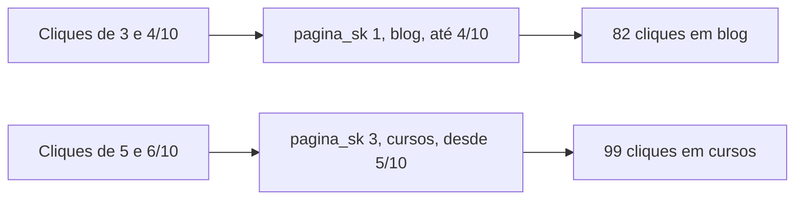

#### Estrela, tabela larga e camadas

A One Big Table (OBT) é uma tabela larga, já com todas as colunas de dimensão repetidas em cada linha. Ela é ótima para alimentar um painel específico, porque a ferramenta de BI não precisa fazer join. Ela é ruim como fonte da verdade, porque cada mudança de dimensão exige reescrever tudo. O caminho comum é guardar o esquema estrela e gerar tabelas largas a partir dele.

As camadas bronze, prata e ouro organizam esse fluxo. Bronze é o dado bruto, do jeito que veio. Prata é o dado limpo, tipado, deduplicado e com chaves normalizadas. Ouro é o que o negócio consome, as fatos, as dimensões e as tabelas largas. No dbt, os nomes equivalentes são staging, intermediate e marts.

### Exemplo guiado

Vamos montar uma estrela para Search Console, GA4 e crawl, com dimensões compartilhadas. Rode no DuckDB.

O diagrama mostra as três fatos e as dimensões que elas compartilham, com as medidas de cada fato.

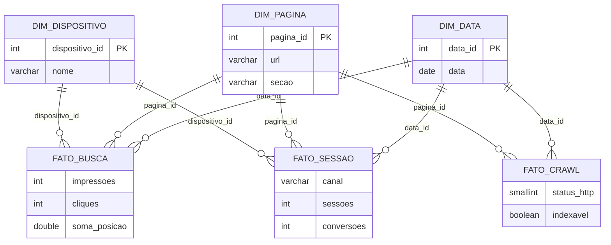

```sql
-- Dimensões compartilhadas
CREATE TABLE dim_data (
    data_id     INTEGER PRIMARY KEY,      -- 20261020
    data        DATE NOT NULL UNIQUE,
    dia_semana  VARCHAR NOT NULL,
    ano_mes     VARCHAR NOT NULL
);

CREATE TABLE dim_pagina (
    pagina_id   INTEGER PRIMARY KEY,      -- chave substituta
    url         VARCHAR NOT NULL UNIQUE,  -- URL normalizada, a chave natural
    secao       VARCHAR,
    template    VARCHAR
);

CREATE TABLE dim_dispositivo (
    dispositivo_id INTEGER PRIMARY KEY,
    nome           VARCHAR NOT NULL UNIQUE   -- desktop, mobile, tablet
);

-- Fato 1. Search Console. Grão: uma linha por data, página e dispositivo
CREATE TABLE fato_busca (
    data_id        INTEGER NOT NULL REFERENCES dim_data(data_id),
    pagina_id      INTEGER NOT NULL REFERENCES dim_pagina(pagina_id),
    dispositivo_id INTEGER NOT NULL REFERENCES dim_dispositivo(dispositivo_id),
    impressoes     INTEGER NOT NULL,
    cliques        INTEGER NOT NULL,
    soma_posicao   DOUBLE  NOT NULL,       -- posição x impressões, para média ponderada
    PRIMARY KEY (data_id, pagina_id, dispositivo_id)
);

-- Fato 2. GA4. Grão: uma linha por data, página de entrada, dispositivo e canal
CREATE TABLE fato_sessao (
    data_id        INTEGER NOT NULL REFERENCES dim_data(data_id),
    pagina_id      INTEGER NOT NULL REFERENCES dim_pagina(pagina_id),
    dispositivo_id INTEGER NOT NULL REFERENCES dim_dispositivo(dispositivo_id),
    canal          VARCHAR NOT NULL,
    sessoes        INTEGER NOT NULL,
    conversoes     INTEGER NOT NULL,
    PRIMARY KEY (data_id, pagina_id, dispositivo_id, canal)
);

-- Fato 3. Crawl. Grão: uma linha por página por rodada de crawl (foto periódica)
CREATE TABLE fato_crawl (
    data_id      INTEGER NOT NULL REFERENCES dim_data(data_id),
    pagina_id    INTEGER NOT NULL REFERENCES dim_pagina(pagina_id),
    status_http  SMALLINT NOT NULL,
    indexavel    BOOLEAN  NOT NULL,
    profundidade SMALLINT,
    PRIMARY KEY (data_id, pagina_id)
);

-- Dados mínimos para testar
INSERT INTO dim_data
SELECT strftime(d, '%Y%m%d')::INTEGER, CAST(d AS DATE), dayname(d), strftime(d, '%Y-%m')
FROM generate_series(TIMESTAMP '2026-10-01', TIMESTAMP '2026-10-07', INTERVAL 1 DAY) AS t(d);

INSERT INTO dim_pagina VALUES
    (1, 'https://exemplo.com.br/guia-seo',    'blog',   'artigo'),
    (2, 'https://exemplo.com.br/curso-dados', 'cursos', 'produto');
INSERT INTO dim_dispositivo VALUES (1, 'desktop'), (2, 'mobile');

INSERT INTO fato_busca VALUES
    (20261006, 1, 2, 1300, 57, 5550.0),
    (20261006, 2, 1,  300, 30,  600.0);
INSERT INTO fato_sessao VALUES
    (20261006, 1, 2, 'Organic Search', 52, 2),
    (20261006, 1, 2, 'Direct',         10, 0),
    (20261006, 2, 1, 'Organic Search', 33, 4);
INSERT INTO fato_crawl VALUES
    (20261006, 1, 200, true,  2),
    (20261006, 2, 200, false, 3);
```

Agora a consulta que cruza as três fatos. A regra é levar cada fato ao grão comum (data e página) antes de juntar. Juntar `fato_busca` com `fato_sessao` direto, linha a linha, repetiria os cliques para cada canal da sessão.

```sql
WITH busca AS (
    SELECT data_id, pagina_id,
           SUM(cliques)    AS cliques,
           SUM(impressoes) AS impressoes,
           SUM(soma_posicao) / SUM(impressoes) AS posicao_media
    FROM fato_busca
    GROUP BY ALL
),
sessao AS (
    SELECT data_id, pagina_id,
           SUM(sessoes)    AS sessoes_organicas,
           SUM(conversoes) AS conversoes_organicas
    FROM fato_sessao
    WHERE canal = 'Organic Search'
    GROUP BY ALL
)
SELECT d.data, p.url, c.indexavel,
       b.cliques, b.impressoes, round(b.posicao_media, 1) AS posicao_media,
       s.sessoes_organicas, s.conversoes_organicas
FROM busca b
JOIN dim_data   d USING (data_id)
JOIN dim_pagina p USING (pagina_id)
LEFT JOIN sessao s     USING (data_id, pagina_id)
LEFT JOIN fato_crawl c USING (data_id, pagina_id)
ORDER BY b.cliques DESC;
```

O resultado mostra a página de curso com cliques e sessões e marcada como não indexável no crawl. Esse tipo de cruzamento é o que o modelo existe para facilitar.

Dois cuidados para levar o modelo ao dado real. Primeiro, a URL das três fontes precisa passar pela mesma normalização antes de virar `pagina_id` (minúsculas no domínio, sem fragmento `#`, regra única para barra final e parâmetros). Segundo, o Search Console omite as consultas anonimizadas quando você agrupa por consulta. Se quiser a consulta, crie uma segunda fato, `fato_busca_consulta`, com grão "data, página, dispositivo e consulta", e não espere que a soma dela feche com `fato_busca`.

Para praticar, acrescente `dim_canal` no lugar da coluna de texto e uma `dim_contato` para o CRM, com a origem do contato em SCD tipo 2.

### Erros comuns

- **Começar pelas colunas, sem declarar o grão.** Duas fatos de grão diferente acabam somadas juntas e o número dobra. Escreva a frase do grão no topo de cada tabela.
- **Guardar a razão e jogar fora os componentes.** CTR e posição média viram média de médias. Guarde cliques, impressões e soma de posição e calcule a razão no fim.
- **Usar a URL crua como chave.** A mesma página aparece duas vezes e o join perde linhas. Normalize a URL numa regra única e gere a chave substituta a partir dela.
- **Sobrescrever atributo que tem história.** A seção ou a origem de ontem some e a análise de antes e depois fica impossível. Use SCD tipo 2 para atributos que mudam e importam.
- **Juntar fatos linha a linha.** O join multiplica os cliques pelo número de canais da sessão. Agregue cada fato ao grão comum e só então junte.

### Na prática

O caso 1 da pasta [casos](../../casos/01-queda-de-leads-que-era-ctr.md) parece um problema de SEO e é também um problema de modelagem. Um painel semanal mostrou queda de leads orgânicos. A primeira hipótese foi perda de posição por atualização de algoritmo.

O teste foi decompor a variação de cliques das buscas de compra em dois efeitos. O efeito volume é a variação de impressões vezes o CTR anterior. O efeito CTR é a impressão atual vezes a variação de CTR. A conta fecha exatamente, porque `cliques₁ − cliques₀ = (impressões₁ − impressões₀) × CTR₀ + impressões₁ × (CTR₁ − CTR₀)`. Depois, conferiu-se a posição média das mesmas buscas. Impressões e posição estavam estáveis e o CTR tinha caído. A página de resultados tinha ganhado elementos que interceptavam o clique.

Agora olhe para o que o modelo precisava ter para essa conta ser possível. Uma fato com grão de consulta e período, com impressões e cliques guardados como medidas aditivas. Uma dimensão de consulta com o atributo "intenção de compra", para filtrar as buscas certas. Posição guardada como soma ponderada, para recalcular a média de qualquer recorte. Com só o CTR guardado em cada linha, o CTR do período sairia como média de médias e a decomposição não fecharia. Sem a dimensão de intenção, cada análise reclassificaria as buscas de um jeito.

O diagnóstico entrou de forma fixa no painel, abaixo dos leads, com os períodos rotulados. Isso só foi possível porque a conta estava apoiada num modelo que separava volume de taxa. A lição é que queda de cliques tem três causas possíveis (demanda, posição, CTR), e o modelo precisa guardar o que separa as três.

### Resumo

- Declare o grão antes de qualquer coluna. Uma frase por tabela fato.
- Fatos guardam medidas. Dimensões guardam o jeito de cortar. Razões são calculadas depois de agregar.
- Chave substituta protege contra URL inconsistente e permite histórico.
- SCD tipo 2 guarda a história de atributos que mudam e importam.
- Para cruzar fatos, agregue cada uma ao grão comum antes do join.

### Para ir além

- Vídeo "Star Schema (aka Kimball Approach)", do canal Kahan Data Solutions, em [videos.md](videos.md). Monta uma estrela do zero e reforça a ordem dos quatro passos.
- Vídeo "Data Modeling · Slowly Changing Dimensions and Idempotency · Day 2 Lecture", em [videos.md](videos.md). Aprofunda o SCD tipo 2, que você vai implementar no desafio.
- "Entenda o esquema em estrela e a importância para o Power BI", da Microsoft Learn, em [leituras.md](leituras.md). Em português, revisa fato, dimensão e chave substituta com outros exemplos.
- "Building a Kimball dimensional model with dbt", em [leituras.md](leituras.md). Leia antes da aula 7, porque leva esta estrela para o dbt.

## Aula 4. Ingestão, ETL e ELT

### A ideia central

Ingerir é trazer o dado de onde ele está para onde você consegue trabalhar com ele. Parece a parte simples e é onde mais coisa quebra. A API tem limite de requisições, a paginação esconde linhas, a rede cai no meio, o dado de ontem muda amanhã. Uma boa ingestão traz tudo, não duplica nada e sabe retomar de onde parou.

O modelo mental certo é a idempotência. Uma carga idempotente pode rodar uma, duas ou dez vezes para o mesmo período e o resultado final é o mesmo. Com essa propriedade, falha deixa de ser emergência. Basta rodar de novo.

### Como funciona

#### ETL contra ELT

| | ETL | ELT |
|---|---|---|
| Ordem | Extrai, transforma fora do banco, carrega o resultado | Extrai, carrega o bruto, transforma dentro do banco |
| Onde roda a regra | Script ou ferramenta de integração | SQL no warehouse, quase sempre com dbt |
| Vantagem | Carrega só o necessário | Guarda o bruto e permite refazer a transformação |
| Quando faz sentido | Dado sensível que precisa ser mascarado antes, volume enorme | Quase todo caso analítico com warehouse ou DuckDB |

O ELT ficou comum porque armazenar ficou barato e os bancos analíticos ficaram rápidos. Guardar o bruto tem uma vantagem que só aparece no dia em que a regra estava errada. Você corrige o SQL e reprocessa, sem precisar chamar a API de novo para um período que ela talvez nem devolva mais.

#### Carga completa e carga incremental

A carga completa traz tudo toda vez. É simples e serve para tabelas pequenas, como a lista de páginas do sitemap. A carga incremental traz só o que falta, a partir de uma marca guardada num arquivo de estado (a última data carregada, o último id). Ela é obrigatória quando a fonte é grande, cobra por chamada ou limita requisições.

Toda carga incremental precisa de uma decisão sobre dado que chega atrasado. Cada fonte tem a sua regra.

| Fonte | Comportamento documentado | Decisão sugerida |
|---|---|---|
| API do Search Console | Por padrão devolve só dados finalizados (`dataState` em `final`). A série vai até cerca de dois dias antes e o dia publicado não muda depois | Pedir até D-2 e não recarregar dias já gravados |
| Exportação diária do GA4 para o BigQuery | A tabela `events_AAAAMMDD` pode ser atualizada por até dois dias corridos depois, além do dia atual | Reprocessar os últimos 3 dias a cada execução |
| API de pageviews da Wikimedia | Publica o dia depois que ele fecha | Pedir até D-2 por segurança |

#### As três técnicas de idempotência

1. **Substituir a partição.** Cada dia vai para um caminho fixo, como `ano=2026/mes=10/dia=20/parte-0.parquet`. Rodar de novo regrava o mesmo arquivo.
2. **Apagar e inserir por chave.** Antes de inserir o período, apague o que existe para aquele período. O dbt chama isso de estratégia `delete+insert`.
3. **Escrita atômica.** Grave num arquivo temporário e troque pelo definitivo com uma operação de renomear. Se o processo morrer no meio, o arquivo antigo continua inteiro.

Acrescentar linhas com `INSERT` puro, sem apagar antes, é o oposto da idempotência. Cada nova execução duplica o período.

#### Paginação e cotas

A API do Search Console devolve no máximo 25.000 linhas por chamada (`rowLimit`). Para pegar o resto, você repete a chamada aumentando `startRow` até a resposta vir sem linhas. A documentação de limites traz duas regras que mudam o desenho da ingestão. Há cota de 1.200 consultas por minuto por site e por usuário. E há uma cota de carga, em que consultas agrupadas por página e consulta ao mesmo tempo, e consultas com períodos longos, são as mais caras. Na prática, peça um dia por vez e evite repetir períodos já trazidos. Se estourar a cota de curto prazo, a orientação oficial é esperar 15 minutos.

#### Limitador, 429 e espera

O código HTTP 429 quer dizer "requisições demais". A resposta pode trazer o cabeçalho `Retry-After` dizendo quanto esperar. A regra deste projeto é parar no primeiro 429, guardar de onde parou e retomar depois. Tentar de novo em laço sem espera piora o bloqueio, desperdiça cota e pode fazer o seu IP ser barrado.

Para erros passageiros que não são de limite (um 503, uma conexão que caiu), a técnica é a espera progressiva com variação aleatória (*exponential backoff with jitter*). Espere 1 s, depois 2, depois 4, com um pequeno sorteio para que vários processos não voltem ao mesmo tempo. Ponha um teto de tentativas e desista com erro claro.

Duas regras de educação valem para toda fonte. Pause entre as requisições, mesmo sem limite declarado. E mande um User-Agent que diga quem você é. A política da Wikimedia, por exemplo, pede um User-Agent informativo com contato e avisa que clientes genéricos, como o padrão `python-requests`, podem ser bloqueados.

#### Formatos

| Formato | Bom para | Ruim para |
|---|---|---|
| CSV | Troca com planilha e pessoas | Tipos (tudo vira texto), aspas e quebras de linha, tamanho |
| JSON | Resposta de API, estruturas aninhadas | Consulta analítica em volume |
| Parquet | Análise. É colunar, comprimido e guarda o tipo de cada coluna | Edição manual e leitura por pessoas |

A regra prática é guardar o bruto como veio (JSON) quando o volume for pequeno e quiser auditoria, e gravar a camada que será consultada em Parquet.

#### Ferramentas prontas

O dlt é uma biblioteca Python de código aberto que cuida de esquema, estado incremental e paginação a partir de configuração. O Airbyte é uma plataforma com conectores prontos para centenas de fontes. Vale escrever a primeira ingestão à mão, como no exemplo abaixo, para entender o que essas ferramentas resolvem. O exercício 3 da trilha pede exatamente essa comparação.

### Exemplo guiado

O script abaixo traz as visualizações diárias de quatro artigos da Wikipédia em português pela API pública da Wikimedia, sem chave. Ele guarda o último dia completo num arquivo de estado, pausa 1 s entre chamadas, para no primeiro 429, limita o backfill a 30 dias por execução e grava cada dia numa partição Parquet de caminho fixo. Salve como `ingerir.py`.

O fluxograma mostra o laço do script, com o ramo do 429 e o estado que só avança depois da gravação.

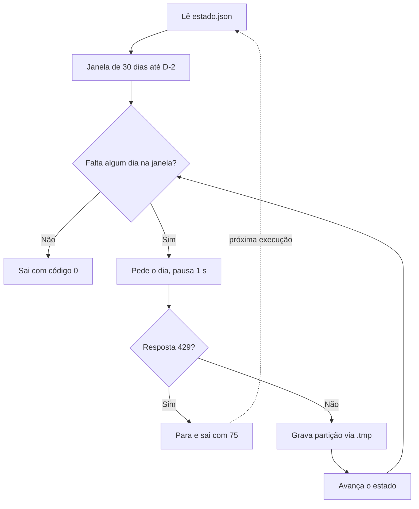

Antes de rodar, defina seu contato para o User-Agent numa variável de ambiente. O e-mail fica fora do código.

```bash
export CONTATO_UA="seu-email@exemplo.com"
```

```python
"""Ingestão incremental e idempotente de pageviews da Wikipédia em português.

Uso: python ingerir.py
Grava em lake/pageviews/ano=AAAA/mes=MM/dia=DD/parte-0.parquet
e guarda o último dia completo em estado.json.
"""
import json
import os
import sys
import time
from datetime import date, datetime, timedelta, timezone
from pathlib import Path
from urllib.parse import quote

import pandas as pd
import requests

ARTIGOS = ["Python", "SQL", "Ciência_de_dados", "Otimização_para_motores_de_busca"]
LAKE = Path("lake/pageviews")
ESTADO = Path("estado.json")
INICIO_PADRAO = date(2026, 9, 1)   # primeira carga começa aqui
MAX_DIAS_POR_EXECUCAO = 30         # limita o backfill de cada execução
PAUSA_S = 1.0                      # pausa entre requisições
CONTATO = os.environ.get("CONTATO_UA", "seu-email@exemplo.com")
UA = f"trilha-seo-dados-ia-estudo/1.0 ({CONTATO})"
URL = ("https://wikimedia.org/api/rest_v1/metrics/pageviews/per-article/"
       "pt.wikipedia/all-access/user/{artigo}/daily/{dia}/{dia}")


class LimiteAtingido(Exception):
    """A API respondeu 429. Paramos e retomamos depois."""


def ler_estado() -> date | None:
    if not ESTADO.exists():
        return None
    return date.fromisoformat(json.loads(ESTADO.read_text())["ultimo_dia"])


def gravar_estado(dia: date) -> None:
    tmp = ESTADO.with_suffix(".tmp")
    tmp.write_text(json.dumps({"ultimo_dia": dia.isoformat()}))
    tmp.replace(ESTADO)  # troca atômica, nunca deixa arquivo pela metade


def buscar_dia(sessao: requests.Session, dia: date) -> pd.DataFrame:
    linhas = []
    for artigo in ARTIGOS:
        url = URL.format(artigo=quote(artigo, safe=""), dia=dia.strftime("%Y%m%d"))
        r = sessao.get(url, timeout=30)
        time.sleep(PAUSA_S)
        if r.status_code == 429:
            raise LimiteAtingido(f"429 em {artigo} {dia}")
        if r.status_code == 404:   # artigo sem visitas no dia
            continue
        r.raise_for_status()
        for item in r.json()["items"]:
            linhas.append({"data": dia, "artigo": artigo, "visualizacoes": item["views"]})
    df = pd.DataFrame(linhas, columns=["data", "artigo", "visualizacoes"])
    df["carregado_em"] = datetime.now(timezone.utc)
    return df


def gravar_particao(df: pd.DataFrame, dia: date) -> Path:
    pasta = LAKE / f"ano={dia:%Y}" / f"mes={dia:%m}" / f"dia={dia:%d}"
    pasta.mkdir(parents=True, exist_ok=True)
    destino = pasta / "parte-0.parquet"
    tmp = pasta / "parte-0.parquet.tmp"
    df.to_parquet(tmp, index=False)
    tmp.replace(destino)  # mesmo dia, mesmo arquivo: rodar de novo substitui
    return destino


def main() -> int:
    ultimo = ler_estado()
    inicio = ultimo + timedelta(days=1) if ultimo else INICIO_PADRAO
    fim = min(datetime.now(timezone.utc).date() - timedelta(days=2),
              inicio + timedelta(days=MAX_DIAS_POR_EXECUCAO - 1))
    if inicio > fim:
        print(f"nada a fazer, último dia carregado {ultimo}")
        return 0

    sessao = requests.Session()
    sessao.headers["User-Agent"] = UA
    dia, total = inicio, 0
    try:
        while dia <= fim:
            df = buscar_dia(sessao, dia)
            gravar_particao(df, dia)
            gravar_estado(dia)        # só avança depois de gravar
            total += len(df)
            dia += timedelta(days=1)
    except LimiteAtingido as erro:
        print(f"parado: {erro}. Retoma de {dia} na próxima execução.")
        return 75                     # código de "tente mais tarde"
    print(f"ok: {inicio} a {fim}, {total} linhas")
    return 0


if __name__ == "__main__":
    sys.exit(main())
```

Rode duas vezes seguidas.

```bash
python ingerir.py   # primeira execução, até 30 dias a partir de 1º de setembro de 2026
python ingerir.py   # segunda execução, continua de onde a primeira parou
python ingerir.py   # sem dia novo disponível, responde "nada a fazer"
```

Agora prove que não duplicou. Apague o estado, rode de novo sobre os mesmos dias e conte. Salve a consulta como `provar.sql` e rode com `duckdb < provar.sql` ou pelo Python.

```sql
SELECT COUNT(*)                        AS linhas,
       COUNT(DISTINCT (data, artigo))  AS chaves,
       MIN(data)                       AS de,
       MAX(data)                       AS ate
FROM read_parquet('lake/pageviews/**/*.parquet', hive_partitioning = true);
```

```bash
rm estado.json
python ingerir.py && python ingerir.py
```

Linhas e chaves precisam dar o mesmo número antes e depois, e iguais entre si. No teste feito para esta aula, com sete dias e quatro artigos, as duas contagens deram 28 nas duas rodadas. A idempotência vem de três escolhas do código. O caminho da partição depende só do dia. A gravação é atômica, com `.tmp` e `replace`. E o estado só avança depois que a partição foi gravada.

Para ver a parada no 429 sem castigar a API, o teste da aula trocou a função de requisição por uma que respondia 429 a partir da sétima chamada. O script imprimiu "parado", saiu com código 75 e o estado ficou no último dia completo. A execução seguinte retomou exatamente dali.

### Erros comuns

- **Inserir sem apagar.** Cada nova execução duplica o período e o total cresce sozinho. Substitua a partição ou apague por chave antes de inserir.
- **Avançar o estado antes de gravar o dado.** Uma falha entre os dois passos pula um dia para sempre. Grave a partição, e só então grave o estado.
- **Tentar de novo em laço depois de um 429.** A cota acaba, o bloqueio aumenta e o pipeline pode ser banido. Pare, registre o ponto de retomada e saia com um código que o orquestrador entenda.
- **Pedir o dia de hoje.** A fonte ainda não fechou o dia e o número fica menor do que será. Respeite o atraso de cada fonte (D-2 para Search Console, reprocessar 3 dias para GA4).
- **Paginar até um número fixo de páginas.** Em dia de mais tráfego, as linhas depois do limite somem sem aviso. Pagine até a resposta vir vazia.
- **Deixar chave de API no código.** Ela vai parar no histórico do Git. Use variável de ambiente e um `.env` listado no `.gitignore`.

### Na prática

A lição do roteiro tem duas frases e um caminho inteiro de raciocínio por trás. "Fonte com limitador se respeita. Pare no primeiro 429, guarde de onde parou e retome depois." E "um pipeline idempotente pode rodar duas vezes no mesmo dia sem duplicar nada".

Pense no que acontece de madrugada sem essas duas propriedades. O agendamento dispara, a API responde 429 no meio do backfill, o script tenta de novo sem parar, a cota do dia acaba e o processo morre com metade dos dias gravados. De manhã, alguém roda à mão para "completar". Como a carga é um `INSERT` puro, os dias que já estavam lá entram duas vezes. O painel mostra o dobro de cliques na primeira metade do período e ninguém percebe até a reunião.

Com as duas propriedades, a mesma noite termina assim. O script para no 429, grava que o último dia completo foi o dia 17 e sai com código de "tente mais tarde". Na próxima janela, ele retoma do dia 18. Se alguém rodar à mão por desconfiança, nada muda, porque cada dia regrava o seu próprio arquivo. A madrugada deixa de exigir alguém acordado.

A lição é desenhar a ingestão pensando na falha. Toda ingestão vai ser interrompida um dia. A pergunta é se rodar de novo conserta ou piora.

### Resumo

- ELT guarda o bruto e transforma dentro do banco, o que permite refazer a regra sem chamar a API de novo.
- Carga incremental usa um arquivo de estado e uma janela de reprocessamento definida pela fonte.
- Idempotência vem de partição de caminho fixo, apagar e inserir por chave e escrita atômica.
- Pare no primeiro 429. Use espera progressiva só para erro passageiro e sempre com teto.
- Prove a idempotência com contagem de linhas e de chaves em duas execuções.

### Para ir além

- Vídeo "Introdução ao Python 12", do canal Téo Me Why, em [videos.md](videos.md). Em português, mostra a coleta do request ao arquivo salvo, bom para quem travou no script.
- Vídeo "Data Ingestion From APIs to Warehouses and Data Lakes", do DataTalksClub, em [videos.md](videos.md). Workshop de dlt para o exercício que compara a ferramenta com o seu script.
- "Tempos limite, novas tentativas e recuo com jitter", da Amazon Builders' Library, em [leituras.md](leituras.md). Explica por que a espera progressiva precisa de sorteio e de teto.
- "How to make data pipelines idempotent", em [leituras.md](leituras.md). Aprofunda as técnicas de substituir partição e apagar por chave.

## Aula 5. Orquestração

### A ideia central

Orquestrar é garantir que as tarefas rodem na ordem certa, na hora certa, que tentem de novo quando falham por motivo passageiro e que avisem alguém quando não dá para resolver sozinho. Um pipeline que só funciona quando alguém lembra de rodar ainda não é um pipeline.

O modelo mental certo é começar pequeno. Cron, um script que encadeia as etapas e um log de cada execução resolvem a maior parte dos pipelines de SEO e marketing. Troque por um orquestrador quando a dor aparecer, por exemplo dezenas de tarefas com dependências cruzadas, necessidade de reprocessar períodos com um clique ou várias pessoas mexendo no mesmo fluxo.

### Como funciona

#### Cron em cinco campos

O cron é o agendador que vem no Linux e no macOS. Cada linha do `crontab` tem cinco campos de tempo e um comando.

| Campo | Valores | Exemplo `30 7 * * 1-5` |
|---|---|---|
| Minuto | 0 a 59 | 30 |
| Hora | 0 a 23 | 7 |
| Dia do mês | 1 a 31 | qualquer |
| Mês | 1 a 12 | qualquer |
| Dia da semana | 0 a 7 (0 e 7 são domingo) | segunda a sexta |

O cron tem armadilhas conhecidas. Ele roda com um ambiente mínimo, sem o `PATH` do seu terminal e sem o ambiente virtual ativado, então use caminhos absolutos. Ele roda no fuso do sistema. E ele não guarda a saída em lugar nenhum útil se você não redirecionar para um arquivo. O site Crontab.guru traduz a expressão para linguagem comum antes de você agendar.

#### Dependência explícita

Uma DAG (*directed acyclic graph*, grafo dirigido sem ciclos) é o desenho das tarefas com setas de dependência. "Transformar" depende de "ingerir", "testar" depende de "transformar". Agendar a ingestão às 7h e a transformação às 7h10 parece igual e é frágil. No dia em que a ingestão demorar 15 minutos, a transformação roda sobre dado pela metade e ninguém fica sabendo. Com dependência explícita, a segunda tarefa só começa quando a primeira termina bem. No script do exemplo guiado, isso é um `if` sobre o código de saída.

A sequência compara o mesmo dia lento com intervalo fixo e com dependência explícita.

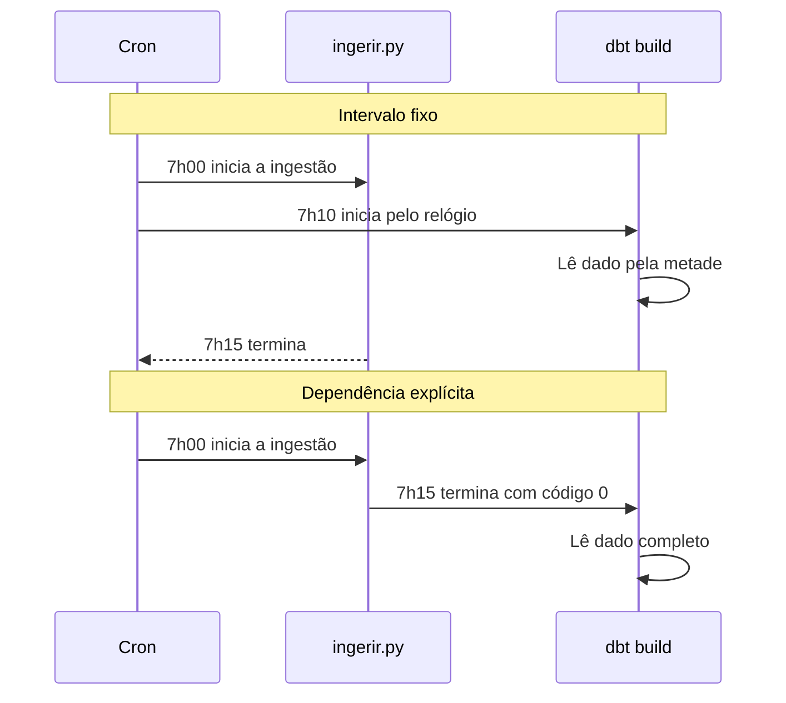

#### Novas tentativas, tempo limite e backfill

Nova tentativa resolve falha passageira (rede, servidor ocupado). Ela só é segura quando a tarefa é idempotente, que é o que a aula 4 garantiu. Tempo limite resolve a tarefa travada, que é pior que a que falha, porque não avisa nada. No Linux, `timeout 30m comando` encerra o processo depois de 30 minutos. E `flock -n arquivo.lock comando` impede que duas execuções rodem ao mesmo tempo.

Backfill é rodar o pipeline para um período passado, por exemplo os últimos 30 dias de um site novo no projeto. O cuidado é a cota da API. Trinta dias pedidos de uma vez podem estourar o limite e travar a execução normal do dia seguinte. Por isso o `ingerir.py` limita cada execução a 30 dias e retoma do estado.

#### "Falhou" e "não rodou"

Alerta de falha é a tarefa avisando que deu erro. Ele cobre o caso em que o pipeline rodou e quebrou. Ele não cobre o caso em que o pipeline nem começou. Máquina desligada, cron apagado numa atualização, permissão negada, agendamento esperando aprovação. Nesses casos, nada roda, nada falha e nada avisa.

O alerta de "não rodou" funciona ao contrário. Uma verificação independente procura a prova de que o pipeline rodou (uma linha no log, um arquivo novo, uma partição de hoje) e avisa quando ela não aparece. A versão mais robusta fica fora da máquina do pipeline, num serviço de *heartbeat* que espera um sinal periódico e avisa quando ele para de chegar.

#### Quando trocar o cron por um orquestrador

| Ferramenta | Como o fluxo é escrito | Quando considerar |
|---|---|---|
| Cron com script | Uma linha por agendamento, dependência dentro do script | Poucas tarefas, uma máquina, uma pessoa |
| Airflow | DAGs em Python | Muitas tarefas e dependências, time de dados, ecossistema grande de conectores |
| Kestra | Fluxos em YAML, com interface web | Quem prefere configuração declarativa e quer subir rápido com Docker |
| Prefect | Funções Python com decoradores | Quem já tem scripts Python e quer agendar e monitorar sem reescrever |
| Dagster | Ativos de dados em Python | Quem pensa em tabelas e na linhagem entre elas |

Todos oferecem nova tentativa, tempo limite, backfill, histórico de execuções e notificação. A troca se paga quando o tempo gasto para fazer isso à mão passa do tempo para aprender a ferramenta.

#### Ambientes e segredos

Credenciais ficam em variáveis de ambiente ou no cofre de segredos do orquestrador, nunca no código nem no crontab versionado. Separe ao menos dois ambientes, um para desenvolver e outro que roda de verdade, com caminhos e bancos diferentes.

### Exemplo guiado

Vamos agendar o pipeline das aulas 4 e 7. A pasta tem esta forma. Se você ainda não fez o projeto dbt da aula 7, comente o bloco do `dbt` no script por enquanto.

```
pipeline/
├── .venv/
├── ingerir.py
├── lake/
├── dbt_seo/
├── rodar.sh
├── verificar.py
└── execucoes.csv     criado na primeira execução
```

1. Crie o `rodar.sh`. Ele encadeia ingestão e transformação, só transforma se a ingestão terminou bem e grava uma linha por execução com início, fim e código de saída.

```bash
#!/usr/bin/env bash
# Executa o pipeline e registra cada execução em execucoes.csv
set -uo pipefail
cd "$(dirname "$0")"

inicio=$(date -u +%Y-%m-%dT%H:%M:%SZ)
.venv/bin/python ingerir.py
status=$?
if [ "$status" -eq 0 ]; then
    (cd dbt_seo && ../.venv/bin/dbt build --profiles-dir .)
    status=$?
fi
fim=$(date -u +%Y-%m-%dT%H:%M:%SZ)
echo "$inicio,$fim,$status" >> execucoes.csv
exit "$status"
```

2. Dê permissão de execução e rode uma vez olhando a tela.

```bash
chmod +x rodar.sh
./rodar.sh
cat execucoes.csv
```

3. Crie o `verificar.py`, a checagem de "não rodou". Ela procura no log a última execução com código 0 e avisa se passou de 26 horas (um dia com folga). Se a variável `ALERTA_WEBHOOK` existir, manda a mensagem para um webhook de entrada do Slack ou ferramenta parecida.

```python
"""Alerta de "não rodou". Roda num agendamento próprio, separado do pipeline."""
import csv
import os
import sys
from datetime import datetime, timedelta, timezone
from pathlib import Path

import requests

LOG = Path(__file__).with_name("execucoes.csv")
JANELA = timedelta(hours=26)  # um dia mais folga


def ultimo_sucesso() -> datetime | None:
    if not LOG.exists():
        return None
    with LOG.open() as f:
        fins = [linha[1] for linha in csv.reader(f) if linha and linha[2] == "0"]
    if not fins:
        return None
    return datetime.fromisoformat(fins[-1].replace("Z", "+00:00"))


def avisar(texto: str) -> None:
    print(texto, file=sys.stderr)
    url = os.environ.get("ALERTA_WEBHOOK")   # webhook de entrada do Slack ou similar
    if url:
        requests.post(url, json={"text": texto}, timeout=10)


if __name__ == "__main__":
    ultimo = ultimo_sucesso()
    agora = datetime.now(timezone.utc)
    if ultimo is None or agora - ultimo > JANELA:
        avisar(f"Pipeline sem execução bem-sucedida desde {ultimo}.")
        sys.exit(1)
    print(f"ok, último sucesso em {ultimo:%Y-%m-%d %H:%M} UTC")
```

4. Abra o agendamento com `crontab -e` e acrescente as linhas abaixo, trocando `/home/voce` pelo seu caminho. A primeira roda o pipeline às 7h30. A segunda é uma nova tentativa às 13h30, que não faz mal porque a carga é idempotente. A terceira é a verificação independente às 9h. A variável de ambiente no topo vale para as linhas de baixo.

```
ALERTA_WEBHOOK=https://hooks.slack.com/services/SEU/WEBHOOK/AQUI
# minuto hora dia-do-mês mês dia-da-semana  comando
30 7  * * * /home/voce/pipeline/rodar.sh >> /home/voce/pipeline/cron.log 2>&1
30 13 * * * /home/voce/pipeline/rodar.sh >> /home/voce/pipeline/cron.log 2>&1
0 9   * * * /home/voce/pipeline/.venv/bin/python /home/voce/pipeline/verificar.py >> /home/voce/pipeline/verificar.log 2>&1
```

5. No dia seguinte, confira `execucoes.csv` e `cron.log`. A primeira execução agendada precisa ser acompanhada. Se nada apareceu, o problema está no agendamento (permissão, caminho, ambiente), porque o script já rodou bem à mão no passo 2.
6. Teste o alerta. Comente as linhas do `rodar.sh` no crontab e rode `verificar.py` no dia seguinte, ou edite o `execucoes.csv` com uma data antiga. O script precisa sair com código 1 e mandar o aviso. No teste desta aula, sem execução nas últimas 26 horas, ele imprimiu "Pipeline sem execução bem-sucedida desde 2026-10-19 07:31:10+00:00" e saiu com 1.

Repare que a verificação lê o log que o próprio pipeline grava. Se a máquina inteira cair, ela cai junto. Para o projeto da trilha, isso basta. Em produção, mande também um sinal para um serviço de heartbeat externo no fim do `rodar.sh`.

O fluxograma resume o arranjo do exemplo, com a nova tentativa e a checagem de "não rodou".

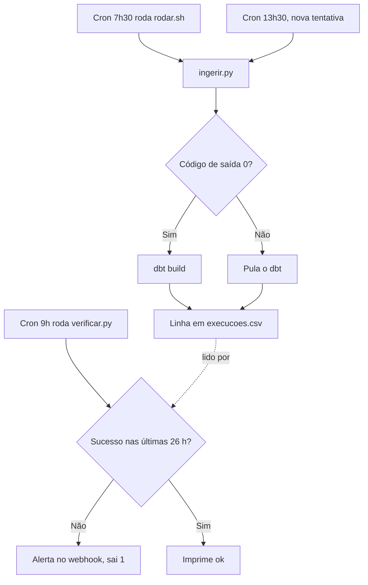

### Erros comuns

- **Agendar duas tarefas com intervalo fixo no lugar de dependência.** No dia em que a primeira atrasar, a segunda roda sobre dado incompleto. Encadeie pelo código de saída ou use um orquestrador.
- **Confiar no `PATH` dentro do cron.** O comando que funciona no terminal falha no agendamento com "command not found". Use caminhos absolutos para o Python, o dbt e os arquivos.
- **Não redirecionar a saída.** O erro some e ninguém sabe por que falhou. Redirecione `>> arquivo.log 2>&1` em toda linha.
- **Ter só alerta de falha.** O pipeline para de rodar e o silêncio parece sucesso. Tenha uma checagem independente de "não rodou".
- **Nova tentativa em tarefa que não é idempotente.** Cada tentativa duplica dados. Garanta a idempotência antes de ligar a repetição automática.
- **Backfill sem respeitar a cota.** O período antigo consome a cota e a carga do dia falha. Limite o número de dias por execução.

### Na prática

A lição do roteiro trata de um tipo de falha que não aparece em nenhum log. Uma rotina agendada que precisa de permissão fica parada esperando alguém aprovar, e ninguém percebe.

O raciocínio começa pela pergunta "o que acontece quando o pipeline não começa?". Se a resposta é "nada", você tem um problema. A rotina foi criada, o agendamento existe, a tela mostra que ela está ativa. Na hora marcada, o sistema pede uma confirmação ou uma permissão que só uma pessoa pode dar. A execução fica pendurada. Não há erro, então o alerta de falha não dispara. O painel continua mostrando o último dado que entrou, e quem olha não tem como saber que ele é velho.

Duas práticas fecham essa porta. A primeira é rodar a primeira execução agendada com alguém olhando. Não basta rodar o script à mão, porque o script à mão herda as permissões e o ambiente de quem está no terminal. É a execução disparada pelo agendador que revela o que falta. A segunda é ter o alerta de "não rodou", além do alerta de "falhou". Ele não depende de o pipeline começar, então pega justamente o caso em que nada começou. O teste de frescor da aula 8 é a terceira camada, do lado do dado.

### Resumo

- Comece com cron, um script que encadeia as etapas e um log por execução.
- Dependência explícita entre tarefas, nunca intervalo fixo.
- Nova tentativa só em tarefa idempotente. Tempo limite para tarefa travada. Backfill com teto de dias.
- Tenha alerta de "falhou" e de "não rodou", e acompanhe a primeira execução agendada.
- Troque por Airflow, Kestra, Prefect ou Dagster quando o trabalho manual passar do custo de aprender a ferramenta.

### Para ir além

- Vídeo "Cron, crontab e cronjob", do canal WDEV, em [videos.md](videos.md). Em português, mostra o crontab passo a passo antes do exemplo guiado.
- Vídeo "DE Zoomcamp 2.2.1 · Workflow Orchestration Introduction", em [videos.md](videos.md). Apresenta o Kestra, que o exercício 2 usa para reescrever este mesmo pipeline.
- Crontab.guru, em [leituras.md](leituras.md). Confira cada expressão antes de salvar o crontab.
- "Best Practices" do Apache Airflow, em [leituras.md](leituras.md). Lista os erros clássicos de tarefa não idempotente e código pesado no topo do arquivo, que valem para qualquer orquestrador.

## Aula 6. Data lake e lakehouse

### A ideia central

Para volumes pequenos e médios, você não precisa de um banco analítico sempre ligado. Arquivos Parquet guardados num armazenamento de objetos, como o S3 da AWS ou o Cloud Storage do Google, mais um motor que consulta esses arquivos, resolvem quase tudo e custam pouco. Esse é o data lake.

O modelo mental certo é o de custo por dado lido. Num motor como o Athena, você paga pelo volume que cada consulta lê. No DuckDB local, você paga em tempo. Nos dois, o trabalho de engenharia é organizar os arquivos para que cada pergunta leia o mínimo. Formato colunar, compressão e partição são as três alavancas.

### Como funciona

#### Armazenamento de objetos

Um bucket guarda objetos identificados por uma chave, como `lake/pageviews/ano=2026/mes=10/dia=20/parte-0.parquet`. As "pastas" são só prefixos da chave. Isso importa porque os motores de consulta usam o prefixo para decidir o que listar e o que ler. Guardar é barato e quase ilimitado. O custo aparece na leitura e nas requisições.

#### Por que Parquet

O Parquet guarda os dados por coluna, comprimidos, em blocos chamados *row groups*. Cada bloco traz estatísticas, como o mínimo e o máximo de cada coluna. Isso dá três vantagens sobre o CSV.

1. **Lê só as colunas pedidas.** Uma soma de receita não toca na coluna de endereço.
2. **Comprime melhor.** Valores parecidos ficam lado a lado na mesma coluna. As opções comuns são `snappy` (rápida) e `zstd` (menor).
3. **Pula blocos.** Se o filtro pede março e o máximo de um bloco é fevereiro, o motor nem lê o bloco.

Além disso, o arquivo guarda o tipo de cada coluna. Data é data, número é número, sem adivinhação na leitura.

#### Particionamento

Particionar é separar os arquivos por um valor, normalmente a data, num caminho no estilo Hive (`chave=valor`). Um filtro nessa chave permite ao motor descartar pastas inteiras sem abrir nenhum arquivo. Isso é a poda de partição.

O fluxograma mostra o caminho de uma consulta filtrada pela partição, do prefixo até a coluna.

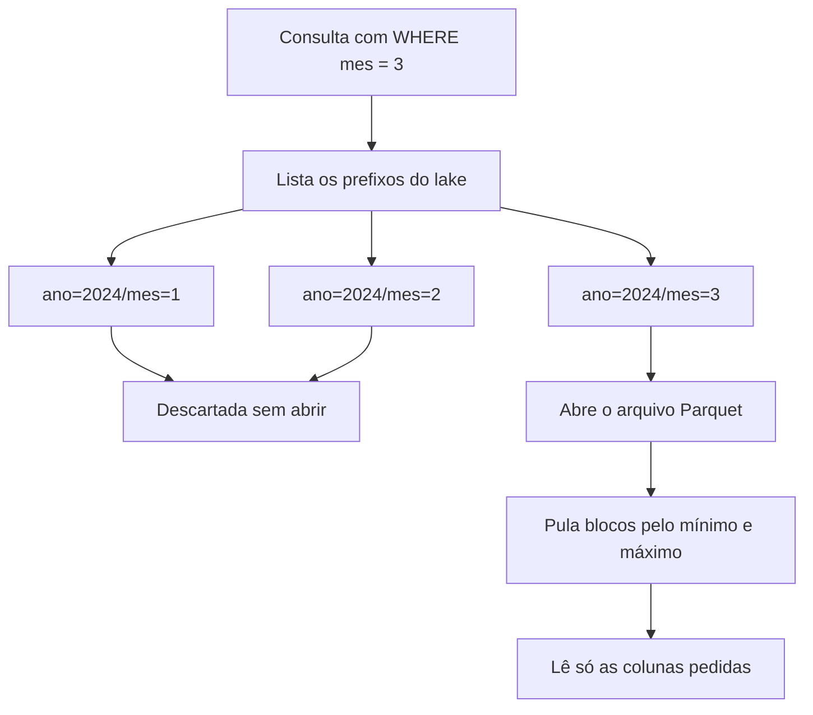

Escolha a chave pela pergunta mais comum, que em SEO é quase sempre o período. Evite chave de alta cardinalidade, como URL ou consulta. Ela gera milhares de arquivos minúsculos, e listar e abrir arquivo também custa. Uma referência prática é ter arquivos de dezenas a centenas de MB. Se cada dia rende poucos KB, particione por mês.

#### Athena e o custo por dado lido

O Athena consulta arquivos no S3 com SQL e cobra pelo volume lido. A página oficial de preços dá os detalhes. O volume é arredondado para cima no megabyte, com mínimo de 10 MB por consulta. Comandos de definição de tabela (`CREATE`, `ALTER`, `DROP`) e consultas que falham não são cobrados. Os exemplos da página usam US$ 5 por TB lido. Um deles mostra o efeito das alavancas. Um arquivo de texto de 3 TB lido inteiro custa US$ 15. Comprimido na proporção de 3 para 1 e convertido para formato colunar, lendo uma de quatro colunas, a mesma consulta lê 0,25 TB e custa US$ 1,25.

O Athena descobre tabelas e partições pelo catálogo do AWS Glue. A documentação de particionamento do Athena, em português, explica como registrar as partições ou projetá-las a partir do caminho.

#### DuckDB local

O DuckDB lê os mesmos arquivos Parquet que o Athena leria, direto do disco ou de uma URL, sem servidor. Com `hive_partitioning = true`, ele transforma as pastas `chave=valor` em colunas e faz a poda. É o jeito mais barato de aprender, testar e até de rodar em produção quando o volume cabe numa máquina.

#### Lakehouse

Um monte de arquivos Parquet não tem transação. Se dois processos escrevem ao mesmo tempo, ou se uma escrita morre no meio, a tabela fica inconsistente. Também não há histórico de versões. Os formatos de tabela abertos, Delta Lake e Apache Iceberg, resolvem isso com um registro de transações ao lado dos arquivos. Ganham-se escrita atômica, evolução de esquema, `UPDATE` e `DELETE` e consulta a versões anteriores (*time travel*). O Databricks é construído sobre o Delta Lake. O Athena e o DuckDB leem Iceberg e Delta, o DuckDB por meio de extensões. O DuckDB também tem o seu próprio formato de lakehouse, o DuckLake.

| | Lake simples | Lakehouse |
|---|---|---|
| Arquivos | Parquet | Parquet |
| Transação | Não tem. Você garante com escrita atômica e partição | Registro de transações |
| Atualizar uma linha | Reescreve a partição | `UPDATE` ou `MERGE` |
| Versão anterior | Só se você guardar | *Time travel* |
| Quando basta | Dado que chega em lote e só é acrescentado | Muitas escritas concorrentes, correções frequentes, exigência de auditoria |

Para o pipeline de SEO desta trilha, com uma carga por dia e partição substituída, o lake simples basta.

### Exemplo guiado

Vamos montar um mini data lake local com três meses de táxi amarelo de Nova York, particionado por ano e mês, e medir quanto cada consulta lê. O download soma perto de 150 MB.

```sql
COPY (
    SELECT *,
           year(tpep_pickup_datetime)  AS ano,
           month(tpep_pickup_datetime) AS mes
    FROM read_parquet([
        'https://d37ci6vzurychx.cloudfront.net/trip-data/yellow_tripdata_2024-01.parquet',
        'https://d37ci6vzurychx.cloudfront.net/trip-data/yellow_tripdata_2024-02.parquet',
        'https://d37ci6vzurychx.cloudfront.net/trip-data/yellow_tripdata_2024-03.parquet'
    ])
    WHERE tpep_pickup_datetime >= TIMESTAMP '2024-01-01'
      AND tpep_pickup_datetime <  TIMESTAMP '2024-04-01'
) TO 'lake_taxi' (FORMAT parquet, PARTITION_BY (ano, mes), COMPRESSION zstd, OVERWRITE_OR_IGNORE);
```

O filtro de data existe porque os arquivos públicos trazem algumas viagens com data fora do mês. Sem ele, apareceriam partições de anos estranhos. O resultado é uma pasta por mês, `lake_taxi/ano=2024/mes=1/`, com um arquivo cada, de 45 a 55 MB no teste. Rodar o mesmo comando de novo regravou os mesmos arquivos, sem duplicar.

Agora compare três consultas com `EXPLAIN ANALYZE`. Procure no resultado as linhas `Data Read`, `Scanning Files` e `Row Groups Scanned`.

```sql
-- A. Filtro na partição, uma coluna
EXPLAIN ANALYZE
SELECT COUNT(*), SUM(total_amount)
FROM read_parquet('lake_taxi/**/*.parquet', hive_partitioning = true)
WHERE mes = 3;

-- B. Mesmo período, filtrando por uma coluna comum
EXPLAIN ANALYZE
SELECT COUNT(*), SUM(total_amount)
FROM read_parquet('lake_taxi/**/*.parquet', hive_partitioning = true)
WHERE tpep_pickup_datetime >= TIMESTAMP '2024-03-01';

-- C. Filtro na partição, todas as colunas
EXPLAIN ANALYZE
SELECT *
FROM read_parquet('lake_taxi/**/*.parquet', hive_partitioning = true)
WHERE mes = 3;
```

No teste desta aula, os números foram estes.

| Consulta | Arquivos abertos | Blocos lidos | Dado lido |
|---|---|---|---|
| A. Partição e uma coluna | 1 de 3 | 30 de 30 | 6,4 MB |
| B. Coluna comum | 3 de 3 | 30 de 80 | 20,3 MB |
| C. Partição e todas as colunas | 1 de 3 | 30 de 30 | 57,0 MB |

A consulta B mostra as estatísticas do Parquet trabalhando. Mesmo sem poda de partição, o DuckDB pulou 50 dos 80 blocos pelo mínimo e máximo da data. Mas precisou abrir os três arquivos e leu três vezes mais que a consulta A. A consulta C mostra o custo do `SELECT *`, quase nove vezes o da A para o mesmo mês.

Para traduzir em dinheiro, use uma estimativa no formato da cobrança do Athena.

```python
import math

PRECO_POR_TB = 5.00   # US$ por TB lido, confira a sua região na página de preços do Athena
MB, TB = 10**6, 10**12

def custo_athena(bytes_lidos: int) -> float:
    """Estimativa. Arredonda para cima no MB e cobra no mínimo 10 MB por consulta."""
    mb = max(10, math.ceil(bytes_lidos / MB))
    return mb * MB / TB * PRECO_POR_TB

for nome, lido in [("1 mês, 1 coluna", 6.4e6), ("filtro em coluna comum", 20.3e6),
                   ("SELECT * de 1 mês", 57.0e6), ("100 GB inteiros", 100e9)]:
    print(f"{nome:<24} US$ {custo_athena(int(lido)):.6f}")
```

No teste, a saída foi esta.

```
1 mês, 1 coluna          US$ 0.000050
filtro em coluna comum   US$ 0.000105
SELECT * de 1 mês        US$ 0.000285
100 GB inteiros          US$ 0.500000
```

Com arquivos de dezenas de MB, todas as consultas caem perto do mínimo de 10 MB e o custo é desprezível. A diferença aparece em escala. Num lake de 100 GB, ler tudo custa US$ 0,50 por consulta, e um painel que dispara 20 consultas a cada abertura, aberto 50 vezes por dia, lê 1.000 vezes esse volume. É aí que partição e seleção de colunas viram dinheiro.

### Erros comuns

- **Guardar o lake em CSV.** Cada consulta lê todas as colunas e o tipo de cada campo é adivinhado. Converta para Parquet na primeira etapa depois do bruto.
- **Particionar por coluna de alta cardinalidade.** Milhares de arquivos pequenos deixam a listagem e a leitura lentas. Particione por período e ajuste a granularidade ao volume.
- **Filtrar pela coluna comum em vez da coluna da partição.** O motor abre todos os arquivos. Filtre pela chave da partição do jeito que ela está no caminho.
- **Usar `SELECT *` em painel.** Lê todas as colunas, mesmo as que o gráfico não usa. Selecione só o necessário ou crie uma tabela agregada para o painel.
- **Escrever direto no caminho final.** Uma escrita interrompida deixa arquivo corrompido que quebra todas as consultas. Escreva num temporário e renomeie, ou use um formato de tabela com transação.
- **Estimar custo sem medir.** A conta de cabeça erra por ordem de grandeza. Rode `EXPLAIN ANALYZE` no DuckDB ou veja o volume lido no histórico do Athena.

### Na prática

Este módulo não tem caso no roteiro, então vale um cenário hipotético. Imagine um portal de notícias que guarda o log de acesso do servidor como CSV no S3, um arquivo por hora, e consulta pelo Athena para saber quantas vezes os robôs de busca visitaram cada seção.

No começo, a consulta é rápida e barata. Um ano depois, cada pergunta sobre "a semana passada" lê o ano inteiro, porque não há partição e o CSV obriga a ler todas as colunas. A conta do mês sobe sem que ninguém tenha mudado nada.

O raciocínio para resolver segue as três alavancas, na ordem do maior ganho. Primeiro, particionar por dia, porque toda pergunta tem período, e a poda corta o volume na proporção do período pedido. Segundo, converter para Parquet, porque a pergunta usa três colunas (data, user-agent, URL) de um log que tem mais de dez. Terceiro, agregar. Se a pergunta recorrente é "visitas de robô por seção e dia", uma tabela pequena com essa contagem, gerada uma vez por dia, atende o painel sem tocar no log.

Antes de mudar, o time do cenário mediria o volume lido de três consultas típicas no histórico do Athena. Depois, mediria de novo. O número de antes e depois é o que justifica o trabalho para quem paga a conta.

### Resumo

- Data lake é Parquet num armazenamento de objetos mais um motor de consulta. Lakehouse acrescenta transação e versão com Delta Lake ou Iceberg.
- Parquet lê só as colunas pedidas, comprime e pula blocos pelas estatísticas.
- Partição por período corta arquivos inteiros. Evite chave de alta cardinalidade.
- No Athena, o custo segue o volume lido, arredondado no MB e com mínimo de 10 MB por consulta.
- Meça com `EXPLAIN ANALYZE` antes e depois de cada mudança.

### Para ir além

- Vídeo "Parquet File Format · Explained to a 5 Year Old!", em [videos.md](videos.md). Visualiza o armazenamento colunar que a tabela de três consultas mediu.
- Vídeo "Consulte dados com o AWS Athena · Português", em [videos.md](videos.md). Mostra o mesmo lake consultado no S3, para o exercício de estimar custo.
- "Particionar dados", da documentação do Amazon Athena, em [leituras.md](leituras.md). Explica como registrar partições, passo necessário para a poda funcionar no Athena.
- "Reading and Writing Parquet Files", da documentação do DuckDB, em [leituras.md](leituras.md). Referência das opções de leitura e escrita usadas no exemplo guiado.

## Aula 7. Transformação com dbt

### A ideia central

O dbt (*data build tool*) leva para o SQL as práticas que a engenharia de software usa há décadas. Cada transformação vira um arquivo `.sql` versionado no Git. As dependências entre as tabelas ficam declaradas no código. Os testes rodam junto com a construção. A documentação e o grafo de linhagem saem de graça.

O modelo mental certo é que o dbt não move dado. Ele escreve e executa `SELECT`s dentro do banco que você já tem. A ingestão da aula 4 traz o bruto, e o dbt transforma o bruto em tabelas confiáveis, na ordem certa, toda vez do mesmo jeito.

### Como funciona

#### Versões em outubro de 2026

Há duas linhas do dbt. A versão 1 (dbt Core, hoje na 1.12) é instalada com `pip install dbt-core` mais um adaptador por banco, como o `dbt-duckdb`. A versão 2 passou a ser a instalação padrão (`pip install dbt`), é um binário único, é gratuita para uso sob licença própria e tem uma variante de código aberto, o `dbt-oss`. A v2 suporta o DuckDB pela linha de comando. O projeto desta aula foi testado nas duas, no dbt Core 1.12.6 com `dbt-duckdb` 1.11.0 e no dbt 2.0.9. Os exercícios usam a versão 1 com `dbt-duckdb`.

#### Modelos, `ref` e `source`

Um modelo é um arquivo `.sql` com um `SELECT`. O nome do arquivo vira o nome da tabela ou view. Dentro dele, você nunca escreve o nome físico de outra tabela.

| Função | Aponta para | O que acontece no grafo |
|---|---|---|
| `{{ source('wikipedia', 'pageviews') }}` | Dado bruto que o dbt não criou, declarado num `.yml` | Vira um nó de origem, com frescor testável |
| `{{ ref('stg_pageviews') }}` | Outro modelo do projeto | Cria a seta de dependência e define a ordem de execução |

Com `ref`, o dbt sabe que `fct_pageviews_diario` depende de `stg_pageviews` e roda um antes do outro. É a dependência explícita da aula 5, aplicada às tabelas.

#### Materializações

| Materialização | O que cria | Quando usar |
|---|---|---|
| `view` | Uma view, recalculada a cada consulta | Staging leve, que só renomeia e tipa |
| `table` | Uma tabela recriada inteira a cada execução | Marts pequenos e médios |
| `incremental` | Uma tabela que recebe só o que mudou | Fatos grandes, em que recriar tudo custa caro |
| `ephemeral` | Nada. Vira uma CTE dentro de quem a referencia | Passos intermediários que ninguém consulta direto |

O modelo incremental precisa de duas decisões. A `unique_key` diz qual combinação de colunas identifica uma linha. A janela de reprocessamento diz quantos dias para trás recalcular, para pegar dado que chegou atrasado. Sem `unique_key`, cada execução acrescenta linhas e duplica o período reprocessado. A estratégia `delete+insert` apaga as chaves que vão chegar e insere de novo, que é a substituição de partição da aula 4 feita dentro do banco.

A sequência mostra o que o dbt pede ao banco numa execução incremental com `delete+insert`.

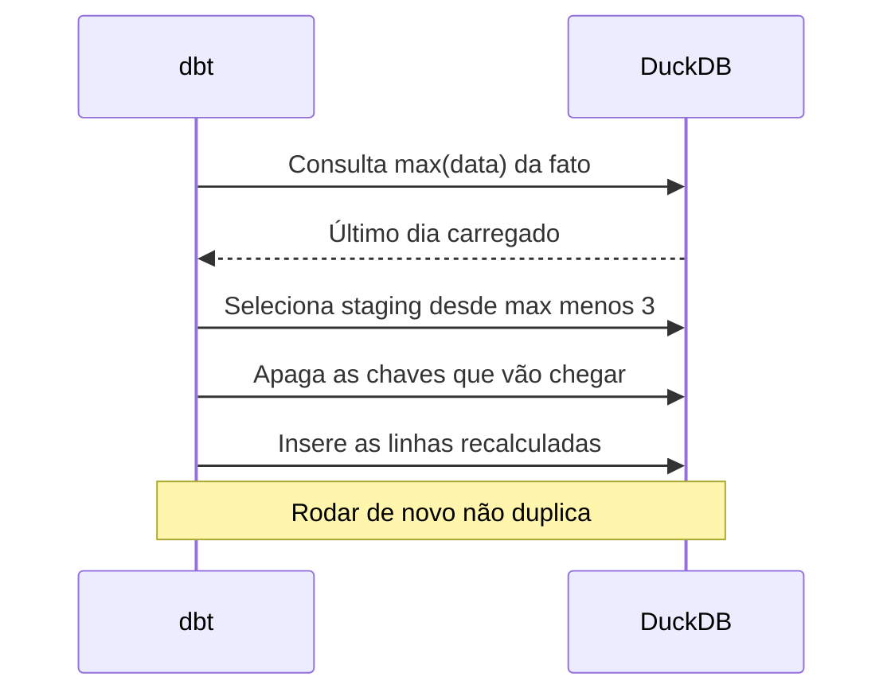

#### Testes de dados

Os testes de dados do dbt são consultas que procuram linhas problemáticas. Se a consulta devolve alguma linha, o teste falha. A chave no YAML hoje se chama `data_tests`, para diferenciar dos testes unitários. A documentação diz que `tests` ainda é aceito como sinônimo, mas que um mesmo recurso não pode ter as duas chaves. Os testes genéricos que vêm prontos são quatro, `unique`, `not_null`, `accepted_values` e `relationships`. Os parâmetros de um teste, como `to` e `field` do `relationships`, vão dentro de `arguments`. Isso existe desde a versão 1.10.5 e é obrigatório na versão 2.

O teste singular é um arquivo `.sql` na pasta `tests/` com uma consulta que deve voltar vazia. É onde moram as regras de negócio, como "a soma do mart é igual à soma da fonte".

#### Camadas

O guia de estrutura do dbt organiza os modelos em três pastas. `staging` tem um modelo por tabela de origem, só com renomeação, tipos e limpeza. `intermediate` junta e prepara lógica reaproveitada por mais de um mart. `marts` tem as fatos e dimensões que o negócio consome. É a mesma ideia de bronze, prata e ouro da aula 3, com outros nomes.

#### Seeds, snapshots e documentação

Seed é um CSV pequeno versionado no projeto e carregado com `dbt seed`, bom para tabelas de mapeamento, como a classificação de consultas por intenção. Snapshot grava o histórico de uma tabela que muda, no formato de SCD tipo 2, com colunas de vigência. `dbt docs generate` gera a documentação com descrições, colunas e o grafo de linhagem, e `dbt docs serve` abre no navegador.

### Exemplo guiado

Vamos transformar o lake de pageviews da aula 4 num pequeno modelo com staging, uma dimensão, uma fato incremental e testes. Crie a pasta `dbt_seo` ao lado da pasta `lake`.

O fluxograma mostra a linhagem que o projeto vai ter, com as setas de `ref` e os dois testes que cruzam modelos.

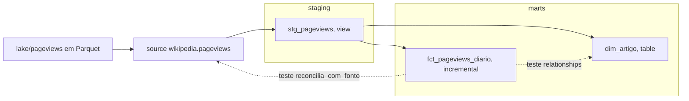

Arquivo `dbt_seo/dbt_project.yml`.

```yaml
name: dbt_seo
version: "1.0.0"
profile: dbt_seo

models:
  dbt_seo:
    staging:
      +materialized: view
    marts:
      +materialized: table
```

Arquivo `dbt_seo/profiles.yml`. O banco DuckDB é criado na primeira execução.

```yaml
dbt_seo:
  target: dev
  outputs:
    dev:
      type: duckdb
      path: seo.duckdb
      threads: 4
```

Arquivo `dbt_seo/models/staging/_fontes.yml`. O `external_location` é uma configuração do `dbt-duckdb` que faz a fonte apontar para os arquivos Parquet. O caminho é relativo à pasta de onde você roda o dbt. A aula 8 acrescenta o teste de frescor a este arquivo.

```yaml
sources:
  - name: wikipedia
    tables:
      - name: pageviews
        config:
          external_location: "read_parquet('../lake/pageviews/**/*.parquet', hive_partitioning = true)"
```

Arquivo `dbt_seo/models/staging/stg_pageviews.sql`.

```sql
select
    cast(data as date)          as data,
    artigo,
    cast(visualizacoes as bigint) as visualizacoes,
    carregado_em
from {{ source('wikipedia', 'pageviews') }}
```

Arquivo `dbt_seo/models/marts/dim_artigo.sql`.

```sql
select distinct
    md5(artigo)                 as artigo_id,
    artigo,
    replace(artigo, '_', ' ')   as titulo
from {{ ref('stg_pageviews') }}
```

Arquivo `dbt_seo/models/marts/fct_pageviews_diario.sql`. O bloco `is_incremental()` só entra a partir da segunda execução. Na primeira, a tabela é criada inteira.

```sql
{{ config(
    materialized='incremental',
    unique_key=['data', 'artigo_id'],
    incremental_strategy='delete+insert'
) }}

select
    md5(cast(data as varchar) || '|' || artigo) as pageview_id,
    data,
    md5(artigo)                                 as artigo_id,
    sum(visualizacoes)                          as visualizacoes
from {{ ref('stg_pageviews') }}

-- reprocessa desde 3 dias antes do último dia já carregado
where data >= (select max(data) - interval 3 day from {{ this }})

group by all
```

Arquivo `dbt_seo/models/marts/_marts.yml`, com a granularidade escrita na descrição e os testes.

```yaml
models:
  - name: dim_artigo
    description: "Uma linha por artigo da Wikipédia acompanhado."
    columns:
      - name: artigo_id
        data_tests:
          - unique
          - not_null

  - name: fct_pageviews_diario
    description: "Grão. Uma linha por dia e artigo."
    columns:
      - name: pageview_id
        data_tests:
          - unique
          - not_null
      - name: data
        data_tests:
          - not_null
      - name: artigo_id
        data_tests:
          - not_null
          - relationships:
              arguments:
                to: ref('dim_artigo')
                field: artigo_id
      - name: visualizacoes
        data_tests:
          - not_null
```

Arquivo `dbt_seo/tests/reconcilia_com_fonte.sql`, o teste singular de reconciliação.

```sql
-- Falha (retorna linha) se o total do mart for diferente do total da fonte
with fonte as (
    select sum(visualizacoes) as total from {{ source('wikipedia', 'pageviews') }}
),
mart as (
    select sum(visualizacoes) as total from {{ ref('fct_pageviews_diario') }}
)
select fonte.total as total_fonte, mart.total as total_mart
from fonte, mart
where fonte.total <> mart.total
```

Rode de dentro da pasta `dbt_seo`.

```bash
cd dbt_seo
dbt debug --profiles-dir .          # confere a conexão
dbt build --profiles-dir .          # constrói os modelos e roda os testes, na ordem do grafo
dbt build --profiles-dir .          # segunda vez, agora incremental
dbt docs generate --profiles-dir .
dbt docs serve --profiles-dir .     # abre a documentação com o grafo de linhagem
```

No teste desta aula, as duas execuções de `dbt build` terminaram com 3 modelos e 9 testes passando. A fato ficou com 28 linhas e 28 chaves distintas depois da segunda execução, a mesma contagem do lake. Para ver um teste falhar, mude o `group by all` da fato para não agrupar, ou apague uma linha da dimensão, e rode de novo.

Para o exercício de três camadas, crie `models/intermediate/` com um modelo que calcule a média móvel de 7 dias por artigo, usando a função de janela da aula 2, e faça um mart semanal ler dele.

### Erros comuns

- **Escrever o nome físico da tabela no lugar de `ref`.** O dbt não enxerga a dependência, roda na ordem errada e o grafo fica incompleto. Use `ref` para modelos e `source` para dado bruto.
- **Incremental sem `unique_key`.** O período reprocessado entra de novo e duplica. Defina a chave e uma estratégia que substitua, como `delete+insert` ou `merge`.
- **Incremental sem janela de reprocessamento.** Dado que chega atrasado nunca entra. Reprocesse os dias que a fonte ainda pode mudar e compare com a fonte num teste.
- **Copiar a sintaxe antiga dos testes.** Parâmetro solto ao lado do nome do teste gera aviso de depreciação na versão 1 e erro na versão 2. Use `data_tests` e ponha os parâmetros em `arguments`.
- **Regra de negócio espalhada nos marts.** A mesma métrica é calculada de dois jeitos. Calcule uma vez, num modelo intermediário ou numa coluna do mart, e reaproveite com `ref`.
- **Testar só unicidade e não nulo.** Os testes passam e o total está errado. Acrescente um teste singular de reconciliação com a fonte.

### Na prática

O roteiro não traz caso para este módulo, então vale um cenário hipotético. Imagine um blog de receitas cujo relatório semanal de tráfego sai de um notebook com dezenas de células, rodado à mão toda segunda por uma única pessoa.

Os sintomas são conhecidos. Quando essa pessoa sai de férias, o relatório atrasa. Quando alguém pergunta como "visitas de busca" é calculado, a resposta está na célula 23, que depende da 17, que só funciona se a 9 rodou antes. Um dia, o total de março aparece diferente em dois relatórios, e ninguém sabe qual está certo.

O raciocínio para migrar começa pelo grafo. Liste as tabelas que o notebook produz e de quais ele depende. Cada tabela vira um modelo, cada dependência vira um `ref`, e cada leitura de arquivo vira um `source`. A célula que limpa nomes de coluna vira staging. A célula que junta tudo vira um mart. A conta de "visitas de busca" passa a existir em um só lugar.

Depois vem a pergunta "o que precisa ser verdade para eu confiar neste número?". Cada resposta vira um teste. Uma linha por dia e página vira `unique`. Toda página da fato existe na dimensão vira `relationships`. O total bate com a fonte vira um teste singular. Na segunda-feira seguinte, `dbt build` roda tudo na ordem certa e para no primeiro teste que falhar, antes de o número errado chegar ao relatório.

### Resumo

- O dbt executa `SELECT`s dentro do seu banco, na ordem dada por `ref` e `source`.
- View para staging leve, table para marts, incremental com `unique_key` e janela de reprocessamento para fatos grandes.
- Testes usam a chave `data_tests`, com parâmetros em `arguments`. Teste singular cobre regra de negócio.
- Staging, intermediate e marts organizam o projeto do bruto ao consumo.
- O mesmo projeto roda no dbt Core 1.12 com `dbt-duckdb` e no dbt 2.

### Para ir além

- Vídeo "What Is DBT and Why Is It So Popular", em [videos.md](videos.md). Explica o problema que o dbt resolve, bom para ver antes de montar o projeto.
- Vídeo "dbt Core com PostgreSQL · Transformação de Dados na Prática em 10 MINUTOS!", em [videos.md](videos.md). Em português, mostra o mesmo fluxo com outro banco.
- "How we structure our dbt projects", em [leituras.md](leituras.md). O guia oficial das camadas staging, intermediate e marts que o exercício pede.
- "Configure incremental models", em [leituras.md](leituras.md). Leia antes do desafio de `delete+insert` com reprocessamento de 3 dias.

## Aula 8. Qualidade e observabilidade de dados

### A ideia central

Dado errado que chega ao painel destrói confiança mais rápido que dado nenhum. Depois do primeiro número errado apresentado numa reunião, todo número seguinte é recebido com desconfiança, inclusive os certos. Qualidade de dados é testar o dado como se testa código, de forma automática, a cada execução.

O modelo mental certo é saber antes do gestor. Fonte externa sempre falha um dia. O objetivo é que a falha vire um alerta para quem cuida do pipeline antes de virar uma pergunta de quem usa o painel.

### Como funciona

#### Os quatro tipos de teste

| Tipo | Pergunta | Exemplo de falha real | Como testar |
|---|---|---|---|
| Esquema | As colunas e os tipos são os esperados? | A API renomeia um campo e a coluna chega nula | `not_null`, `accepted_values`, contrato de modelo |
| Volume | Chegou a quantidade de linhas de sempre? | Um filtro novo na exportação corta metade das páginas | Comparar com a média dos mesmos dias da semana |
| Frescor | O dado mais recente é de quando? | O agendamento parou e o painel mostra a semana passada | `dbt source freshness` com limite de 2 dias |
| Distribuição | Os valores estão numa faixa plausível? | CTR acima de 100% depois de um join que multiplicou cliques | Faixas mínimas e máximas, testes de proporção |

Os testes de unicidade e não nulo da aula 7 cobrem parte do esquema. Volume, frescor e distribuição pegam o que eles não pegam.

O fluxograma mostra em que etapa do pipeline cada tipo de teste olha o dado.

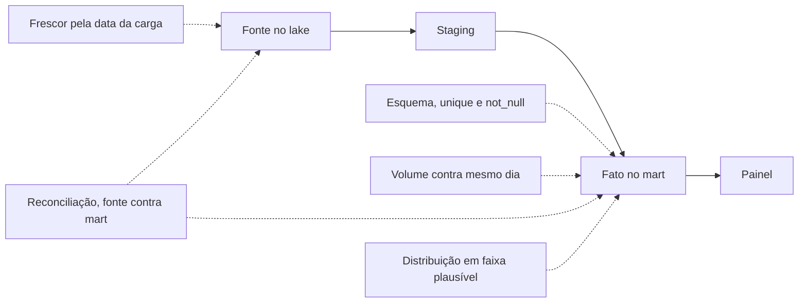

#### Contrato de dados

O teste verifica depois que o dado chegou. Um contrato de dados é um acordo explícito entre quem produz e quem consome uma tabela, com nomes de colunas, tipos, chave, frequência de atualização e quem avisar quando algo mudar. No dbt, o contrato de modelo impõe nomes e tipos de colunas na construção e faz o `dbt build` falhar se o `SELECT` não bater com o declarado. A parte humana do contrato, como "o time do CRM avisa antes de mudar a regra de origem", fica num documento combinado entre as áreas.

#### Reconciliação com a fonte

Reconciliar é conferir se a soma da sua tabela bate com o total que a fonte mostra. É o teste que pega o erro silencioso. Uma linha a menos, um filtro esquecido, uma página que a normalização de URL descartou. Unicidade e não nulo passam nesses casos, porque cada linha que está lá está certa. O problema é a linha que não está.

Algumas diferenças são esperadas e precisam ser conhecidas antes de reconciliar. No Search Console, a tabela por consulta omite as consultas anonimizadas e nunca fecha com o total. A API tem um parâmetro `aggregationType` que distingue agregação por propriedade e por página, e os dois jeitos podem dar números diferentes. Compare sempre no mesmo tipo de agregação. Documente as diferenças esperadas e investigue todas as outras.

#### Alertas de anomalia e linhagem

Limite fixo ("menos de 1.000 linhas é erro") quebra com sazonalidade. Um alerta melhor compara o dia com a média do mesmo dia da semana nas semanas anteriores, que é o desenho do exemplo guiado. Ferramentas como Elementary (feita para dbt), Great Expectations e Soda automatizam esse tipo de detecção.

A linhagem diz quais tabelas e painéis dependem de cada fonte. Quando um teste falha na fonte, a linhagem do dbt mostra quem será afetado e quem precisa ser avisado.

### Exemplo guiado

#### 1. Teste de frescor

Acrescente o frescor à fonte do projeto da aula 7. Este é o arquivo `dbt_seo/models/staging/_fontes.yml` completo.

```yaml
sources:
  - name: wikipedia
    tables:
      - name: pageviews
        config:
          external_location: "read_parquet('../lake/pageviews/**/*.parquet', hive_partitioning = true)"
          loaded_at_query: |
            select max(carregado_em)
            from read_parquet('../lake/pageviews/**/*.parquet')
          freshness:
            warn_after: {count: 1, period: day}
            error_after: {count: 2, period: day}
```

A configuração de frescor fica dentro de `config` desde a versão 1.9. O `loaded_at_query`, disponível desde a 1.10, é uma consulta que devolve o momento da carga mais recente. Ela foi usada aqui porque a fonte é um conjunto de arquivos, e assim o mesmo arquivo funciona no dbt 1.12 e no dbt 2. A coluna medida é `carregado_em`, o momento da ingestão. Medir pela coluna `data` daria alarme falso, porque a fonte sempre publica com dois dias de atraso.

```bash
cd dbt_seo
dbt source freshness --profiles-dir .   # dbt 1.x. No dbt 2, o comando novo é "dbt freshness"
```

Com a ingestão em dia, o resultado é `PASS`. Para ver falhar, pare a ingestão por três dias, ou simule regravando as partições com `carregado_em` três dias no passado. No teste desta aula, a simulação deu `ERROR STALE` e o comando saiu com código 1 nas duas versões do dbt. Esse código de saída é o que o `rodar.sh` da aula 5 usa para registrar a falha.

#### 2. Alerta de volume

Primeiro, veja o alerta disparar numa série de exemplo, com uma queda forte no último dia. Rode no DuckDB.

```sql
-- Série diária de exemplo com uma queda forte no último dia
CREATE OR REPLACE TABLE cliques_diarios AS
SELECT CAST(d AS DATE) AS data,
       CASE WHEN d = DATE '2026-10-20' THEN 410
            WHEN dayofweek(d) IN (0, 6) THEN 600 + (abs(hash(d)) % 60)::INTEGER
            ELSE 1000 + (abs(hash(d)) % 100)::INTEGER END AS cliques
FROM generate_series(DATE '2026-09-01', DATE '2026-10-20', INTERVAL 1 DAY) AS t(d);

-- Alerta: queda maior que 30% contra a média do mesmo dia da semana nas 4 semanas anteriores
WITH base AS (
    SELECT data, cliques,
           AVG(cliques) OVER (
               PARTITION BY dayofweek(data)
               ORDER BY data
               ROWS BETWEEN 4 PRECEDING AND 1 PRECEDING
           ) AS media_4_semanas,
           COUNT(*) OVER (
               PARTITION BY dayofweek(data)
               ORDER BY data
               ROWS BETWEEN 4 PRECEDING AND 1 PRECEDING
           ) AS semanas_na_base
    FROM cliques_diarios
)
SELECT data, dayname(data) AS dia_semana, cliques,
       round(media_4_semanas) AS media_4_semanas,
       round(100.0 * (cliques / media_4_semanas - 1), 1) AS variacao_pct
FROM base
WHERE semanas_na_base = 4
  AND cliques < 0.7 * media_4_semanas
ORDER BY data;
```

O resultado mostra uma linha, a terça-feira 20 de outubro, com 410 cliques contra uma média perto de 1.050 nas quatro terças anteriores. A condição `semanas_na_base = 4` evita alarme nas primeiras semanas, quando ainda não há base.

Depois, leve a mesma regra para o projeto dbt como teste singular com severidade de aviso. Ele roda em todo `dbt build`, avisa sem interromper a construção e mostra as linhas suspeitas. Arquivo `dbt_seo/tests/alerta_volume.sql`.

```sql
-- Avisa quando o total do dia cai mais de 30% contra a média
-- do mesmo dia da semana nas 4 semanas anteriores
{{ config(severity = 'warn') }}

with diario as (
    select data, sum(visualizacoes) as visualizacoes
    from {{ ref('fct_pageviews_diario') }}
    group by all
),
base as (
    select data, visualizacoes,
           avg(visualizacoes) over w as media_4_semanas,
           count(*)           over w as semanas_na_base
    from diario
    window w as (partition by dayofweek(data) order by data
                 rows between 4 preceding and 1 preceding)
)
select *
from base
where semanas_na_base = 4
  and visualizacoes < 0.7 * media_4_semanas
```

#### 3. Reconciliação

O teste `reconcilia_com_fonte` da aula 7 já compara o total do mart com o total da fonte. Para o Search Console do seu site, faça a versão por página. Puxe da API o total da propriedade no período e a soma por página com o mesmo `aggregationType`, compare e liste as páginas que estão na fonte e não estão na sua tabela com um `LEFT JOIN ... WHERE tabela.pagina IS NULL`.

O fluxograma mostra a ordem da reconciliação, do total à lista de páginas.

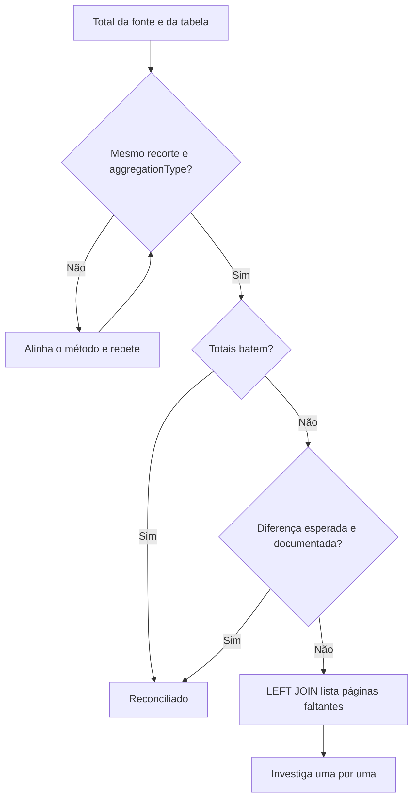

### Erros comuns

- **Testar só unicidade e não nulo.** O total sai errado e todos os testes passam. Acrescente reconciliação com a fonte.
- **Medir o frescor pela data do fato.** Fonte com atraso estrutural dispara alarme todo dia e o alarme passa a ser ignorado. Meça pela data da carga e descubra o atraso normal de cada fonte.
- **Limite fixo para volume.** Fim de semana e feriado disparam alarme falso. Compare com o mesmo dia da semana nas semanas anteriores.
- **Ignorar diferença pequena.** "É arredondamento" esconde a página que ficou de fora. Toda diferença tem explicação documentada ou vira investigação.
- **Alerta sem dono.** O aviso chega num canal que ninguém lê. Cada alerta tem uma pessoa responsável e uma ação esperada.
- **Teste que falha sempre.** O time aprende a ignorar o vermelho. Corrija o teste ou a regra até que falha volte a significar problema.

### Na prática

A lição do roteiro é curta e muito concreta. Num levantamento de Search Console, a soma dos cortes ficou abaixo do total do painel, e foi essa pequena diferença que apontou exatamente as 3 URLs que tinham ficado de fora.

O raciocínio começa por levar a diferença a sério. A tentação, diante de um número um pouco menor que o total, é atribuir ao arredondamento, à anonimização ou a "como o Google conta". Essas explicações às vezes estão certas, e é justamente por isso que elas escondem o erro real com tanta facilidade.

O caminho que funciona tem três passos. Primeiro, comparar no mesmo recorte e no mesmo tipo de agregação, para eliminar as diferenças que são do método. Segundo, se a diferença persiste, trocar a comparação de totais por uma comparação de listas, com as páginas que estão na fonte e não estão na tabela. Terceiro, olhar uma por uma as que sobraram. Foi esse segundo passo que transformou "a soma está um pouco abaixo" em três URLs com nome.

O ganho vai além daquele levantamento. A lista das páginas que ficaram de fora mostra onde está a falha no pipeline, seja um filtro, uma normalização ou uma paginação incompleta. Depois de corrigida, a mesma comparação vira um teste automático, e a próxima página perdida aparece no dia em que se perder.

### Resumo

- Teste esquema, volume, frescor e distribuição. Cada um pega um tipo diferente de falha.
- Contrato de dados é o acordo prévio entre quem produz e quem consome sobre colunas, tipos e frequência.
- Reconcilie com a fonte e trate toda diferença como algo a explicar.
- Frescor se mede pela data da carga, com `loaded_at_query` ou `loaded_at_field` e limite de 2 dias.
- Alerta de volume compara com o mesmo dia da semana nas semanas anteriores.

### Para ir além

- Vídeo "DBT Tests · Data Build Tool · Singular · Generic · Custom · Prebuild · Source Freshness", em [videos.md](videos.md). Mostra todos os tipos de teste do dbt, inclusive o frescor configurado nesta aula.
- "Source freshness", do dbt Developer Hub, em [leituras.md](leituras.md). Explica como agendar o frescor separado dos jobs de construção.
- "Elementary", em [leituras.md](leituras.md). Leia quando for montar o relatório diário de qualidade do desafio, porque ele gera esse relatório a partir dos testes do dbt.
- "What Is Data Observability? 5 Key Pillars To Know In 2026", da Monte Carlo, em [leituras.md](leituras.md). Organiza os sinais de frescor, distribuição, volume, esquema e linhagem.

## Aula 9. BI e painéis

### A ideia central

O painel é o produto final do pipeline. Tudo o que veio antes (ingestão, modelo, testes) existe para que alguém olhe um número e tome uma decisão melhor. Por isso, painel se projeta como produto. Quem usa, que pergunta responde, com que frequência e o que a pessoa faz depois de olhar.

O modelo mental certo é uma cadeia de três elos para cada gráfico. Pergunta, gráfico, ação. Se um gráfico não responde uma pergunta que alguém faz, ou se a resposta não muda nenhuma ação, ele ocupa espaço, deixa o painel mais lento e dilui a atenção dos gráficos que importam.

### Como funciona

#### Painel de TV e painel analítico

| | Painel de TV | Painel analítico |
|---|---|---|
| Para quem | Time inteiro, de passagem | Analista ou gestor sentado para investigar |
| Pergunta | Está tudo normal agora? | Por que mudou e onde? |
| Forma | Poucos números grandes, cor de alerta, atualização automática | Filtros, recortes, tabela com detalhe |
| Erro típico | Gráfico pequeno e detalhado que ninguém lê de longe | Dez números em destaque sem hierarquia |

O painel semanal de SEO costuma ser analítico, com um topo de poucos indicadores e, abaixo, os cortes que explicam a variação.

#### Métrica definida uma vez

Quando "sessões orgânicas" é calculada num gráfico com um filtro e noutro com filtro diferente, a reunião vira debate sobre qual número está certo. A solução é definir cada métrica num lugar só e fazer todos os gráficos lerem dali.

| Onde a métrica pode morar | Vantagem | Limite |
|---|---|---|
| Coluna de um mart do dbt | Versionada, testada, serve qualquer ferramenta | Recortes novos pedem novo modelo |
| Camada semântica (MetricFlow no dbt, métricas e modelos no Metabase) | Definição única com recortes livres | Prende a definição a uma ferramenta |
| Campo calculado na ferramenta de BI | Rápido de criar | Cada painel tende a criar o seu, e as definições se afastam |

Para o tamanho dos projetos desta trilha, o mart do dbt resolve. Razões como CTR e taxa de conversão são calculadas no mart a partir das somas, do jeito que a aula 3 ensinou.

#### Ferramentas

O Metabase é de código aberto, sobe com um comando Docker e conversa com dezenas de bancos, inclusive DuckDB por um driver da comunidade. O Data Studio do Google, que voltou a usar esse nome depois de anos como Looker Studio, é gratuito e se liga bem a Search Console, GA4, BigQuery e Planilhas. O Apache Superset é outra opção aberta, mais voltada a times técnicos.

#### Filtros, desempenho e permissões

Filtro bom é o que a pessoa usa para responder a pergunta seguinte. Período, seção do site, dispositivo e canal cobrem a maioria dos painéis de SEO.

Desempenho é parte da experiência. Painel que demora a carregar não é aberto. Cada gráfico é uma consulta, e um painel com muitos gráficos pesados dispara todas ao abrir. As saídas, em ordem de impacto, são ler de um mart já agregado em vez da fato diária, ativar o cache (no Metabase, na aba de desempenho do painel de administração) e dividir o painel em abas ou painéis menores. A própria documentação do Metabase sugere levar para outro painel as perguntas que só precisam ser vistas de tempos em tempos.

Permissão define quem vê o quê. Dado de receita e de CRM costuma ter público menor que dado de tráfego. Separe por coleção ou por painel desde o começo.

### Exemplo guiado

Vamos criar o mart que alimenta um painel semanal e depois montar o painel no Metabase.

1. Crie o mart no projeto dbt das aulas 7 e 8. Arquivo `dbt_seo/models/marts/mart_artigo_semanal.sql`.

```sql
-- Grão. Uma linha por semana (segunda a domingo) e artigo.
-- Cada métrica do painel é definida aqui, uma vez só.
with semanal as (
    select
        date_trunc('week', f.data)  as semana,
        a.titulo                    as artigo,
        sum(f.visualizacoes)        as visualizacoes,
        count(*)                    as dias_com_dado
    from {{ ref('fct_pageviews_diario') }} f
    join {{ ref('dim_artigo') }} a using (artigo_id)
    group by all
)
select
    semana,
    artigo,
    visualizacoes,
    dias_com_dado = 7                        as semana_completa,
    round(visualizacoes / dias_com_dado, 1)  as media_diaria,
    -- variação só entre semanas completas, para não comparar 2 dias com 7
    case when dias_com_dado = 7 and lag(dias_com_dado) over w = 7
         then round(100.0 * (visualizacoes / lag(visualizacoes) over w - 1), 1)
    end                                      as variacao_semana_pct
from semanal
window w as (partition by artigo order by semana)
```

2. Rode `dbt build --profiles-dir .` e confira o resultado no DuckDB.

```sql
SELECT * FROM mart_artigo_semanal ORDER BY artigo, semana;
```

Repare na coluna `semana_completa`. No teste desta aula, a semana de 19 de outubro tinha só dois dias carregados. Uma versão anterior do mart, sem essa proteção, mostrou queda de 51% para um dos artigos, comparando dois dias com cinco. É o mesmo tipo de virada falsa do [caso 5](../../casos/05-virada-que-nao-existia.md). O mart agora só calcula a variação entre semanas completas, e o painel deve filtrar `semana_completa` ou mostrar a semana corrente com um rótulo de parcial.

O fluxograma mostra o caminho do modelo ao painel e onde a proteção de semana completa entra.

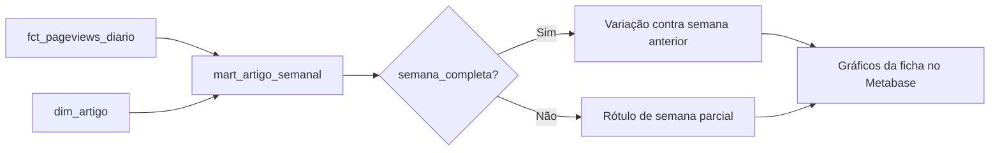

3. Suba o Metabase.

```bash
docker run -d -p 3000:3000 --name metabase metabase/metabase
```

Abra `http://localhost:3000` e crie o usuário administrador local. Para ler o arquivo `seo.duckdb`, instale o driver DuckDB da comunidade, seguindo o repositório do driver, e monte a pasta do projeto no contêiner. O DuckDB aceita um processo escrevendo por vez no mesmo arquivo, então rode o dbt fora do horário de uso do painel ou exporte o mart para Parquet. Se preferir o Data Studio, exporte o mart para uma planilha ou para o BigQuery e conecte por lá.

4. Antes de criar qualquer gráfico, escreva a ficha do painel.

| Pergunta | Gráfico | Ação de quem olha |
|---|---|---|
| A audiência da semana subiu ou caiu? | Número grande com variação contra a semana anterior | Se caiu mais de 30%, abrir o corte por artigo |
| Qual artigo puxou a variação? | Barras de variação por artigo, só semanas completas | Revisar o artigo que mais caiu |
| A queda é tendência ou ponto fora da curva? | Linha de 12 semanas por artigo | Decidir entre esperar e agir |

5. Monte só os gráficos da ficha, com filtros de período e artigo. Cada gráfico lê do `mart_artigo_semanal`, sem campo calculado na ferramenta. Pare em no máximo 6 gráficos.

### Erros comuns

- **Gráfico sem pergunta.** O painel cresce, fica lento e ninguém sabe o que olhar primeiro. Para cada gráfico, escreva a pergunta e a ação. Sem ação, corte.
- **Métrica calculada em cada gráfico.** Dois números diferentes para a mesma métrica na mesma reunião. Defina no mart ou na camada semântica e faça todos lerem dali.
- **Comparar período incompleto com período completo.** A semana corrente parece uma queda. Marque o período parcial e compare só períodos equivalentes.
- **Painel lendo a tabela diária crua.** Cada abertura recalcula meses de dado e o carregamento passa de segundos. Leia de um mart agregado e ligue o cache.
- **Parágrafo explicando o gráfico dentro do painel.** O texto envelhece na semana seguinte e esconde o gráfico. A narrativa vai para o relatório.
- **Permissão decidida depois.** Dado sensível já circulou. Separe coleções e painéis por público desde o primeiro dia.

### Na prática

A lição do roteiro veio de um pedido real. Gestor que olha painel toda semana quer gráfico e filtro. Parágrafo explicando o gráfico atrapalha. A narrativa vai para o relatório.

O raciocínio por trás é sobre frequência e função. O painel é aberto toda semana, às vezes todo dia, pela mesma pessoa. Na primeira vez, um texto explicando o gráfico ajuda. Da segunda vez em diante, a pessoa já sabe ler o gráfico e o texto vira ruído entre ela e o número. Pior, o texto descreve a semana em que foi escrito. Na semana seguinte, ele diz "alta de 12%" sobre um gráfico que agora mostra queda, e a confiança no painel inteiro cai junto.

O que funciona é dividir os papéis. O painel é dado, com títulos que dizem o que o gráfico mede, períodos rotulados e filtros para a próxima pergunta. A interpretação ("caiu por causa de X, a ação é Y") vai num relatório datado, que pode ficar velho porque tem data. Quando um diagnóstico precisa ficar fixo no painel, como a decomposição de cliques em volume e CTR do caso 1, ele entra como gráfico.

A lição vale para qualquer cliente. Antes de acrescentar um parágrafo ao painel, pergunte se ele ainda vai estar certo na semana que vem. Se não vai, o lugar dele é o relatório.

### Resumo

- Painel é produto. Cada gráfico liga uma pergunta a uma ação.
- Painel de TV responde "está normal?". Painel analítico responde "por que mudou?".
- Defina cada métrica uma vez, no mart do dbt ou numa camada semântica, e faça todos os gráficos lerem dali.
- Desempenho vem de mart agregado, cache e menos gráficos por tela.
- Painel mostra dado. Interpretação vai para o relatório com data.

### Para ir além

- Vídeo "How to create a dashboard · Getting started with Metabase", em [videos.md](videos.md). O passo a passo oficial para o exemplo guiado, com filtros.
- Vídeo "AULA Data Studio do ZERO para INICIANTES", em [videos.md](videos.md). Em português, para quem vai montar o painel no Data Studio.
- "BI dashboard best practices", do Metabase Learn, em [leituras.md](leituras.md). Ajuda a escolher métricas e layout para a ficha de perguntas.
- "Common Pitfalls in Dashboard Design", de Stephen Few, em [leituras.md](leituras.md). Os erros clássicos de painel, para revisar o seu antes de entregar o projeto da trilha.
