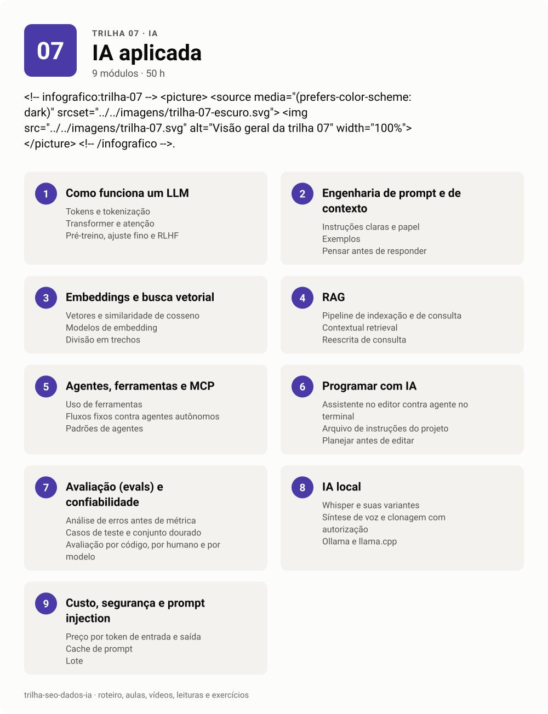

# 07 · IA aplicada

<!-- infografico:trilha-07 -->
<picture>
  <source media="(prefers-color-scheme: dark)" srcset="../../imagens/trilha-07-escuro.svg">
  
</picture>
<!-- /infografico -->

Esta trilha é sobre usar modelos de linguagem para resolver problemas reais, com engenharia. Como o modelo funciona, como dar o contexto certo, como ligar a dados e ferramentas, como medir se está funcionando e quanto custa. É também a base técnica do GEO, porque buscadores com IA são sistemas de RAG.

**Pré-requisitos.** Trilha 00 completa. Trilha 06, módulos 1 a 4, ajuda nos projetos.
**Carga estimada.** 50 h.

**Ao terminar, você consegue**
- explicar o que acontece entre o prompt e a resposta, sem misticismo;
- escrever prompts e contextos que funcionam de forma estável;
- construir um RAG com embeddings e avaliar se ele recupera o que deveria;
- criar um agente com ferramentas e um servidor MCP;
- programar com assistentes de IA sem perder o controle do código;
- montar avaliações automáticas e estimar custo antes de escalar;
- rodar transcrição, voz e modelos abertos localmente.

## Roteiro

### 1. Como funciona um LLM

Um LLM prevê o próximo token a partir dos anteriores. Treino em grande volume de texto, ajuste com instruções e preferência humana, e uma janela de contexto que é toda a memória que ele tem na conversa.

**Conceitos-chave.** Tokens e tokenização. Transformer e atenção. Pré-treino, ajuste fino e RLHF. Janela de contexto. Temperatura e amostragem. Alucinação. Corte de conhecimento.

- [ ] Assisti a uma introdução completa a LLMs e resumi em uma página
- [ ] Contei tokens de um texto em português e em inglês e comparei
- [ ] Sei explicar por que o modelo inventa referência com confiança

### 2. Engenharia de prompt e de contexto

O prompt é só uma parte. O que decide a qualidade é o contexto inteiro que o modelo vê. Instruções, exemplos, documentos, histórico, ferramentas e o formato pedido.

**Conceitos-chave.** Instruções claras e papel. Exemplos (few-shot). Pensar antes de responder. Saída estruturada (JSON). Separar dado de instrução com marcação. Engenharia de contexto. Prompt de sistema.

**Na prática.** Diga ao modelo o porquê da regra, não só a regra. "Não use travessão, porque o texto vai ser colado no WhatsApp" funciona melhor que "não use travessão". E mantenha um arquivo de instruções do projeto que o assistente lê toda vez, com as decisões já tomadas.

- [ ] Fiz o tutorial interativo de prompt engineering da Anthropic
- [ ] Transformei um prompt instável em um com exemplos e saída em JSON
- [ ] Escrevi um arquivo de instruções de projeto para um assistente de código

### 3. Embeddings e busca vetorial

Embedding transforma texto em um vetor de números, e textos parecidos ficam perto. É a base de busca semântica, recomendação, agrupamento e RAG.

**Conceitos-chave.** Vetores e similaridade de cosseno. Modelos de embedding. Divisão em trechos (chunking). Bancos vetoriais e índices aproximados. Busca híbrida (palavra-chave e vetor). Reranking.

- [ ] Gerei embeddings de 500 títulos de páginas e agrupei por tema
- [ ] Comparei busca por palavra-chave e busca vetorial na mesma base
- [ ] Testei 3 tamanhos de trecho e vi o efeito na recuperação

### 4. RAG (geração aumentada por recuperação)

RAG é dar ao modelo os documentos certos na hora da pergunta. Quase todo problema de RAG é problema de recuperação, não de geração.

**Conceitos-chave.** Pipeline de indexação e de consulta. Contextual retrieval. Reescrita de consulta. Citação de fonte. Avaliação de recuperação (recall, precisão) e de resposta (fidelidade). Quando RAG não é a solução.

**Na prática.** É a mesma engenharia que decide se a sua página vira citação num buscador generativo. Construir um RAG pequeno é o jeito mais rápido de entender GEO por dentro.

- [ ] Construí um RAG sobre a documentação de um produto
- [ ] Medi o recall da recuperação com 20 perguntas de teste
- [ ] A resposta cita o trecho de origem e eu conferi 10 citações

### 5. Agentes, ferramentas e MCP

Agente é um modelo que decide quais ferramentas chamar, em laço, até cumprir a tarefa. O MCP (Model Context Protocol) é um padrão aberto para ligar modelos a ferramentas e dados.

**Conceitos-chave.** Uso de ferramentas (tool use). Fluxos fixos contra agentes autônomos. Padrões de agentes (encadeamento, roteamento, paralelização, orquestrador e trabalhadores). MCP, servidores, clientes, ferramentas e recursos. Permissões e confirmação humana.

**Na prática.** Comece pelo fluxo fixo mais simples que resolve. Agente autônomo só quando o caminho realmente não é previsível. E dê ao agente o menor poder possível. Leitura livre, escrita com confirmação.

- [ ] Criei um agente com 2 ferramentas usando a API de um modelo
- [ ] Escrevi um servidor MCP que expõe uma consulta ao meu banco de dados
- [ ] Liguei o servidor MCP a um cliente e usei numa conversa

### 6. Programar com IA

Assistentes de código como o Claude Code leem o projeto, rodam comandos e editam arquivos. Rendem muito quando o humano define o objetivo, revisa e testa.

**Conceitos-chave.** Assistente no editor contra agente no terminal. Arquivo de instruções do projeto. Planejar antes de editar. Testes como critério de pronto. Revisão de diff. Subagentes e trabalho em paralelo. Permissões.

**Na prática.** Este próprio repositório foi montado com um agente de código. A curadoria rodou em seis subagentes em paralelo, cada um com regras de verificação de link. O humano decidiu a estrutura, aprovou antes de construir e revisou o resultado.

- [ ] Usei um agente de código para criar um script com testes
- [ ] Escrevi um arquivo de instruções com regras do projeto e vi o efeito
- [ ] Revisei um diff gerado por IA e achei pelo menos um problema

### 7. Avaliação (evals) e confiabilidade

Sem avaliação, melhoria de prompt é sensação. Eval é um conjunto de casos com critério de acerto que roda a cada mudança.

**Conceitos-chave.** Análise de erros antes de métrica. Casos de teste e conjunto dourado. Avaliação por código, por humano e por modelo (LLM como juiz). Regressão. Variância entre execuções.

- [ ] Escrevi 30 casos de teste para uma tarefa de classificação
- [ ] Comparei 2 prompts com o mesmo conjunto e medi a diferença
- [ ] Usei um modelo como juiz e conferi o juiz contra a minha própria avaliação

### 8. IA local (Whisper, TTS, Ollama, modelos abertos)

Muita coisa roda no próprio computador, sem custo por uso e sem mandar dado para fora. Transcrição, voz sintética e modelos abertos de bom tamanho.

**Conceitos-chave.** Whisper e suas variantes. Síntese de voz (TTS) e clonagem com autorização. Ollama e llama.cpp. Quantização. Modelos abertos e licenças. Limites de memória.

**Na prática.** Um gerador de vídeos documentais feito localmente usa TTS para a narração e Whisper para conferir a voz. Como não dá para ouvir tudo, o pipeline transcreve o áudio gerado e compara com o roteiro. Voz é sempre sintética ou com autorização, nunca clone de pessoa real sem consentimento.

- [ ] Transcrevi 10 minutos de áudio com Whisper local
- [ ] Rodei um modelo aberto com Ollama e comparei com um modelo de API
- [ ] Gerei uma narração com TTS local e conferi o texto com Whisper

### 9. Custo, segurança e prompt injection

Em produção, o que derruba projeto de IA é custo inesperado e segurança. Prompt injection é o problema mais sério, porque o modelo não separa bem dado de instrução.

**Conceitos-chave.** Preço por token de entrada e saída. Cache de prompt. Lote (batch). Escolha de modelo por tarefa. Prompt injection direta e indireta. OWASP Top 10 para aplicações com LLM. Vazamento de dados. Menor privilégio.

- [ ] Estimei o custo mensal de uma aplicação antes de construir
- [ ] Reduzi o custo de uma tarefa com cache ou com um modelo menor
- [ ] Testei uma injeção indireta (instrução escondida numa página) contra um agente meu

## Material

- [Aulas](aulas.md)
- [Vídeos](videos.md)
- [Leituras](leituras.md)
- [Exercícios e projeto da trilha](exercicios.md)

**Próxima trilha.** [04 GEO e busca generativa](../04-geo-busca-generativa).
