# Aulas · 08 · Ofício do consultor

Texto de apoio de cada módulo. Leia depois dos vídeos e antes dos exercícios. Onde houver comando ou código, rode no seu computador.

## Sumário

1. [Auditoria com método](#aula-1-auditoria-com-método)
2. [Priorização](#aula-2-priorização)
3. [Relatórios e visualização de dados para gestor](#aula-3-relatórios-e-visualização-de-dados-para-gestor)
4. [Storytelling com dados e apresentações](#aula-4-storytelling-com-dados-e-apresentações)
5. [Trabalhar com desenvolvedores e stakeholders](#aula-5-trabalhar-com-desenvolvedores-e-stakeholders)
6. [Consultoria independente](#aula-6-consultoria-independente)

Os exemplos em Python usam `requests`, `beautifulsoup4` e `pandas`. Se você fez a trilha 00, o ambiente virtual de lá serve.

## Aula 1. Auditoria com método

### A ideia central

Auditoria é investigação. Cada achado começa como hipótese e só vira afirmação depois de um teste que qualquer pessoa consegue repetir. O relatório que afirma um erro inexistente perde mais que aquele item. O cliente passa a desconfiar de todos os outros, inclusive dos certos, e a recomendação mais importante do documento vai para o fim da fila.

O modelo mental certo separa três coisas que costumam vir misturadas. O sinal é o que levantou a suspeita (um alerta de ferramenta, um número estranho, um padrão no HTML). O teste é a verificação direta do estado do site. A evidência é o resultado do teste, com a origem marcada. Um sinal nunca entra no relatório como evidência. No máximo entra como "verificação recomendada".

### Como funciona

#### Hipótese, teste e evidência

Pegue a suspeita "as páginas de categoria estão sem canonical". Ela é uma hipótese. O teste é pedir um conjunto de URLs de categoria, ler o HTML com parser e listar os `link rel=canonical` de cada uma, junto com o status. A evidência é a tabela que sai desse teste, com a data, o comando e a amostra usada. Se 40 de 40 páginas não têm canonical, o achado é confirmado. Se o teste cobriu 40 de 3 mil, o achado é parcial e diz isso.

Um bom teste tem três propriedades. Ele olha o estado do site diretamente (a resposta do servidor, o log, o dado do próprio Google). Ele pode dar errado, isto é, existe um resultado que derrubaria a hipótese. E ele é reproduzível, com o comando escrito no relatório para o cliente ou o desenvolvedor repetir.

O fluxograma mostra o caminho de uma suspeita até o rótulo que ela recebe no relatório.

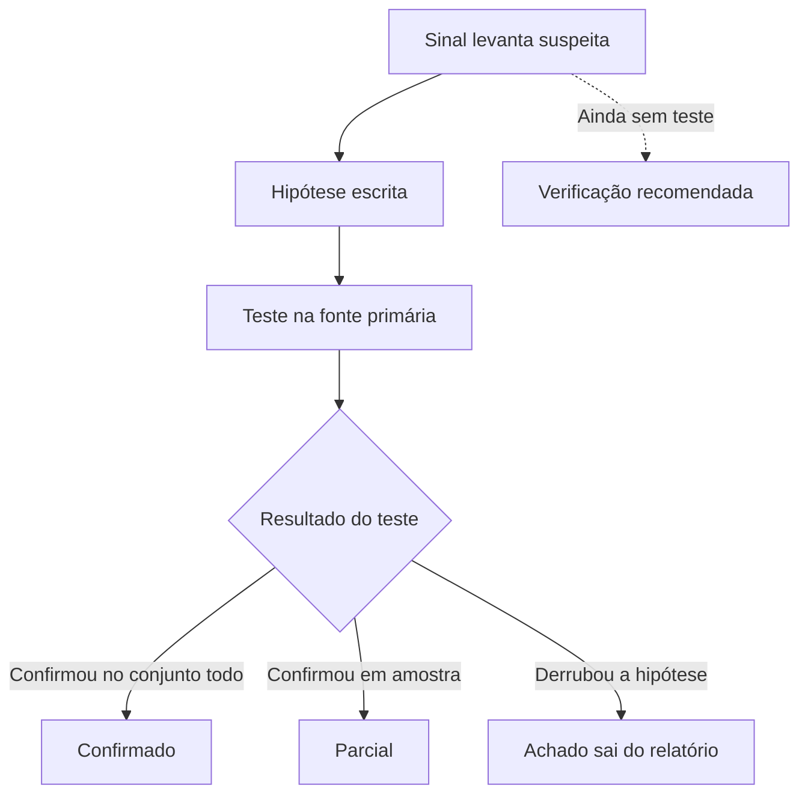

#### Fonte primária contra ferramenta

Nem toda fonte prova a mesma coisa. Antes de escrever um achado, pergunte de onde veio o número e o que aquela fonte consegue provar.

| Origem da evidência | O que prova | O que não prova |
|---|---|---|
| Resposta do servidor (`curl`, HTML lido com parser) | O estado daquela URL, naquele momento, para aquele cliente | Como o robô real foi tratado. Robô e você podem receber respostas diferentes |
| Log do servidor | O que cada robô pediu e o que recebeu | O que acontece depois da indexação |
| Search Console | Como o Google vê o site (indexação, cliques, impressões) | O estado atual. Os dados chegam com atraso e a interface mostra no máximo 1.000 linhas |
| Crawl próprio | O que o seu crawler encontrou seguindo links, dentro dos limites que você configurou | O que existe fora do alcance do crawl |
| Ferramenta de terceiros (Semrush, Ahrefs e afins) | Uma estimativa feita com o modelo da ferramenta | Tráfego, posição ou contagem real do site |
| Declaração do próprio site (home, meta description, institucional) | O que o site diz de si | Que o número é verdadeiro |

As três primeiras linhas são fontes primárias para perguntas diferentes. As três últimas servem como sinal. Elas apontam onde testar.

#### Os quatro padrões de erro

O caso que fecha esta aula mostra nove afirmações erradas num backlog de 32, todas com a mesma raiz. O estado do site foi inferido a partir de sinal indireto, sem teste. Essa raiz aparece em quatro formas, e vale aprender a reconhecer cada uma.

**1. Grep em vez de parser.** O `grep` acha sequências de caracteres. HTML tem comentário, script, ordem variável de atributos e aspas simples ou duplas. Uma busca por `application/ld+json` acha a string dentro de um JavaScript e conta um bloco de dados estruturados que não existe. Uma busca por `rel="canonical"` não acha `<link href="..." rel='canonical'>` e conta uma ausência que não existe. O erro vai nas duas direções. O teste certo é ler o HTML com BeautifulSoup ou lxml, que montam a árvore como o buscador monta, e contar elementos dessa árvore. Use o `grep` para triagem e o parser para afirmar.

**2. Ausência no relatório tratada como ausência no site.** A ferramenta de crawl não listou uma página. Isso pode significar que a página não existe, ou que o crawl parou no limite de URLs, ou que a página só é alcançada por um link em JavaScript, ou que o robots.txt bloqueou o crawler, ou que a profundidade configurada não chegou lá. O relatório da ferramenta descreve o que ela encontrou. O teste certo é pedir a URL diretamente com `curl -sI` e ler o HTML. Se ela responde 200 com título próprio, ela existe, e o achado vira outro ("página sem link interno rastreável", talvez).

**3. Estimativa apresentada como fato.** Um número de itens do catálogo escrito sem contagem, um tráfego tirado de ferramenta de terceiros, uma quantidade calculada por amostra e extrapolada. Estimativa tem lugar no relatório, desde que venha dita como estimativa, com o método e a faixa. O teste certo, quando existe, é contar (pelo sitemap mais o Search Console, pelo crawl completo, pelo banco do cliente). Quando não dá para contar, o texto diz "estimativa de X a Y, calculada por tal método".

**4. Número que o site declara usado como contagem.** "Mais de 10 mil produtos" na meta description, "50 mil alunos" no institucional. É o que o site diz de si, escrito por alguém de marketing, talvez anos atrás. O teste certo é contar com uma fonte independente. Se você precisar citar o número declarado, cite como declaração ("o site afirma ter mais de 10 mil produtos").

Há um quinto padrão que costuma vir junto. **Um sinal isolado no lugar de dois juntos.** Uma página de erro também tem título e, às vezes, canonical. Conferir só o título faz uma rota que responde 404 parecer uma página válida. Status e meta robots se olham sempre juntos.

#### Rotular a evidência

Todo achado leva duas marcas. A primeira é a origem da evidência, uma das linhas da tabela acima. A segunda é o rótulo de verificação.

| Rótulo | Quando usar | Como aparece no relatório |
|---|---|---|
| Confirmado | Testado na fonte primária, com o teste reproduzível | Como fato, com o comando ou a consulta |
| Parcial | Testado numa amostra, ou com uma ressalva conhecida | Como fato sobre a amostra, com o tamanho dela e a ressalva |
| Verificação recomendada | Só existe sinal indireto, ainda sem teste | Numa seção própria, como pergunta a responder, nunca como fato |

A regra que protege o relatório é simples de dizer e difícil de cumprir. Nada com rótulo "verificação recomendada" aparece como fato no resumo executivo, no deck ou na conversa com o cliente.

#### O formato de um achado

```text
Achado            Rota /busca/{termo} responde 200 indexável para qualquer texto.
Hipótese          A rota aceita slug arbitrário e gera um espaço infinito de URLs.
Teste             GET em /busca/teste-auditoria-3f9a1c2e (slug inventado), lendo
                  status, x-robots-tag, meta robots e canonical com parser.
Evidência         200, sem noindex, canonical para a própria URL. Crawl próprio, 22/10/2026.
Rótulo            Confirmado
Solução proposta  Responder 404 para termo sem resultado, ou noindex em toda a rota
                  de busca interna. Exemplo de regra e teste de aceite em anexo.
Como reproduzir   python testar_rota.py "https://site/busca/{slug}"
```

A solução proposta faz parte do achado. Apontar o problema sem dizer como deveria ser deixa o trabalho pela metade para quem vai implementar.

### Exemplo guiado

Vamos testar uma rota com parâmetro usando slug inventado, o teste que achou o problema mais grave do caso desta aula. Salve como `testar_rota.py`.

```python
import secrets
import sys

import requests
from bs4 import BeautifulSoup

UA = "auditoria-estudo/1.0 (+mailto:voce@exemplo.com)"


def ler(url):
    r = requests.get(url, headers={"User-Agent": UA}, timeout=20)
    sopa = BeautifulSoup(r.text, "html.parser")
    robots = sopa.find("meta", attrs={"name": "robots"})
    return {
        "status": r.status_code,
        "x_robots_tag": r.headers.get("x-robots-tag"),
        "meta_robots": robots.get("content") if robots else None,
        "canonical": [l.get("href") for l in sopa.find_all("link", rel="canonical")],
        "title": sopa.title.get_text(strip=True) if sopa.title else None,
    }


modelo = sys.argv[1]                      # ex.: https://site.com/busca/{slug}
slug = "teste-auditoria-" + secrets.token_hex(4)
url = modelo.format(slug=slug)
dados = ler(url)

print("URL testada  ", url)
for campo, valor in dados.items():
    print(f"{campo:<13}", valor)

diretivas = f"{dados['x_robots_tag'] or ''} {dados['meta_robots'] or ''}".lower()
if dados["status"] == 200 and "noindex" not in diretivas:
    print("ALERTA  slug inventado responde 200 indexável. Possível espaço infinito de URLs.")
else:
    print("OK  a rota não aceita qualquer texto como página indexável.")
```

1. Rode numa rota pública que você conhece.

```bash
python testar_rota.py "https://pt.wikipedia.org/wiki/{slug}"
```

2. Leia a saída inteira. Numa execução de outubro de 2026, a resposta foi 404, com `noindex` na meta robots, um title completo e um canonical apontando para a própria URL inventada. Se você olhasse só o title, ou só o canonical, concluiria que a página existe. O status e a meta robots, lidos juntos, dizem o contrário. É o quinto padrão, reproduzido em um comando.
3. Rode no seu site, em cada rota que recebe parâmetro (busca, filtro, tag, paginação, perfil). Espere alguns segundos entre uma execução e outra.
4. Para cada rota, registre o achado no formato da seção anterior, com origem "crawl próprio" e o rótulo certo. Se testou uma rota de cada tipo e o site tem dezenas, o rótulo é parcial.
5. Abra uma auditoria antiga sua e passe cada achado por quatro perguntas. Veio de grep? Veio de ausência numa ferramenta? É estimativa? É número declarado pelo site? Cada "sim" vira um teste a fazer antes de manter o achado.

O fluxograma mostra as quatro perguntas aplicadas a cada achado antigo.

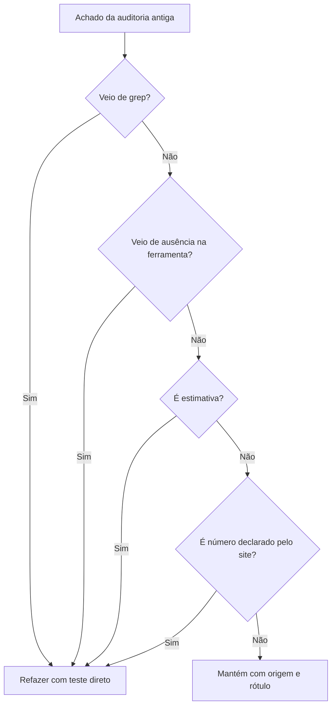

### Erros comuns

- **Copiar o alerta da ferramenta como achado.** O relatório repete falsos positivos e o cliente descobre na primeira conferência. Trate o alerta como sinal e teste a URL.
- **Afirmar sobre "o site todo" a partir de uma fonte só.** O sitemap, o crawl e o Search Console enxergam pedaços diferentes. Cruze pelo menos duas fontes independentes antes de falar do todo.
- **Esconder a amostra.** "Páginas de produto sem dados estruturados" lido pelo cliente vira "todas". Escreva "38 de 40 páginas testadas" e diga como a amostra foi escolhida.
- **Achado sem solução.** O desenvolvedor recebe "canonical errado" e precisa adivinhar o certo. Traga como deveria ser, com exemplo de código ou de configuração.
- **Teste que não pode falhar.** Procurar só a evidência que confirma a suspeita. Desenhe o teste pensando no resultado que derrubaria a hipótese.
- **Revisar só os itens duvidosos.** O erro mais grave costuma estar no que ninguém questionou. Na revisão, refaça o teste de todos os itens.

### Na prática

Uma auditoria de SEO foi entregue como backlog de 32 itens. Na revisão, surgiu a dúvida de que alguns itens não batiam com a realidade. A primeira hipótese foi a confortável, um ou dois erros de digitação ou de cópia.

O teste escolhido foi reverificar cada item do zero, testando a rota diretamente, sem aproveitar a evidência original. Nove itens estavam errados, todos pela mesma causa de fundo, e cada um caía num dos quatro padrões. Uma busca por texto tinha encontrado dados estruturados que eram uma string dentro de um JavaScript, e com parser a contagem era zero. Páginas que a ferramenta de SEO não mostrava respondiam 200 com título próprio. Um número de itens do catálogo tinha sido escrito sem contagem. Uma quantidade tinha vindo da meta description do site. No caminho apareceu o quinto ponto. Rotas que davam 404 tinham sido descritas como canonizadas, porque só o título foi testado.

O que vale estudar é o padrão por trás dos nove. Nenhum erro foi de digitação. Em todos, alguém olhou um sinal e escreveu um estado. Corrigir item por item não resolveria a próxima auditoria. O que mudou foi o processo. Cada item do backlog passou a ter a origem da evidência marcada (crawl próprio, ferramenta, Search Console) e um status (confirmado, parcial, verificação recomendada).

E a revisão completa achou o problema mais grave, que não estava em nenhuma versão anterior. Uma rota parametrizada devolvia 200 indexável para qualquer texto na URL, um espaço de URLs infinito. Ele só apareceu porque a revisão testou com slug inventado em vez de confiar nas URLs que a ferramenta tinha listado. As regras que ficaram são testar antes de afirmar, marcar a origem de cada evidência, olhar status e meta robots sempre juntos e usar slug inventado em toda rota com parâmetro.

### Resumo

- Achado é hipótese até ser testado na fonte primária, com teste reproduzível escrito no relatório.
- Os quatro padrões de erro são grep no lugar de parser, ausência na ferramenta lida como ausência no site, estimativa como fato e número declarado como contagem. O quinto é usar um sinal isolado no lugar de status e meta robots juntos.
- Todo achado leva origem da evidência e rótulo (confirmado, parcial, verificação recomendada).
- "Verificação recomendada" nunca aparece como fato no resumo ou no deck.
- Junto de cada problema vai a solução, dizendo como deveria ser.

### Para ir além

- [Effective Troubleshooting](leituras.md), do Google SRE Book, em leituras.md. O ciclo de observar, levantar hipótese e testar, escrito por quem depura sistemas grandes. É a base teórica desta aula.
- [Depurar quedas de tráfego na Pesquisa Google](leituras.md), em leituras.md. Mostra como confirmar cada causa possível com dado antes de concluir.
- [SEO troubleshooting with Browser Devtools](videos.md), do Google Search Central, em videos.md. Ensina a coletar a evidência no navegador em vez de confiar só na ferramenta de crawl.

## Aula 2. Priorização

### A ideia central

Uma auditoria séria encontra mais problemas do que o time consegue resolver num trimestre. Priorizar é escolher o que mexe no resultado com o menor esforço e o menor risco, e dizer com clareza o que fica para depois. Uma lista de 40 itens sem ordem transfere essa escolha para o cliente, que vai começar pelo mais fácil ou pelo que a diretoria mencionou.

O modelo mental é de custo de oportunidade. Cada sprint do desenvolvimento gasto num item de baixo impacto é um sprint a menos no item que destrava o resto. A nota de priorização é um instrumento para discutir essa troca com o cliente. O julgamento continua sendo seu. A nota só obriga a escrever as premissas.

### Como funciona

#### Matriz de impacto e esforço

O ponto de partida é uma matriz de dois eixos. Alto impacto e baixo esforço são as vitórias rápidas (quick wins). Alto impacto e alto esforço são os projetos estruturais, que entram no roadmap com prazo. Baixo impacto e baixo esforço entram quando sobrar capacidade. Baixo impacto e alto esforço saem da lista, com o motivo escrito.

A matriz mostra os quatro quadrantes com exemplos genéricos de item de backlog.

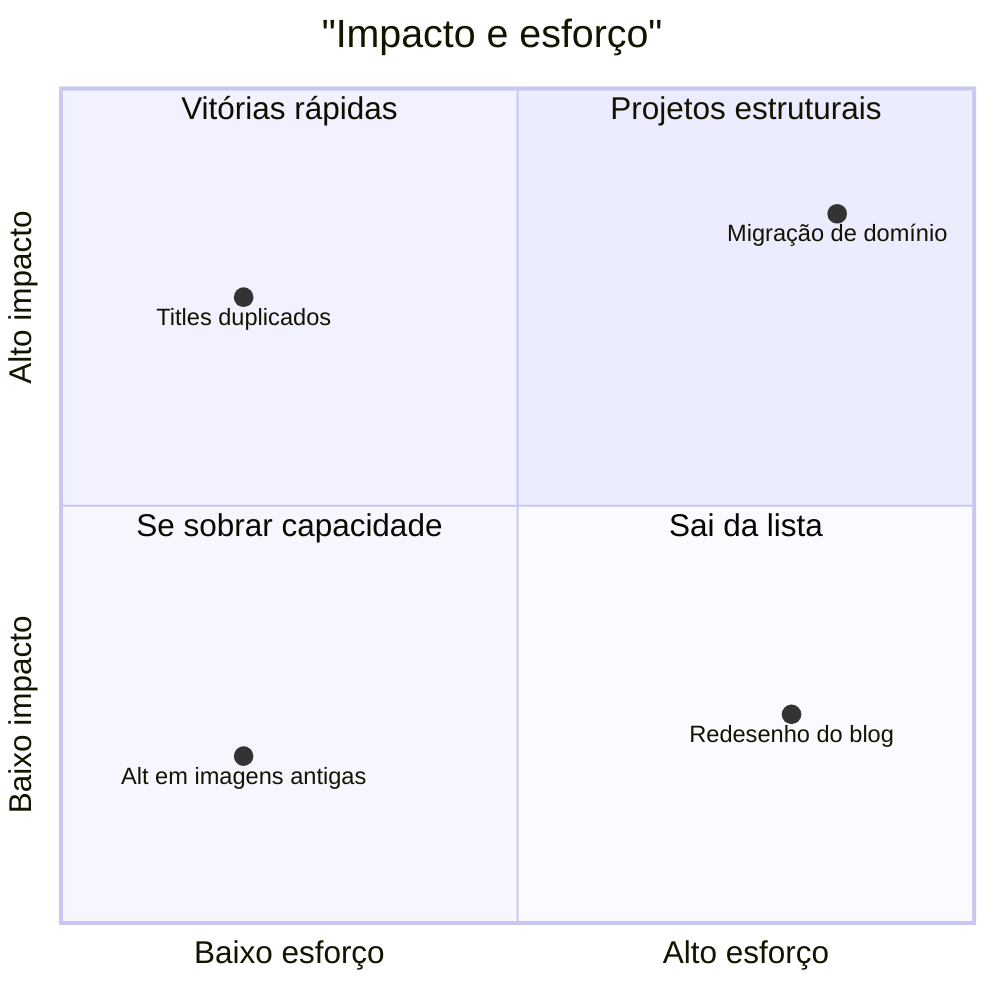

#### ICE

ICE dá três notas de 1 a 10 a cada item. Impacto (quanto mexe na métrica-alvo), confiança (quanto você confia na estimativa de impacto) e facilidade (o inverso do esforço). Há quem multiplique as três notas e quem tire a média. As duas versões existem. Use a mesma em todo o backlog.

A confiança é a nota que mais se infla. Ela deveria refletir o rótulo de verificação da aula 1. Um achado confirmado com dado de impacto pode ter confiança 8 ou 9. Um achado com "verificação recomendada" não passa de 3 ou 4.

#### RICE

O RICE, publicado pela Intercom, acrescenta o alcance. A conta é alcance vezes impacto vezes confiança, dividido pelo esforço. No texto original, alcance é o número de pessoas ou eventos afetados num período (por exemplo, por trimestre). Impacto usa uma escala fixa (3 massivo, 2 alto, 1 médio, 0,5 baixo, 0,25 mínimo). Confiança vai em percentual (100%, 80%, 50%). Esforço é medido em pessoa-mês.

Em SEO, o alcance costuma ser as impressões ou as URLs afetadas por trimestre. É aí que o RICE muda a ordem. Um ajuste pequeno que vale para 40 mil URLs pode passar à frente de uma melhoria grande que vale para 150.

#### Dependências e as duas colunas

Um quick win que depende de uma tarefa estrutural deixou de ser quick win. Ele herda o prazo da dependência. Marque dependências explicitamente, numa coluna "depende de", e ordene respeitando-as.

Separe também o backlog em duas colunas. "SEO com governança" reúne o que o time de SEO ou de conteúdo faz sozinho, com o acesso que já tem (títulos, links internos, redirecionamentos no painel do CMS). "Precisa de dev" reúne o que entra na fila do desenvolvimento (templates, regras de servidor, renderização). As duas filas andam em paralelo, e a primeira mostra resultado enquanto a segunda espera sprint.

O fluxograma mostra as duas filas andando em paralelo e uma dependência dentro da fila de dev.

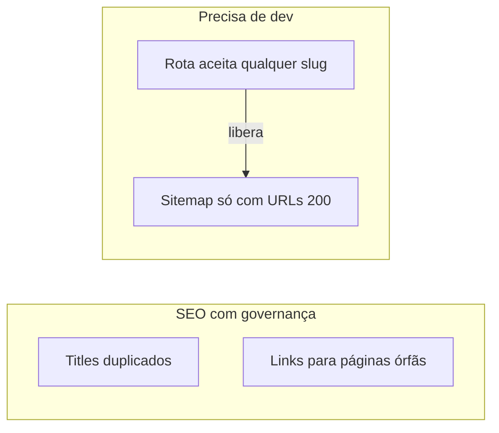

#### Roadmap por trimestre

Transforme a ordem em calendário. Um trimestre comporta poucos projetos estruturais. Três é um teto razoável para um time de desenvolvimento que tem outras prioridades. Escreva o que fica para o trimestre seguinte e por quê.

### Exemplo guiado

Vamos pontuar um backlog fictício com ICE e RICE e ver onde a ordem muda. Crie `backlog.csv`. Os números são inventados para o exercício.

```text
item,frente,impacto,confianca,facilidade,alcance,impacto_rice,confianca_rice,esforco_meses,depende_de
Rota com parâmetro aceita qualquer slug,dev,9,9,6,40000,3,1.0,1,
Titles duplicados nas categorias,seo,6,7,9,800,1,0.8,0.5,
Cadeias de 3 saltos após migração,dev,5,9,7,3000,0.5,1.0,0.5,
Dados estruturados nos artigos,dev,6,5,5,1200,1,0.5,2,
Links internos para páginas órfãs,seo,7,6,8,150,2,0.8,0.5,
Sitemap só com URLs 200 canônicas,dev,4,8,8,40000,0.5,0.8,0.5,Rota com parâmetro aceita qualquer slug
```

Salve como `priorizar.py`.

```python
import pandas as pd

b = pd.read_csv("backlog.csv").fillna({"depende_de": ""})
b["ice"] = b["impacto"] * b["confianca"] * b["facilidade"]
b["rice"] = b["alcance"] * b["impacto_rice"] * b["confianca_rice"] / b["esforco_meses"]
b["pos_ice"] = b["ice"].rank(ascending=False, method="min").astype(int)
b["pos_rice"] = b["rice"].rank(ascending=False, method="min").astype(int)

cols = ["item", "frente", "ice", "pos_ice", "rice", "pos_rice", "depende_de"]
print(b.sort_values("ice", ascending=False)[cols].to_string(index=False))
```

```bash
python priorizar.py
```

Leia o resultado em três passos.

1. Pelo ICE, o sitemap fica em 5º lugar. Pelo RICE, sobe para 2º, porque afeta 40 mil URLs. O alcance mudou a ordem.
2. O sitemap depende da correção da rota. Mesmo em 2º no RICE, ele só pode entrar depois do 1º. A coluna de dependência impede um quick win falso.
3. Os dois itens de "seo" (titles e links internos) não disputam a fila do desenvolvimento. Eles começam já, em paralelo.

Agora escreva a justificativa dos cinco primeiros, uma frase cada, com o número que sustenta o impacto. Se você não consegue escrever o número, a nota de impacto estava chutada.

### Erros comuns

- **Ordenar pela facilidade sem admitir.** O backlog vira uma lista de quick wins e os projetos estruturais nunca começam. Garanta pelo menos um item estrutural por trimestre.
- **Confiança inflada.** Itens sem teste recebem 8 de confiança e sobem na fila. Amarre a confiança ao rótulo de verificação da auditoria.
- **Ignorar dependências.** O time faz o item 4 antes do 1 e precisa refazer. Marque "depende de" e ordene respeitando.
- **Nota sem número por trás.** "Impacto 9" sem dizer em quantas URLs, impressões ou receita. A nota vira opinião. Escreva o dado que sustenta cada nota alta.
- **Misturar filas.** Um item de conteúdo espera sprint de desenvolvimento sem necessidade. Separe "SEO com governança" de "precisa de dev".
- **Não escrever o que fica de fora.** O cliente cobra depois o que nunca foi prometido. A lista do que fica para depois, com o motivo, é parte da priorização.

### Na prática

O README deste módulo não traz caso, então vale olhar um da pasta casos/. O relatório de Core Web Vitals do Search Console de um site de educação mostrava centenas de URLs ruins ou precisando de melhoria, no celular e no desktop. A primeira hipótese levava a um backlog enorme. O site inteiro seria lento e precisaria de uma otimização ampla de imagens, scripts, cache e tema.

Antes de priorizar, a equipe abriu cada grupo de URLs ruins e olhou quais templates e domínios estavam nele. Os dois grupos ruins tinham causa única cada um. No celular, todas as URLs ruins eram de um subdomínio de API lento. No desktop, todas eram a home, por um único elemento que mudava de lugar durante o carregamento. Os grupos "precisa de melhoria" se concentravam em poucos templates.

A priorização saiu desse diagnóstico. Uma primeira fase reuniu mudanças de configuração, com backup de tudo, que resolviam as duas causas únicas com pouco esforço. Em laboratório, a nota da home mais que dobrou. A segunda fase atacou o que sobrou por ordem de retorno. A lição para priorizar é que o impacto de um item depende de quantas URLs ele resolve. Duas correções certeiras valem mais que cem espalhadas, e só um diagnóstico por grupo mostra quais são.

### Resumo

- Priorizar é escolher pelo impacto, pelo esforço e pelo risco, e escrever o que fica para depois.
- ICE usa impacto, confiança e facilidade. RICE acrescenta o alcance e divide pelo esforço.
- A confiança segue o rótulo de verificação da auditoria.
- Dependências e as duas filas (SEO com governança, precisa de dev) mudam a ordem real de execução.
- Diagnóstico por grupo antes de priorizar evita backlog de cem itens para duas causas.

### Para ir além

- O artigo original do RICE, de Sean McBride na Intercom ([Simple prioritization for product managers](leituras.md)), em leituras.md. O texto original, com as escalas e exemplos de cálculo usados nesta aula.
- [ICE Framework](leituras.md), da Growth Method, em leituras.md. Ajuda a dar nota sem virar chute.
- [What is the RICE Scoring Model?](videos.md), da ProductPlan, em videos.md. Mostra por que o alcance importa quando as páginas afetadas variam muito de volume.

## Aula 3. Relatórios e visualização de dados para gestor

### A ideia central

O gestor tem cinco minutos e vai decidir alguma coisa com o que ler. O relatório responde três perguntas, nesta ordem. O que aconteceu, por que aconteceu e o que fazer. Quem começa pela metodologia perde o leitor antes da conclusão.

O modelo mental separa dois produtos. O relatório pontual conta uma história e tem narrativa, conclusão e recomendação. O painel recorrente mostra dado e filtro, sem comentário, e serve para o gestor olhar sozinho toda semana. Misturar os dois gera painel cheio de texto que envelhece e relatório sem conclusão.

### Como funciona

#### A pirâmide

A estrutura em pirâmide, associada a Barbara Minto, põe a conclusão no topo. Os argumentos que sustentam a conclusão vêm logo abaixo, e os dados que sustentam cada argumento vêm depois. Na prática, o primeiro parágrafo de um relatório já diz a resposta. Um exemplo com números fictícios. "Os cliques orgânicos de setembro caíram 8% contra agosto, comparando dias da semana equivalentes. A queda veio do CTR, com impressões e posição estáveis. Recomendamos revisar títulos e descrições das páginas de compra." O resto do documento sustenta essas três frases.

O fluxograma mostra a pirâmide do exemplo, com a conclusão no topo.

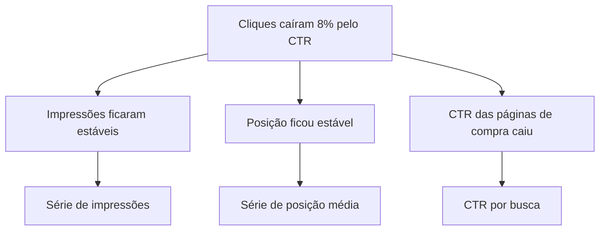

#### Um gráfico, uma mensagem

Cada gráfico existe para dizer uma coisa, e o título do gráfico é essa coisa escrita como frase. "Cliques caíram por CTR, impressões ficaram estáveis" informa mais que "Cliques e impressões, set/2026". A cor destaca só o que importa (a série da mensagem em cor, o resto em cinza). O período está no título ou no subtítulo, sempre.

| Pergunta | Gráfico que responde |
|---|---|
| Como mudou no tempo? | Linha |
| Quem é maior? | Barras horizontais, ordenadas |
| Qual a composição? | Barras empilhadas, ou barras lado a lado se forem poucas partes |
| Como duas medidas se relacionam? | Dispersão |
| Qual o valor exato? | Tabela, ou o número grande com o período |

#### Comparação justa

Séries de busca e de leads têm sazonalidade semanal forte. Dia útil e fim de semana podem diferir em duas ou três vezes. Por isso comparar o dia 3 de um mês com o dia 3 do mês anterior engana, porque um pode ser terça e o outro domingo. A comparação justa pareia pelo dia da semana (a primeira terça com a primeira terça). Os dias sem par nas pontas aparecem sinalizados, e os feriados da janela entram como nota.

#### Período rotulado

Cada fonte tem o seu período e o seu atraso. O Search Console publica a série diária até cerca de dois dias antes de hoje. O GA4 costuma estar configurado em mês corrente. O CRM pode fechar no dia anterior. Num mesmo painel, os números não somam, e o gestor percebe. A saída é rotular o período no título de cada bloco ("Search Console, 7 dias até 20/10" e "GA4, outubro até 21/10").

#### Painel recorrente

O painel recorrente é dado e filtro. Sem parágrafo de análise, porque a análise de hoje está errada na semana que vem. O que entra fixo no painel é o diagnóstico que se repete, como uma decomposição de causa logo abaixo da métrica principal. A ferramenta mais comum para isso, com o Search Console, é o Data Studio (o antigo Looker Studio, que voltou a se chamar Data Studio na documentação do Google).

### Exemplo guiado

Vamos comparar dois meses do Search Console do seu site pelas duas formas, por data e por dia da semana.

1. No Search Console, abra Desempenho, escolha os últimos três meses e exporte em CSV. O pacote traz um arquivo com a série diária (na interface em português, costuma vir como `Datas.csv`). As duas primeiras colunas são a data e os cliques.
2. Salve o script como `comparar_meses.py`.

```python
import sys

import pandas as pd

arquivo, mes = sys.argv[1], pd.Period(sys.argv[2])   # ex.: Datas.csv 2026-09

serie = pd.read_csv(arquivo).iloc[:, :2]
serie.columns = ["data", "cliques"]
serie["data"] = pd.to_datetime(serie["data"])


def do_mes(periodo):
    m = serie[serie["data"].dt.to_period("M") == periodo].copy()
    m["dia"] = m["data"].dt.day
    m["dia_semana"] = m["data"].dt.day_of_week
    m["ocorrencia"] = (m["dia"] - 1) // 7 + 1      # 1ª, 2ª... terça do mês
    return m


atual, anterior = do_mes(mes), do_mes(mes - 1)

por_data = atual.merge(anterior[["dia", "data", "cliques"]], on="dia",
                       how="left", suffixes=("", "_ant_data"))
pareado = por_data.merge(anterior[["dia_semana", "ocorrencia", "data", "cliques"]],
                         on=["dia_semana", "ocorrencia"], how="left",
                         suffixes=("", "_ant_semana"))

pareado["var_por_data"] = pareado["cliques"] / pareado["cliques_ant_data"] - 1
pareado["var_por_semana"] = pareado["cliques"] / pareado["cliques_ant_semana"] - 1
pareado["sem_par"] = pareado["cliques_ant_semana"].isna()

saida = pareado[["data", "cliques", "data_ant_data", "var_por_data",
                 "data_ant_semana", "var_por_semana", "sem_par"]]
print(saida.to_string(index=False, float_format=lambda x: f"{x:+.0%}"))
```

```bash
python comparar_meses.py Datas.csv 2026-09
```

3. Olhe as colunas `var_por_data` e `var_por_semana` lado a lado. Numa série de teste com dias úteis perto de 260 e domingos perto de 100, a comparação por data mostrou altas de até 197% e quedas de até 65% em dias sem nenhuma mudança real. Pareada pelo dia da semana, nenhuma variação passou de 15% em qualquer direção, que era o ruído da própria série.
4. Os dias com `sem_par` verdadeiro (a quinta ocorrência de um dia da semana que não existe no outro mês) vão para a legenda, sem variação calculada.

O fluxograma mostra a regra de pareamento que o script aplica a cada dia.

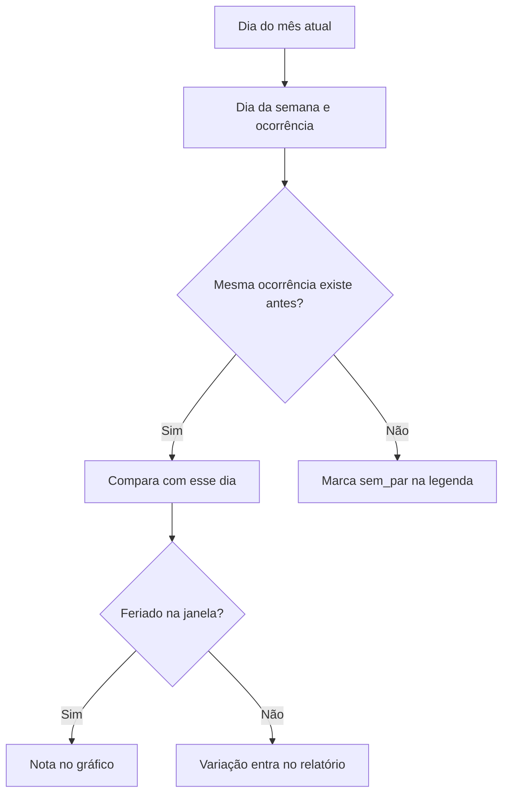
5. Escreva o parágrafo para o gestor com a conclusão primeiro e o período rotulado.

### Erros comuns

- **Começar pela metodologia.** O gestor lê dois parágrafos de contexto e para antes da conclusão. Conclusão no primeiro parágrafo, método no anexo.
- **Título descritivo no gráfico.** "Tráfego orgânico" obriga o leitor a descobrir a mensagem. Escreva a mensagem no título.
- **Cor sem função.** Seis séries em seis cores e nenhuma em destaque. Cinza para o contexto e uma cor para a mensagem.
- **Comparar por data do mês.** Cria virada e queda que não existem. Pareie pelo dia da semana e anote feriados.
- **Período implícito.** Números de fontes com janelas diferentes lado a lado, sem rótulo, e o gestor conclui que alguém errou. Rotule o período em cada bloco.
- **Comentário dentro do painel recorrente.** O texto de análise fica velho em uma semana e passa a contradizer os números. Narrativa vai no relatório.

### Na prática

Três situações reais mostram as regras desta aula em ação. Na primeira, o README conta que uma gestora cobrou exatamente o rótulo de período. O painel juntava Search Console em semana móvel e GA4 em mês corrente, os números não somavam e ninguém dizia por quê. A correção foi pôr o período no título de cada bloco. Nenhum número mudou e a desconfiança acabou.

Na segunda, um deck semanal comparava leads diários dia contra dia do mês. Um dia apareceu com alta de 162%. A primeira hipótese foi que alguma ação de marketing ou de SEO tinha funcionado. O teste foi olhar o dia da semana de cada lado. A comparação punha uma terça, com cerca de 260 leads, contra um domingo, com cerca de 100. Contra a terça equivalente do mês anterior, com cerca de 265, a variação era de 2% para baixo. A comparação diária passou a parear pelo dia da semana, com os dias sem par sinalizados na legenda. Semanal e acumulado continuaram por data, lidos nos marcos de semana cheia, e os feriados entraram como nota.

Na terceira, um painel semanal de leads orgânicos mostrou queda e a gestora perguntou o motivo. A decomposição mostrou impressões e posição estáveis com CTR em queda. O diagnóstico entrou fixo no painel, logo abaixo dos leads, com volume e CTR separados e os períodos rotulados. É o exemplo de diagnóstico que pertence ao painel, porque se repete toda semana e é dado, sem opinião.

### Resumo

- Relatório responde o que aconteceu, por quê e o que fazer, com a conclusão no primeiro parágrafo.
- Um gráfico, uma mensagem, e a mensagem vai no título.
- Comparação diária se pareia pelo dia da semana, com dias sem par e feriados sinalizados.
- Cada número leva o período da sua fonte no rótulo.
- Painel recorrente é dado e filtro. Narrativa fica no relatório pontual.

### Para ir além

- [Visual Vocabulary](leituras.md), do Financial Times, em leituras.md. Tenha aberto ao escolher o gráfico de cada pergunta.
- [Fundamentals of Data Visualization](leituras.md), de Claus O. Wilke, em leituras.md. Os capítulos sobre cor e sobre rótulo aprofundam "cor com função".
- [How to declutter data visualizations (5 steps)](videos.md), do storytelling with data, em videos.md. Mostra como tirar ruído de um gráfico até sobrar a mensagem, antes da prática 2.

## Aula 4. Storytelling com dados e apresentações

### A ideia central

Uma apresentação boa conta uma história com começo, meio e fim. Situação (como as coisas estavam), complicação (o que mudou ou o que ameaça) e resolução (o que fazer). Dados sem essa estrutura viram um desfile de gráficos que a plateia esquece antes do café.

O modelo mental é que os títulos dos slides, lidos em sequência, contam a história inteira. Cada título é uma frase com a conclusão do slide. O corpo do slide prova o título. Quem ler só os títulos sai da sala com a mensagem. Quem quiser o detalhe encontra no anexo.

### Como funciona

#### Situação, complicação e resolução

| Parte | Função | Exemplo numa queda de tráfego orgânico |
|---|---|---|
| Situação | O que todo mundo aceita como verdade | "As páginas de compra trazem a maior parte dos leads orgânicos" |
| Complicação | O que mudou e por que importa | "Os cliques dessas páginas caíram, com impressões e posição estáveis" |
| Resolução | A resposta e o que fazer | "A página de resultados mudou. Vamos revisar títulos e acompanhar os novos elementos" |

A complicação gera a pergunta que a resolução responde. Se a plateia não sente a pergunta, a resposta não interessa.

#### Título de slide como afirmação

| Título descritivo | Título como afirmação |
|---|---|
| Tráfego orgânico | Cliques orgânicos caíram 8% em setembro, puxados pelo CTR |
| Core Web Vitals | Duas correções resolvem todas as URLs ruins do celular e do desktop |
| Próximos passos | Três mudanças no trimestre, duas sem depender de desenvolvimento |

O título como afirmação obriga você a saber a conclusão antes de montar o slide. Se não consegue escrever a frase, o slide ainda não tem mensagem.

#### Contexto antes do número

"Queda de 650 cliques" não significa nada sem a base. 650 em 3.600 é muito. 650 em 300 mil é ruído. Dê o período, a base e a comparação antes de mostrar a variação. Em projeções, mostre a faixa (mínimo e máximo) e de onde ela veio.

#### Corpo e anexo

No corpo ficam os slides que sustentam a história, em geral entre 6 e 10. No anexo ficam a metodologia, as tabelas completas, as análises que você fez e descartou e as respostas às perguntas previsíveis. O anexo protege a apresentação, porque a pergunta difícil tem resposta pronta sem quebrar o fluxo.

#### Revisar o slide renderizado

O slide no editor e o slide exportado em PDF ou projetado são coisas diferentes. Fontes trocam, textos cortam, gráficos perdem o rótulo. Exporte em PDF e revise página por página. Se tiver o poppler instalado, `pdftoppm -png -r 80 deck.pdf slide` gera uma imagem por slide para você olhar em sequência.

### Exemplo guiado

Vamos montar a espinha de um deck a partir de uma decomposição de cliques, o mesmo teste usado no caso da queda de leads. Os números abaixo são de exemplo.

1. Calcule a decomposição. A variação de cliques entre dois períodos se divide em efeito volume (variação de impressões vezes o CTR anterior) e efeito CTR (impressões atuais vezes a variação do CTR). Os dois somam a variação total.

```python
i0, c0 = 120_000, 3_600     # impressões e cliques, período anterior
i1, c1 = 118_000, 2_950     # impressões e cliques, período atual

ctr0, ctr1 = c0 / i0, c1 / i1
efeito_volume = (i1 - i0) * ctr0
efeito_ctr = i1 * (ctr1 - ctr0)

print(f"variação total   {c1 - c0:+,.0f}")
print(f"efeito volume    {efeito_volume:+,.0f}")
print(f"efeito CTR       {efeito_ctr:+,.0f}")
print(f"CTR              {ctr0:.2%} -> {ctr1:.2%}")
```

A saída mostra 650 cliques a menos, dos quais 60 vêm de volume e 590 de CTR. A complicação está aí. A procura quase não mudou e o clique sumiu.

O fluxograma mostra como a variação total se divide nos dois efeitos.

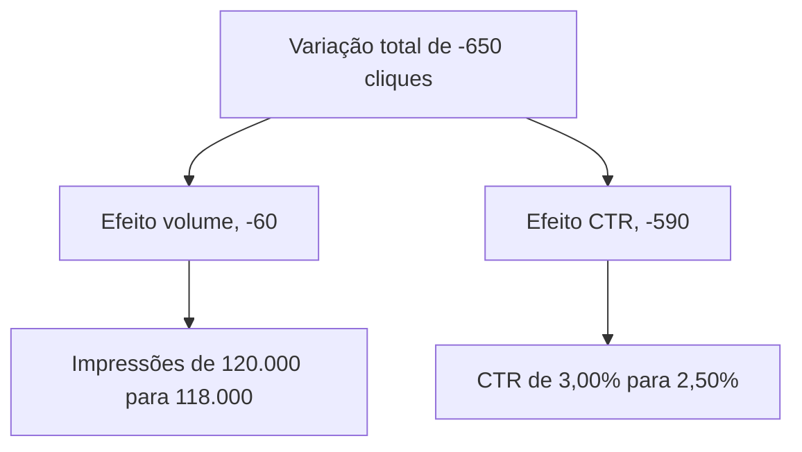

2. Confira a posição média das mesmas buscas no mesmo período. Se ficou estável, a causa está na página de resultados ou no seu snippet, e o ranking fica descartado.
3. Escreva os títulos dos 8 slides antes de abrir a ferramenta de apresentação.

```text
1. As buscas de compra trazem a maior parte dos leads orgânicos          (situação)
2. Os cliques dessas buscas caíram 18% contra o período anterior        (complicação)
3. A procura não caiu. Impressões variaram menos de 2%                   (complicação)
4. A posição também ficou estável                                        (complicação)
5. Quase toda a perda veio do CTR, 590 de 650 cliques                    (complicação)
6. A página de resultados ganhou elementos que interceptam o clique      (resolução)
7. Revisar títulos e descrições das páginas de compra é a primeira ação  (resolução)
8. O painel passa a mostrar volume e CTR separados, toda semana          (resolução)
```

O fluxograma mostra os oito títulos agrupados em situação, complicação e resolução.

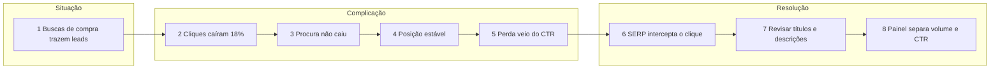

4. Leia só os títulos em voz alta. Se alguém de fora entende o que aconteceu e o que será feito, a espinha está pronta. Só então monte o corpo de cada slide, com um gráfico que prove o título.
5. Mova para o anexo a fórmula da decomposição, a tabela por consulta e a série de posição.

### Erros comuns

- **Títulos descritivos.** A plateia precisa adivinhar a conclusão de cada slide. Escreva a afirmação no título.
- **Começar pelos dados.** Dez slides de métricas antes da complicação. A plateia se perde. Situação e complicação vêm primeiro, e cada dado entra para provar um título.
- **Número sem base nem período.** "Queda de 650" sem dizer de quanto e em qual janela. Dê contexto antes do número.
- **Anexo no corpo.** Metodologia e tabelas completas no meio do fluxo derrubam o ritmo. Leve para o anexo e cite no slide.
- **Esconder a incerteza.** Uma projeção sem faixa vira promessa. Mostre mínimo, máximo e a origem.
- **Não revisar o renderizado.** Texto cortado e gráfico sem rótulo só aparecem no PDF ou no projetor. Exporte e revise slide por slide.

### Na prática

O caso da correlação que não servia mostra a parte mais difícil do storytelling, que é contar o que o dado não sustenta. A pergunta era quanto de receita a melhoria de Core Web Vitals poderia trazer, para justificar o investimento de desenvolvimento. A correlação entre LCP no celular e receita mensal era forte e estatisticamente significativa. A primeira hipótese era usar a regressão para projetar o ganho de cada milissegundo.

Três verificações derrubaram essa saída. Havia só seis meses de sobreposição entre os dados de experiência e a receita. O intervalo de confiança da correlação ia de quase nada a quase perfeito. E um teste de placebo mostrou que o mês em que a métrica de interação piorou era só o quarto pior entre doze cortes, enquanto os piores meses não tinham nenhum evento técnico. Com seis pontos, qualquer tendência sazonal produz correlação forte.

A história contada no deck foi construída com isso. O número entregue saiu de âncoras publicadas (estudos de caso com efeito medido de performance em conversão), aplicadas ao tráfego e à receita do próprio site, com uma faixa de mínimo a máximo. E o deck mostrou a correlação e explicou por que ela não foi usada. Em termos de estrutura, a complicação ganhou um slide a mais ("a correlação é forte e não serve para projetar"), e a resolução trouxe uma faixa no lugar de um número único. Dizer que o dado não sustenta uma conclusão também é um achado, e protege o consultor quando o resultado vier diferente da projeção.

### Resumo

- A história tem situação, complicação e resolução, e a complicação cria a pergunta.
- Cada título de slide é uma afirmação. Os títulos em sequência contam tudo.
- Contexto (base, período, comparação) vem antes do número.
- O detalhe e a metodologia vão para o anexo.
- Revise o deck renderizado, slide por slide, antes de apresentar.

### Para ir além

- [The Minto Pyramid Principle](leituras.md), de Barbara Minto, em leituras.md. O método de começar pela conclusão, base desta aula e da anterior.
- [O Método da Pirâmide (Barbara Minto)](videos.md), da Eximia, em videos.md. Resumo em português para quem não vai ler o livro agora.
- [The best stats you've ever seen](videos.md), de Hans Rosling, em videos.md. Assista prestando atenção em como ele dá contexto antes de cada número.

## Aula 5. Trabalhar com desenvolvedores e stakeholders

### A ideia central

Recomendação que não vira tarefa não vira resultado. O desenvolvedor recebe dezenas de pedidos por semana, de várias áreas. Um pedido vago ("melhorar o canonical das categorias") gera perguntas, espera e uma implementação diferente da que você imaginou. Um pedido claro entra no sprint e sai certo na primeira vez.

O modelo mental é escrever a tarefa para que ninguém precise te perguntar nada. Contexto (por que isso importa), o que fazer, critério de aceite (como saber que está pronto), exemplo e como testar. Para mudanças grandes, a regra se estende ao plano inteiro. Documentar e pedir aprovação antes de construir, e ter o caminho de volta escrito antes de mexer em produção.

### Como funciona

#### As partes de uma tarefa técnica

| Parte | Pergunta que ela evita |
|---|---|
| Contexto (problema e evidência) | "Por que isso é prioridade?" |
| O que fazer | "O que exatamente você quer?" |
| Critério de aceite | "Como eu sei que terminei?" |
| Exemplo de código ou configuração | "Como fica o resultado?" |
| Como testar | "Como eu confiro antes de subir?" |

#### Critério de aceite verificável

A descrição diz o que fazer. O critério de aceite diz o que precisa ser verdade quando terminar, de forma que dê para testar. O formato dado, quando, então (Given, When, Then) ajuda a escrever sem ambiguidade. Ele vem da prática de BDD (desenvolvimento guiado por comportamento) e Martin Fowler o descreve num artigo curto.

```text
Dado     uma página de categoria que responde 200, em qualquer nível
Quando   o HTML é pedido sem parâmetros na URL
Então    existe exatamente um <link rel="canonical"> no <head>
E        o href é a URL absoluta da própria página, com https e sem parâmetros
E        páginas de categoria com ?ordem= ou ?pagina= apontam para a URL sem parâmetro
```

Cada linha pode ser testada por um script. "Canonical correto" não pode.

#### Homologação, backup e rollback

Toda mudança passa antes pelo ambiente de homologação (staging), uma cópia do site onde dá para testar sem afetar usuários e buscadores. O ambiente de homologação precisa estar fechado para robôs, com autenticação ou `noindex`, para não virar conteúdo duplicado.

Em produção, faça backup antes de qualquer gravação. Banco, arquivo de configuração, regra de redirecionamento, o que for mudar. E escreva o rollback antes de executar. Rollback é a lista de passos para voltar ao estado anterior, testada, com quem executa e em quanto tempo.

O fluxograma mostra o caminho de uma mudança da tarefa até a produção, com a volta pronta.

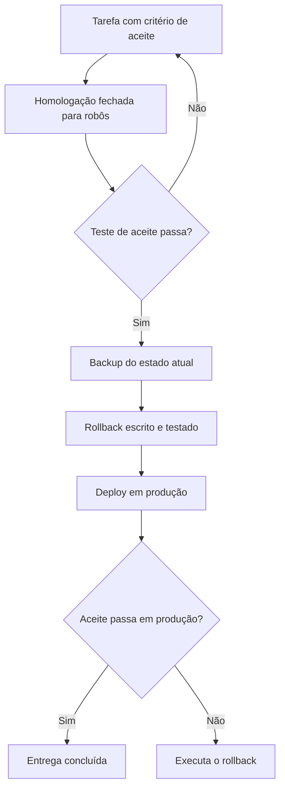

#### Documentar antes de construir

Em entrega grande (migração, nova arquitetura de URLs, um painel inteiro), escreva primeiro um documento curto com objetivo, escopo, fora de escopo, riscos, plano, backup, rollback e como medir. Peça aprovação por escrito. Custa um dia e evita refazer uma semana, porque o desacordo aparece no documento e não no produto pronto.

#### Stakeholders

Além do desenvolvedor, a tarefa passa por produto, conteúdo, jurídico ou marketing. Cada um precisa de uma versão do mesmo fato. O desenvolvedor quer o critério de aceite. O gestor quer o impacto e o prazo. A aprovação por escrito, mesmo um e-mail de uma linha, evita a discussão de "eu não autorizei isso" três meses depois.

A sequência mostra quem recebe o quê numa entrega grande, da aprovação ao aceite.

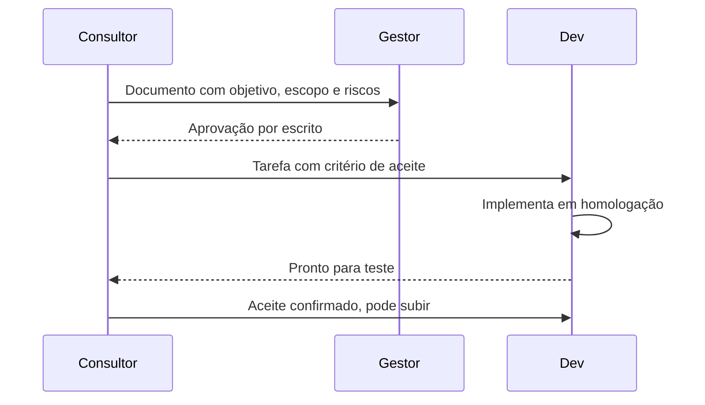

### Exemplo guiado

Vamos escrever uma tarefa completa e um teste de aceite que o desenvolvedor roda sozinho.

1. Escreva a tarefa. Os dados abaixo são de exemplo.

```text
Título      Canonical autorreferente nas páginas de categoria

Contexto    Na auditoria de 22/10, 38 de 40 páginas de categoria testadas
            não tinham canonical (crawl próprio, rótulo parcial). As versões
            com ?ordem= ficam indexáveis e competem com a página principal.

O que fazer Incluir no template de categoria um único link rel=canonical
            com a URL absoluta da categoria, sem parâmetros.

Exemplo     <link rel="canonical" href="https://www.exemplo.com.br/categoria/livros">

Aceite      (os cinco itens dado/quando/então da seção anterior)

Como testar python aceite_canonical.py homolog.txt, com as URLs de teste
            listadas em homolog.txt. O script sai com código 0 quando todas
            atendem ao critério.
```

2. Escreva o teste de aceite. Salve como `aceite_canonical.py`.

```python
import sys
import time

import requests
from bs4 import BeautifulSoup

UA = "aceite-canonical/1.0 (+mailto:voce@exemplo.com)"
urls = [u.strip() for u in open(sys.argv[1], encoding="utf-8") if u.strip()]
falhas = 0

for i, url in enumerate(urls):
    r = requests.get(url, headers={"User-Agent": UA}, timeout=20, allow_redirects=False)
    if r.status_code == 429:
        sys.exit(f"429 em {url}. Parei.")
    sopa = BeautifulSoup(r.text, "html.parser")
    canonicals = [l.get("href") for l in sopa.find_all("link", rel="canonical")]
    ok = r.status_code == 200 and canonicals == [url]
    falhas += not ok
    print("OK   " if ok else "FALHA", r.status_code, url, canonicals)
    if i < len(urls) - 1:
        time.sleep(2)

print(f"{len(urls) - falhas} de {len(urls)} atendem ao critério")
sys.exit(1 if falhas else 0)
```

3. Teste o próprio teste numa página pública antes de entregar. Crie `homolog.txt` com duas linhas, `https://pt.wikipedia.org/wiki/HTTP` e `https://pt.wikipedia.org/wiki/Hypertext_Transfer_Protocol`, e rode `python aceite_canonical.py homolog.txt`. A primeira passa, porque o canonical aponta para ela mesma. A segunda falha, porque aponta para outra URL. O teste distingue os dois casos, então serve.
4. Escreva o plano de mudança em cinco linhas. Backup do template atual (arquivo e versão no Git), passos de deploy, como conferir (o script acima em produção), rollback (reverter o commit e limpar o cache da CDN) e quem aprova.

### Erros comuns

- **Tarefa sem critério de aceite.** O desenvolvedor entrega algo razoável e diferente do que você queria. Escreva o aceite em dado, quando, então.
- **Pedido sem evidência.** A tarefa compete com outras e perde, porque ninguém sabe por que importa. Ponha o problema, o número e a origem no contexto.
- **Testar só em produção.** Um erro de template derruba milhares de páginas de uma vez. Passe por homologação.
- **Homologação aberta para robôs.** O ambiente de teste é indexado e compete com o site real. Feche com autenticação ou `noindex`.
- **Gravar em produção sem backup.** Uma regra errada de redirecionamento apaga a anterior e não há como voltar. Backup antes, rollback escrito.
- **Construir antes de aprovar.** Uma semana de trabalho descartada por um desacordo que caberia num parágrafo. Documente e peça aprovação por escrito.

### Na prática

O README deste módulo traz uma regra de entrega. Em entregas grandes, documente o plano e peça aprovação antes de construir. Em produção, faça backup antes de qualquer gravação e tenha o caminho de volta escrito.

O caso de Core Web Vitals da pasta casos/ mostra a regra em execução. Depois do diagnóstico, a primeira fase reuniu mudanças de configuração num site em produção. Modo de depuração desligado, tag duplicada removida, script de terceiro desnecessário desativado e cache para a API lenta. Cada mudança teve backup antes. Essas mudanças parecem pequenas, e é exatamente por isso que o backup importa. Desativar um script de terceiro pode quebrar um formulário de lead que ninguém lembrava que dependia dele. Com backup e caminho de volta, um efeito colateral desses vira um ajuste de minutos. Sem eles, vira um incidente. Em laboratório, a nota da home mais que dobrou e o tempo de bloqueio caiu para cerca de um sétimo.

### Resumo

- Tarefa boa tem contexto, o que fazer, critério de aceite, exemplo e como testar.
- Critério de aceite em dado, quando, então, e cada linha vira um teste.
- Homologação fechada para robôs, backup antes de gravar, rollback escrito antes de executar.
- Entrega grande começa por um documento aprovado por escrito.

### Para ir além

- [Given When Then](leituras.md), de Martin Fowler, em leituras.md. O formato de critério de aceite desta aula, explicado pela fonte.
- [How to Report Bugs Effectively](leituras.md), de Simon Tatham, em leituras.md. Ensina a descrever um problema de forma que o desenvolvedor consiga reproduzir, o mesmo cuidado do campo "como testar".
- [What SEOs should know about devs](videos.md), do Google Search Central, em videos.md. Mostra o lado de quem recebe a tarefa.

## Aula 6. Consultoria independente

### A ideia central

Consultoria é vender confiança. O cliente compra a expectativa de que você vai entender o problema dele, entregar o que prometeu, no prazo, e dizer a verdade quando o dado não sustentar o que ele queria ouvir. Escopo claro, entregável concreto, preço que cobre o risco e histórico de resultado são as formas visíveis dessa confiança.

O modelo mental é tratar a consultoria como um produto com especificação. A proposta é a especificação. Ela diz o que está dentro, o que está fora, o que será entregue, em que formato, quando e por quanto. Tudo que não está escrito vira expectativa do cliente, e expectativa não escrita é a origem da maior parte dos conflitos.

### Como funciona

#### Escopo e fora de escopo

O escopo lista o que você vai fazer. O fora de escopo lista o que alguém poderia supor que está incluído e não está. Numa auditoria técnica, por exemplo, implementação, redação de conteúdo, gestão de mídia paga e acompanhamento depois da entrega costumam ficar fora. Escrever isso protege as duas partes. O cliente sabe o que contratar à parte e você tem onde apontar quando o pedido crescer.

#### A proposta

Uma proposta completa tem, nesta ordem, contexto (o problema do cliente nas palavras dele), objetivo, escopo, fora de escopo, entregáveis com formato, cronograma, preço com a lógica do cálculo, premissas (o que o cliente precisa fornecer, como acessos e um ponto focal) e condições de pagamento.

#### Modelos de preço

| Modelo | Bom para | Risco |
|---|---|---|
| Por projeto | Escopo fechado, como uma auditoria ou uma migração | Subestimar o esforço e trabalhar de graça no fim |
| Por hora | Trabalho exploratório ou sob demanda | O cliente controla cada hora e o seu ganho fica preso ao tempo |
| Retenção mensal | Acompanhamento contínuo, como gestão de SEO ou de painel | Escopo que cresce sem o preço acompanhar |

Mesmo cobrando por projeto, saiba o seu preço mínimo por hora. Ele é o piso abaixo do qual o projeto dá prejuízo.

O fluxograma mostra a escolha do modelo de preço e o piso que vale para os três.

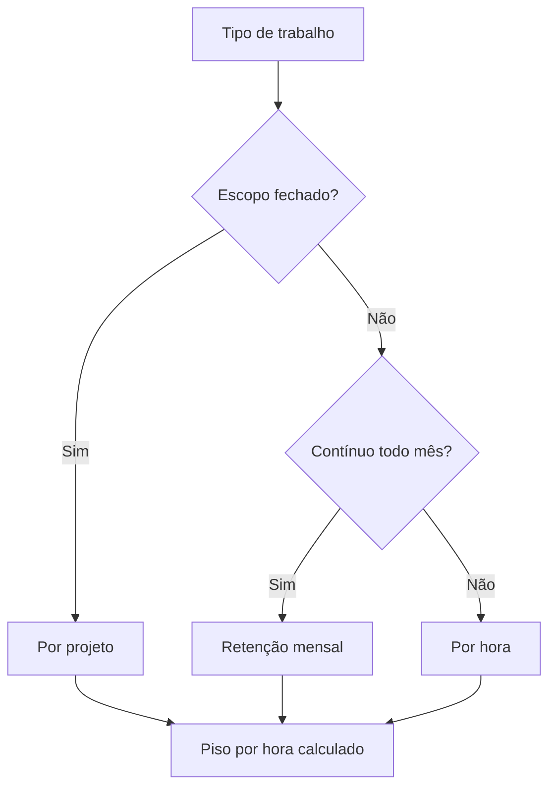

#### Contrato e confidencialidade

O contrato formaliza o que a proposta descreve e acrescenta o que protege as partes. Propriedade do que for entregue, confidencialidade, prazo de pagamento, multa e rescisão. Os detalhes jurídicos e tributários dependem do seu regime e do seu país. Converse com um contador e, para contratos maiores, com um advogado.

#### Portfólio com casos anonimizados

Casos são o histórico de resultado que um consultor novo não tem como mostrar de outro jeito. Para ir ao portfólio sem quebrar a confidencialidade, tire nome, marca, URLs, capturas de tela com identificação e números absolutos que identifiquem o porte. Mantenha o setor de forma genérica, o sintoma, a hipótese, o teste, a causa e o resultado.

#### Rotina de status

O cliente que não recebe notícia imagina o pior. Uma mensagem semanal curta, sempre no mesmo dia, resolve.

```text
Feito nesta semana      ...
Em andamento            ...
Bloqueado               ... (o que trava e desde quando)
Preciso de você         ... (acesso, aprovação, decisão, com prazo)
Próxima semana          ...
```

### Exemplo guiado

Vamos calcular o preço mínimo por hora e usar o número numa proposta. Os valores abaixo são um exemplo. Troque pelos seus, e confirme a alíquota de impostos com um contador.

```python
renda_liquida_mensal = 12_000   # o que você quer levar para casa por mês
custos_fixos_mensais = 1_500    # contador, ferramentas, equipamento, plano de saúde
aliquota_impostos = 0.15        # exemplo; confirme a sua com um contador
meses_trabalhados = 11          # um mês de férias e folgas no ano
horas_semana = 40
fracao_faturavel = 0.55         # o resto é venda, administração e estudo
reserva = 0.20                  # colchão para meses sem cliente


def reais(valor):
    return f"R$ {valor:,.0f}".replace(",", ".")


custo_anual = (renda_liquida_mensal + custos_fixos_mensais) * 12
faturamento_necessario = custo_anual / (1 - aliquota_impostos) * (1 + reserva)
horas_faturaveis = horas_semana * fracao_faturavel * 52 / 12 * meses_trabalhados

print("Faturamento anual necessário ", reais(faturamento_necessario))
print("Horas faturáveis no ano      ", round(horas_faturaveis))
print("Preço mínimo por hora        ", reais(faturamento_necessario / horas_faturaveis))
```

Com esses valores de exemplo, o faturamento necessário fica perto de 229 mil reais por ano, as horas faturáveis perto de 1.050 e o preço mínimo perto de 218 reais por hora. Repare em duas coisas. A fração faturável é a variável que mais pesa, porque ninguém fatura 40 horas por semana o ano inteiro. E a reserva existe porque haverá meses sem cliente.

O fluxograma mostra a ordem da conta do preço mínimo por hora.

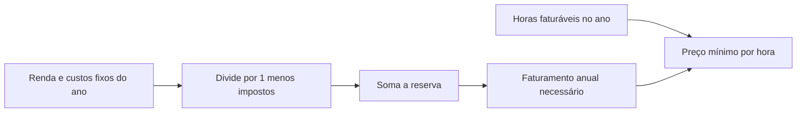

Agora use o número. Estime as horas de uma auditoria técnica num e-commerce de 50 mil URLs, por etapa (crawl e coleta, análise, testes de cada achado, priorização, relatório, apresentação). Multiplique pelo preço mínimo e compare com o valor que você teria chutado antes da conta. Se a diferença for grande, o chute estava cobrando o risco errado. Na proposta, apresente o preço do projeto e a lógica do cálculo, sem expor a sua planilha de custos.

### Erros comuns

- **Proposta sem fora de escopo.** O cliente pede implementação achando que estava incluída. Liste o que não está.
- **Preço chutado.** O projeto fecha e dá prejuízo. Calcule o piso por hora e estime por etapa.
- **Contar 100% das horas como faturáveis.** Venda, administração e estudo somem do cálculo e o preço sai baixo. Use uma fração realista.
- **Caso no portfólio com dado que identifica o cliente.** Uma URL ou um número absoluto revela quem é e quebra a confidencialidade. Anonimize antes de publicar.
- **Silêncio entre entregas.** O cliente imagina atraso e cobra. Mande status semanal, mesmo quando a semana foi de espera.
- **Aceitar escopo crescente sem revisar o preço.** A retenção vira trabalho ilimitado. Registre os pedidos novos e reabra o escopo quando passarem do combinado.

### Na prática

Este módulo não tem caso próprio, e a própria pasta casos/ serve de exemplo de anonimização. Os nomes das empresas foram removidos e alguns números foram arredondados. Cada caso traz só o setor de forma genérica (saúde, educação, varejo online) e segue sempre a mesma ordem. Contexto, sintoma, primeira hipótese, teste, causa, o que foi feito e lição. É um formato que serve ao portfólio porque mostra o raciocínio, que é o que o próximo cliente quer comprar, sem expor quem pagou por ele.

Para a rotina de status, imagine uma consultora que atende três clientes de retenção mensal. Toda sexta, às 16h, ela manda a mesma mensagem de cinco linhas para cada um. Numa semana, um cliente não liberou o acesso ao Search Console. A linha "Preciso de você" registra o pedido, com a data em que foi feito. Quando o prazo do relatório chega, o atraso já está explicado por escrito, três semanas antes. A rotina custa meia hora por semana e evita a conversa mais desgastante de uma consultoria, a de quem atrasou o quê.

### Resumo

- A proposta é a especificação da consultoria. Escopo, fora de escopo, entregáveis, cronograma e preço com lógica.
- Projeto, hora e retenção servem a trabalhos diferentes, e todos precisam de um piso por hora calculado.
- Contrato e impostos dependem do seu regime. Contador e advogado fazem parte do custo.
- Portfólio se faz com casos anonimizados que mostram o raciocínio.
- Status semanal no mesmo dia, com o que você precisa do cliente.

### Para ir além

- [Você precisa de SEO?](leituras.md), do Google Search Central, em leituras.md. Mostra o que o próprio Google orienta o cliente a perguntar ao contratar, útil para desenhar o escopo.
- O artigo de precificação do Sebrae RN ([8 dicas para precificar seu produto ou serviço](leituras.md)), em leituras.md. Base de custo e margem para conferir o piso calculado aqui.
- [Precificação de Serviços de Consultoria ou Agência](videos.md), de Nino Carvalho, em videos.md. Discute os modelos de cobrança no mercado brasileiro.
